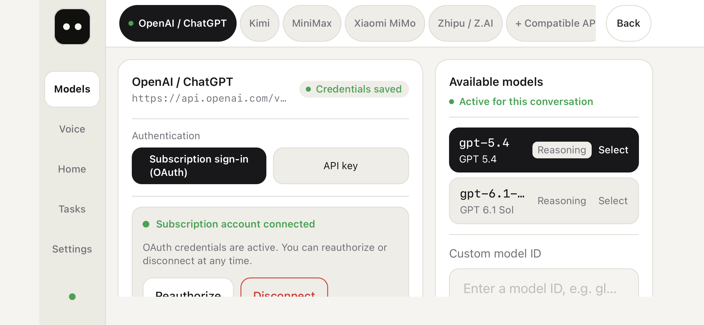
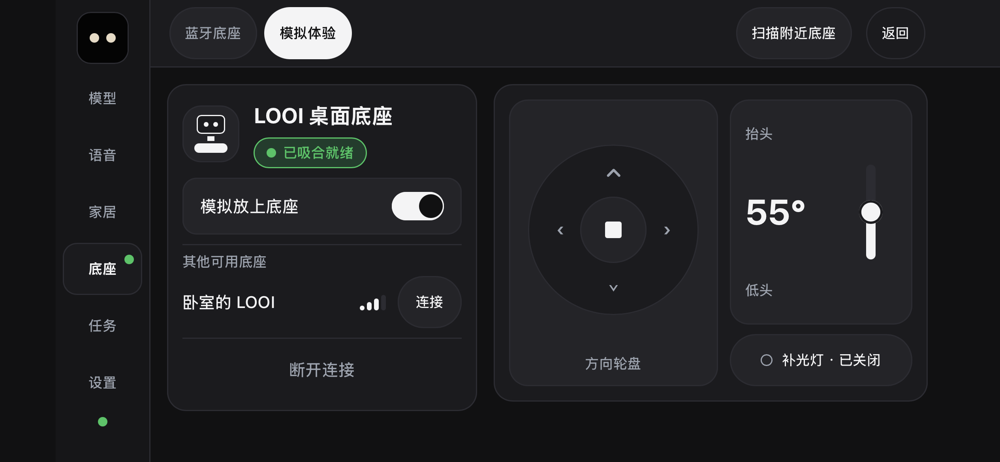
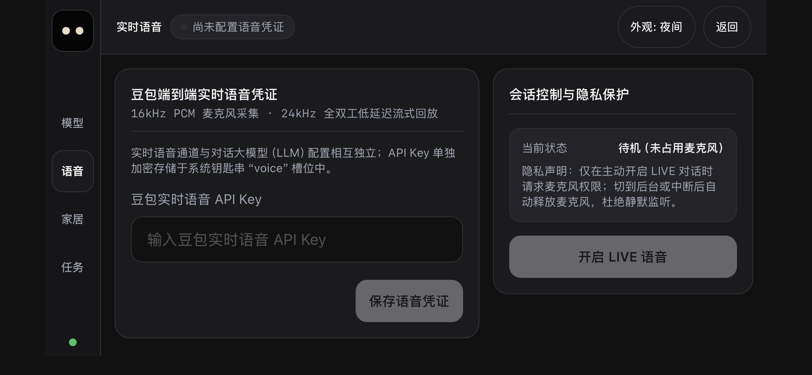
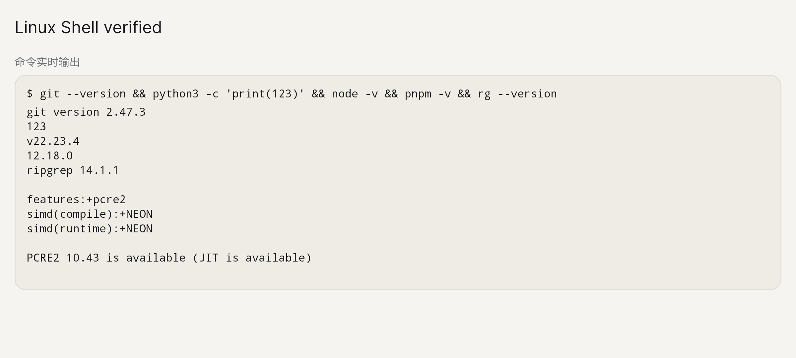
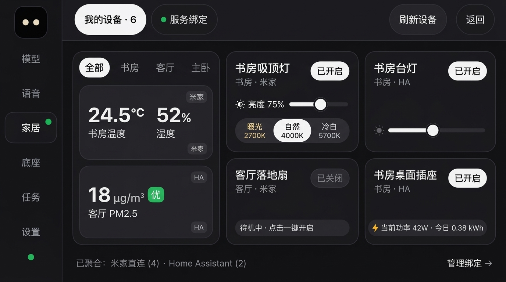
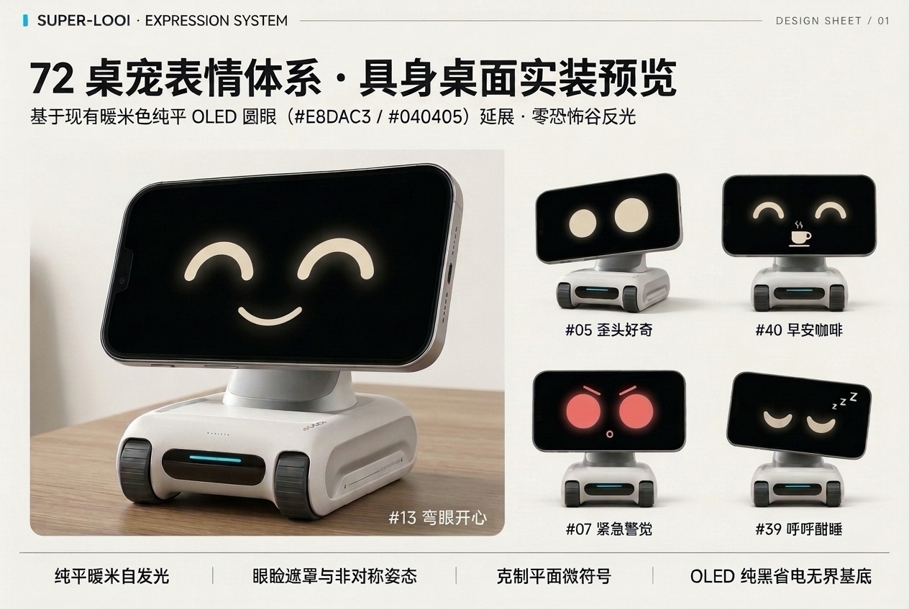
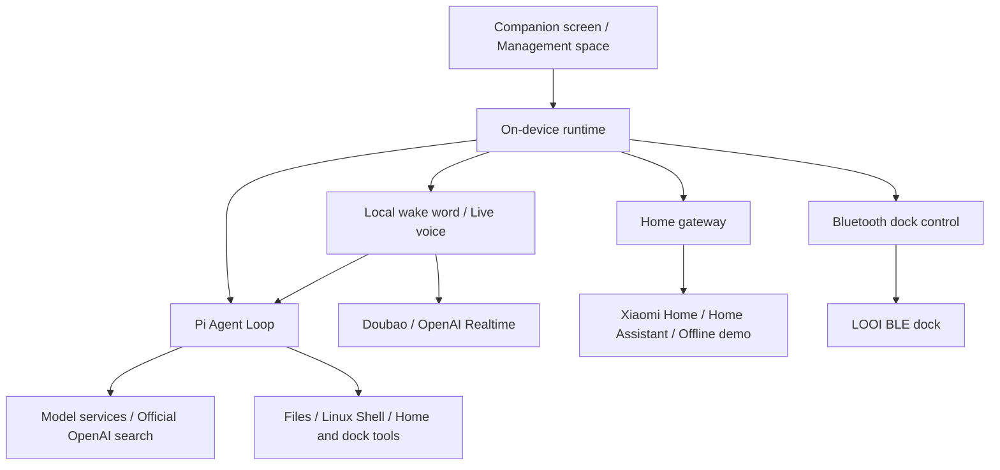

<div align="center">
  
  <h1>Super-LOOI</h1>
  <p><strong>English</strong> · <a href="README.zh-CN.md">简体中文</a></p>
  <p><strong>Turn your phone into a desk companion that talks, shows emotion, and gets things done.</strong></p>
  <p>iOS / Android · 72 expressions · Live voice · On-device agent · Smart home · LOOI Bluetooth dock</p>
  <p><a href="#quick-start">Quick start</a> · <a href="#use-cases">Use cases</a> · <a href="#gallery">Gallery</a> · <a href="#architecture-and-source">Architecture</a> · <a href="#documentation">Documentation</a></p>
</div>


Super-LOOI is a personal AI agent that runs on your phone. Warm, expressive eyes keep you company on your desk; say **“Hey LOOI”** to start a live conversation. You can also type a task and ask it to research a topic, read and write files, run commands, or control connected home devices.

Connect a LOOI dock to give your companion a body that can turn, tilt its head, and adjust its light. The agent and task runtime run on the phone, which connects directly to model, voice, and home services. Model inference and live voice use your accounts with the respective cloud providers.

## What it can do

| Capability | What you can do with it |
| --- | --- |
| 👀 **An expressive desk companion** | 72 declarative expressions cover idle, listening, thinking, speaking, emotions, and dock interactions. Blinks, gaze, and small movements respond to its state. |
| 🎙️ **Wake word and live voice** | Local “Hey LOOI” detection while the app is in the foreground, with Doubao Duplex V3 or OpenAI Realtime for conversations. Voice can start agent tasks and check their progress. |
| 🧠 **Bring your own model** | Connect OpenAI / ChatGPT, Kimi, MiniMax, Xiaomi MiMo, Zhipu / Z.AI, or a custom compatible API. Use an API key or subscription sign-in where available. |
| 🛠️ **Get work done on your phone** | The agent reads and writes workspace files, runs shell commands, and asks you questions when it needs input. View progress, artifacts, terminal output, and conversation history in Tasks. Official OpenAI connections support web search with clickable sources. |
| 🐧 **Linux inside your phone** | Embedded Alpine Linux runs through PRoot on Android and iSH on iOS. Install Git, Python, Node.js, pnpm, and other tools as needed. |
| 🏠 **A shared space for your home** | Connect directly to Xiaomi Home or use Home Assistant. Group devices by room and control lights, switches, and other capabilities with resizable tiles. Try the offline demo without any devices. |
| 🤖 **Give LOOI a body** | Connect the dock over Bluetooth. Use the direction pad, head tilt slider, and light control manually, or ask the agent to operate them through text or voice. |
| 🌗 **Make it your own** | Light and dark management themes, landscape layouts, and Simplified Chinese / English. Model and voice credentials are kept in system-backed secure storage. |

## Quick start

### 1. Prepare your environment

To build from source, you need:

| Environment | Requirements |
| --- | --- |
| JavaScript | Node.js **24.9+**, pnpm **9.15.9** (pinned by the repository) |
| Rust | **1.97+**, with the compilation targets for your platform |
| iOS | macOS, Xcode, a connected iPhone, a development signing identity, and a provisioning profile |
| Android | Android SDK / NDK, a JDK, and an Android phone with USB debugging enabled |
| Linux guest build | On macOS, install `meson`, `ninja`, `llvm`, `lld`, and `libarchive`. See the [Linux Shell build guide](docs/nsh-linux-shell.md#构建). |

The build scripts pin **NSH 0.5.0** and build the locked source revision if a matching CLI is unavailable. The first build also downloads the wake word model and Linux dependencies.

### 2. Clone and install

```sh
git clone https://github.com/GrinZero/super-looi.git
cd super-looi
pnpm install --frozen-lockfile
pnpm build
```

Put platform toolchain and signing settings in the root `.env` file. Connect model accounts and configure live voice credentials inside the app.

**Android phone:** find its serial number with `adb devices`, then start the development host:

```sh
pnpm --filter @super-looi/nsh exec node --import tsx scripts/nsh.ts run --target android --device "<ADB_SERIAL>"
```

**iPhone:** first add your signing settings to `.env`:

```dotenv
IOS_SIGN_IDENTITY="Apple Development: Your Name (TEAMID)"
IOS_PROVISIONING_PROFILE=/absolute/path/to/profile.mobileprovision
```

Find the device identifier with `xcrun devicectl list devices`, then build, sign, and install:

```sh
pnpm ios --device "<IPHONE_UDID>"
```

Replace `<ADB_SERIAL>`, `<IPHONE_UDID>`, and the signing values with your own settings. `pnpm mobile` is an alias for `pnpm ios` and also requires an iPhone identifier. See the [NSH app guide](apps/nsh/README.md) for more build commands.

<details>
<summary>Or ask your AI assistant to set up the development environment</summary>

```text
Help me build Super-LOOI from source and run it on a physical phone.
Repository: https://github.com/GrinZero/super-looi

Read README.md, AGENTS.md, and apps/nsh/README.md first. Use pnpm.
Check Node.js, Rust, the target platform's toolchain, and connected phones.
Prepare the build settings in .env, install dependencies, build the app,
and use the physical-device commands in the README to install and run it.
If you need iPhone signing details or an account sign-in from me,
point me to the exact setting or step I need to complete.
```

</details>

### 3. Connect your accounts and start using it

1. **Choose a model:** open the management space from the top-right corner of the companion screen. In **Models**, choose a provider and connection type, enter an API key or sign in with OAuth, then select a model.
2. **Start a task:** return to the companion screen, open text chat, and enter a task. In **Tasks**, view progress, terminal output, and results, continue the conversation, or stop the task.
3. **Enable voice:** save your live voice credentials in **Voice**. Wake word detection is enabled by default. Say “Hey LOOI” while the app is in the foreground, wait for the cue, and start speaking. You can also tap the voice button. It keeps listening after a reply and returns to standby after 12 seconds of silence.
4. **Connect your home:** link Xiaomi Home or Home Assistant in **Home**, or choose the offline demo to try it out. See [home connections](apps/nsh/README.md#家居连接).
5. **Connect the dock:** if you have a LOOI dock, scan for it in **Dock** and connect over Bluetooth. Try the direction pad, head tilt, and light controls.

Live voice uses Doubao by default. To use OpenAI Realtime, set `VOICE_PROVIDER=openai` in the root `.env` file and rebuild. The model for text tasks and the live voice provider are configured separately.

## Use cases

Once the relevant services or devices are connected, try these requests in text or voice:

| Scenario | Example |
| --- | --- |
| Research on the web | “Find out what this open-source project does and what's new. Include source links.” Uses search through an official OpenAI connection. |
| Organize files | “Read the notes in my workspace, summarize them in Markdown, and save the result as summary.md.” |
| Run code | “Use Python to count missing values in each column of this CSV and write a report. Install Python first if needed.” |
| Control lights | “Find the desk lamp in the study, turn it on, and set the brightness to half.” |
| Move the dock | “Tilt your head up a little, then set the light to half brightness.” |
| Delegate by voice | “Help me organize the files in my workspace.” Later, ask “Has that task finished?” |

### Model connections

| Provider | Connection options in the app |
| --- | --- |
| OpenAI / ChatGPT | Official API key, ChatGPT subscription OAuth |
| Kimi | Kimi Code subscription key / OAuth, Moonshot API for China / international |
| MiniMax | API keys for China / international sites |
| Xiaomi MiMo | Pay-as-you-go API, Token Plan keys for China / Singapore / Europe |
| Zhipu / Z.AI | Standard APIs for China / international, Coding Plan keys |
| Custom compatible API | Set a compatible endpoint, API key, and model ID |

Refresh a connected provider's model list from its account API. See [`llm-providers.ts`](packages/looi-runtime/src/agent/llm-providers.ts) for connection options and authentication implementations.

### Files and terminal

Task files and the shell share `/workspace`. The embedded image includes basic Alpine / BusyBox commands. Ask the agent to install additional tools, or have it run:

```sh
apk add git python3 nodejs npm ripgrep
npm install -g pnpm
```

Packages and workspace files stay in the app's private directory and persist across restarts. The `bash` tool executes `/bin/sh -c`; install Bash first if you need Bash-specific syntax. See the [Linux Shell guide](docs/nsh-linux-shell.md) for usage and platform details. Android ARM64 has been tested on a physical phone. iOS device builds are complete; execution and package installation on an iPhone await device testing. See the [verification record](docs/nsh-linux-shell-verification.md).

## Gallery

The companion screen stays dark, while management spaces offer light and dark themes. These runtime screenshots live in the repository; click an image to view it at full size.

| Model connections · English, light theme | Dock controls · dark theme, demo mode |
| --- | --- |
|  |  |

| Live voice | Android Linux terminal output |
| --- | --- |
|  |  |

<details>
<summary>Home and expression design references</summary>

**Home space design reference:** organize devices by room and bring Xiaomi Home and Home Assistant status and controls together. The implementation uses tiles with adjustable size and order.



**72-expression design reference:** eyes, eyelids, mouths, and small symbols combine into emotions and interaction poses. See [`face-recipes.ts`](apps/nsh/ui/face-recipes.ts) for the runtime recipes.



</details>

## Architecture and source

The app uses **NSH (Native Shell) + TSX + Rust**. The Pi Agent Loop in QuickJS handles model calls and tool execution. The Rust host provides audio, Bluetooth, credentials, SQLite, files, and Linux execution.



| Module | Responsibility |
| --- | --- |
| [`apps/nsh`](apps/nsh/README.md) | TSX UI, app state, task / voice / home / dock runtimes, native bridges, and packaging for both platforms. |
| [`packages/looi-runtime`](packages/looi-runtime/src/index.ts) | Agent execution, model providers, conversation and task storage, voice protocols, and observability. |
| [`packages/nsh-node-compat`](packages/nsh-node-compat/README.md) | Maps the Node APIs required by Pi to the QuickJS / Rust host. |
| [`packages/home-devices`](packages/home-devices/src/index.ts) | Device entity aggregation, capability mapping, and tile layout preferences. |
| [`packages/home-assistant`](packages/home-assistant/src/core/gateway.ts) | Transport, discovery, and control for Home Assistant, Xiaomi MIoT, and demo data. |
| [`packages/looi-driver`](packages/looi-driver/src/body-supervisor.ts) | LOOI BLE protocol, body state, and action scheduling. |
| [`packages/contracts`](packages/contracts/src/index.ts) | Shared data contracts and protocol types. |

Tasks, conversations, and home settings are stored on the phone. Credentials use secure storage backed by iOS Keychain / Android Keystore. Connect Langfuse to trace voice sessions, model calls, and tool execution; see [development observability](apps/nsh/README.md#开发观测). Browse module relationships and call paths in the [architecture diagram source](docs/arch/index.html).

## Development and docs

With the build environment above, run:

```sh
pnpm typecheck
pnpm test
pnpm build
```

See the [NSH app guide](apps/nsh/README.md) for platform probes, packaging, and targeted verification commands. Native capabilities are added through build plugins registered in [`native/plugins.json`](apps/nsh/native/plugins.json).

### Documentation

| Topic | Start here |
| --- | --- |
| Native builds, physical devices, and verification commands | [NSH app guide](apps/nsh/README.md) |
| Module relationships and source call paths | [Architecture diagram](docs/arch/index.html) |
| Layout, themes, and interaction rules | [NSH design guide](apps/nsh/DESIGN.md) |
| Linux, package management, and source builds | [Linux Shell](docs/nsh-linux-shell.md) · [Android device and iOS build results](docs/nsh-linux-shell-verification.md) |
| Xiaomi Home and Home Assistant setup | [In-app home connections](apps/nsh/README.md#家居连接) |
| Bluetooth handshake and dock testing | [LOOI BLE verification](docs/looi-ble-live-verification.md) |
| UI and voice languages | [Bilingual integration](docs/nsh-bilingual-integration.md) |
| Expressions and visual design | [72-expression design](docs/super-looi-72-expressions-design.md) |
| Remaining features and device testing | [todo.md](todo.md) |

The former Expo / React Native app and Hub source are archived on the `archive/legacy-hub-and-expo` branch. Their phase reports remain in `docs/` as historical records.

## License

Super-LOOI is licensed under the **GNU General Public License v3.0 only** (`GPL-3.0-only`). See [LICENSE](LICENSE) for the full terms.

Third-party components retain their own licenses. See the [Linux Shell license section](docs/nsh-linux-shell.md#第三方许可证与-ios-对应源码) for embedded Linux components and corresponding source information. The original Expo template's MIT notice is preserved in [LICENSES/Expo-MIT.txt](LICENSES/Expo-MIT.txt).
