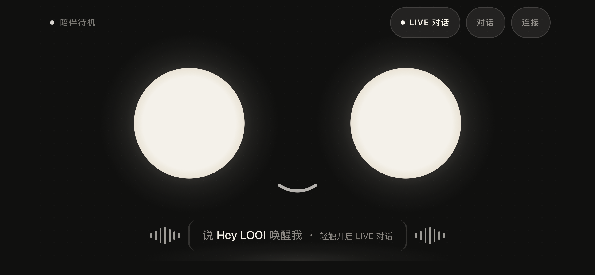

# Super-LOOI

Super-LOOI 是面向 LOOI 具身形态的手机端个人 Agent。当前 iOS / Android 应用在手机本机运行任务与会话：用户可以在桌宠主页文字对话或发起实时语音，让 Agent 使用本机工具处理任务，并从管理空间连接模型和家居设备。



## 运行与使用

需要 Node.js 24.9+、pnpm 9、Rust 1.97+ 和对应平台的原生工具链；iOS 使用 macOS / Xcode。应用固定使用 NSH 0.4.0，构建脚本会检查配置的 NSH CLI，必要时构建固定版本。详细环境要求见 [NSH 应用说明](apps/nsh/README.md)。

```sh
pnpm install
pnpm build
pnpm ios
```

`pnpm ios` 在 iOS 模拟器启动应用；`pnpm mobile` 是同一入口。启动后：

1. 在主页点「连接」→「模型」，选择服务商、完成 API Key 或 OAuth 授权，再选定模型。模型空间支持 OpenAI / ChatGPT、Kimi、MiniMax、小米 MiMo、智谱 / Z.AI 和自定义兼容 API；已连接服务商的模型列表可从账号接口刷新。
2. 回到主页点「对话」输入文字任务。任务执行过程、结果和历史任务记录可在「任务」空间查看。
3. 在「语音」空间配置实时语音凭证后，自动唤醒默认开启，可在前台待机时直接说「Hey LOOI」，也可点主页右上角声波语音胶囊直接开启对话。默认使用豆包；OpenAI Realtime 由根目录 `.env` 的 `VOICE_PROVIDER=openai` 在构建时选择。
4. 在「家居」空间选择米家直连、Home Assistant 或离线演示，连接后从界面或 Agent 任务操作设备。

需要本地 Home Assistant 时，运行 `docker compose -f docker-compose.home.yml up -d`。

根目录 `.env` 供本地构建和测试读取；应用中的模型与语音凭证通过连接界面保存到系统安全存储。常用检查命令：

```sh
pnpm typecheck
pnpm test
```

## 当前架构

现役应用入口是 [`apps/nsh`](apps/nsh/README.md)：NSH 原生宿主运行 TSX 界面和 QuickJS 中的 Pi Agent Loop，Rust 模块提供音频、凭据、文件、SQLite 与 Shell 等手机能力。任务、会话和家居配置保存在本机；模型、Realtime 语音和家居服务由手机直接连接。

| 链路 | 职责与代码入口 |
| --- | --- |
| 交互与状态 | [`App.tsx`](apps/nsh/App.tsx) 绘制桌宠主页和管理空间；[`store.ts`](apps/nsh/store.ts) 连接界面、应用生命周期与各运行时。 |
| 任务与模型 | [`MobileRuntime`](apps/nsh/runtime/application.ts) 管理任务、会话和模型选择；[`PiAgentExecutor`](packages/looi-runtime/src/agent/pi-executor.ts) 执行模型推理、文件、Shell、问答及家居工具；[`nsh-node-compat`](packages/nsh-node-compat/README.md) 将所需 Node API 接到 Rust 宿主。 |
| 实时语音 | [`VoiceRuntime`](apps/nsh/runtime/voice/runtime.ts) 编排本地唤醒、多轮对话和语音工具；[协议适配器](packages/looi-runtime/src/voice/realtime-protocol.ts) 接入豆包 Duplex V3 与 OpenAI Realtime；[Rust 音频层](apps/nsh/src/audio.rs) 负责 sherpa-onnx 本地关键词识别、单流切换和播放。 |
| 家居 | [`HomeRuntime`](apps/nsh/runtime/home.ts) 管理连接与操作；[家居网关](packages/home-assistant/src/core/gateway.ts) 统一 Home Assistant REST、米家 MIoT 和离线演示传输。 |
| 底座与共享契约 | [`contracts`](packages/contracts/src/index.ts) 定义跨包契约；[`looi-driver`](packages/looi-driver/src/body-supervisor.ts) 管理 LOOI BLE 协议与身体状态机，NSH 的 [`BodyRuntime`](apps/nsh/runtime/body.ts) 通过双端原生桥接连接底座。 |

语音可调用 Agent 任务；两条链路通过共享的 Trace Context（追踪上下文）关联。在根目录 `.env` 设置 `LOOI_DEBUG_TELEMETRY=1` 和 `LANGFUSE_BASE_URL`、`LANGFUSE_PUBLIC_KEY`、`LANGFUSE_SECRET_KEY` 后，使用 `pnpm ios` 开发运行即可向本地 Langfuse 写入语音会话、模型调用和工具执行的 OTLP 观测。可点击源码的 [架构图](docs/arch/index.html) 展示各模块与调用路径。

## 界面设计

桌宠主页是常驻的深色舞台，以暖米色圆眼和表情反馈呈现状态，只保留 LIVE 对话、文字对话与连接入口。管理空间承载「模型」「语音」「家居」「底座」「任务」五个模块：横屏使用左侧导航轨与双栏工作区，竖屏改为底部导航和单列内容。主页在日夜模式下都保持深色；管理空间分别使用暖石浅色与中性锌灰深色主题。

颜色、圆角和状态样式由 [`theme.json`](apps/nsh/theme.json) 的语义 Token（设计令牌）统一定义。交互和布局规则见 [NSH 设计规范](apps/nsh/DESIGN.md)；[管理空间截图](docs/artifacts/nsh-node-compat/ios-settings-light.png) 展示横屏浅色布局。

## 文档与当前范围

- [NSH 应用说明](apps/nsh/README.md)：原生构建、平台工具链和验证命令。
- [可点击源码的架构图](docs/arch/index.html)：任务、语音、家居与原生边界。
- [当前待办](todo.md)：BLE 真机接线、媒体和相机等后续工作。

旧 Expo / React Native 应用和 Hub 服务已退出工作区；源码归档在 `archive/legacy-hub-and-expo` 分支。`docs/` 中的早期阶段报告保留了迁移前的设计与验收记录。

## 许可证

SUPER-LOOI 采用 GNU General Public License v3.0（仅第 3 版），SPDX 标识为 `GPL-3.0-only`。完整条款见 [LICENSE](LICENSE)。

第三方代码沿用其各自许可证；Expo 模板的原始版权与 MIT 许可声明保留在 [LICENSES/Expo-MIT.txt](LICENSES/Expo-MIT.txt)。
