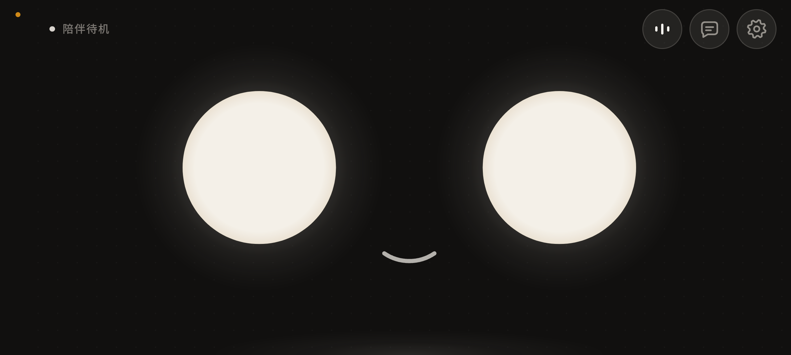
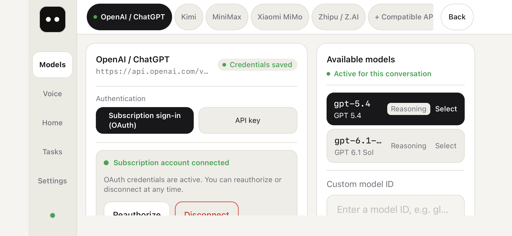
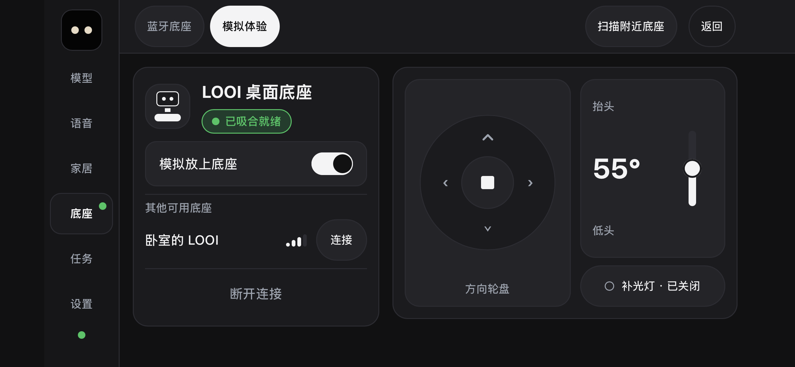
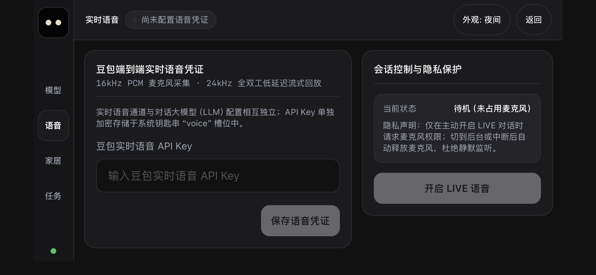
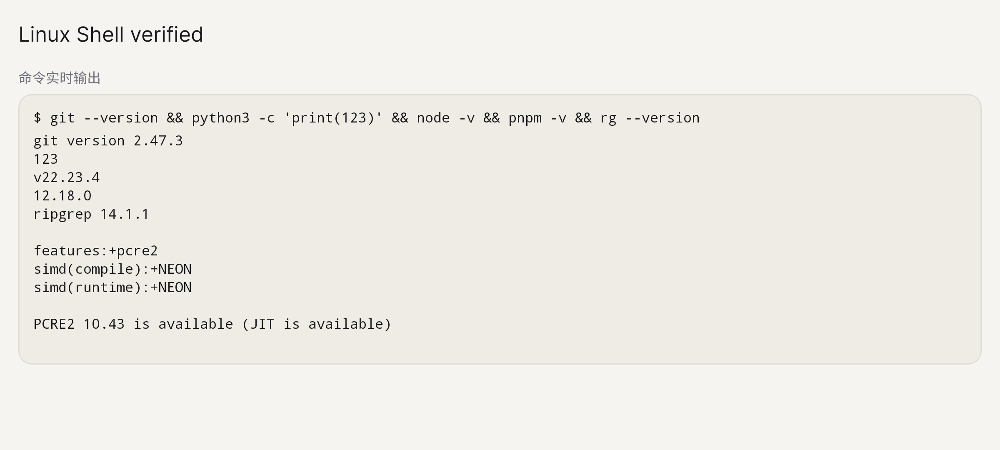
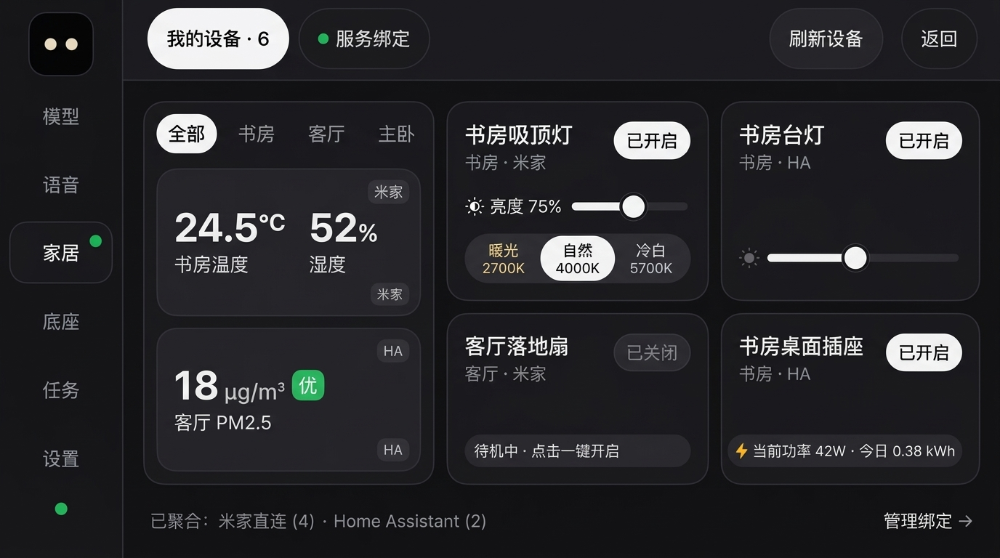
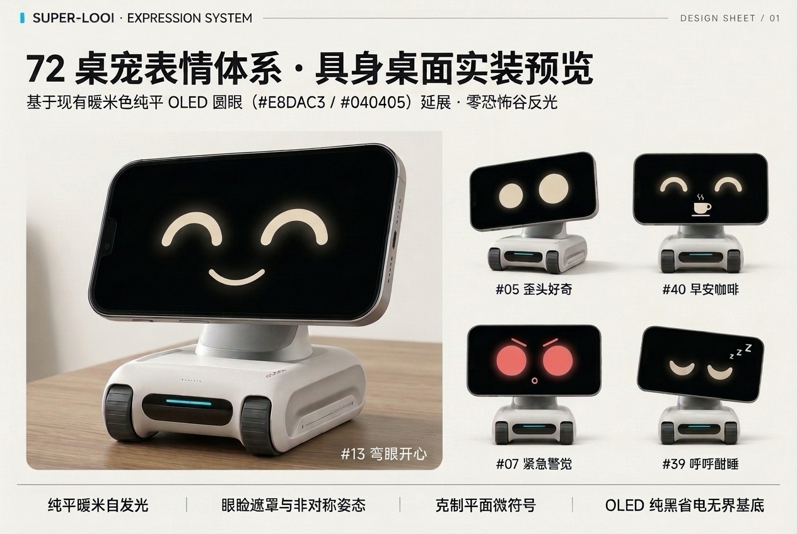
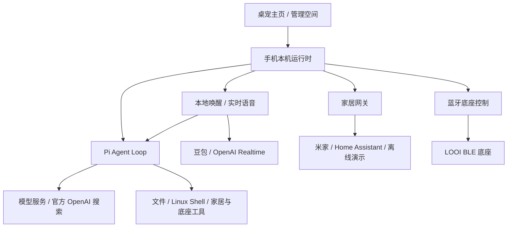

<div align="center">
  
  <h1>Super-LOOI</h1>
  <p><a href="README.md">English</a> · <strong>简体中文</strong></p>
  <p><strong>让手机成为有表情、会对话、能做事的桌面伙伴。</strong></p>
  <p>iOS / Android · 72 种表情 · 实时语音 · 本机 Agent · 智能家居 · LOOI 蓝牙底座</p>
  <p><a href="#快速上手">快速上手</a> · <a href="#使用场景">使用场景</a> · <a href="#界面画廊">界面画廊</a> · <a href="#架构与源码">架构与源码</a> · <a href="#文档导航">文档导航</a></p>
</div>



Super-LOOI 是运行在手机上的个人 AI Agent（智能体）。平时，它以暖米色圆眼和动态表情陪在桌面；说一声 **「Hey LOOI」**，就能开启实时对话。你也可以输入任务，让它查资料、读写文件、运行命令，或操作已连接的家居设备。

接上 LOOI 底座后，手机上的伙伴有了可以转向、抬头和补光的身体。Agent 与任务运行时在手机本机运行，手机直接连接模型、语音和家居服务；模型推理与实时语音需要对应的云端服务账号。

## 它能做什么

| 能力 | 你可以怎样使用 |
| --- | --- |
| 👀 **有表情的桌面伙伴** | 72 种声明式表情，覆盖待机、聆听、思考、说话、情绪与底座交互；眨眼、眼神和微动作随状态变化。 |
| 🎙️ **唤醒与实时对话** | 前台待机时本地识别「Hey LOOI」，接入豆包 Duplex V3 或 OpenAI Realtime；语音可以发起 Agent 任务并查询进度。 |
| 🧠 **选择自己的模型** | 接入 OpenAI / ChatGPT、Kimi、MiniMax、小米 MiMo、智谱 / Z.AI，或自定义兼容 API；按服务商选择 API Key 或订阅授权。 |
| 🛠️ **在手机上完成任务** | Agent 读写工作区文件、运行 Shell、提问并等待你的回答；任务页查看过程、产物、终端输出与历史会话。官方 OpenAI 通道支持联网搜索和可点击来源。 |
| 🐧 **手机内的 Linux 环境** | 内嵌 Alpine Linux，Android 通过 PRoot、iOS 通过 iSH 执行命令；按需安装 Git、Python、Node.js、pnpm 等工具。 |
| 🏠 **一个家居控制空间** | 接入米家直连与 Home Assistant，按房间聚合设备，以多尺寸卡片控制灯光、开关等能力；没有设备也能体验离线演示。 |
| 🤖 **连接 LOOI 身体** | 蓝牙连接底座，用方向轮盘、头部滑条与补光滑杆手动控制，也能通过文字或语音调用底座工具。 |
| 🌗 **适应日常使用** | 管理空间支持浅色 / 深色主题、横屏管理布局和简体中文 / English；模型与语音凭证保存在系统安全存储。 |

## 快速上手

### 1. 准备环境

从源码构建需要：

| 环境 | 要求 |
| --- | --- |
| JavaScript | Node.js **24.9+**，pnpm **9.15.9**（仓库固定版本） |
| Rust | **1.97+**，以及目标平台的 Rust 编译目标 |
| iOS | macOS、Xcode、已连接的 iPhone，以及开发签名和 provisioning profile（描述文件） |
| Android | Android SDK / NDK、JDK，以及开启 USB 调试的 Android 手机 |
| Linux 环境构建 | macOS 上安装 `meson`、`ninja`、`llvm`、`lld`、`libarchive`；详见 [Linux Shell 构建说明](docs/nsh-linux-shell.md#构建) |

构建脚本固定使用 **NSH 0.5.0**，找不到匹配的 CLI 时会构建锁定的源码版本；首次构建还会下载语音唤醒模型与 Linux 依赖。

### 2. 克隆与安装

```sh
git clone https://github.com/GrinZero/super-looi.git
cd super-looi
pnpm install --frozen-lockfile
pnpm build
```

平台工具链与签名配置写在根目录 `.env`。模型账号与实时语音凭证在应用内连接。

**Android 真机**：用 `adb devices` 查看设备序列号，再启动开发宿主：

```sh
pnpm --filter @super-looi/nsh exec node --import tsx scripts/nsh.ts run --target android --device "<ADB_SERIAL>"
```

**iPhone 真机**：先在 `.env` 配置签名：

```dotenv
IOS_SIGN_IDENTITY="Apple Development: Your Name (TEAMID)"
IOS_PROVISIONING_PROFILE=/absolute/path/to/profile.mobileprovision
```

用 `xcrun devicectl list devices` 查看设备标识，再构建、签名并安装：

```sh
pnpm ios --device "<IPHONE_UDID>"
```

`<ADB_SERIAL>`、`<IPHONE_UDID>` 和签名值需替换为自己的配置。`pnpm mobile` 与 `pnpm ios` 是同一入口，也需要指定 iPhone。更多构建命令见 [NSH 应用说明](apps/nsh/README.md)。

<details>
<summary>也可以复制给 AI，让它帮你配置开发环境</summary>

```text
请帮我从源码构建并在真机运行 Super-LOOI。
仓库：https://github.com/GrinZero/super-looi

请先阅读 README.md、AGENTS.md 和 apps/nsh/README.md，使用 pnpm。
检查 Node.js、Rust、目标平台工具链与已连接手机，准备 .env 中的构建配置，
然后安装依赖、构建，并按 README 的真机命令安装运行。
如果缺少 iPhone 签名或需要我完成账号登录，请告诉我具体需要填写或操作的位置。
```

</details>

### 3. 连接账号，开始使用

1. **选择模型**：从主页右上角进入管理空间，在「模型」选择服务商与接入渠道，填写 API Key 或完成 OAuth（账号授权），再选择模型。
2. **发起任务**：回到主页打开文字对话，输入一个任务；在「任务」查看执行过程、终端输出和结果，继续追问或停止任务。
3. **开启语音**：在「语音」保存实时语音凭证。自动唤醒默认开启，前台待机时说「Hey LOOI」，听到提示音后开始说话；也可点击主页语音入口。回复后继续聆听，静默 12 秒返回待机。
4. **连接家居**：在「家居」绑定米家或 Home Assistant；首次体验可选择「离线演示」。连接方式见 [家居连接说明](apps/nsh/README.md#家居连接)。
5. **连接底座**：有 LOOI 时，在「底座」扫描并连接蓝牙设备，使用方向轮盘、俯仰和补光控制。

实时语音默认使用豆包；使用 OpenAI Realtime 时，在根目录 `.env` 设置 `VOICE_PROVIDER=openai` 后重新构建。文字任务模型与实时语音服务分别配置。

## 使用场景

连接对应服务或设备后，可以直接输入或说出这些请求：

| 场景 | 示例 |
| --- | --- |
| 联网查资料 | 「查一下这个开源项目的用途和最近进展，附上来源链接。」使用官方 OpenAI 通道的搜索能力。 |
| 整理文件 | 「读取工作区里的笔记，整理成一份 Markdown 摘要，保存为 summary.md。」 |
| 运行代码 | 「用 Python 统计这份 CSV 每列的缺失值，把结果写成报告；缺少 Python 就先安装。」 |
| 控制灯光 | 「找到书房台灯，打开并把亮度调到一半。」 |
| 控制底座 | 「把头抬高一点，再把补光灯调到一半。」 |
| 语音委派任务 | 「帮我整理工作区里的文件。」之后继续问「刚才的任务做完了吗？」 |

### 模型接入

| 服务商 | 应用内提供的接入方式 |
| --- | --- |
| OpenAI / ChatGPT | 官方 API Key、ChatGPT 订阅 OAuth |
| Kimi | Kimi Code 会员 Key / OAuth、Moonshot 国内 / 国际 API |
| MiniMax | 国内站 / 国际站 API Key |
| 小米 MiMo | 按量 API、国内 / 新加坡 / 欧洲 Token Plan Key |
| 智谱 / Z.AI | 国内 / 国际标准 API、Coding Plan Key |
| 自定义兼容 API | 配置兼容端点、API Key 与模型 ID |

已连接服务商的模型列表可从账号接口刷新；各接入渠道和认证实现见 [`llm-providers.ts`](packages/looi-runtime/src/agent/llm-providers.ts)。

### 文件与终端

任务文件与 Shell 共享 `/workspace`。内嵌镜像提供 Alpine / BusyBox 基础命令，需要其他工具时，可以让 Agent 安装，也可以让它执行：

```sh
apk add git python3 nodejs npm ripgrep
npm install -g pnpm
```

软件包和工作区文件保留在应用私有目录，重启后继续使用。`bash` 工具实际执行 `/bin/sh -c`；需要 Bash 专用语法时先安装 Bash。操作方法与平台实现见 [Linux Shell 说明](docs/nsh-linux-shell.md)。Android ARM64 已完成真机运行验证；iOS 已完成设备目标构建，iPhone 上的运行与包安装待验证，详见 [验证记录](docs/nsh-linux-shell-verification.md)。

## 界面画廊

桌宠主页保持深色，管理空间提供浅色与深色主题。下列运行截图保存在仓库内，点击可以查看原图。

| 模型连接 · English 浅色 | 底座控制 · 深色演示模式 |
| --- | --- |
|  |  |

| 实时语音 | Android Linux 终端输出 |
| --- | --- |
|  |  |

<details>
<summary>家居与表情设计图</summary>

**家居空间设计参考**：按房间组织设备，聚合米家与 Home Assistant 的状态和控制。实现使用可调整尺寸与顺序的设备卡片。



**72 种表情设计参考**：圆眼、眼睑、嘴形与微符号组合成不同情绪和交互姿态；运行时配方见 [`face-recipes.ts`](apps/nsh/ui/face-recipes.ts)。



</details>

## 架构与源码

应用使用 **NSH（Native Shell，原生壳）+ TSX + Rust**。QuickJS 中的 Pi Agent Loop 负责模型与工具循环，Rust 宿主提供音频、蓝牙、凭据、SQLite、文件和 Linux 执行能力。



| 模块 | 职责 |
| --- | --- |
| [`apps/nsh`](apps/nsh/README.md) | TSX 界面、应用状态、任务 / 语音 / 家居 / 底座运行时，以及双端原生桥接与打包。 |
| [`packages/looi-runtime`](packages/looi-runtime/src/index.ts) | Agent 执行器、模型服务接入、会话与任务存储、语音协议及观测。 |
| [`packages/nsh-node-compat`](packages/nsh-node-compat/README.md) | 把 Pi 所需的 Node API 接到 QuickJS / Rust 宿主。 |
| [`packages/home-devices`](packages/home-devices/src/index.ts) | 设备实体聚合、能力映射和卡片布局偏好。 |
| [`packages/home-assistant`](packages/home-assistant/src/core/gateway.ts) | Home Assistant、米家 MIoT 与演示数据的传输、设备发现及控制。 |
| [`packages/looi-driver`](packages/looi-driver/src/body-supervisor.ts) | LOOI BLE 协议、身体状态与动作调度。 |
| [`packages/contracts`](packages/contracts/src/index.ts) | 跨模块共享的数据契约与协议类型。 |

任务、会话和家居配置保存在手机本机；凭证由 iOS Keychain / Android Keystore 支持的安全存储管理。需要追踪语音、模型与工具调用时，可接入 Langfuse；配置见 [NSH 应用说明](apps/nsh/README.md#开发观测)。可浏览 [架构图源码](docs/arch/index.html) 中的模块与调用关系。

## 开发与文档

在上述构建环境中运行：

```sh
pnpm typecheck
pnpm test
pnpm build
```

平台探针、打包和更多定向验证命令见 [NSH 应用说明](apps/nsh/README.md)。新增原生能力通过 [`native/plugins.json`](apps/nsh/native/plugins.json) 注册的构建插件接入。

### 文档导航

| 想了解什么 | 从这里开始 |
| --- | --- |
| 原生构建、真机运行与验证命令 | [NSH 应用说明](apps/nsh/README.md) |
| 模块关系与源码调用路径 | [架构图](docs/arch/index.html) |
| 界面布局、主题与交互规则 | [NSH 设计规范](apps/nsh/DESIGN.md) |
| Linux 环境、包管理与源码构建 | [Linux Shell](docs/nsh-linux-shell.md) · [Android 真机与 iOS 构建记录](docs/nsh-linux-shell-verification.md) |
| 米家与 Home Assistant 接入 | [手机内家居连接](apps/nsh/README.md#家居连接) |
| 蓝牙握手与底座实测 | [LOOI BLE 验证记录](docs/looi-ble-live-verification.md) |
| 中英界面与语音语言 | [双语接入说明](docs/nsh-bilingual-integration.md) |
| 表情系统与视觉规范 | [72 种表情设计](docs/super-looi-72-expressions-design.md) |
| 尚待完成的功能与真机验证 | [todo.md](todo.md) |

旧 Expo / React Native 应用与 Hub 源码归档在 `archive/legacy-hub-and-expo` 分支；`docs/` 中相应阶段报告保留为历史记录。

## 许可证

Super-LOOI 使用 **GNU General Public License v3.0，仅第 3 版**（`GPL-3.0-only`），完整条款见 [LICENSE](LICENSE)。

第三方组件保留各自许可证；内嵌 Linux 组件的声明与对应源码说明见 [Linux Shell 许可证章节](docs/nsh-linux-shell.md#第三方许可证与-ios-对应源码)。Expo 模板的原始 MIT 许可声明保存在 [LICENSES/Expo-MIT.txt](LICENSES/Expo-MIT.txt)。
