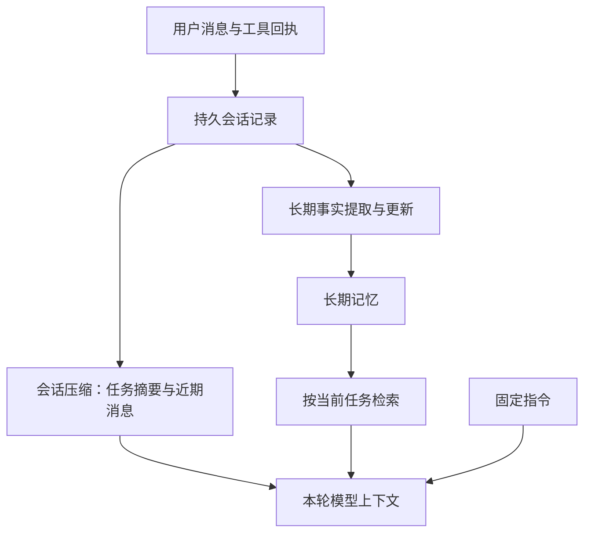

# Agent 记忆、会话与上下文压缩机制调研

调研日期：2026-11-09。Claude Code、OpenCode、Letta 以官方文档为依据；Codex 另核对公开源码提交 [`8703d32bd0ea5cf26768859a3dd476df906ba053`](https://github.com/openai/codex/tree/8703d32bd0ea5cf26768859a3dd476df906ba053)；Pi 核对本仓库安装的 1.5.0 与官方文档。下文将已公开机制与针对 Super-LOOI 的设计建议分开。

## 1. 核心结论

这些实现体现了四种不同职责：持久会话记录用于恢复与追查；当前上下文维持任务连续性；压缩控制当前上下文长度；长期记忆把有用事实带到新会话。Claude Code 与 Codex 都另外保留人维护的指令文件，并将它们与自动提取的经验区分。[Claude Code 工作原理](https://code.claude.com/docs/en/how-claude-code-works)、[Codex 自定义机制](https://learn.chatgpt.com/docs/customization/overview)

| 维度 | Claude Code | Codex | 对 Super-LOOI 的直接意义 |
| --- | --- | --- | --- |
| 工作记忆 | 当前消息、工具结果、计划与压缩摘要 | 当前模型窗口、任务状态与压缩检查点 | 目标、约束和未完成事项应能在压缩后继续使用 |
| 长期规则 | CLAUDE.md，以及支持的 AGENTS.md 加载路径 | 分层 AGENTS.md | 固定行为规则与自动记忆分别管理 |
| 长期经验 | auto memory；短入口与主题文件 | 可启用的本地 memories；后台提取与整合 | 跨会话回忆需要独立写入和读取路径 |
| 控制上下文量 | 按需读取、子任务独立窗口、自动压缩 | 有限摘要注入、定向读取、手动或自动压缩 | 保存的全部资料不必每轮全部发送 |
| session 恢复 | 持久 transcript 与压缩后的有效上下文 | rollout 与压缩检查点重建 | 存档和发给模型的视图应分离 |

表中工作记忆是本文的职责归纳，不表示这些产品均有一个名为 WorkingMemory 的公开类。具体依据见后续各节。

## 2. Claude Code

### 2.1 长期记忆：指令、经验、索引与正文

`CLAUDE.md` 记录人工规则，auto memory 记录有用经验，包含 user、feedback、project、reference 等类型。自动记忆按仓库存储，同一仓库的 worktree 共享；`MEMORY.md` 是入口，启动加载前 200 行或 25KB，以先达到者为准，主题文件按需读取。这是一种“少量内容常驻，详细内容查到再读”的结构。[官方 memory 文档](https://code.claude.com/docs/en/memory)

### 2.2 工作上下文：延迟加载与独立窗口

技能先提供描述，调用时再加载正文；普通 subagent 在独立窗口处理任务，向主会话返回结果。这样大量探索性读取可以留在子任务中。采用它的成本是额外模型请求以及主任务的结果整合，而非获得免费的上下文空间。[工作原理](https://code.claude.com/docs/en/how-claude-code-works)、[subagent 文档](https://code.claude.com/docs/en/sub-agents)

### 2.3 压缩：生成摘要，再恢复必要材料

接近窗口限制时自动压缩，也能手动 `/compact` 指定关注重点。官方文档列明压缩后重新注入根指令、auto memory、计划，部分内容按需重新加载；最近修改的已读或编辑文件最多重读 5 个，超过 5,000 token 的文件仅提供路径。技能正文有独立预算，部分加载行为带版本要求，例如技能描述重建要求 v2.1.304+。这些属于公开的上下文重建行为，不能据此断言闭源摘要算法的内部实现。[context window 文档](https://code.claude.com/docs/en/context-window)

### 2.4 session：恢复有效上下文，不重跑动作

CLI 持续写本机 JSONL transcript，支持 `--continue` 和 `--resume`。压缩过的会话恢复摘要、当时保留的消息及后续消息，而不是重新塞入全部旧历史；恢复也不会自动重跑中断的工具。[sessions 文档](https://code.claude.com/docs/en/sessions)

## 3. Codex

### 3.1 AGENTS.md 与自动记忆有不同职责

Codex 按全局、项目根目录到当前目录加载指令，合并内容受 `project_doc_max_bytes` 限制，默认 32 KiB。它是人工维护的长期指导入口。[AGENTS.md 官方文档](https://learn.chatgpt.com/docs/agent-configuration/agents-md)

本地 Codex memories 是单独的可启用功能，官方说明默认关闭；可以分别控制新聊天是否使用已有记忆、是否参与后续记忆生成。它与 ChatGPT 网页记忆使用不同存储。生成在后台进行，会避开仍活跃或不满足条件的会话，不是每轮完成就立刻写入。[Memories 官方文档](https://learn.chatgpt.com/docs/customization/memories)

### 3.2 长期记忆：逐会话提取，再跨会话整合

公开源码存在两阶段管线：Phase 1 对符合条件的历史 rollout 提取记录，Phase 2 将选中的记录整理为供未来使用的文件。运行入口先检查会话类型、功能开关及状态数据库，再异步执行两阶段；整合阶段维护共享记忆工作区。[启动入口](https://github.com/openai/codex/blob/8703d32bd0ea5cf26768859a3dd476df906ba053/codex-rs/memories/write/src/start.rs)、[Phase 1](https://github.com/openai/codex/blob/8703d32bd0ea5cf26768859a3dd476df906ba053/codex-rs/memories/write/src/phase1.rs)、[Phase 2](https://github.com/openai/codex/blob/8703d32bd0ea5cf26768859a3dd476df906ba053/codex-rs/memories/write/src/phase2.rs)

需要区分 v1 与 v2：v1 的提取输出有 `raw_memory`、`rollout_summary`；v2 只解码 `rollout_summary` 和 slug，整合成 `memory_summary.md`。v2 的提取提示要求区分用户原话、Agent 提议、已实施结果与未决事项，不把单次要求推成永久偏好；整合提示要求保留项目范围、时间和来源指针。[输出契约](https://github.com/openai/codex/blob/8703d32bd0ea5cf26768859a3dd476df906ba053/codex-rs/memories/write/src/phase1_output.rs)、[v2 提取提示](https://github.com/openai/codex/blob/8703d32bd0ea5cf26768859a3dd476df906ba053/codex-rs/memories/write/templates/memories/stage_one_system_v2.md)、[v2 整合提示](https://github.com/openai/codex/blob/8703d32bd0ea5cf26768859a3dd476df906ba053/codex-rs/memories/write/templates/memories/consolidation_v2.md)

读路径把有限长度的 `memory_summary.md` 放入上下文；其中的历史记录指针用于在确有需要时读取 `rollout_summaries/`。当前本地搜索后端支持文本匹配，因此这一具体读路径并不要求向量数据库。用户明确要求记住、纠正或遗忘时，v2 提示指向附加 note，由后续整合应用。[摘要注入实现](https://github.com/openai/codex/blob/8703d32bd0ea5cf26768859a3dd476df906ba053/codex-rs/ext/memories/src/prompts.rs)、[v2 读取提示](https://github.com/openai/codex/blob/8703d32bd0ea5cf26768859a3dd476df906ba053/codex-rs/ext/memories/templates/memories/read_path_v2.md)、[本地搜索](https://github.com/openai/codex/blob/8703d32bd0ea5cf26768859a3dd476df906ba053/codex-rs/ext/memories/src/local/search.rs)

v1/v2 的目录选择与迁移取决于配置和客户端：当前官方文档区分 `memories/`、`memories_v2/` 与 dual-write，不能把某个目录结构当成所有安装版本的统一结构。[Memories 官方文档](https://learn.chatgpt.com/docs/customization/memories)

### 3.3 工作上下文与压缩检查点

Codex 提供手动 `/compact`，以及 `model_auto_compact_token_limit` 自动阈值；未指定阈值时使用模型默认值，另有回合结束压缩相关配置。[开发者命令](https://learn.chatgpt.com/docs/developer-commands)、[配置参考](https://learn.chatgpt.com/docs/config-file/config-reference)

公开源码的常规摘要路径根据 provider 能力选择远端压缩或本地摘要。这里的“本地摘要”指由客户端组织请求，仍然调用模型；默认摘要提示要求保留进度、关键决定、约束、下一步和继续任务所需资料。实现会重建必要上下文，并记录可恢复的压缩检查点。[路径选择](https://github.com/openai/codex/blob/8703d32bd0ea5cf26768859a3dd476df906ba053/codex-rs/core/src/tasks/compact.rs)、[默认摘要提示](https://github.com/openai/codex/blob/8703d32bd0ea5cf26768859a3dd476df906ba053/codex-rs/prompts/templates/compact/prompt.md)、[上下文重建](https://github.com/openai/codex/blob/8703d32bd0ea5cf26768859a3dd476df906ba053/codex-rs/core/src/compact.rs)

源码另有受 feature 与 provider 能力控制的异步压缩：先对当前前缀生成候选结果，之后在检查点采用，并处理生成期间新增的后缀消息。这证明后台压缩需要管理快照与新增消息的关系，不能只把同步函数放进后台；也不表示每个客户端默认启用该路径。[异步压缩](https://github.com/openai/codex/blob/8703d32bd0ea5cf26768859a3dd476df906ba053/codex-rs/core/src/session/async_compaction.rs)、[结果安装](https://github.com/openai/codex/blob/8703d32bd0ea5cf26768859a3dd476df906ba053/codex-rs/core/src/compact_remote_v2_installation.rs)

session 恢复代码会寻找压缩检查点及其 `replacement_history`，随后重建生效历史。压缩改变模型当前读取的窗口，与持久 rollout 的用途不同。[rollout 重建](https://github.com/openai/codex/blob/8703d32bd0ea5cf26768859a3dd476df906ba053/codex-rs/core/src/session/rollout_reconstruction.rs)

### 3.4 Responses API 压缩与 Codex 产品机制的边界

Responses API 支持 `context_management` 配合 `compact_threshold` 的服务端压缩，也提供独立 `/responses/compact`。返回的 compaction item 是不可读的模型状态，应原样继续传递，不能作为普通文字摘要来编辑。这是 OpenAI API 能力，不等于所有 Codex 客户端或兼容 provider 均使用同一机制。[Compaction API 指南](https://developers.openai.com/api/docs/guides/compaction)

Prompt caching（提示词缓存）复用未变化前缀的计算状态，解决重复计算成本；它不会自动生成跨会话事实，也不等于缩短模型实际上下文。压缩改变前缀还可能影响缓存复用。[Prompt caching 指南](https://developers.openai.com/api/docs/guides/prompt-caching)

## 4. 社区实现的补充

### 4.1 Pi：与现有技术栈最接近

`pi-agent-core` 的裸 `Agent` 提供上下文处理挂钩，自动 session 压缩属于 `pi-coding-agent` 的 `AgentSession`。当前 Super-LOOI 仅创建前者，没有配置自动压缩所需的上层逻辑。[agent-core 文档](https://github.com/earendil-works/pi/blob/main/packages/agent/README.md)、[本仓库执行器](../packages/looi-runtime/src/agent/pi-executor.ts)

核对本机 1.5.0：默认 `reserveTokens=16384`、`keepRecentTokens=20000`；阈值为 `contextTokens > contextWindow - reserveTokens`。它选择保留边界，结合旧摘要更新较早历史，追加 `CompactionEntry` 与 `firstKeptEntryId`，下一次模型请求使用摘要加近期消息，原始日志仍保留。切分不会从 toolResult 开始，避免拆散调用与结果。[压缩文档](https://github.com/earendil-works/pi/blob/main/packages/coding-agent/docs/compaction.md)

本机版本核对位置：`node_modules/.pnpm/@earendil-works+pi-coding-agent@1.5.0_*/node_modules/@earendil-works/pi-coding-agent/dist/core/compaction/compaction.js`、`agent-session.js`。线上 main 会继续变化，默认值以本机 1.5.0 核对结果为基准。

### 4.2 OpenCode：摘要旁边保留近期原文

官方文档说明：摘要请求看到当前完整对话，下一窗口使用摘要与最近约 15,000 token 的原文；后续压缩迭代更新摘要。默认预留窗口 15% 且至少 16k，参数可配置。实验性后台压缩预先生成摘要，到阈值时替换，并保留期间新增内容；未采用的预生成摘要仍产生模型费用。[OpenCode compaction](https://opencode.ai/docs/compaction/)

### 4.3 Letta：常驻核心与按需资料

当前 Agent SDK 的记忆采用 git 支持的 MemFS：`system/` 内容每轮注入，其余文件按需读取；Dreaming 可以在步数或压缩事件后触发后台整理。其 V1 legacy 的 memory blocks、archival memory 是另一代接口，不宜与当前 SDK 直接混称同一架构。可借鉴的是分配常驻预算与按需读取，而非必须采用整套运行时。[Letta 当前 memory 文档](https://docs.letta.com/agent-sdk/memory)

## 5. 面向 Super-LOOI 的设计判断

以下为根据现有调用方与状态生命周期作出的建议，不是上游产品的承诺或本仓库已经实现的功能。

### 5.1 保持两条数据流

现役 NSH 的持久状态包括 SQLite 任务快照与 JSON 会话消息。`PiTaskRunner` 从同一会话恢复消息，并在成功结束后保存；普通语音转写用于界面显示，最近后台任务回执保存在 `VoiceRuntime` 内存中。个人事实的写入、检索和上下文注入需要接入现役调用链。下图描述这些能力的目标关系。

压缩摘要描述“这件事做到哪一步”；长期事实描述“以后哪些事情仍然有用”。例如开灯任务的执行进度进入工作摘要，用户说“以后睡前灯光调到 20%”才可能形成长期偏好。执行是否成功仍以实际回执为依据，摘要只是对回执的引用和归纳。

### 5.2 建议的增量与复杂性成本

| 选择 | 具体用途 | 新增成本 | 判断 |
| --- | --- | --- | --- |
| 分离原始记录与压缩检查点 | 恢复时读取摘要和之后消息，不再每轮全量加载 | 维护摘要覆盖边界及持久化顺序 | 优先，直接解决当前历史增长 |
| 摘要保存目标、约束、进度、决定、待办及引用 | 压缩后能继续原任务 | 摘要提示与字段约定 | 优先，可用一份结构化文本，无需增加独立规划 Agent |
| 接通显式记住、查询、纠正、遗忘 | 新会话能取回用户事实 | 工具接口、存储所有权及上下文预算 | 以现有 SQLite 持久化能力承载单一事实入口 |
| 少量核心事实常驻、其余按需查 | 控制输入量并保留个人化能力 | 一个有预算的组装入口 | 适合先用普通文本或结构化条件查询 |
| 自动提取再整合 | 从历史积累重复出现且有用的信息 | 额外模型调用、候选管理、更新与删除传播 | 显式记忆链路落地后再引入 |
| 后台压缩或 Dreaming | 降低达到阈值时的等待、自动整理经验 | 快照/后缀协调、调度、取消、额外费用 | 先以同步压缩确认实际等待成本 |
| 向量数据库或知识图谱 | 大量事实的语义检索或关系查询 | embedding、索引、更新与运行依赖 | 当前缺少规模和检索失败证据支持引入 |

### 5.3 Pi 接入应先比较状态所有权

整体采用 `AgentSession`，可以取得压缩、session 树与恢复，但需要协调我们现有 JSON 消息、SQLite 任务、审批与 NSH 宿主生命周期。沿用裸 `Agent` 并复用摘要/切分思路，集成面较小，但检查点与恢复要由现有执行器负责。两者都应从现有调用契约评估，不能因为包已安装就假定自动压缩已经可用。

对当前范围，优先评估复用 Pi 的压缩算法与摘要格式、保留现有任务所有权；是否整体切换 `AgentSession`，需要比较实际 API 与移动宿主依赖后决定。这里尚无足够证据支持为了压缩同时替换整个执行框架。

### 5.4 文字与语音要共享可恢复的任务状态

现有文字 Agent 使用持久 session；Realtime 语音连接单独创建，重连只携带最近后台任务回执，普通聊天没有持久摘要。可以让逻辑会话继续承载任务摘要和长期事实，语音 WebSocket 只作为一次传输连接；重连时组装有预算的摘要与相关记忆。新增成本是转写、任务回执和摘要的统一归属，以及语音服务允许的上下文注入方式。[Agent 调用](../apps/nsh/runtime/application.ts)、[语音生命周期](../apps/nsh/runtime/voice/runtime.ts)、[回执格式](../apps/nsh/runtime/voice/task-coordinator.ts)

## 6. 实施前需要回答的具体问题

1. Pi 1.5.0 的压缩入口能否独立复用并保留现有 SQLite 任务与审批生命周期，还是需要一个薄的上下文适配层？
2. 个人事实采用什么存储结构和更新语义？记住、纠正、遗忘与检索注入应使用同一个事实入口。
3. 当前豆包/OpenAI 语音链路哪些转写事件能稳定落盘，重连时能注入多少摘要？据此确定文字与语音的逻辑 session 边界。
4. 应按实际选用模型的窗口、工具输出增长和输出预留量确定阈值；Pi/OpenCode 的默认数字可作参考，不直接复制为本项目常量。
