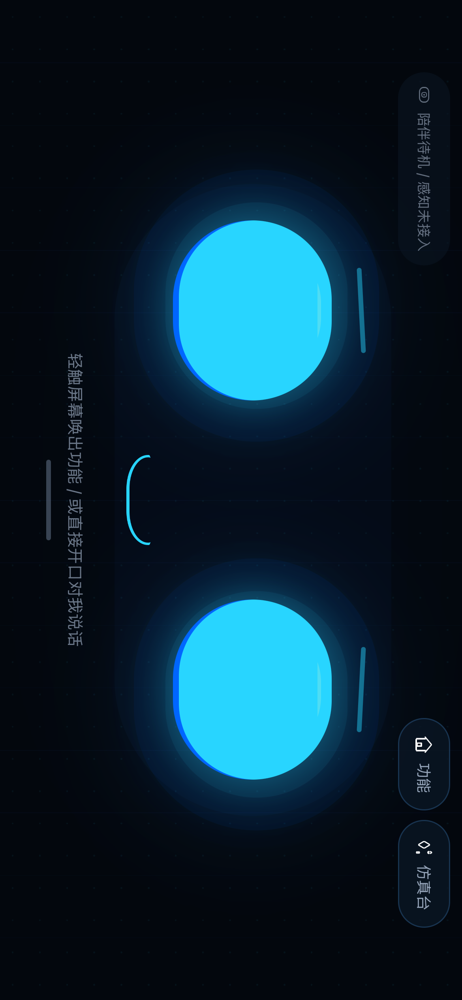
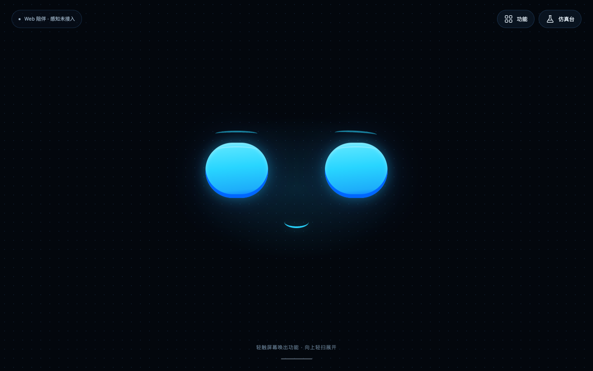
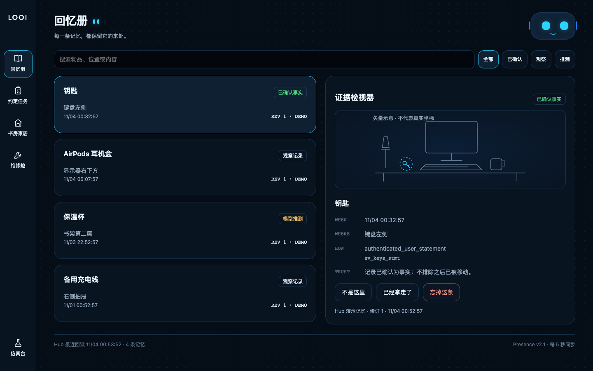
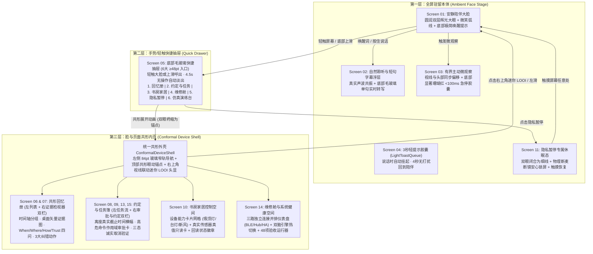

# Super-LOOI UI 深度审阅与新版设计方案 (Presence v2.1)

## 一、 现状视觉对比：为什么目前效果不佳？

以下为当前 iOS 模拟器实机运行截图与产品原始目标设计稿（提取自仓库 `archive/legacy-v1:design/` 与 `docs/design-v2/ui_manifest.json`）的直观对比：

````carousel

<!-- slide -->

<!-- slide -->

````

---

## 二、 七大核心病灶深度剖析（附代码级根因定位）

### 1. 致命视觉故障：所有 Emoji 在 iOS 模拟器中渲染为 `[?]` 豆腐块且间距撕裂
- **代码位置**：[index.tsx](file:///Users/bugyaluwang/project/super-looi/apps/mobile/app/index.tsx#L167-L212)、[index.tsx](file:///Users/bugyaluwang/project/super-looi/apps/mobile/app/index.tsx#L289-L328)
- **根因剖析**：
  - 当前界面将 `🧲`、`📷`、`🎤`、`👁️`、`🤖`、`📖`、`📋`、`🛠️`、`🚨` 等 25+ 个 Emoji 直接作为主 UI 图标混排在 `<Text>` 中。
  - 在 iOS 26.3 模拟器字体回退链路下，这些 Emoji 全部渲染成缺失字形 `[?]`，且带变体选择符 `U+FE0F` 的 `👁️` 甚至渲染出**两个 `[?] [?]` 加大段空白**（见顶栏 `CLOUD` 胶囊）。
  - 早期设计规范（`.claude/plans/ui-redesign.md`）明确规定：**“不再用 emoji 承担主图标……主要 UI 图标使用线性图标风格”**，但最新一次提交未遵守该约束。

### 2. 严重布局崩坏：顶栏单行硬塞 8 个胶囊导致右侧溢出，“维修舱”入口完全不可见
- **代码位置**：[index.tsx](file:///Users/bugyaluwang/project/super-looi/apps/mobile/app/index.tsx#L164-L215)、[index.tsx](file:///Users/bugyaluwang/project/super-looi/apps/mobile/app/index.tsx#L675-L734)
- **根因剖析**：
  - `topBar` 使用单行 `flexDirection: "row"` 同时放置左侧 4 个状态胶囊（`statusPills`）和右侧 4 个导航按钮（`navTabs`），总宽度超过 iPhone 横屏安全宽度（844pt）。
  - 结果如实拍图所示：**右侧第三个 Tab `约定任务 (2)` 被屏幕右边缘硬生生截断，第四个 Tab `🛠️ 维修舱` 100% 溢出屏幕外，用户根本无法点击进入维修舱！**
  - 同时根容器未使用 `SafeAreaView` 或 `useSafeAreaInsets`（[index.tsx](file:///Users/bugyaluwang/project/super-looi/apps/mobile/app/index.tsx#L162)），未避让 iOS 横屏左右灵动岛/刘海与底部 Home Indicator。

### 3. 代码级 Bug：`LOOI_PALETTE.emergencyCoral` 拼写错误导致色值为 `undefined`（且 `tsconfig` 漏检 `app/`）
- **代码位置**：
  - 色板定义：[theme.ts](file:///Users/bugyaluwang/project/super-looi/apps/mobile/src/ui/theme.ts#L30) 定义的字段名为 `alertCoral: "#FA8E86"`，**根本不存在 `emergencyCoral`**。
  - 错误引用（共 5 处）：[index.tsx](file:///Users/bugyaluwang/project/super-looi/apps/mobile/app/index.tsx#L779-L780)（`eyeOrbStopped`）、[index.tsx](file:///Users/bugyaluwang/project/super-looi/apps/mobile/app/index.tsx#L822)（`actionBtnAlert`）、[index.tsx](file:///Users/bugyaluwang/project/super-looi/apps/mobile/app/index.tsx#L833)（`emergencyStopBtn`）、[index.tsx](file:///Users/bugyaluwang/project/super-looi/apps/mobile/app/index.tsx#L1145)（`diagBtnDanger`）。
  - 编译盲区：[tsconfig.json](file:///Users/bugyaluwang/project/super-looi/apps/mobile/tsconfig.json#L8) 的 `"include": ["src/**/*"]` **漏掉了 `"app/**/*"`**，导致 `pnpm typecheck` 完全没有检查 `app/index.tsx`！
- **视觉后果**：
  - 首屏右下角最关键的 **“刹车急停”按钮 (`emergencyStopBtn`) 背景色变成了 `undefined`（全透明）**，在黑色背景上只剩一行毫无警示感的小白字；点击急停时双眼也不会变为珊瑚红。

### 4. 信息架构背离产品灵魂：把“桌面具身宠物”做成了“带常驻顶栏和调试按钮的工程后台”
- **代码位置**：[prd.md](file:///Users/bugyaluwang/project/super-looi/docs/design-v2/prd.md#L134-L143)、[ui_manifest.json](file:///Users/bugyaluwang/project/super-looi/docs/design-v2/ui_manifest.json#L2-L21) (Screen 01 & 05) vs [index.tsx](file:///Users/bugyaluwang/project/super-looi/apps/mobile/app/index.tsx#L164-L331)
- **根因剖析**：
  - `prd.md` 与 `ui_manifest.json` 反复强调：**“默认横屏只有原创双眼、轻量表情与低干扰的真实采集状态……不在首页常驻 tabbar；用户上滑或轻触才出现快捷抽屉”**。
  - 当前实现却在机器人头顶常驻一条管理后台顶栏，在机器人下巴常驻 6 个 QA 调试按钮（`说话中测试`、`记当前画面`、`主动微观察`、`拔下手机`、`隐私暂停`、`刹车急停`），彻底破坏了“屏幕就是机器人的脸”的具身沉浸感。

### 5. 机器人表情造型粗糙（“塑料贴纸眼” + 待机乱跳声波 + 零情绪维度）
- **代码位置**：[index.tsx](file:///Users/bugyaluwang/project/super-looi/apps/mobile/app/index.tsx#L85-L123)、[index.tsx](file:///Users/bugyaluwang/project/super-looi/apps/mobile/app/index.tsx#L228-L279)、[index.tsx](file:///Users/bugyaluwang/project/super-looi/apps/mobile/app/index.tsx#L760-L800)
- **根因剖析**：
  - **造型失真**：当前 `eyeOrb` 是 `80×100` 的窄竖椭圆，间距仅 `50pt`，右上角贴了一个死板的 `20×20` 白色圆片（`eyeGlint`），看起来像廉价的“塑料贴纸眼”。而目标设计（`首屏示例.png` 及旧版 `RobotFace.tsx`）是大尺寸圆润眼睛（`150×150` 或 `136×96`）、宽眼距（`140~180pt`）、外层深蓝到青色柔和径向光晕、底部 `#0066FF` 内缘立体折射，以及中心微笑弧线 `︶` 与动态眉毛。
  - **违背安静驻留的伪声波**：[index.tsx](file:///Users/bugyaluwang/project/super-looi/apps/mobile/app/index.tsx#L112-L123) 用 5 个 `setInterval` 每 200ms 随机缩放 `waveformBar`，**哪怕在无人说话的安静待机态，下巴上的 5 根柱子也在永不停歇地抽动**！
  - **缺失睡眠/思考/警惕等 7 态表情**：开启“隐私暂停”后，机器人眼睛依然睁大闪烁、声波依然跳动，完全没有进入闭眼休眠态（Screen 11）。

### 6. 视图层与底层 7 大核心控制器 100% 脱节（“假共形”、“假时间戳”、“假队列”）
- **代码位置**：[index.tsx](file:///Users/bugyaluwang/project/super-looi/apps/mobile/app/index.tsx#L1-L159) vs `apps/mobile/src/ui/*` & `apps/mobile/src/shell/*`
- **根因剖析**：
  - `apps/mobile/src/` 下已经实现了完整的 [`PresenceStateManager`](file:///Users/bugyaluwang/project/super-looi/apps/mobile/src/shell/presence-state.ts)、[`DockedLongevitySupervisor`](file:///Users/bugyaluwang/project/super-looi/apps/mobile/src/shell/longevity-supervisor.ts)、[`RobotFaceController`](file:///Users/bugyaluwang/project/super-looi/apps/mobile/src/ui/robot-face-controller.ts)、[`LightToastQueue`](file:///Users/bugyaluwang/project/super-looi/apps/mobile/src/ui/light-toast-queue.ts)、[`MemoriesConformalSpaceController`](file:///Users/bugyaluwang/project/super-looi/apps/mobile/src/ui/memories-space.ts)、[`TasksAndRulesSpaceController`](file:///Users/bugyaluwang/project/super-looi/apps/mobile/src/ui/tasks-and-rules-space.ts)、[`CabinSpaceController`](file:///Users/bugyaluwang/project/super-looi/apps/mobile/src/ui/cabin-space.ts)。
  - **但 `app/index.tsx` 对上述 7 个控制器的引用数为 0！**
  - 回忆册里的 `<Text>小 LOOI 视线当前盯视选中卡片 [0.65, 0.35]</Text>`（[index.tsx](file:///Users/bugyaluwang/project/super-looi/apps/mobile/app/index.tsx#L342)）和任务页的 `<Text>已离开底座 · 桌面观察停于 19:42</Text>`（[index.tsx](file:///Users/bugyaluwang/project/super-looi/apps/mobile/app/index.tsx#L412)）全是写死的字符串。

### 7. 二级内页缺乏横屏网格布局、桌面视距字号与 15 屏关键状态覆盖
- **代码位置**：[index.tsx](file:///Users/bugyaluwang/project/super-looi/apps/mobile/app/index.tsx#L334-L665)、[index.tsx](file:///Users/bugyaluwang/project/super-looi/apps/mobile/app/index.tsx#L840-L1190)
- **根因剖析**：
  - **横屏单列浪费空间**：在 844pt 宽的横屏上，回忆册、任务簿、维修舱三路连接状态全部是单列全宽长条卡片纵向堆叠，一屏只能看 1.5 张卡片。
  - **字号与触控热区过小**：大量标签与按钮采用 `10~11pt` 字号与 `22~28pt` 高度，在 50~80cm 的桌面底座观看距离下难以辨认，且违反 `ui_manifest.json` Screen 05 **“44 dp 以上触摸目标”** 的硬性要求。
  - **15 屏规范缺失项**：缺少 `02_listening`（底部实时短句转写浮层）、`05_quick_drawer`（上滑/轻触毛玻璃快捷抽屉）、`07_evidence_detail`（带桌面矢量示意图与 4 问凭据的证据详情检视面板）、`11_privacy_pause`（闭眼隐私锁屏遮罩）、`15_cancellation_in_progress`（`请求取消中 -> 已取消 / 结果待核实` 三态诚实取消交互）。

---

## 三、 新版 UI 设计规范：Super-LOOI Presence v2.1

> **核心设计主张**：**「安静具身设备感 (Quiet Embodied Device) + 脸与页面共形 (Conformal Space)」**  
> 屏幕就是 LOOI 的脸；功能空间不是跳出机器人进入另一个管理后台，而是从机器人眼神与脑内展开的玻璃拟态层，右上角始终有活着的迷你 LOOI 与你共同注视当前内容。

### 3.1 信息架构与交互流转图 (Three-Layer Embodied IA)



---

### 3.2 视觉设计系统与 Token 规范 (`apps/mobile/src/ui/theme.ts` 升级)

#### 1) 色彩体系（杜绝散落 Hex，严格绑定语义）

| 分类 | Token 名称 | 色值 | 视觉用途与硬件级约束 |
| :--- | :--- | :--- | :--- |
| **设备屏底色** | `bgDeep` | `#03070D` | 全屏机器人脸根背景（深邃夜空黑蓝，凸显 OLED 发光眼） |
| **内页底色** | `bgRaised` | `#07111D` | 共形内页主舞台背景 |
| **毛玻璃卡片** | `surfaceGlass` | `rgba(10, 22, 36, 0.78)` | 二级空间卡片、快捷抽屉、字幕浮层表面 |
| **高光浮层** | `surfaceElevated` | `rgba(16, 34, 54, 0.88)` | 选中态卡片、模态审批框、右上角迷你头显外壳 |
| **细描边** | `lineSubtle` | `rgba(84, 167, 255, 0.20)` | 默认玻璃卡片 1px 描边 |
| **激活描边** | `lineActive` | `rgba(40, 213, 255, 0.75)` | 选中卡片、当前导航项、聚焦态描边 |
| **主生命色 (Cyan)** | `presenceCyan` | `#28D5FF` | **独占**：机器人双眼主色、真实语音波形、共形视线锚点 |
| **深层辉光 (Blue)** | `electricBlue` | `#1F7CFF` | 眼球底部立体折射内缘、背景径向呼吸光晕 |
| **确认绿 (Green)** | `confirmGreen` | `#4ADE80` | **仅限**：主人已确认事实 (`confirmed`)、设备/产物已回读核验 (`verified`) |
| **推测/待批琥珀** | `cautionAmber` | `#F3C56B` | **仅限**：模型推测 (`inferred`)、高危待审批 (`awaiting_approval`)、待核实 (`unverified`)、脱座提醒 |
| **紧急珊瑚红** | `alertCoral` *(别名 `emergencyCoral`)* | `#FA8E86` | **仅限**：`<100ms` 紧急停车、高危拦截、子系统失联、删除/撤销 |
| **文本层级** | `textPrimary` / `textSecondary` / `textMuted` | `#EDF7FF` / `#9BB0C4` / `#647B90` | 三级高对比度文本，消灭 `<12pt` 模糊灰字 |

#### 2) 图标与图形规范（彻底根除 `[?]` 豆腐块）
- **严禁在任何 UI 组件中使用 Emoji 字符充当图标**。
- 封装统一的纯矢量/几何图标组件 `LooiIcon`（基于 `@expo/vector-icons/Ionicons` + 纯 RN 几何矢量 Fallback，不依赖未加载的外部字体或 iOS 版本特定 Emoji），确保在 iOS 17/26 模拟器、Android 与 Web 上 100% 清晰渲染。

#### 3) 桌面视距排版与触控规范（50–80cm 底座距离优化）
- **字号阶梯**：内页大标题 `24–28pt` (Bold)、卡片主标题 `17–19pt` (SemiBold)、正文/描述 `14–15pt`、徽章与时间戳 `12–13pt`（全面取消 `10px/11px` 微小字号）。
- **触控热区**：所有按钮、导航项、卡片动作按钮强制 `minHeight: 44pt`（快捷抽屉入口 `56pt`），带 `({ pressed }) => ({ opacity: pressed ? 0.78 : 1, transform: [{ scale: pressed ? 0.97 : 1 }] })` 物理按压反馈。

---

### 3.3 核心界面详细设计蓝图

#### 蓝图 A：第一层 —— 全屏机器人本体 (`RobotFaceStage` + `QuickDrawer` + `SimLabSheet`)

```text
+--------------------------------------------------------------------------------------------------+
|  [● 镜头就绪  ● 双麦就绪] (极弱微指示点, 透明度 0.55)                         (右上角留白，无顶栏) |
|                                                                                                  |
|                                                                                                  |
|                         .-~~~~~~~~~-.                        .-~~~~~~~~~-.                       |
|                      .'               '.                  .'               '.                    |
|                     /   #28D5FF 发光眼   \                /   #28D5FF 发光眼   \                   |
|                    ;                     ;              ;                     ;                  |
|                    |                     |              |                     |                  |
|                    ;    #1F7CFF 立体内缘 ;              ;    #1F7CFF 立体内缘 ;                  |
|                     \                   /                \                   /                   |
|                      '.               .'                  '.               .'                    |
|                         '~---------~'                        '~---------~'                       |
|                                                                                                  |
|                                              \         /                                         |
|                                               '~~~~~~~'   (微笑弧线 / 思考平线 / 说话真实声波)   |
|                                                                                                  |
|                    ···|·|···  (  轻触屏幕唤出功能 · 或直接开口对我说话  )  ···|·|···             |
|                                              ━━━━━━━━━                                           |
+--------------------------------------------------------------------------------------------------+
```

1. **还原 `首屏示例.png` 的标志性发光机械眼**：
   - 双眼尺寸升级为 `148×132pt`（大圆角 `66pt`），眼距 `130pt`，背后叠加 `480×260pt` 的柔光呼吸光晕层。
   - 眼球内部不再贴刺眼的白色圆片，而是采用底部 `#1F7CFF` 立体内缘阴影 + 顶部柔和月牙反光带，配合动态双眉（`neutral` 放松、`listening` 聚焦微扬、`thinking` 单侧微倾、`curious` 好奇抬眉、`alarmed` 警示变为 `#FA8E86`）。
   - 嘴部区域根据状态切换：
     - `neutral` / `curious`：经典的柔和青色微笑弧线 `︶`（底部边框圆弧）。
     - `thinking`：缩短的思考平线 + 视线平滑看向一侧。
     - `listening` / `speaking`：由 `RobotFaceController` 驱动的 7 柱对称声波共振条（仅在发声/拾音时律动，待机时安静收敛为微笑弧线）。
     - `sleeping`（隐私暂停）：双眼平滑闭合为两条温暖的低亮细线，弹出 **Screen 11 隐私暂停安心卡**（显示“已切断相机与麦克风 · 短时缓冲已清空 · 轻触屏幕恢复感知”）。
2. **顶部角落微指示器 & 运动态专属 `<100ms` 紧急停车**：
   - 左上角仅保留极克制的双模态真实硬件状态微胶囊（如 `● 桌面陪伴中`），点击可直接查看连接状态。
   - 当且仅当 `BodySupervisor` 处于运动租约中（如正在执行主动微观察俯仰），屏幕底部中央立即浮现高对比度珊瑚红 **`[ 立即停止运动 ]` 大号胶囊按钮（高 48pt，背景 `#FA8E86`）**。
3. **点击/上滑呼出 `QuickDrawer`（Screen 05 快捷抽屉）与 `SimLabSheet`（仿真演练抽屉）**：
   - 轻触机器人大脸或从底部上滑，机器人双眼微缩上移，底部浮出半透明毛玻璃快捷抽屉（4.5 秒无操作自动收起）：
     - **四大核心空间入口**：`回忆册 (4)`、`约定与任务 (2)`、`书房家居`、`维修舱`。
     - **两大即时控制**：`隐私暂停`、`仿真演练台 (Lab)`。
   - **收纳调试按钮**：原先堆在机器人下巴上的 6 个测试按钮（`说话测试`、`记当前画面`、`主动微观察`、`拔下手机/放回底座`、`48项验收一键跑`）全部收纳进可随时呼出的悬浮 **“仿真演练台 (Lab)”** 胶囊抽屉中，既方便演示所有验收用例，又还给首屏一张纯粹的机器人脸！

---

#### 蓝图 B：第三层 —— 脸与页面共形内页 (`ConformalDeviceShell`)

参考 `记忆示例.png` 与 `DeviceShell.tsx`，所有二级功能空间共享统一的横屏设备外壳：

```text
+------------+-------------------------------------------------------------------------------------+
|  [ LOOI ]  |  我的记忆  ···|·|···          [ 🔍 搜索记忆内容...        ]  +--------------------+ |
|   返回大脸 |  [全部 (4)]  [已确认 (1)]  [观测记录 (2)]  [推测 (1)]         |  (  ●        ●  )  | |
|            |--------------------------------------------------------------|       ︶           | |
|  ( 记忆 )  |  ┌─ 选中卡片 (左侧列表 52% 宽) ──┐  ┌─ 证据详情检视 (右侧 48% 宽, Screen 07) ────┐ | |
|   回忆册   |  │ ● 钥匙在书桌键盘左侧    20m前 │  │  [ 桌面矢量/抓拍示意图：键盘 + 钥匙高亮 ]  │ | |
|            |  │   [已确认事实]  语音 + 视觉   │  │  最后观察：今天 19:42 · 书桌键盘左侧       │ | |
|  ( 任务 )  |  └───────────────────────────────┘  │  认识论边界：不排除之后已被移动             │ | |
|  约定任务  |  ┌───────────────────────────────┐  │  凭据来源：主人语音确认 + 摄像头抓拍帧     │ | |
|            |  │ ● AirPods 耳机盒       45m前 │  │                                            │ | |
|  ( 家居 )  |  │   [观测记录]    摄像头抓拍    │  │  [ 不是这里 ]  [ 已经拿走了 ]  [ 忘掉这条 ] │ | |
|  书房设备  |  └───────────────────────────────┘  └────────────────────────────────────────────┘ | |
|            |  ┌───────────────────────────────┐                                                  |
|  ( 维修 )  |  │ ● 保温杯在书架二层      2h前 │  ─────────────────────────────────────────────── |
|   维修舱   |  │   [模型推测]    近期规律推断  │  ● 已存储 4 条可追溯证据  |  隐私纪元 Epoch #1  |
+------------+-------------------------------------------------------------------------------------+
```

1. **左侧 86pt 玻璃窄轨导航 (`LeftNavRail`)**：
   - 顶部为发光的 `LOOI` 徽标按钮（点击立即收敛返回全屏机器人脸）。
   - 中部为 4 个大热区（`68×58pt`）线性矢量图标导航项：`记忆`、`任务`、`家居`、`维修`。
   - 当处于脱座便携竖屏模式（`!isDocked`）时，窄轨自动平滑切换为底部/顶部紧凑导航栏。
2. **右上角实时视线联动迷你 LOOI 头显 (`MiniLooiHead`)**：
   - 还原 `记忆示例.png` 右上角极具辨识度的圆角深色机器人头盔框 + 发光青色双眼 + 微笑小嘴。
   - **真正接入 `MemoriesConformalSpaceController.getState().miniAvatar`**：当用户点击某张记忆卡片或审批卡片时，右上角迷你 LOOI 的瞳孔视线平滑移向卡片所在方位（如 `{ x: -8, y: 5 }`），点击迷你头显直接返回全屏大脸。
3. **四大二级空间横屏 Bento 双栏/多栏升级**：
   - **空间 1：回忆册 (`MemoriesSpace` — Screen 06 & 07)**：
     - 采用**左列表（或双列卡片）+ 右侧证据详情检视器（Evidence Inspector）**双栏架构。
     - 右侧详情检视器内建精美的**桌面空间矢量示意图（Vector Scene Illustration）**（清晰画出显示器、键盘与高亮标记的目标物体位置，完全契合 `ui_manifest.json` Screen 07 *“此处桌面画面为明确标记的矢量示意”*），完整呈现 `When / Where / How / Trust` 四问与诚实认识论话术，并提供真实可交互的“不是这里（弹窗/内联选择新位置并晋升为 `confirmed` Revision +1）”、“已经拿走了”、“忘掉这条”三大动作。
   - **空间 2：约定与任务簿 (`TasksSpace` — Screen 08, 09, 13, 15)**：
     - **左栏（生产力任务流）**：展示任务目标、工作区沙箱路径、真实事件进度条、已核验产物清单（`ReadbackEvidence`），以及支持演示 **Screen 15 三态诚实取消**（点击取消先进入琥珀色 `请求取消中...`，可切换验证 `已确认进程退出 (Cancelled)` 或 `连接中断·结果待核实 (Unknown)`）。
     - **右栏（Screen 09 作用域审批卡 + 日常约定清单）**：将 `awaiting_approval` 高危操作独立成醒目的琥珀色作用域审批面板，清晰列出 **“读取范围 / 写入目标 / 拦截命令 (`git push --force`) / 单次授权边界”**；下方展示可增删切换的日常约定（Commitments & Promoted Rules）。
   - **空间 3：书房家居 (`HomeSpace` — Screen 10)**：
     - 将智能家居从拥挤的维修舱中解耦为独立高频空间（对应 `ui_manifest.json` Screen 10 与快捷抽屉入口）。
     - **2×2 设备能力 Bento 网格**：书房吸顶灯（带亮度 1..255 与色温 3000K/4000K/5500K 档位选择）、书房台灯、新风系统、以及**环境传感器真值面板**（温度、湿度、CO₂ `612 ppm`，明确标注 `sensor.study_co2 物理真值`）。每张卡片右上角实时展示回读徽章（`设备已回报` 绿 / `等待回读` 琥珀 / `网关离线不可用` 灰红）与更新时间戳，并提供“多源冲突调和演示”与“连续 3 次微调晋升规则提案”交互。
   - **空间 4：维修舱 (`CabinSpace` — Screen 14)**：
     - **顶部横向三列并排连接卡片**：`LOOI 底座 (BLE)`、`Hub 主机`、`Home Assistant 网关` 并排呈现（不再纵向堆叠），各自展示独立状态色点、最后验真时间与断连零重放保护计数。
     - **中部双脑引擎热切换矩阵**：A 轨（豆包端到端全双工）vs B 轨（模块化流式 ASR+LLM+TTS）；视觉 Cloud vs LAN vs Edge（含 5s 空闲卸载状态指示）+ `DockedLongevitySupervisor` 热状态（Nominal/Fair/Serious/Critical）与防烧屏位移指示。
     - **底部 48 项核心验收全集看板**：支持按 A~H 8 大测试组可视化展示 48 条用例通过状态与四大安全硬门禁（0 越权、0 跨主体泄露、0 僵尸复活、0 未核验成功）。

---

## 四、 架构接线与模块拆分方案

为了彻底解决 `app/index.tsx` 单文件 1190 行硬编码且与 `src/` 脱节的问题，建议将移动端视图层按职责拆分为清晰组件，并 **100% 接入 `apps/mobile/src/` 下的现有控制器与 Hub REST API（带离线本地回退）**：

| 模块路径 | 职责说明 | 绑定的底层控制器 (`apps/mobile/src/`) |
| :--- | :--- | :--- |
| `apps/mobile/tsconfig.json` | 将 `"app/**/*"` 纳入 `include` 进行严格类型检查，并保留 `tsconfig.build.json` 供包构建 | 全局 TypeScript 类型门禁 |
| `apps/mobile/src/ui/theme.ts` | 扩充设备屏 Token（玻璃表面、描边、字体层级），补齐 `emergencyCoral` 别名 | `LOOI_PALETTE` |
| `apps/mobile/src/ui/components/LooiIcon.tsx` | 零 Emoji 的跨端矢量/几何图标组件（彻底消灭 `[?]` 豆腐块） | - |
| `apps/mobile/src/ui/components/RobotFaceView.tsx` | 全屏陪伴大脸 + 右上角迷你头像双模式组件（双层辉光、眉毛、7 态表情、真实声波、防烧屏位移） | `RobotFaceController`, `PresenceStateManager`, `DockedLongevitySupervisor` |
| `apps/mobile/src/ui/components/QuickDrawerModal.tsx` | Screen 05 毛玻璃快捷抽屉 + 悬浮“仿真演练台 (Lab)” | `PresenceStateManager`, `KeepAwakeController` |
| `apps/mobile/src/ui/components/ConformalDeviceShell.tsx` | 二级空间统一设备外壳（左侧 86pt 窄轨、顶部眼动锚点、右上角视线联动迷你 LOOI、轻提示胶囊） | `LightToastQueue`, `MemoriesConformalSpaceController` |
| `apps/mobile/src/ui/spaces/MemoriesSpaceView.tsx` | Screen 06 & 07 双栏回忆册与桌面矢量证据检视器 | `MemoriesConformalSpaceController` |
| `apps/mobile/src/ui/spaces/TasksSpaceView.tsx` | Screen 08, 09, 13, 15 双栏任务簿、作用域审批卡与三态诚实取消 | `TasksAndRulesSpaceController` |
| `apps/mobile/src/ui/spaces/HomeAndCabinSpaceView.tsx` | Screen 10 & 14 书房家居 Bento 网格、三列独立连通性仪表盘、双脑切换与 48 项验收看板 | `CabinSpaceController`, `DockedLongevitySupervisor` |
| `apps/hub/src/console-html.ts` | 同步升级 Web 端控制台为相同的深邃点阵设备屏 + 全屏大脸 + 抽屉/共形内页体验 | Hub `/api/*` 实时接口 |

---

## 五、 实施计划 (Step-by-Step Roadmap)

若您认可上述新版 UI 设计方案，我们将严格按照 `AGENTS.md` 规范更新 `progress.md` 与 `todo.md`，调度执行层（Codex）分步落地并由子 Agent 逐步 Review + iOS 模拟器实机截图核验：

- [ ] **Step 1: 修复类型盲区、统一设备屏 Token 与零 Emoji 矢量图标底座**
  - 修复 `apps/mobile/tsconfig.json` 与 `LOOI_PALETTE.emergencyCoral` 缺失问题，实现 `LooiIcon` 组件，消除所有 `[?]` 乱码。
- [ ] **Step 2: 重构第一层 —— 纯净全屏 `RobotFaceView`、隐私休眠态与毛玻璃 `QuickDrawer`**
  - 移除首屏常驻顶栏与底部调试按钮，还原 `首屏示例.png` 双层辉光圆润大眼、微笑弧线、实时短句字幕浮层、运动态 `<100ms` 急停胶囊、Screen 11 闭眼隐私休眠态，以及上滑/点击呼出的快捷抽屉与“仿真演练台”。
- [ ] **Step 3: 重构第三层 —— `ConformalDeviceShell` 与四大共形功能空间**
  - 实现左侧玻璃窄轨 + 右上角视线联动迷你 LOOI 头显；落地双栏回忆册（含桌面矢量证据图与 4 问检视器）、双栏任务簿（含作用域审批卡与三态诚实取消）、书房家居 2×2 网格与维修舱三列独立连接看板，并全面打通 `src/ui/*` 与 `src/shell/*` 控制器。
- [ ] **Step 4: 同步升级 Hub Web 控制台 (`console-html.ts`) 与 iOS 模拟器全屏实机验收**
  - 在 iOS 模拟器逐屏截图核验首屏、快捷抽屉、回忆册、任务簿、书房家居、维修舱与隐私暂停态，确保 `pnpm typecheck` 与 `pnpm test` 100% 通过。
