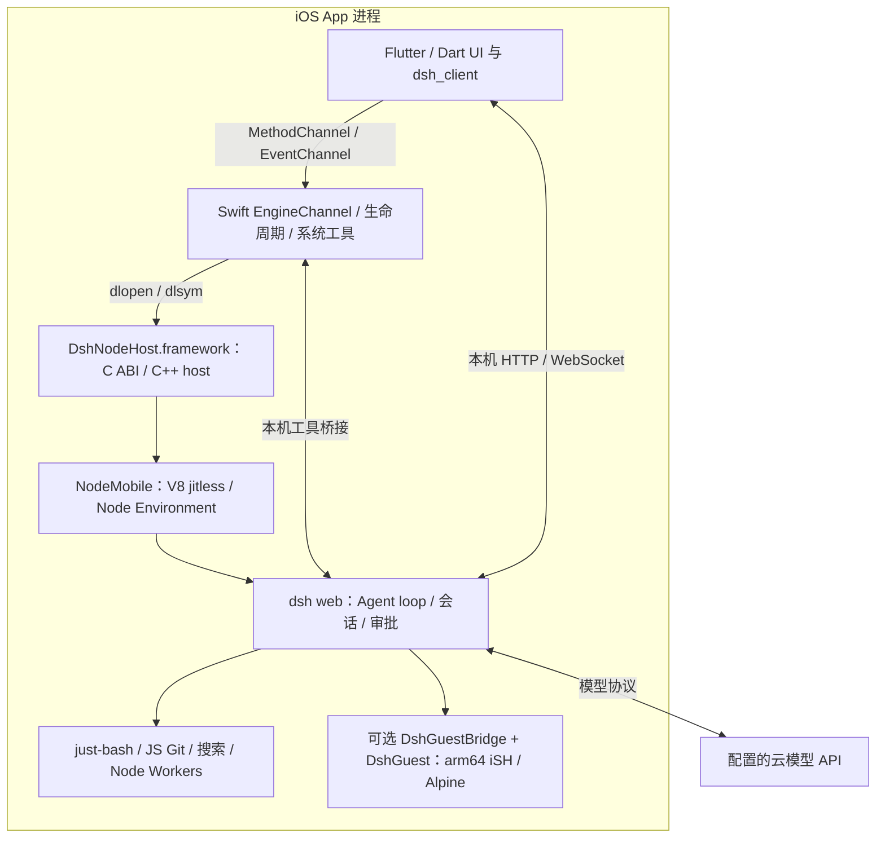

# dsh-Go iOS 分支：内嵌 Node、虚拟工具与可选 Linux guest

调研日期：2026-11-06（Asia/Taipei）。入口是 [issue #609](https://github.com/ccch1mneyyy/dsh-Go/issues/609)。本轮读取 issue、评论、两分支源码与 GitHub Actions 状态，并在本机运行 loader 的 4 项测试；没有安装 IPA、重签、调用真实云模型或执行 iPhone/iPad 真机测试。

固定源码：

- 上游 `ccch1mneyyy/dsh-Go` 的 `feat/ios-foundation`：`745cc73171287e606339969173b3dcd625847962`，提交时间 2026-11-06 16:08:46 +08:00。
- 个人 fork `Mingxi2077/dsh-go` 的 `ios/device-startup`：`5f72f5f52e36500af1954cbb36dd4743ca379d05`。issue 的核心修复是 `d9a695dafd73917b84b2c28bb5508826893000e0`；真机包并非当前最新上游产物。

## 1. 对此前结论的修正

**iOS 子分支已有本机引擎，不能继续概括为“dsh-Go 只有 Android 本机、iOS 待适配”。** 早先调研固定的主线 commit 描述 Android Ubuntu + Node + PRoot 路线；这个 iOS 分支采用不同实现：**NodeMobile 嵌入 App 进程，默认用虚拟 shell，最新上游还接入可选 arm64 iSH / Alpine guest。**

因此需要分别理解“执行 JS agent”“执行 shell 语义”“运行 Linux 工具”。iOS 上没有开放桌面式原生 `fork/exec`，但可以用解释器/兼容后端实现一部分命令能力。这是不同的技术路线，不能把“没有原生子进程”写成“任何 shell 都不可能”。

issue #609 也不是 iOS 架构的起点：上游已有 `feat/ios-foundation`，并在 `2ed25cf05f33280c52e930fbc10331ca6e42b323` 做了 addon framework 改造；fork 补充个人重签包的故障与真机验证。维护者随后用 `f8979c5a62757556f338fe43decf7f260c401b84` 增加路径与布局测试。[维护者回复](https://github.com/ccch1mneyyy/dsh-Go/issues/609#issuecomment-6673931343)

## 2. 基本架构：完整 Node 引擎在手机 App 进程内

这套方案不要求外部 Hub，但手机内仍有监听在 `127.0.0.1`、随机端口的 `dsh web` 服务。共享 HostCore 构造 `dsh-node --jitless --import ... dsh/lib/bin.js web --host 127.0.0.1 --port 0 --no-open`，前端继续复用 DSH 客户端协议。[HostCore 启动入口](https://github.com/ccch1mneyyy/dsh-Go/blob/745cc73171287e606339969173b3dcd625847962/app/ohos/entry/src/main/cpp/host_core.cpp#L295-L298)

Swift 首次启动时从 App Frameworks 目录 `dlopen` 宿主，使用 `dsh_host_start/stop/state/drain` 等 C 函数控制运行和取回事件。C ABI 用 JSON 传状态，避免把 C++ 类型交给 Swift；这与启动独立 Linux Node 可执行文件不同。[Swift NativeEngine](https://github.com/ccch1mneyyy/dsh-Go/blob/745cc73171287e606339969173b3dcd625847962/app/ios/Runner/EngineChannel.swift#L75-L160)、[C ABI 宿主](https://github.com/ccch1mneyyy/dsh-Go/blob/745cc73171287e606339969173b3dcd625847962/runtime/ios/host/ios_host.cc)

### Node 和 DSH 如何被打进 App

`prepare-engine.sh` 固定下载 `fogtape/nodejs-mobile` 的 `24.22.1-0` iOS xcframework 和 DSH 所需 addon 源码，校验 SHA256；先复用鸿蒙 `runtime/ohos` 的组合工具，再用 iOS specializer 生成 `runtime.zip`。构建机用的 Node 只负责准备资源，不会作为 Linux 可执行文件带进手机。[准备脚本](https://github.com/ccch1mneyyy/dsh-Go/blob/745cc73171287e606339969173b3dcd625847962/tooling/ios/prepare-engine.sh)

原生引擎与 addon 留在随 App 签名的 framework；JS runtime 随包压缩，安装时校验清单后解压到 App 私有数据目录。清单拒绝 `.node/.so/.dylib` 等原生文件进入可写 runtime 数据区。这里目录名 `runtime/rootfs` 不代表默认安装了 Ubuntu。[Runtime 清单与安装](https://github.com/ccch1mneyyy/dsh-Go/blob/745cc73171287e606339969173b3dcd625847962/app/ios/Runner/EngineRuntime.swift#L23-L76)

### 为什么能在 App 内运行、停止后再启动

Node runner 明确要求 `--jitless`，在专用 pthread 上运行，V8 与 Node 的进程级状态保留；每次启动创建新的 `CommonEnvironmentSetup` / Environment，执行 `LoadEnvironment` 和 `SpinEventLoop`。停止用 `node::Stop`，不是向独立 Node 子进程发 kill；下一次新建 Environment，因此不需要关闭整个 App。[Node runner](https://github.com/ccch1mneyyy/dsh-Go/blob/745cc73171287e606339969173b3dcd625847962/runtime/ios/host/node_runner.cc)

为复用鸿蒙适配，bootstrap 把 JS 可见的 `process.platform` 设为 `openharmony`、移除 `WebAssembly`，以选中同进程、无宿主子进程的运行路径。这是兼容路由，不能理解成 iOS 真正在运行鸿蒙。[平台 bootstrap](https://github.com/ccch1mneyyy/dsh-Go/blob/745cc73171287e606339969173b3dcd625847962/runtime/ios/host/node_runner.cc#L31-L44)

## 3. 默认工具：用 JS / Worker 实现命令，保持 Agent loop

| 能力 | 默认 iOS 路径 | 限制 |
| --- | --- | --- |
| Agent loop、HTTP、模型流、会话 | 真 Node 中运行 DSH，并接移动生命周期补丁 | 未证明全部桌面插件均兼容 |
| 文件读写 | App 沙箱中的 Node fs + 工作区路径校验 | 受 App 容器与授权根限制 |
| Bash / sh | `just-bash@3.6.0` 解析和执行命令语义 | 无完整 POSIX / 任意二进制保证；无 PTY，stdin 为批量 |
| Git | `isomorphic-git@1.44.9` 加自有命令适配 | 是明确支持的子集，不是系统 Git 全部行为 |
| 搜索 | JS 实现/适配的 rg 路径与正则构建产物 | 按支持范围执行，不加载 Linux rg ELF |
| `node script.js` | 当前 HEAD 有受控 Node Worker 路径 | 只支持指定脚本形式，校正 cwd/fs，不能创建 OS 子进程 |
| 原生 child_process | preload 拒绝 spawn/exec/fork 等 API | 不因嵌入 Node 而获得系统进程权限 |
| Python、任意 Linux CLI | 默认虚拟路径不提供 | 可选 guest 的具体程序另行判断 |
| stdio MCP / LibreOffice / 任意插件安装 | iOS specializer 明确限制或拒绝 | 不能据此宣称整个桌面生态原样迁移 |

依据：[命令与能力表](https://github.com/ccch1mneyyy/dsh-Go/blob/745cc73171287e606339969173b3dcd625847962/runtime/ohos/process/commands.mjs)、[Worker 虚拟执行器](https://github.com/ccch1mneyyy/dsh-Go/blob/745cc73171287e606339969173b3dcd625847962/runtime/ohos/process/runtime.mjs)、[Node 脚本 Worker](https://github.com/ccch1mneyyy/dsh-Go/blob/745cc73171287e606339969173b3dcd625847962/runtime/ohos/process/node-script.mjs)、[系统子进程拒绝](https://github.com/ccch1mneyyy/dsh-Go/blob/745cc73171287e606339969173b3dcd625847962/runtime/ohos/process/child-process.mjs)、[iOS specializer](https://github.com/ccch1mneyyy/dsh-Go/blob/745cc73171287e606339969173b3dcd625847962/tooling/ios/specialize-runtime.py#L29-L142)。复用文件名含 ohos，不影响它们经 specializer 成为 iOS runtime 的事实。

这正是它绕开 Ubuntu / PRoot 的主要工程工作：保留 DSH 的调度和工具接口，把不适合手机的执行后端替换掉。当前 sandbox 自报 `enforcement: partial`；路径检查/Worker 不能宣称是对任意代码的操作系统级隔离。[sandbox 契约](https://github.com/ccch1mneyyy/dsh-Go/blob/745cc73171287e606339969173b3dcd625847962/runtime/ohos/process/sandbox.mjs)

## 4. 最新上游的可选 Linux guest：超过 issue 原始反馈的新增能力

当前 `745cc731` 已有安装通道、路由、N-API 桥和 iSH 后端，不能只依据尚未更新的 README 中“只构建、未接入”文字下结论。

- 固定 `OpenMinis/ish-arm64@c5c264da19148512167aa493d7bd4e50aae1b74e`，JIT 关闭；生成 `DshGuest.framework`，经 `DshGuestBridge.framework` 暴露 N-API。它是 arm64 fork，不应套用经典 iSH 的 x86 描述。[源码固定](https://github.com/ccch1mneyyy/dsh-Go/blob/745cc73171287e606339969173b3dcd625847962/tooling/ios/ish/source.lock.json)、[构建输入](https://github.com/ccch1mneyyy/dsh-Go/blob/745cc73171287e606339969173b3dcd625847962/tooling/ios/ish/README.md)
- Swift installer 下载并验证固定的 **Alpine 3.24.4 aarch64**，发布 fakefs 的 `data/` 与 `meta.db`；不是 Ubuntu，也不使用 PRoot。只有安装完整、原生 owner 报告可用时，启动快照才允许进入 guest。[固定 rootfs 与校验](https://github.com/ccch1mneyyy/dsh-Go/blob/745cc73171287e606339969173b3dcd625847962/app/ios/Runner/GuestRootfsArchive.swift#L49-L57)、[启动接入](https://github.com/ccch1mneyyy/dsh-Go/blob/745cc73171287e606339969173b3dcd625847962/app/ios/Runner/EngineChannel.swift#L1012-L1034)
- Shell AST 先完整预判：已支持命令走虚拟 shell；需要 guest 且能证明可路由时，将整个脚本交给 guest；混合 Node Worker 与 Linux、无法判断的动态执行会拒绝，避免先执行半个脚本再切换。[路由规则](https://github.com/ccch1mneyyy/dsh-Go/blob/745cc73171287e606339969173b3dcd625847962/runtime/ios/guest/route.mjs#L234-L258)
- guest 执行仍经过原有审批产生的受限票据；只映射已授权工作区与临时目录，拒绝与凭据/引擎等保护路径交叠。iSH 内的进程、信号与文件系统属于 guest，不代表 iOS 宿主开放了 `fork/exec`。[Guest provider](https://github.com/ccch1mneyyy/dsh-Go/blob/745cc73171287e606339969173b3dcd625847962/runtime/ios/guest/provider.mjs)、[原生后端](https://github.com/ccch1mneyyy/dsh-Go/blob/745cc73171287e606339969173b3dcd625847962/runtime/ios/guest/native/guest_backend.c)
- 目前按串行 guest job 执行；取消要等待退出和资源清理的确认，失败会 fault/quarantine，不能仅凭收到 kill 请求就报完成。能力元数据仍是 `enforcement: partial`、`python: unknown`；Alpine minirootfs 不等于默认包含 Python。[队列和取消](https://github.com/ccch1mneyyy/dsh-Go/blob/745cc73171287e606339969173b3dcd625847962/runtime/ios/guest/channel.mjs)、[宿主能力快照](https://github.com/ccch1mneyyy/dsh-Go/blob/745cc73171287e606339969173b3dcd625847962/app/ios/Runner/EngineChannel.swift#L1023-L1034)

当前 CI 的 guest 场景是真实 guest `uname`、Alpine release、工作区读写、退出码 7、审批拒绝、循环取消后无后续写入、再执行任务。测试脚本对 Python 做存在性检查，不构成 Python 可用承诺；模型是 `startGuestModel` 提供的脚本模型。[脚本模型与命令](https://github.com/ccch1mneyyy/dsh-Go/blob/745cc73171287e606339969173b3dcd625847962/tooling/ios/engine-smoke/guest-model.mjs)、[验收场景](https://github.com/ccch1mneyyy/dsh-Go/blob/745cc73171287e606339969173b3dcd625847962/tooling/ios/engine-smoke/guest-drive.mjs#L267-L278)

如果考虑直接复用 iSH 代码，还应按它随产物提供的 GPLv3、源码与补丁要求评估工程分发方式；这与只借鉴 Node 嵌入架构是不同的复用范围。[iSH 构建与许可说明](https://github.com/ccch1mneyyy/dsh-Go/blob/745cc73171287e606339969173b3dcd625847962/tooling/ios/ish/README.md)

## 5. 手机工具、图片与后台

手机工具不交给虚拟 shell 假装执行。DSH 插件注册 `mcp__phone__*`、`mcp__browser__*`、`mcp__system__*`，通过本机桥接交给 Swift，Swift 负责确认和系统权限；bridge 有 runId、token 和单次动作状态。当前目录分别列出 13 / 11 / 8 个工具，列出不等于真机都已验收。[工具注册](https://github.com/ccch1mneyyy/dsh-Go/blob/745cc73171287e606339969173b3dcd625847962/runtime/ios/phone/plugin.mjs)、[桥接](https://github.com/ccch1mneyyy/dsh-Go/blob/745cc73171287e606339969173b3dcd625847962/runtime/ios/phone/bridge.mjs)

App 内网页操作走 WKWebView，提醒/联系人/定位/OCR 走系统 API。操作其他 App 的 PhoneRunner 是另一条测试自动化通路，依赖 Mac 启动持续 XCUITest，不能把它计入“无电脑的普通 iOS App”能力。[PhoneRunner 说明](https://github.com/ccch1mneyyy/dsh-Go/blob/745cc73171287e606339969173b3dcd625847962/tooling/ios/phone/README.md)

图片处理也做了平台替换：`ios-sharp.cjs` 适配原 sharp 调用，像素处理交给 ImageIO 原生 binding。由此可见，Node SDK 能加载只是迁移的一部分，原生依赖仍需逐项适配。[图像适配](https://github.com/ccch1mneyyy/dsh-Go/blob/745cc73171287e606339969173b3dcd625847962/runtime/ios/image/ios-sharp.cjs)

后台分两层：

1. 普通退后台用短暂 `beginBackgroundTask` 留时间记录暂停，更新 lifecycle，停止派发新工具；前台恢复后核查/重连。不是常驻服务。[普通后台](https://github.com/ccch1mneyyy/dsh-Go/blob/745cc73171287e606339969173b3dcd625847962/app/ios/Runner/EngineChannel.swift#L1281-L1308)
2. iOS 26+ 对用户在前台发起的 turn 申请 `BGContinuedProcessingTask`，策略为 `.fail`；系统同意才继续，系统过期/用户取消后本轮不再重试继续。进度显示与可继续运行不等于无限后台授权。[ContinuedRun](https://github.com/ccch1mneyyy/dsh-Go/blob/745cc73171287e606339969173b3dcd625847962/app/ios/Runner/ContinuedRun.swift)

Node runner 加了堆上限、接近上限时停本次 Environment 的处理，但 Buffer、原生分配和系统 jetsam 不在此保证范围。它还针对 NodeMobile 24.22.1-0 的 fd tracking 做补丁，未关闭的原始 fd 可能留到 App 退出。这些是当前嵌入式路线的维护成本，不能按桌面 Node 的行为直接推断。[runner 与资源处理](https://github.com/ccch1mneyyy/dsh-Go/blob/745cc73171287e606339969173b3dcd625847962/runtime/ios/host/node_runner.cc)

## 6. Issue #609 究竟修了什么

作者用旧基线生成未签名 Release IPA，再通过爱思 Apple ID 重签。原先 addon 以裸 `.so` 文件放在 Frameworks 下，重签产物未给它们正确签名，`process.dlopen` 因缺 cdhash / code signature 退出。这里的文件扩展名不能据此推断为 Linux ELF。

修复要求三处同步：

| 位置 | 新布局 / 处理 |
| --- | --- |
| 构建与嵌入 | 生成并签名 `DshFlock.framework/DshFlock` 与 `DshRequireBuiltin.framework/DshRequireBuiltin` |
| JS loader | 从两个 framework 的 executable 路径加载 addon |
| C++ 宿主 | 信任路径检查同步到相同布局，继续拒绝缺文件或越界链接 |

只换文件或只重签，宿主仍按旧路径检查就会报 `ERR_OHOS_NATIVE_LIBRARY_PATH`。前缀来自复用代码，不说明运行到了鸿蒙设备。runtime 版本也更新，旧安装须重新准备/安装。[原生构建](https://github.com/ccch1mneyyy/dsh-Go/blob/745cc73171287e606339969173b3dcd625847962/tooling/ios/build-engine-native.sh#L33-L84)、[嵌入与签名](https://github.com/ccch1mneyyy/dsh-Go/blob/745cc73171287e606339969173b3dcd625847962/tooling/ios/embed-engine.sh#L59-L96)、[specializer loader](https://github.com/ccch1mneyyy/dsh-Go/blob/745cc73171287e606339969173b3dcd625847962/tooling/ios/specialize-runtime.py#L75-L80)

## 7. 已验证与尚未验证

| 证据 | 能证明什么 | 不能证明什么 |
| --- | --- | --- |
| issue 作者的个人 fork 自签包：同一 iPad Air 5，iPadOS 18.7.7 / 26.7.2 | 该包引擎启动、停止/重启、HTTP 响应及部分冷启动反馈 | 作者明确未测真实模型；未重验最新上游包；白屏根因未确认；不是所有设备或正式分发验收 |
| 当前上游 745cc731 的 iOS compile：completed/success | simulator / device 编译、默认真实引擎/工具回合、停止恢复、App 内流程、unsigned Archive 检查 | 使用脚本模型，不证明真实云模型对话或签名发布 |
| 同一 compile 的 guest 工具步骤及 iOS guest workflow：success | 模拟器 guest 工具审批链与相关 guest 回归已通过 | 不证明 iPhone/iPad 真机 guest、Python全生态、性能或 App Store 审核 |
| 本轮本机 loader 4 项测试通过，Node 24.14.0 | 生成 loader 的 framework 路径、缺失/越界拒绝等逻辑 | 测试替代了 process.dlopen，不是 Mach-O 加载、签名或 iOS 运行测试 |

已直接查询的 CI：上游 [iOS compile 42185613696](https://github.com/ccch1mneyyy/dsh-Go/actions/runs/42185613696) 与 [iOS guest 42185613684](https://github.com/ccch1mneyyy/dsh-Go/actions/runs/42185613684)，head SHA 均为 `745cc731...`，截至读取时均 completed/success。这比 issue 评论中“f897 CI 还在跑”的时间点更新。

Archive workflow 明确关闭 codesign；成功表示结构/依赖检查通过，不代表已上传 TestFlight 或通过 App Store 审核。[Archive 检查](https://github.com/ccch1mneyyy/dsh-Go/blob/745cc73171287e606339969173b3dcd625847962/tooling/ios/check-archive.sh#L20-L22)

## 8. 对 Super-LOOI / NSH 的适用判断

**这个分支证明“iOS App 内可以承载真实 Node / DSH 引擎与工具循环”，使内嵌 Node 成为我们应比较的候选。** 它没有证明“桌面 DSH 全部依赖不经适配就能上手机”。本项目现在是 Pi，而不是 DSH，不能照搬整套 specializer 后就认为 Pi 验证完成。

| 路线 | 对我们的含义 |
| --- | --- |
| NSH QuickJS 内直接接 Pi core | JS 引擎较少；继续做 SDK / globals / imports 兼容验证 |
| NSH 界面 + 原生宿主 + 内嵌 NodeMobile / Pi | UI 与 Agent 使用各自引擎，可能减少 Node SDK 适配；增加第二个 JS runtime、桥接、内存、签名及生命周期成本；仍需移除宿主 child_process 假设 |
| 再加入 iSH / Alpine guest | 面向明确需要 Linux CLI 的功能；不是陪伴、家居、BLE 的前置依赖，需单独验收工具/许可/性能/真机 |

以上是结合源码的架构推断，未在 NSH / Super-LOOI 中实现或验证。我们最值得借鉴的是：App 级引擎生命周期、宿主与工具接口分离、原生 addon 随包签名、真实审批链及 unknown 副作用恢复；虚拟 shell 或 guest 按实际产品需求选用。

豆包 PCM 全双工、BLE、相机和机器人的原生媒体/绘制需求仍需我们自己验证。该分支系统听写或手机工具成功不能替代这些验收。普通核心路径保持“无自建服务端、手机直连云 API”，操作其他 App 的 Mac runner 不纳入该承诺。

独立审查已完成，主 agent 修正两处源码行锚。原有应用代码与四个语音相关未提交文件未改动。
