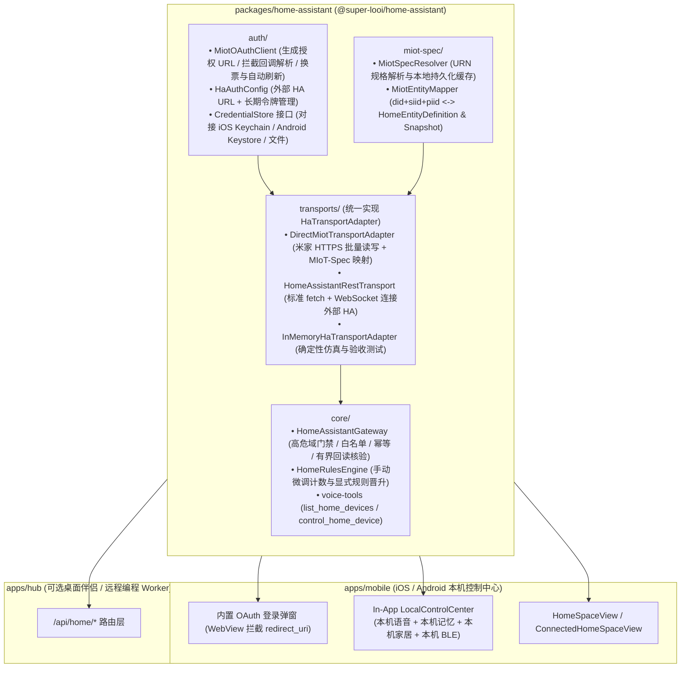

# 智能家居与本机控制中心：iOS/Android 跨平台运行时调研与 `@super-looi/home-assistant` 独立包架构

调研与修订日期：2026-11-06
演进结论：**放弃在手机内塞入 `PRoot + Linux + Python 3.14 + Home Assistant Core` 容器的重型路线；转向“跨平台本机原生控制中心（In-App Local Control Center）+ `@super-looi/home-assistant` 独立包（含米家 OAuth 登录与 MIoT 直连驱动）”架构，一套纯 TypeScript 核心同时打通 iOS 与 Android。**

---

## 1. 核心决策与第一性原理重构

### 1.1 从“搬运 Linux 容器”回到“让控制中心在本机直接处理”

初版调研曾参考 `dsh-Go` 探讨在 Android 内通过 `PRoot + Ubuntu ARM64 rootfs + Python 3.14` 运行完整的 Home Assistant Core 进程。但深入审视 iOS 可行性与本仓库代码后，我们识别出原路线的根本偏差——**把“手段”（在手机里跑一个完整的 Linux Home Assistant 服务器）当成了“目的”（让手机脱离电脑，在本机独立完成语音、记忆、具身与智能家居控制）。**

结合仓库现状与底层协议拆解，确立以下三项核心架构决策：

1. **iOS 与 Android 双端统一走“进程内原生控制中心（In-App Local Control Center）”**：
   - 非越狱 iOS 因 XNU 内核 ABI、强制代码签名（`CS_HARD`/`CS_KILL`）、W^X 内存保护与沙盒禁 `fork()`/`posix_spawn()`，无法运行 `PRoot + Linux ELF`；即便通过 PEP 730 嵌入 iOS 原生 CPython，也会被 HA 的动态 C/Rust 扩展、`psutil`/网卡沙盒限制以及后台挂起持有 SQLite 锁触发 `0xdead10cc` 强杀所阻断。
   - 反观 Super-LOOI 的控制中心能力（家居安全网关、米家云/局域网协议、全双工豆包语音、个人记忆账本、BLE 具身底座），**本质上全部是标准网络协议（HTTPS / WSS / MQTT / UDP）与纯 TypeScript 状态机**，完全不需要 Linux 容器或 Python 解释器。
2. **将智能家居与米家登录/驱动抽离为独立 Monorepo 包 `@super-looi/home-assistant`（`packages/home-assistant`）**：
   - 剥离现有 [`apps/hub/src/home/*`](../apps/hub/src/home/gateway.ts) 对 Node 专属模块（如 `node:util`、`node:timers/promises`、`ws`、Fastify）的耦合，沉淀为**零 Node 强绑定、跨平台（React Native Hermes / Web / Node.js 通用）的独立包 `@super-looi/home-assistant`**。
   - 包内将**认证登录（OAuth 2.0 会话与令牌生命周期）**、**协议传输（`DirectMiotTransportAdapter` 米家直连 / `HomeAssistantRestTransport` 外部 HA REST+WS / `InMemoryHaTransportAdapter` 仿真）**与**安全网关（`HomeAssistantGateway` + `HomeRulesEngine` + 语音工具）**解耦封装。
3. **App 内置 WebView 导航拦截，根治 `homeassistant.local:8123` OAuth 回调痛点**：
   - 小米官方 OAuth 将 `redirect_uri` 固定为 `http://homeassistant.local:8123/api/webhook/...`。
   - 在移动端使用内置 `WebView`（iOS `WKWebView` / Android `WebView`）发起登录，通过 `onShouldStartLoadWithRequest` 在**系统发起 DNS 解析与网络连接前**直接拦截 302 跳转 URL，提取 `code` 与 `state` 完成本机换票并存入系统安全凭据库（iOS Keychain / Android Keystore），彻底消除 8123 端口监听、mDNS 广播与局域网同名冲突问题。

---

## 2. 为什么“内置 Linux / Python HA 容器”在 iOS 上不可行（对比分析）

我们对“在手机内跑 Home Assistant Core”与“跨平台原生 `@super-looi/home-assistant` 包”进行了底层技术对比：

| 维度 | 路线 A：`PRoot + Linux rootfs + HA Core`（初版 Android 草案） | 路线 B：iOS 进程内嵌入 CPython 3.14 + HA Core | 路线 C：`@super-looi/home-assistant` 独立包 + 本机原生控制中心（选定方案） |
| :--- | :--- | :--- | :--- |
| **iOS 可行性** | **不可行（0%）**。iOS 为 XNU/Darwin 内核 + Mach-O 格式，不兼容 Linux ELF 系统调用；沙盒禁止 `fork`/`execve`；可写目录解压二进制违反强制代码签名（触发 `SIGKILL`）。 | **极低（工程倒挂）**。禁止运行时 `pip` 加载未签名 `.so`/`.dylib`；`xiaomi_home` 依赖的 `psutil`、`ffmpeg` 子进程在 iOS 沙盒报 `EPERM`；挂起时持有 SQLite WAL 锁会被系统 `0xdead10cc` 强杀。 | **100% 原生支持**。纯 TypeScript + 标准 `fetch`/`WebSocket` + 原生 Keychain/文件存储，直接运行在 React Native (Hermes) 主进程内。 |
| **Android 可行性** | 需锁定 `targetSdk=28` 绕过 W^X 限制或将二进制伪装进 `jniLibs`，与现代 Expo 56 / RN 0.85 及 Google Play 要求冲突。 | 需交叉编译数十个 C/Rust wheel（`cryptography`、`orjson`、`aiohttp` 等）并魔改 HA 包管理器。 | **100% 原生支持**。与 iOS 共用同一套 `@super-looi/home-assistant` 代码，完全兼容现代 `targetSdk`。 |
| **包体积与内存开销** | 安装包/解压膨胀 **500MB~1.2GB**；常驻内存 **350MB~800MB**。 | 预编译全部原生扩展框架膨胀 **200MB+**；常驻内存 **250MB+**。 | 代码体积 **< 100KB**；运行时内存开销 **< 10MB**，零额外发热。 |
| **冷启动与唤醒恢复** | 解压首装需数十秒；每次进程被杀后冷启动 HA 需 **20~60 秒**。 | 解释器初始化与 1121 实体加载需 **10~30 秒**。 | **毫秒级启动**；App 从后台唤醒后批量刷新 45 台设备状态仅需 **~200ms**。 |
| **米家 OAuth 登录体验** | 极差：需在手机广播 mDNS `homeassistant.local` 并开放 8123 端口，极易与局域网已有 HA 冲突或被系统浏览器 DNS 忽略。 | 同左，且 iOS 绑定 mDNS 组播需额外申请 Apple 特殊 Entitlement。 | **原生丝滑一键登录**：App 内置 WebView 在 DNS 解析前直接拦截回调 URL 提取 `code`，零端口暴露、零 mDNS 依赖。 |

---

## 3. 底层拆解：为什么不需要 HA Core 就能在手机本机直控米家？

审阅本仓库已部署的米家官方集成源码（[`data/home-assistant/custom_components/xiaomi_home/miot/`](../data/home-assistant/custom_components/xiaomi_home/miot/miot_cloud.py)）与 Hub 家居模块（[`apps/hub/src/home/`](../apps/hub/src/home/gateway.ts)）可以确认：

### 3.1 Super-LOOI 的家居安全策略本就是 100% 纯 TypeScript

在 [`HomeAssistantGateway` (`apps/hub/src/home/gateway.ts`)](../apps/hub/src/home/gateway.ts) 与 [`HomeRulesEngine` (`apps/hub/src/home/rules-engine.ts`)](../apps/hub/src/home/rules-engine.ts) 中，Super-LOOI 所需的全部核心业务逻辑已经由纯 TypeScript 实现：
- **安全红线门禁**：物理隔离 `lock`、`alarm_control_panel`、`gas`、`water_heater`、`garage_door` 五大高危域（[`FORBIDDEN_HIGH_RISK_DOMAINS`](../apps/hub/src/home/gateway.ts#L13-L19)）。
- **白名单与幂等纪律**：拒绝非幂等的 `toggle` 指令，强制显式目标状态（`turn_on` / `turn_off`）与参数边界校验（亮度 `1..255`、色温 `2200..6500K`）。
- **新鲜 No-op 短路与真实回读核验**：状态在有效期内已匹配目标时直接返回 `noop`；控制指令下发后轮询真实设备回读，仅当回读匹配且时间戳更新时才签发 `verified / applied`，绝不将 HTTP 200 当作物理执行成功。
- **多源证据诚实调和**：视觉观测（VLM）与物理传感器/回读冲突时并存保留，环境数值（温湿度/CO₂/PM2.5）强制仅从传感器实体读取。

目前 [`gateway.ts`](../apps/hub/src/home/gateway.ts#L1-L2) 中仅有两处轻量 Node 内置引用（`node:util` 的 `isDeepStrictEqual` 与 `node:timers/promises` 的 `setTimeout`），替换为零依赖的跨平台工具函数后，即可 100% 在 React Native (iOS/Android) 中直接运行。

### 3.2 `ha_xiaomi_home` 的底层实质是标准 HTTPS + MIoT-Spec 协议

剖析 [`miot_cloud.py`](../data/home-assistant/custom_components/xiaomi_home/miot/miot_cloud.py)、[`miot_spec.py`](../data/home-assistant/custom_components/xiaomi_home/miot/miot_spec.py) 与 [`const.py`](../data/home-assistant/custom_components/xiaomi_home/miot/const.py)，米家集成不依赖任何 Linux 内核特性，其核心链路仅由以下 5 个标准步骤构成：

1. **OAuth 2.0 授权与令牌刷新（[`MIoTOauthClient`](../data/home-assistant/custom_components/xiaomi_home/miot/miot_cloud.py#L74-L239)）**：
   - 授权地址：`https://account.xiaomi.com/oauth2/authorize?redirect_uri=http://homeassistant.local:8123/api/webhook/...&client_id=2882303761520251711&response_type=code&device_id=ha.<uuid>&state=<sha1>`
   - 换取/刷新 Token：`GET https://ha.api.io.mi.com/app/v2/ha/oauth/get_token?data=<json>`，返回 `access_token`、`refresh_token` 与 `expires_in`。
2. **家庭与房间拓扑获取（[`get_homeinfos_async`](../data/home-assistant/custom_components/xiaomi_home/miot/miot_cloud.py#L480-L556)）**：
   - `POST https://ha.api.io.mi.com/app/v2/homeroom/gethome`，获取家庭列表、房间名称（`room_name`）及房间下的设备 `dids` 映射。
3. **设备清单与模型发现（[`__get_device_list_page_async`](../data/home-assistant/custom_components/xiaomi_home/miot/miot_cloud.py#L561-L633)）**：
   - `POST https://ha.api.io.mi.com/app/v2/home/device_list_page`，返回每台设备的 `did`、`name`、`model`、`spec_type`（MIoT-Spec URN，如 `urn:miot-spec-v2:device:light:0000A001:...`）、`isOnline` 及局域网 `token` / `local_ip`。
4. **MIoT-Spec-V2 模型规格解析（[`miot_spec.py`](../data/home-assistant/custom_components/xiaomi_home/miot/miot_spec.py)）**：
   - 根据设备的 `urn` 查询规格定义（支持缓存至手机本地存储），将标准服务（如 `light`、`fan`、`switch`、`environment`）映射为具体的 `{ siid, piid }`、读写权限及数值范围（如色温范围 `[2700, 6500]`、亮度范围 `[1, 100]` 与网关 `1..255` 的归一化换算）。
5. **批量属性读取与控制下发（[`get_props_async` / `set_prop_async`](../data/home-assistant/custom_components/xiaomi_home/miot/miot_cloud.py#L736-L858)）**：
   - 批量读取：`POST https://ha.api.io.mi.com/app/v2/miotspec/prop/get`（单次支持最多 150 个 `{ did, siid, piid }` 批量查询）。
   - 属性写入：`POST https://ha.api.io.mi.com/app/v2/miotspec/prop/set`（传入 `[{ did, siid, piid, value }]`）。
   - 动作触发：`POST https://ha.api.io.mi.com/app/v2/miotspec/action`。

---

## 4. `@super-looi/home-assistant` 独立包架构设计

在 Monorepo 的 `packages/` 下新建 **`packages/home-assistant`（`@super-looi/home-assistant`）**，与 `@super-looi/contracts`、`@super-looi/looi-driver` 并列，供 `@super-looi/mobile`（iOS/Android 本机）和 `@super-looi/hub`（桌面端）共同消费。



### 4.1 目录结构设计

```text
packages/home-assistant/
├── package.json
├── tsconfig.json
├── src/
│   ├── index.ts                      # 统一导出核心类、Adapter、登录模块与类型
│   ├── types.ts                      # HaTransportAdapter, CredentialStore, ConnectionStatus 等接口
│   ├── core/
│   │   ├── gateway.ts                # 跨平台版 HomeAssistantGateway（零 node:* 依赖）
│   │   ├── rules-engine.ts           # HomeRulesEngine
│   │   └── voice-tools.ts            # HOME_VOICE_TOOLS 与 executeHomeVoiceTool
│   ├── auth/
│   │   ├── miot-oauth.ts             # 米家 OAuth2 授权 URL 构造、回调 URL 拦截解析、Token 换取与刷新
│   │   └── token-manager.ts          # 令牌过期预判（0.7 比例自动续期）与 CredentialStore 抽象
│   ├── miot/
│   │   ├── miot-http-client.ts       # 米家云 HTTPS 接口封装（gethome / device_list / prop/get / prop/set）
│   │   ├── miot-spec-resolver.ts     # MIoT-Spec-V2 拉取、解析与 StorageCache 注入
│   │   └── miot-entity-mapper.ts     # 将米家设备与属性映射为 Super-LOOI 的 HomeEntityDefinition 与 Snapshot
│   └── transports/
│       ├── direct-miot-transport.ts  # DirectMiotTransportAdapter（手机本机直连米家，无需 HA 实例）
│       ├── ha-rest-transport.ts      # HomeAssistantRestTransport + 跨平台 WebSocket 注册表读取
│       └── in-memory-transport.ts    # InMemoryHaTransportAdapter
└── test/
    ├── gateway.test.ts
    ├── miot-oauth.test.ts
    ├── direct-miot-transport.test.ts
    └── ha-rest-transport.test.ts
```

### 4.2 独立登录模块（`auth/miot-oauth.ts`）的设计细节

针对小米 OAuth2 回调地址固定为 `http://homeassistant.local:8123` 的限制，`MiotOAuthClient` 提供纯函数式的回调拦截器，天然适配 iOS / Android：

1. **生成登录会话 (`beginAuthSession`)**：
   - 生成唯一 `deviceId = ha.<uuid>` 与 `state = sha1("d=" + deviceId)`，构造完整的 `https://account.xiaomi.com/oauth2/authorize?...` 地址。
2. **拦截回调请求 (`tryInterceptCallbackUrl(url)`)**：
   - 在移动端 WebView 的 `onShouldStartLoadWithRequest`（或桌面端收到回调 URL）时调用。
   - 只要检测到目标 URL 匹配 `http://homeassistant.local:8123/api/webhook/...`，立即阻止浏览器实际发起网络请求（无需 DNS 解析 `homeassistant.local`），校验 `state` 一致后提取 `code`。
3. **换取并持久化凭据 (`completeAuthWithCode(code)`)**：
   - 直接请求 `https://ha.api.io.mi.com/app/v2/ha/oauth/get_token` 获取 `access_token`、`refresh_token`、`expires_in`，通过注入的 `CredentialStore`（iOS Keychain / Android Keystore）安全保存，并在剩余有效期低于 30% 时自动静默续期。

---

## 5. 全景架构：iOS / Android 跨平台本机原生控制中心

当 `@super-looi/home-assistant` 独立成包后，Super-LOOI 移动端（`@super-looi/mobile`）不再只是一个“远程遥控器 UI”，而是可以在手机本机独立闭环的 **Local Control Center（本机控制中心）**：

| 控制中心子系统 | 本机运行形态（iOS & Android 通用） | 对外依赖与退化边界 |
| :--- | :--- | :--- |
| **1. 家居控制中心**<br>(`@super-looi/home-assistant`) | 进程内直接运行 `HomeAssistantGateway`。<br>支持三种连接模式热切换：<br>① **本机米家直连 (`direct_miot`)**：手机直连米家云，零外部主机；<br>② **外部 HA 实例 (`external_ha`)**：连接局域网 Mac mini / NAS 上的 HA；<br>③ **本地演示 (`simulation`)**：离线安全演练。 | 网关回执纪律不变：未收到真实回读一律标记 `unverified`，断网恢复绝不自动重放旧控制指令。 |
| **2. 实时全双工语音**<br>(`DoubaoVoiceSession` + `LoopbackSuppression`) | 手机端本机直连豆包 Duplex WSS（省去 `手机 -> Mac Hub -> 豆包` 的局域网中转跳数），本机直接触发 `list_home_devices`、`control_home_device`、`remember_fact`、`recall_memory` 工具调用。 | 若配置了远程 Hub 也可切换回 Hub 代理模式；本机模式下端到端语音延迟降低 30~80ms。 |
| **3. 个人记忆与证据账本**<br>(`PersonalMemoryStore` + `MemoryLedgerService`) | 基于 `expo-file-system`（`Paths.document`）在手机沙盒内持久化 JSON 状态，支持本机零心智记住、检索、遗忘与代际墓碑校验。 | 手机离线或出门在外时，个人记忆与回忆册依然 100% 可读写。 |
| **4. 具身底座与视觉观察**<br>(`@super-looi/looi-driver` + `DockedLongevitySupervisor`) | 本机 CoreBluetooth / BLE 直连 LOOI 底座，`<100ms` 脱座急停与热阶梯降级在手机端闭环。 | 物理运动最高优先级，不受任何网络或家居请求阻塞。 |
| **5. 电脑生产力副驾 (DSH)**<br>(`DshAgentExecutor`) | **按职责分层**：日常问答、记忆、家居编排在手机本机直接完成；涉及电脑代码仓库与终端命令（`git` / `pnpm`）的任务，按需派发给可选的桌面 Hub Worker。 | 当桌面 Hub 关闭时，仅“远程电脑终端任务”提示电脑离线，**语音、记忆、家居与具身陪伴在手机本机 100% 独立可用**。 |

---

## 6. iOS 与 Android 生命周期及合规边界

### 6.1 生命周期与持久化契约

1. **磁吸驻座常亮态（Docked Mode — 主力全功能形态）**：
   - 当手机磁吸在 LOOI 无线充底座上并启用 `expo-keep-awake`（iOS `isIdleTimerDisabled = true`）时，App 处于前台活跃态，iOS 与 Android 均赋予 100% 持续的网络、蓝牙、麦克风与定时器权限，不会被系统挂起。
   - 由于摒弃了笨重的 Linux/Python 容器，本机控制中心仅占用极少内存（<15MB），配合现有的 OLED 像素微偏移与热阶梯守护器（[`DockedLongevitySupervisor`](../apps/mobile/src/shell/longevity-supervisor.ts)），适合 7×24 小时驻座运行。
2. **离座锁屏 / 切后台态（Background & Instant Resume）**：
   - **LIVE 语音进行中**：通过 `UIBackgroundModes: ["audio", "bluetooth-central"]`（iOS）及前台音频服务（Android）保持会话不断连。
   - **静默锁屏挂起与毫秒级恢复**：非语音状态下锁屏允许系统正常挂起进程以节省电量（无需后台空转轮询）；当用户再次点亮屏幕或放回底座时，`DirectMiotTransportAdapter` 直接使用本地缓存的家庭/设备拓扑与 Token 发起一次批量属性读取（`/app/v2/miotspec/prop/get`），**200~500ms 内即可完成全屋状态刷新**，且绝不触发 iOS `0xdead10cc` SQLite 锁崩溃。

### 6.2 凭据安全与开源/商业许可边界

- **本机凭据安全**：米家 `access_token` / `refresh_token`、外部 `HA_TOKEN` 以及模型 API Key 严禁硬编码或写入公开缓存，统一通过 `CredentialStore` 存入系统级安全存储（iOS Keychain / Android Keystore），且默认排除在系统自动云备份之外。
- **小米接口许可边界**：如 [`miot/const.py`](../data/home-assistant/custom_components/xiaomi_home/miot/const.py#L5-L15) 源码许可头所示，小米 `ha_xiaomi_home` 及其关联云端接口的 `OAUTH2_CLIENT_ID` 授权范围限定为个人非商业用途。因此：
  - `DirectMiotTransportAdapter` 适用于**个人自用 / 开发者本机独立运行**验证；
  - 面向公众的商业化 App Store 分发时，`@super-looi/home-assistant` 可通过同一套 `HaTransportAdapter` 切换至用户自建 HA 实例（`HomeAssistantRestTransport`）或扩展 iOS 原生 **Apple HomeKit (`HMHomeManager`) / Matter** 适配器。

---

## 7. 实施路线图（替代原 PRoot P0–P5 计划）

| 阶段 | 目标产物 | 验收标准 |
| :--- | :--- | :--- |
| **Phase H1：抽离 `@super-looi/home-assistant` 核心与外部 HA 适配器** | 建立 `packages/home-assistant`，迁入 `HomeAssistantGateway`、`HomeRulesEngine`、`voice-tools`、`InMemoryHaTransportAdapter` 与跨平台版 `HomeAssistantRestTransport`（零 `node:*` / `ws` 强耦合）；`apps/hub` 改为引用该包。 | 全仓 `pnpm build`、`typecheck`、`test` 100% 通过；Hub 现有家居接口与 48 项核心验收回归全绿。 |
| **Phase H2：实现米家独立登录（`MiotOAuthClient`）与本机直连驱动（`DirectMiotTransportAdapter`）** | 在 `@super-looi/home-assistant` 内实现 `MiotOAuthClient`（支持拦截 `homeassistant.local:8123` 回调 URL 换票与自动刷新）、`MiotHttpClient`、`MiotSpecResolver`（含属性与亮度/色温范围映射）及 `DirectMiotTransportAdapter`。 | 单元测试覆盖 OAuth 回调解析、Token 续期、45 台设备/1121 实体规模下的批量状态读取、白名单控制与有界回读确认。 |
| **Phase H3：移动端接入本机家居控制与米家登录流（iOS 优先）** | `apps/mobile` 直接引入 `@super-looi/home-assistant`，提供“本机直连米家 / 连接外部 HA / 离线演示”切换与登录引导；关闭 Mac 上的 Docker HA 后，iOS 模拟器/真机仍能直接完成米家设备读取与控制。 | 关闭桌面 Docker HA，在 iOS 端直接通过 `@super-looi/home-assistant` 读取真实米家设备状态并完成回读验证。 |
| **Phase H4：本机控制中心全闭环（In-App Local Control Center）** | 将 `PersonalMemoryStore` 与 `DoubaoVoiceSession` 语音工具桥接同步接入移动端本机运行时，实现在**完全关闭 Mac Hub** 的情况下，iOS 本机独立完成“LIVE 语音对话 + 个人记忆存取 + 米家设备查询与控制”。 | Mac Hub 与 Docker HA 全部停止时，iOS 模拟器/真机可独立进行语音对话、记忆读写与家居控制。 |
