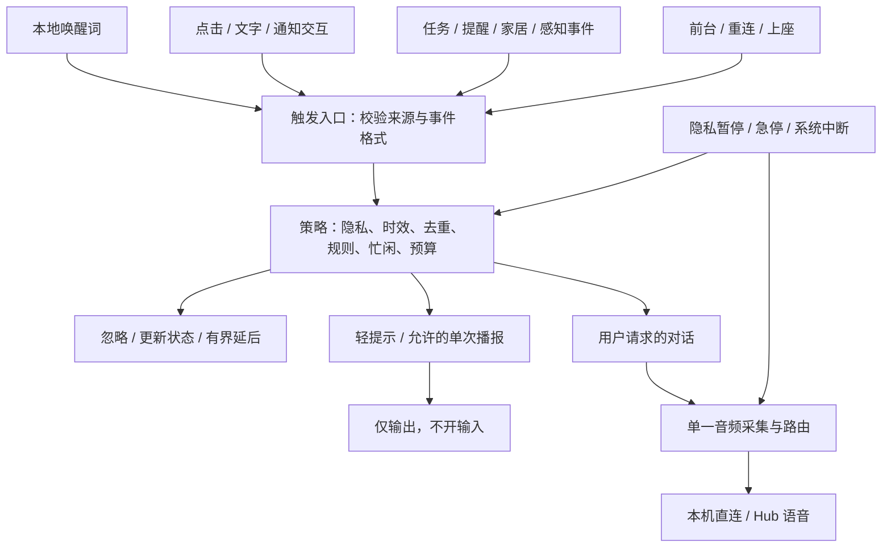

# Super-LOOI 智能唤醒与事件介入方案

日期：2026-11-06。状态：设计完成、尚未实施。本文的阈值均为初始产品目标，不是已测性能。

## 1. 决策与范围

把“唤醒”拆成两个独立问题：**什么事情值得处理，以及处理结果是否值得打扰用户**。统一入口，分别管理计算、屏幕、扬声器和麦克风。事件到达不等于开启语音，更不等于获得执行授权。

首版场景是手机放在 LOOI 上、App 在前台、用户主动开启陪伴监听。保留手动 LIVE 入口，先完成本地唤醒词与确定性事件规则，再做可选主动搭话。后台/锁屏常听、任意一句话免唤醒、声纹身份识别均不作为首版交付条件。屏幕调暗仍属 App 前台，区别于操作系统锁屏。

### 触发分类与默认行为

| 类别 | 示例 | 触发依据 | 默认介入 | 默认打开对话上行 |
| --- | --- | --- | --- | --- |
| 唤醒词 | “Hey LOOI，台灯开一下” | 本地 KWS（关键词检测）命中，策略允许 | 眼神/光效确认，连接语音会话 | 是，就绪后开口；连说模式单独启用 |
| 显式交互 | 点击 LIVE、输入文字、点击通知的“和我聊聊” | 可验证的用户操作 | 按具体入口进入语音或文字 | 仅语音入口打开 |
| 对话续接/打断 | 回复追问、在回答后继续说、点击打断 | 已有对话的有界窗口 | 继续当前会话，不重复唤醒 | 窗口内允许；语音打断另设验收门槛 |
| 确定性事件 | 提醒到点、任务完成、家居状态持续越界 | 已订阅事件 + 已启用规则 | 卡片/轻提示；预先允许时简短播报 | 否 |
| 感知与主动搭话 | 看见用户回到桌边、房间变化、推测用户需要帮助 | 观察证据 + 可选策略 | 默认只更新状态；主动搭话默认关闭 | 否；用户明确回应后才进入对话 |
| 运行恢复 | App 回前台、BLE/网络重连、重新上座 | 生命周期与连接状态 | 恢复此前允许的待机能力 | 不自动恢复旧对话/旧指令 |
| 安全中断 | 脱座、急停、隐私暂停、严重热压力 | 本地硬件/系统信号 | 立即停止相关能力，必要时提示 | 否；优先级高于其他触发 |

VAD 只说明“可能有人说话”，RMS 只说明音量变化，两者不能证明用户在呼叫 LOOI。唤醒词也不能证明说话者身份，更不能代替敏感操作授权。

## 2. 当前代码事实与可复用部分

- [首页](../apps/mobile/app/index.tsx)：点击 LIVE 才执行 `client.start()`；离开前台执行 `stop()`；“Hey LOOI”仍是提示文案。`use-wake-guide.ts` 仅持久化引导是否隐藏。
- [LiveVoiceClient](../apps/mobile/src/runtime/live-voice-client.ts)：有录音、PCM 上行、回复播放、手动 `bargeIn()`；提供 `enableNativeMic: false` 和外部 `pushFloat32MicSamples()` 接口，可作为单一采集管道的接入点。当前播放期间的 `speakerUntil` 会拦截上行，不能宣称已实现可靠外放语音打断。
- [LocalVoiceSocket](../apps/mobile/src/runtime/local-voice-socket.ts)：本机直连豆包，不依赖 Mac Hub；`session.created` 后才可用。当前 `LiveVoiceClient` 在 WebSocket 打开后较早进入 listening，后续须统一为“上游就绪且采集成功”才显示正在听。
- [ContextTriggerBus](../apps/hub/src/memory/context-engine.ts)：已有内存队列、默认 3000ms 后台频控和 400ms 同类合并，当前主要见于测试/验收代码；不是全产品运行中的唤醒管理器。`priority: high` 被视作 explicit，同 kind 合并未区分 source，不能直接拿来做可信用户意图或权限判断。
- [PresenceStateManager](../apps/mobile/src/shell/presence-state.ts)、[LightToastQueue](../apps/mobile/src/ui/light-toast-queue.ts)、[长稳监督器](../apps/mobile/src/shell/longevity-supervisor.ts)：可复用隐私纪元、导航守卫、延迟轻提示和降级接口。状态对象中的“麦克风 on / 缓冲 cleared”不是原生硬件回执，接入时需补实际证据。
- [LocalControlCenter](../apps/mobile/src/runtime/local-control-center.ts) 有配置/记忆订阅和家居状态读取；订阅不等于米家实时设备推送。[HomeRulesEngine](../packages/home-assistant/src/core/rules-engine.ts) 有规则提议与确认原型，尚不是持久调度及事件执行服务。

历史 Phase 11 中“VAD 唤醒已完成”的描述在本设计中更正为：已接通手动启动的语音链路，未接通待机唤醒词、统一事件介入与真实后台常听。

## 3. 统一架构

共享 TypeScript 策略放入拟新增的 `packages/presence-runtime`，保持浏览器/RN/Node 可用；契约放入 `packages/contracts`。Mobile 执行本机策略，Hub 处理其负责的任务与事件，通过适配器传递给设备。本机模式完整运行，不引入 Hub 硬依赖。首版指定一个播报设备，其他端只同步卡片；多设备自动争抢响应后续再做。

拟新增模块职责：

| 模块 | 职责与边界 |
| --- | --- |
| `TriggerIngress` | 适配来源、校验 scope/账号/代际/时间；外部 payload 不能自称用户操作或紧急事件 |
| `WakeCoordinator` | 串行接纳唤醒、会话代际、取消、超时；同时最多一个活跃语音会话 |
| `AttentionPolicy` | 纯函数输出忽略、更新、延后、提示、播报或对话及原因；不调用 LLM 决定隐私开关 |
| `AudioCaptureRouter` | 独占原生麦克风；重采样、连续帧编号、KWS、内存缓冲、对话路由 |
| `WakeWordDetector` | 推理适配器；只返回命中与音频位置，不自行录音或联网 |
| `EventRuleRuntime` | 规则状态、迟滞、去重、持久调度/待交付事件；不把规则转换成虚构的用户命令 |
| `NotificationPresenter` | 卡片/提示/仅输出播报；与对话输入开关分离，不调用默认开麦的 `start()` |

旧 `ContextTriggerBus` 保留原上下文收集职责，迁移去重/限流时复用契约，避免并存两个拥有最终介入决定权的控制器。

### 事件与决策契约

`TriggerEvent` 至少含 `eventId`、`kind`、`sourceId`、`scopeId`、`observedAt`、`receivedAt`、`expiresAt`、`dedupeKey`、`correlationId`、`runtimeGeneration`、`evidenceRef`；有感知音频时必须携带 `captureEpoch`，有规则时携带 `ruleId/ruleRevision`。按来源类型使用可校验的联合类型，原始音频不进入事件 JSON。

`AttentionDecision` 返回 `effect: ignore | update | defer | notify | announce | converse`、`reasonCode`、`expiresAt`，以及独立的 `inputPermission: none | current_turn | followup_window` 和 `outputPermission`。输入、输出、工具执行、身体运动各自检查授权；优先级不是授权。唤醒词命中只是对话候选，只有后续明确语音意图才可形成 `voice_command` 操作引用。

设备内窗口使用单调时钟；跨设备使用带 TTL 的 UTC 时间并检查时钟偏差。事件 ID/规则代际用于幂等，音频序号用于连续性。先校验、去重，再合并，最后频控；不同设备/账号/实体不按同一种 kind 误合并。

## 4. 唤醒词与对话音频

### 引擎选择

**优先用 sherpa-onnx KWS 做选型 PoC，Porcupine 作为对照候选；通过实测后再锁定发布依赖。** 这是对本项目中英混用、本机运行需求的设计判断，不是性能结论。

| 方案 | 已核实能力 | 本项目尚需验证 |
| --- | --- | --- |
| sherpa-onnx KWS | 开放词表关键词配置，官方有中英模型；支持 iOS/Android 原生平台 | “LOOI”的读音/词典、RN 0.85/Expo 56 接入、包体、功耗与误触发；仓库 Apache-2.0 不替代具体模型许可核查 |
| Porcupine | RN 自定义关键词文件及低层 PCM `process()` 接口；需要 AccessKey，模型按平台生成 | “Hey LOOI”模型生成效果、当前商业条款/授权与离线初始化行为；不假定免费或无需联网校验 |
| 常开云端 ASR 后匹配词语 | 能复用部分对话设施 | 待机持续上行、成本、隐私与断网依赖不符合首版目标，不采用 |

来源：[sherpa KWS](https://k2-fsa.github.io/sherpa/onnx/kws/index.html)、[中英候选模型](https://k2-fsa.github.io/sherpa/onnx/kws/pretrained_models/index.html)、[平台支持](https://github.com/k2-fsa/sherpa-onnx)、[仓库许可](https://github.com/k2-fsa/sherpa-onnx/blob/master/LICENSE)、[Porcupine RN API](https://picovoice.ai/docs/api/porcupine-react-native/)、[自定义词与 AccessKey](https://picovoice.ai/docs/porcupine/)。查询日期为 2026-11-06，选定版本与模型校验值在 PoC 后记录。

首版评测主词为 “Hey LOOI”，中文候选为“你好，LOOI”；明确 LOOI 的目标读音并收集真实口音。不能因为模型支持自定义词就认定品牌词已可识别。首版不默认添加单独“LOOI”这种短词；多个别名分别测误触发。

### 音频所有权与首句衔接

只保留一个原生采集者。初期验证现有 Audio Studio 能否连续提供准确 PCM 与时间戳；用同一流喂低层 KWS 和 `LiveVoiceClient(enableNativeMic: false)`，禁止另开一个自带录音的唤醒 Manager。持续采集/KWS 优先在原生线程处理，避免每帧经 JS 数组复制；如现有桥接不满足，需要本地 Expo module，原生配置一律通过 app.json/config plugin 与模块源码完成，不编辑 prebuild 产物。

待机音频只存在设备内存，采用 16kHz 单声道 PCM16 作为内部规范，实际输入采样率先核实并重采样，推理帧长读取引擎接口。维护约 2 秒环形缓冲用于**本地检测**；绝不把整段环形缓冲直接上云。

**W1 默认使用“唤醒 → 就绪提示 → 说命令”**：等待上游 ready 和实际采集成功后才给开始说的提示并接纳命令，不把连接前的环境语音补发给模型。若检测到用户提前说话，提示“请在提示后再说一次”，不能假装已完整收到。

“Hey LOOI，开灯”的连说模式作为 W1 的有条件增强：引擎必须可靠标记关键词结束帧，只接纳其后的首句，连接期间用独立 FIFO 缓冲（初值最多 5 秒）。**20ms 音频按 20ms 发送不会自行追平冷启动积压**，因此不承诺直接拼接无限实时流：本地 VAD/端点器确认首句结束后，关闭本轮输入接纳，UI 显示正在处理；保持相应句尾静音，待上游 ready 后按帧序排空这一段有限音频，再等首轮回复。下一轮从播放完成后的续聊窗口开始，旧音频不带入；处理期间用户继续说话须有“请稍后再说”的可见反馈，不能静默接收后丢弃。若仍存在服务端积压，等待消费确认或重建会话后才开放下一轮，不能仅凭客户端发送队列为空认定追平。原生采集者可以继续供本地检测，但没有下一轮输入许可，不积累第二句话。

连说模式从命中到首句本地结束最多 5 秒；从命中到上游 ready 最多 5 秒；本地端点确认后本机排空耗时目标 ≤5 秒，服务端消费/首轮回复另有 15 秒超时。任一越界、端点不确定、关键词边界不可靠或代际变化均结束本轮并提示重说，不上传更早的环境聊天来兜底。按既有节拍推流，每帧只发送一次；当前协议未核实支持快速预填，不把突发加速发送当默认优化。W0 验证端点与服务端队列回执，不具备可靠恢复实时的证据时只交付默认提示模式。

待机不维持云端音频会话。连接期间立即给本地视觉反馈；确认开始听需要上游 ready **和** 实际麦克风采集成功。Key 缺失时提供具体设置入口，不循环重连，也不显示正在听。离线仍可本地命中并提示服务不可用，不能宣称云端对话可离线。

### 对话时限与打断

- 默认模式从 ready 且实际采集成功、发出就绪提示后计时，5 秒没有本地有效语音才回待机；不等待云端 ASR 才判定用户说话，不自动说一段问候。连说模式按上文首句采集/连接/排空的独立预算处理。
- 回复播完后默认留 12 秒续聊窗口；仅有效用户话语重置该窗口。思考、工具执行和播报期间不由空闲计时器切断任务，设置独立超时与停止入口。首版有效话轮提交后关闭输入上行，长工具任务不构成持续开麦理由；回复播完才再次明确显示续聊监听。未来通过 AEC 验收后，再单独开放处理中或播报中的语音打断。
- “先这样/不用了”结束交互、关闭上行；独立任务继续按其生命周期执行，完成时走事件通知。“停止任务”才请求取消任务。
- 首版保留点击打断。当前外放抑制会丢弃用户声音，语音打断需另做 AEC、播放参考和回声实测；没有通过验收前不承诺全双工插话。KWS 在自身播报及尾音窗口暂停，防止自唤醒；语音打断后续使用独立的回声处理路径，不能与全量静音门同时启用。
- 机器人电机、自身光效与 TTS 通过 `SelfEventWindow` 标记。光效/电机触发不能生成新的主动搭话链。

## 5. 事件触发与主动搭话

### 事件默认规则

| 事件 | 接纳条件 | 首版行为 | 失效/复触发 |
| --- | --- | --- | --- |
| 任务完成/失败 | 可信任务账本终态，附结果证据 | 更新任务卡；用户忙时合并，默认轻提示 | 同 taskId + 终态版本只交付一次，不重新执行任务 |
| 任务待审批/待回答 | 请求仍有效且 taskId/requestId 匹配 | 提示有待办；用户主动打开应答入口 | 到期撤销交互，通知到达不能代替批准 |
| 提醒/计时器 | 用户创建且启用的规则 | 前台按偏好响铃/短播报；后台依赖明确的执行宿主 | occurrenceId 幂等；错过后显示“已错过”，不重演旧动作 |
| 家居阈值 | 真实、足够新且持续满足条件的状态 | 默认提示“有一项家居提醒”，点开看详情 | 每条规则有迟滞、持续时间与恢复阈值，unknown 不算恢复 |
| 设备上线/离线 | 连续样本确认，区分连接错误和物理状态 | 状态角标，持续故障才提示一次 | 重连首批快照作为基线，不重放历史边沿 |
| 人出现/环境变化 | 已允许的摄像头观测，稳定时间及证据 | 默认只改眼神/朝向，不说话 | active-look 运动仍需身体授权；视觉原型不等于真实检测 |
| 拍手/异响等声学事件 | 另行启用的本地分类器及规则 | 后续可选，首版关闭 | 不用单纯音量阈值当可靠声学类别 |

任务/提醒事件可跳过 LLM 直接形成模板提示；只有需要理解上下文时才给有预算的推理任务，推理结果再经过同一策略。家居事件适配器需新增：外部 HA 可评估真实状态订阅，米家先用前台有界轮询和快照差分。刷新 UI 的订阅、OAuth 刷新和真实设备事件分别建模，不能混为一谈。断网期间标为 unknown；恢复后的新鲜快照重新建基线。

示例规则（产品初值，可调整）：温度高于 29℃ 持续 2 分钟才提醒，低于 28℃ 才解除，至少 10 分钟后才可再提醒。数值须带单位、来源时刻和新鲜度；这不是默认控制风扇的权限。用户另行启用自动化时，规则绑定允许的设备/动作/参数、有效期与撤销入口，执行仍走家居网关和回读。

### 打扰预算与优先顺序

策略按以下顺序检查：隐私/系统能力 → 来源与规则 → 时效与去重 → 用户当前交互 → 通道偏好/勿扰 → 合并与预算。安全停止独立执行，不等待队列和 LLM；“紧急播报”必须来自预先登记的规则能力，不能由外部事件 `priority` 或模型文本自行提升。

- 显式用户交互优先于普通通知；用户讲话或已打开操作页面时，普通事件只更新卡片/排队，不能抢导航和麦克风。
- 同一事件按 `source + entity/task + rule + occurrence` 去重。队列上限 50 条，持久通知元数据保留最多 24 小时；溢出时淘汰低优先过期项并显示计数，不存音频。
- 普通主动搭话的起始预算：全局间隔至少 10 分钟、每小时最多 3 次；被忽略后同类 30 分钟内不再搭话。用户设置的闹钟/到点提醒走独立额度和到期策略，不被聊天预算吞掉。
- 非紧急可打断通知初始 TTL 为 2 分钟；过期保留卡片记录，不补念。审批请求沿用原到期时间，提醒使用自身发生时间与错过策略。
- 勿扰时间内默认静默卡片；明确选择的提醒通道例外。隐私暂停期间不播报、不主动采集；来自已有任务/外部设备的业务记录可更新，等待用户恢复后查看，不自动补播。

### 主动搭话的门槛

用户单独打开主动搭话后，才评估“信息有用、证据足够新、用户可能在场、当前可打扰、预算尚有余额”。确定性规则先筛，LLM 只负责生成一句有证据支撑的话。用户在场未知时只留卡片；不能为了确认人在不在临时偷偷开相机。

例如回到桌边可以先抬眼、显示“刚才的任务有结果了”。若允许口播则只说这一句，不自动进入 12 秒开麦。用户说唤醒词或点击回复进入对话；未来若要支持直接回答主动提问，必须额外选择“提问后短时监听”，明确提示和超时，默认关闭。首版不做“从环境闲聊里推测一句是在叫我”。

## 6. 状态、隐私与执行宿主

采用正交状态避免把“醒着”当作一切权限：

- `availability = paused | suspended | available | degraded`：隐私暂停、离开支持的运行环境、可用、故障降级。
- `conversation = idle | connecting | listening | thinking | speaking | followup`：只有显式请求才能从 idle 进入 connecting；followup 到期回 idle。
- `captureRoute = off | local_kws | conversation`：前台获准待机才 local_kws；conversation 需要具体会话许可。播报不隐式改变此值。
- `notification = idle | pending | presenting`：独立于 conversation，输出资源由 presenter 串行仲裁。

隐私暂停使 availability=paused，撤销输入许可、增加 captureEpoch/会话代际、关闭 socket、停止原生录音、清空 KWS/FIFO/播放缓存并等待回执。立即禁止任何新音频上行；原生关闭未确认时显示“正在关闭/关闭未确认”，不能单改状态就说已关闭。旧检测结果、迟到握手和规则决策均因代际失效丢弃。恢复只由用户明确操作；任务事件、上座和网络重连不能恢复。

来电/音频路由变化/权限撤回进入 suspended 或 degraded；取消旧会话并清缓冲。回前台、重新上座后，只在用户已开启监听、当前权限有效且非隐私暂停时恢复 KWS，不能恢复旧上行或执行旧命令。脱座是否继续听由用户偏好决定，初值只在驻座前台自动待机，脱座回手动；身体移动始终沿用现有安全租约。

| 执行宿主 | 本方案交付边界 |
| --- | --- |
| iOS 首版 | App 前台驻座/可调暗屏，用户开启本地监听；来电及后台停止后诚实显示不可唤醒。模拟器做状态/界面，真实录放音、功耗和远场须 iPhone 实测 |
| iOS 后续 | Apple 支持配置后台 audio 延续录音，但不是任意事件可重启被终止的 App；需单独验证音频中断、原生处理、耗电及适用性，不能只加 plist 就宣称常听。见 [Apple 音频录制说明](https://developer.apple.com/documentation/avfaudio/avaudiosession/category-swift.struct/record) |
| Android 后续 | 单独做 microphone 前台服务、权限和可见通知；从可见界面按用户操作启动，后台启动受限。现有 WAKE_LOCK 不是后台录音方案。见 [Android 服务类型](https://developer.android.com/develop/background-work/services/fgs/service-types#microphone) |
| Hub Web | 前台安全来源、用户首次交互授权后运行；不承诺页面休眠/关闭后常听。保持手动入口 |
| 提醒/家居自动化 | App 被挂起时 JS 定时器/轮询不提供准时保证；需要本地系统通知或常驻 Hub/外部 HA 执行。每条规则标注 owner 与可用范围，不假定手机后台永远在线；切 owner 用租约/规则代际避免双重执行 |

任何系统通知能力需要另行接入；本次只规划，不创建 Codex 自动化、不注册手机提醒或开启任何监听。

## 7. UI 与可观测性

首屏保留大脸和一个状态入口，展示真实能力：“待机 · 本地听唤醒词”“正在连接”“正在听”“仅手动”“隐私暂停”。未启用/不可用时隐藏“说 Hey LOOI 唤醒我”的承诺；首次启用说明待机只做本地检测、对话时向所选服务发送语音。

设置区分开：唤醒词监听、事件通知、主动搭话、勿扰/安静时段、允许的播报设备。事件通知下配置哪些类别可出声；主动搭话单独开关，首版关闭。敏感提醒默认只说“有一条提醒”，详情留卡片。

诊断记录仅保留事件 ID/来源、规则版本、决策原因、处理耗时、队列丢弃数、采集/上传状态及错误码；不默认保存待机录音、全文环境聊天或声纹。设置修改有代际号，关闭能力后取消排队及迟到的介入。

## 8. 实施顺序与验收

| 阶段 | 具体产物 | 完成门槛 |
| --- | --- | --- |
| W0：选型 PoC | 固定目标读音、模型/许可/版本；iOS 原生单一采集 + KWS；测 Hey LOOI 与中文候选；校验采样率/帧序及断网启动 | 真机能命中且可记录误触发/漏检/资源；未达到目标则继续手动，不假装交付唤醒 |
| W1：前台唤醒闭环 | shared runtime、Coordinator、隐私代际、首句缓冲、直连/Hub 会话接入、真实状态 UI | 手动/唤醒均能在就绪提示后对话和续聊；连说增强须单独通过端点/排空验收才启用；断网/Key 缺失/切模式/退出前台无迟到开麦；首版点击打断可用 |
| W2：确定性事件 | 任务/审批事件 + 一个真实家居规则 + 前台提醒；幂等账本、TTL、通知通道与勿扰；明确执行宿主 | 事件不自动开麦、不伪造授权、不抢导航、不重复执行；服务恢复不播过时消息 |
| W3：可选主动搭话与自然打断 | 有证据的在场适配器、预算、用户反馈抑制；AEC/外放打断专项 | 先开放影子模式只记决策，达到低误打扰要求后逐类启用；自然打断独立验收 |
| W4：平台扩展 | Android 原生/前台服务、iOS 后台 PoC、Web 适配、多端协调 | 分别出具真机证据和限制，独立开关；不阻塞前台版本 |

W0 前不预估精确工期：原生采集/KWS 桥接和品牌词命中率是主要不确定项。W0/W1 只做语音入口，W2 事件可在引擎选型期间独立实现；W3 不应成为基本唤醒的前置条件。

初始验收目标和测法：

1. **识别质量**：至少 5 名说话者、每个距离/噪声条件至少 100 次独立样本，调参集和验收集分开。1m 安静识别率目标 ≥95%；3m 日常噪声目标 ≥90%，分别报告置信区间、设备/音量/SNR，不能用整体均值掩盖弱项。
2. **误唤醒**：电视、人声、音乐、电机和自身 TTS 等负样本至少 24 小时，分别统计“候选命中”和“实际进入对话”，初值目标实际误唤醒 ≤1 次/8 小时。注明样本有限，不推断生产环境长期保证。
3. **响应与首句**：词尾到本地视觉反馈 p95 ≤300ms；模型/音频缓冲延时包含在内。云端 ready 与首个回答单独统计冷/热启动，不混入本地指标。默认模式须区分本地命中与 ready 提示，提前说话有明确重说反馈。启用连说增强前，“唤醒词+指令”至少 100 条验收句的关键命令词不得因切流而截断/重复，并覆盖 0/1/3/5 秒握手延时、本地端点后排空 ≤5 秒、回复后再开输入时首帧上行音频年龄 ≤300ms；无法证明恢复实时则回默认模式。
4. **隐私与竞态**：所有暂停/后台/切账号/切模式/迟到 ready 测试中，代际撤销后的应用层音频发送次数为 0；原生释放延时另外实测，区分已在网络中的旧数据。待机云端音频上传为 0，原始缓冲不落盘。
5. **事件策略**：确定性测试覆盖去重、跨实体不合并、阈值抖动、时钟变更、重连基线、勿扰、满队列、审批到期、规则撤销、双端 owner 切换；每个副作用验证执行次数和最终回执。
6. **长稳与资源**：真机充电驻座跑 8 小时，记录原生进程 CPU/内存、热状态、采集丢帧、误触发、会话泄漏；与同屏幕亮度/同网络下关闭监听的基线比较。持续 serious/critical 热压力不达标，降级必须可见；CPU/电池绝对预算在 W0 测量后锁定，不能用模拟器结论替代。

工程检查沿用 pnpm：实现阶段跑受影响包测试、typecheck/build；原生版本用 simulator 验交互、真机验声音与长稳，每阶段主 agent 实现、子 agent 独立 review 后提交。

## 9. 待决项

- “LOOI”标准读音、方言/英文发音变体与最终中文唤醒词；默认不要求用户录制声纹。
- W0 后锁定引擎和模型，验证模型许可、包体及 RN 原生桥接；品牌词不达标时比较其他词形/候选引擎。
- Audio Studio 的实际 PCM/时间戳/AEC 能力、路由切换和输出会话冲突；必要时独立 Expo 原生音频模块。
- 后台/锁屏是单独产品能力；确定事件宿主、外部 HA/米家可用事件源和轮询成本后再排期。
- 本机直连缺 Key 的具体错误提示需与 W1 联动，保留手动配置与回退路径。

以上实施待办同步到根目录 todo.md；本次交付不修改运行代码或原生配置。

独立只读复审：修正冷启动缓存无法按同速推流自行追平的问题，区分提示后说与有界首句连说；五秒无命令超时从本地语音及 ready 回执判断。本轮仅文档，未运行或宣称实现测试通过。
