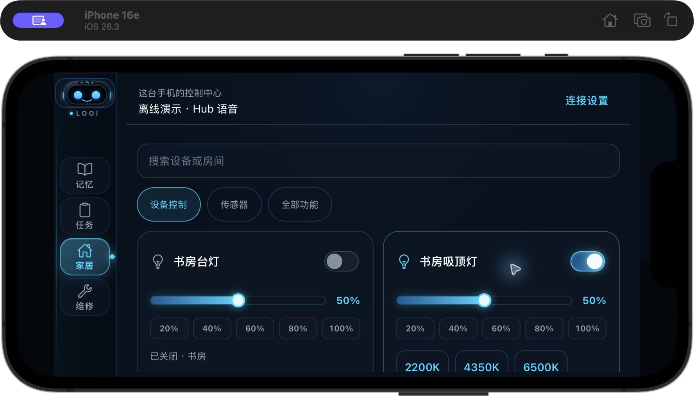
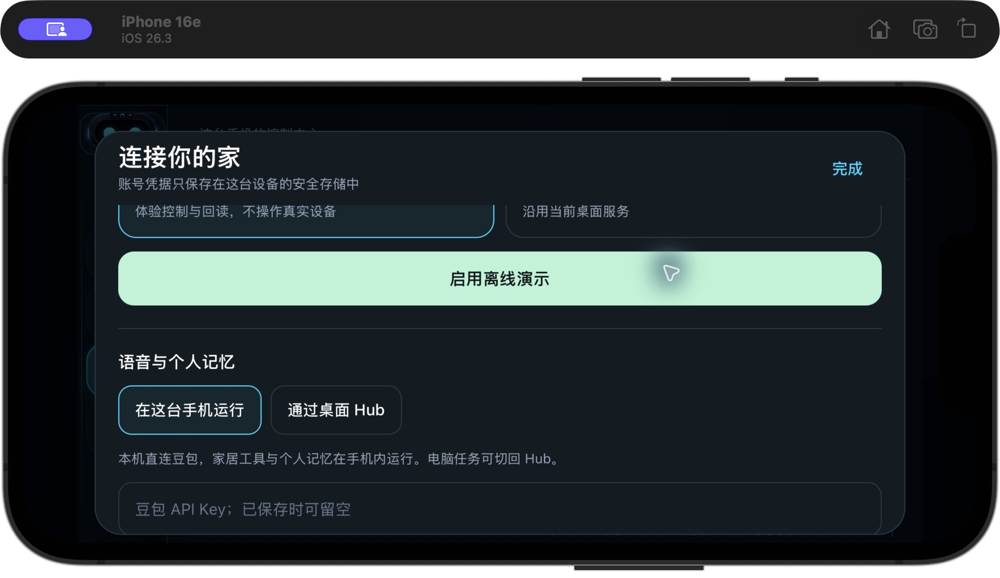

# 本机控制中心 H3 / H4 软件交付

日期：2026-11-06

移动端软件已接通米家直连、外部 Home Assistant、离线演示、本机个人记忆和豆包实时语音。iOS 原生开发包已重建并安装到 iPhone 16e / iOS 26.3 模拟器。真实米家账号授权、手机麦克风与真实设备物理回读仍需本人登录后验收。

## 使用入口

打开「家居 → 连接设置」。

1. **米家直连**：选择与米家 App 一致的地区，点「登录米家并连接设备」，在内置的小米官方页面完成本人授权。回调在 WebView 导航前拦截，沿用 H2 的 state、一次性 code 与令牌管理。
2. **Home Assistant**：填写实例地址与长期令牌。实体控制需能核查所属设备与安全能力；未找到所属设备、高危设备或无法识别的通用开关保持只读。
3. **离线演示**：独立运行演示灯光、风扇与传感器，所有回执明确带演示标记。真实连接失败不会切回演示。
4. **语音与个人记忆**：选择「在这台手机运行」，将豆包 API Key 保存到系统安全存储，再点 LIVE 使用本机直连语音。选择「通过桌面 Hub」可沿用桌面服务。

本机文字入口支持「记住钥匙在抽屉」「钥匙在哪」「忘记钥匙」「打开书房吸顶灯」。文字记忆操作不需要语音 Key 或网络；设备开关需要当前家居连接，并继续经过安全网关。自由问答通过 LIVE 语音进行。豆包的 `conversation.item.create` 是上下文 / 工具结果接口，不能将普通文本注入当作自由问答已经触发；本次实测据此修正了本机文字入口。协议参考 [官方全双工接口](https://docs.volcengine.com/docs/doubao-voice/end-to-end-real-time-voice-full-duplex-version?lang=zh)。

## 实现与安全边界

- `LocalControlCenter` 管理本地配置、连接代际和统一设备接口。保存配置不等待旧网络发现结束；切模式、账号或地区会撤销旧 OAuth，旧结果不覆盖当前界面，旧连接尚未派发的真实控制会在 native fetch 前被拦住。已经发出的操作结果保留待核实。
- `NativeLocalStorage` 使用带校验和的文件槽，保留可恢复的已提交版本；确认新写入后删除旧副本。配置、公共规格与个人记忆位于应用沙盒，凭据使用 SecureStore。iOS Keychain 为 `WHEN_UNLOCKED_THIS_DEVICE_ONLY`，Android 使用 Keystore，备份排除由插件配置。
- `LocalPersonalMemoryStore` 串行提交事实与删除墓碑，持久化失败不会更新可见记忆；更正按原 ID 更新，删除后或隐私取消后的迟到写入会被拒绝 / 回滚。回忆册的更正与删除直接操作真实本机存储，空列表不会恢复演示事实。
- 删除记忆会结束旧模型会话，防止模型根据旧上下文迟到写回。下一次点 LIVE 或开始新的输入可继续；退出、隐私暂停与后台切换清空音频队列，不重放旧音频或控制。
- `LocalVoiceSocket` 在进程内桥接现有录音 / 播放客户端与豆包，使用 20ms / 640B PCM16k 分片、24kHz PCM 回复和本机工具。修复了原生录音 `event.data` 读取、取消握手、旧连接帧隔离、异步播放器迟到启动和播放抑制窗口清理。
- 本机模式不会把桌面 Hub 标记为已连接。切换记忆来源先清空当前列表，旧来源的晚到结果被隔离。Hub 记忆删除使用原有真实接口；位置更正需要服务端原子按 ID API，当前明确禁用该按钮。

## 原生构建与界面验收

新增 `expo-secure-store`、`expo-crypto`、`react-native-webview`，并将 Reanimated / Worklets 对齐 Expo SDK 56 推荐的 **4.3.1 / 0.8.3**。原生修改仅通过 `app.json`、配置插件和 Expo prebuild 生成。pnpm 重生成锁文件，消除了既有重复键并记录新依赖；冻结锁文件离线安装通过。

已执行 `expo prebuild --platform ios --no-install` 与 `expo run:ios --device … --no-bundler`，构建成功、0 error，原生包安装并打开。模拟器验证了：

- 家居连接设置及本机语音安全输入框；
- 离线设备列表、灯开关和明确标注的回读回执；
- 本机配置在应用重载后恢复；
- 原生加密生成米家 OAuth 会话，WebView 实际打开小米官方账号页面。

实测发现并修复横屏 Modal 默认方向崩溃；表单与 WebView 使用同一个 Modal，避免 iOS 叠加呈现失败。





## 无 Hub 的真实豆包验收

可重复命令：

```sh
pnpm --filter @super-looi/hub verify:local-center
```

这是 macOS 验收脚本，读取根 `.env` 的现有 `DOUBAO_API_KEY`，使用系统 TTS 生成合成中文测试音频，经过同一移动端音频客户端与本机语音桥接器进入真实豆包 API。它不启动 Hub 服务，把所有 Hub HTTP 请求设置为失败，并仅控制离线演示设备。临时事实文件在脚本结束后清理，Key 不写入输出或 App bundle。

实际结果见 [voice-smoke.json](artifacts/local-center/voice-smoke.json)：

- `hubRequests: 0`
- 模型实际调用 `remember_fact`、`list_home_devices`、`control_home_device`、`recall_memory`
- 演示吸顶灯查询回读为 on，记忆写入文件后由新运行时恢复
- 收到 **151,552 字节**模型回复 PCM
- `realDeviceControl: false`

这证明了真实语音识别 / 模型 / 工具 / 文件记忆 / 回复音频的软件链路。它不替代手机实际录音、扬声器播放或真实米家物理执行验收。

## 回归与剩余验收

全仓 `pnpm build`、`pnpm typecheck`、`pnpm test` 均退出 0，**290 项测试全部通过**（contracts 5、looi-driver 11、home-assistant 42、mobile 143、hub 89），包含原有 48 核心验收运行器。新增用例覆盖旧 Hub / OAuth / 真实预读晚到、跨模式零派发、缺失或高危设备只读、删除 / 更正并发、旧模型写回、存储失败、离线文字、握手取消、旧帧和打断后的麦克风恢复。

独立子 agent review 的阻断问题均已修复，增量终审通过。React Doctor 对最后增量扫描未报告问题；首次全分支扫描的既有复杂度 / 可维护性告警仍存在，挂载 effect 的 timer/subscription 清理已人工核对，未为消除告警改变无关界面。

剩余需要本人授权或实际硬件的项目继续保留在 [todo.md](../todo.md)：米家登录后 Keychain 凭据写入 / 恢复、真实设备读控与断网恢复、手机 LIVE 录放音及无桌面服务的完整物理闭环、Android 原生 / 真机验证。当前 App 在进入后台时暂停语音，前台重新开始 LIVE；长时间后台连续语音不在本次已验收范围。
