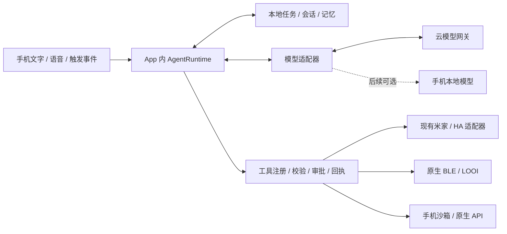

# 手机端 Agent loop 与去 Hub 调研

调研日期：2026-11-06（Asia/Taipei）。本轮为源码与官方资料调研，没有安装候选 App、执行手机端 Agent 或验证模型质量。以下区分已核验的源码事实、架构建议与待验证项；原有 DSH/Hub 文档描述历史方案，本报告以最终不依赖 Hub 为目标。

> 2026-11-06 补充：本文 dsh-Go 部分固定的是旧主线源码。新核查的 `feat/ios-foundation@745cc731` 已有 NodeMobile 内嵌 iOS 引擎、默认虚拟 shell 及可选 arm64 iSH / Alpine guest；模拟器真实工具循环与 guest 审批链 CI 已通过，不能再将当前 iOS 分支概括为待适配。真实云模型、最新上游真机与正式分发仍须另验，详见 [iOS 分支与 issue #609 调研](dsh-go-ios-branch-research.md)。

## 1. 建议与目标边界

**建议把 Agent loop、工具调度、审批、任务账本和会话放进现有 Expo App，先直连云端模型；本地推理作为后续独立选项。** 保留 Pi core 做第一轮兼容性验证；若依赖适配成本过高，比较 AI SDK Core。不要为去 Hub 先引入完整 Linux 环境，也无需先重写 Swift/Kotlin App。这是结合现有代码的推荐，并非已完成迁移。

“本机运行”需要分别回答四个问题：

| 部分 | 去 Hub 后建议所在位置 | 是否要求离线 |
| --- | --- | --- |
| Agent loop：决定继续调用模型、调哪个工具、何时结束 | 手机 App 内 | 是本机执行，但模型调用可联网 |
| 模型推理 | 第一阶段直连现有兼容网关；以后可换本地模型 | 不作为去 Hub 前置条件 |
| 工具执行 | 手机沙箱、原生 API、米家/HA、BLE | 取决于具体服务；米家云仍需网络 |
| 任务、会话、记忆与恢复 | 手机本地存储 | 本地可读写；备份同步另行设计 |

“无 Hub”验收应是：关闭电脑与 Hub，手机仍能完成多轮模型→工具→模型任务，查看任务、审批、取消和恢复；不是只让手机显示远端 Agent 的状态。远程电脑任务可以作为用户显式配置的可选工具，但不能成为普通家居、记忆和对话的必经路径。

## 2. dsh-Go 是怎么做到手机本机运行的

固定源码：[`ccch1mneyyy/dsh-Go@cf2f7c8`](https://github.com/ccch1mneyyy/dsh-Go/tree/cf2f7c861e1098661a3a2039b3a4cb1633790102)。名称中的 Go 指产品名；客户端主体是 Flutter/Dart，Android 运行时管理是 Kotlin，Agent 引擎仍是 DSH。

本机链路是：

```text
Android App 的运行控制面：
  Flutter → MethodChannel / EventChannel → Kotlin RuntimeController / DshService
                                              ↓ 安装、启动、日志、终止、前台通知
                                    PRoot + Ubuntu rootfs + Node.js + dsh web

Android App 的对话面：
  Dart dsh_client ↔ HTTP / WebSocket（127.0.0.1）↔ Linux 内的 dsh web
                                                        ↓
                                                 DSH agent loop
                                              ↙                 ↘
                              文件 / Shell / 桥接手机工具      云模型提供方
```

核验点：

- 打包脚本准备 Ubuntu Base、Linux Node 与 PRoot 等运行时产物；默认采用 PRoot 兼容启动，另有可选 direct-glibc 路径。免 Root、免另装 Termux，不等于没有 Linux 兼容层。[运行时构建脚本](https://github.com/ccch1mneyyy/dsh-Go/blob/cf2f7c861e1098661a3a2039b3a4cb1633790102/runtime/build-runtime.sh)
- `DshProcess` 明确启动 `dsh web`，通过 `ProcessBuilder` 创建进程，等 token 和本机 socket 就绪，管理日志与退出。[DshProcess.kt](https://github.com/ccch1mneyyy/dsh-Go/blob/cf2f7c861e1098661a3a2039b3a4cb1633790102/app/android/app/src/main/kotlin/io/github/ccch1mneyyy/dsh_app/runtime/DshProcess.kt#L21)
- `DshService` 用 Android 前台服务和 wake lock 承载运行时；这说明它在处理 Android 生命周期，不能据此保证永久存活。[DshService.kt](https://github.com/ccch1mneyyy/dsh-Go/blob/cf2f7c861e1098661a3a2039b3a4cb1633790102/app/android/app/src/main/kotlin/io/github/ccch1mneyyy/dsh_app/runtime/DshService.kt#L21)
- Flutter 通过 MethodChannel / EventChannel 控制 Kotlin 运行时，HTTP/WS 对话请求则由 Dart `dsh_client` 直接发到 `dsh web`；Kotlin 运行时管理器不是对话 HTTP 服务端。[RuntimePlugin.kt](https://github.com/ccch1mneyyy/dsh-Go/blob/cf2f7c861e1098661a3a2039b3a4cb1633790102/app/android/app/src/main/kotlin/io/github/ccch1mneyyy/dsh_app/runtime/RuntimePlugin.kt)
- `dsh_client` 是 Dart 的 `dsh web` API 客户端，处理 HTTP、`/api/remote.mux`、事件重同步和审批；本机和远程模式可以复用这套客户端。[客户端说明](https://github.com/ccch1mneyyy/dsh-Go/blob/cf2f7c861e1098661a3a2039b3a4cb1633790102/packages/dsh_client/README.md)
- 当前公开本机产品路线是 Android；README 把 iOS/鸿蒙列为待适配。模型请求仍发给配置的提供方，且当前 Android 构建以 APK 侧载为目标。[README](https://github.com/ccch1mneyyy/dsh-Go/blob/cf2f7c861e1098661a3a2039b3a4cb1633790102/README.md)

**适用判断：** dsh-Go 证明“把完整桌面 Harness 放到 Android 手机”可行，尤其能保留 Shell/文件/插件生态。代价是 Linux rootfs、进程监管、安装升级、DNS/路径兼容等工程工作。我们优先 iOS，且主要工具是家居、身体与记忆，因此更适合参考其任务交互、进程终态和重连设计，而不是复制这套 Linux 宿主。后者也不是一个可直接加入 Expo 的跨平台 Agent npm 包。

## 3. 有没有移动端可用的基础库 / 工具

有，但应区分 **Agent 循环底座、模型推理后端、工具能力库**，没有一个依赖会自动补齐本产品的全部能力。

| 候选 | 实际提供什么 | 对本项目的建议 |
| --- | --- | --- |
| `@earendil-works/pi-agent-core` | TypeScript Agent、工具循环、事件、工具钩子、取消与状态 | 第一候选；已有 Hub 接入经验，先做 Hermes/Metro 验证 |
| AI SDK Core（`ai`） | `generateText` / `streamText`、工具 schema/执行、多步循环和 provider 抽象 | 移动适配的比较候选；不能把 Expo 的服务端 API Route 示例当成本机 loop |
| Callstack React Native AI | AI SDK 的 RN 原生模型 provider，如 Apple / llama.rn；不是完整任务账本 | 需要本地推理时重点参考；当前 Expo 56 / RN 0.85 的兼容性仍需固定版本验证 |
| Expo FileSystem / SecureStore / 原生模块 | 沙箱文件、密钥与设备 API | 替换 Node 工具和存储；仓库已有部分接入 |
| Loopl / AgenticKit | Swift 原生 Agent 循环及工具抽象 | 用作 iOS 实现参考；接 Expo 需桥接，不建议为此重写现有 App |

Callstack 给出了 Expo / React Native 的专用 polyfill 接入说明，包括编码流与 `structuredClone`；这是现成移动适配资料，但不是对本仓库版本组合的实测保证。[RN / Expo polyfill 源码文档](https://github.com/callstackincubator/ai/blob/33ed22fe17003714f29245f7a3d3569acbb49637/website/src/content/docs/docs/polyfills.mdx)

AI SDK 的多步能力会把工具结果送回模型继续生成，直到结束或命中停止条件；默认的一步调用不等于多轮任务。其 Core API 本身不要求你创建 Hub，是否在手机运行取决于调用代码和工具实际部署在哪里。[官方工具循环说明](https://ai-sdk.dev/docs/ai-sdk-core/tools-and-tool-calling#multi-step-calls-using-stopwhen)

Callstack 的 llama provider 将本地模型返回的 `tool_calls` 转成 SDK 工具调用，外层可由 JS 中的 AI SDK 驱动后续轮次；其 Apple provider 则由原生 Foundation Models session 驱动工具循环，再回调 JS 工具。**两种循环所有权不同：Apple 路径不能假设 AI SDK 的每步钩子/停止条件能约束原生每次调用。** 审批、预算和动作校验必须落实到真实工具边界。[llama provider 源码](https://github.com/callstackincubator/ai/blob/33ed22fe17003714f29245f7a3d3569acbb49637/packages/llama/src/ai-sdk.ts#L333)、[Apple 工具文档](https://www.react-native-ai.dev/docs/apple/tools)

若“基础工具”特指 `bash`：跨 iOS/Android 的普通 App 不能把桌面 `/bin/sh` 和任意子进程当成共同基础。即使嵌入 `nodejs-mobile`，官方仍明确 `child_process` / `cluster` 不支持。文件工具可以用 App 沙箱实现；计算/转换可用受限 JS 等方案；系统动作应走明确的原生 API。[Node.js Mobile API 差异](https://nodejs-mobile.github.io/docs/api/differences/)

## 4. 核验过的社区手机端 loop

### PalmClaw：与“手机宿主 + 云模型”最接近

Android/Kotlin。`AgentLoop.run()` 从本机会话仓库读上下文，在 `1..maxRounds` 中请求云模型、执行工具、持久化工具结果，再进入下一轮；无工具、终结工具或预算用尽后结束，取消由 coroutine 传播。loop 和状态确实在手机。[固定 AgentLoop.kt](https://github.com/ModalityDance/PalmClaw/blob/75a42aeda0e580ebad0de4a38c00c94146148366/app/src/main/java/com/palmclaw/agent/AgentLoop.kt#L57)

可参考 provider、repository、tool registry、memory/skills 注入边界，以及工具超时/校验。前台服务只负责运行生命周期。项目采用 AGPL-3.0 并提供商业许可，宜先借鉴架构；当前有 APK 和研究演示，不代表已经验证适合我们的产品。[ToolRegistry](https://github.com/ModalityDance/PalmClaw/blob/75a42aeda0e580ebad0de4a38c00c94146148366/app/src/main/java/com/palmclaw/tools/ToolRegistry.kt)、[许可](https://github.com/ModalityDance/PalmClaw/blob/75a42aeda0e580ebad0de4a38c00c94146148366/LICENSE)、[项目说明](https://github.com/ModalityDance/PalmClaw/blob/75a42aeda0e580ebad0de4a38c00c94146148366/README.md)

### Loopl：iPhone 内的 Swift 循环

`public actor Agent` 的 `eventLoopCycle` 负责模型流、工具执行和继续循环；依赖 `Model` / `Tool` 协议，原生工具和推理后端单独拆分。其包提供 MLX、可选 GGUF/llama.cpp 与 Apple Foundation Models 路径；iOS 部署最低版本不等于所有模型后端的最低版本。核心 MIT，项目为早期 SDK / 展示 App。[Agent.swift](https://github.com/cagataycali/loopl/blob/9a9ffab0ef9cabe9908bde154e45af3c50181638/Sources/Loopl/Agent.swift#L521)、[Package.swift](https://github.com/cagataycali/loopl/blob/9a9ffab0ef9cabe9908bde154e45af3c50181638/Package.swift)、[许可](https://github.com/cagataycali/loopl/blob/9a9ffab0ef9cabe9908bde154e45af3c50181638/LICENSE)

值得参考 typed events、审批和 checkpoint。它明确说明恢复 checkpoint 不会恢复原来悬挂的工具工作，未决审批要再次询问。工具执行副作用不能仅靠会话重放恢复；其无固定迭代上限的策略也不建议照搬到机器人。[Checkpoint.swift](https://github.com/cagataycali/loopl/blob/9a9ffab0ef9cabe9908bde154e45af3c50181638/Sources/Loopl/Checkpoint.swift#L178)

### Google AI Edge Gallery：手机 skills / 工具执行参考

Google 的 Apache-2.0 参考项目。本轮核验的是 Android 实现：`DefaultAgentRuntimeExecutor` 组合 skills、tools、dispatcher 和本地 session，把工具交给 LiteRT-LM；自动模型/工具循环由底层运行时承载。不能只看 App 发行平台就推断 iOS 的内部实现相同。[运行执行器](https://github.com/google-ai-edge/gallery/blob/be7e32b70292e8911449b5dc29f06737f1a3bdae/Android/src/app/src/main/java/com/google/ai/edge/gallery/agent/DefaultAgentRuntimeExecutor.kt)

其 skills 把指令与执行分开：原生 intent 工具处理系统动作，自定义 JS 工具使用隐藏 WebView。可参考手机专用工具设计；这不代表桌面 SKILL.md 中的 Bash/Python 命令能直接运行，也不建议为了去 Hub 先加入任意脚本执行。[Skills 说明](https://github.com/google-ai-edge/gallery/blob/be7e32b70292e8911449b5dc29f06737f1a3bdae/skills/README.md)、[RunJsTool](https://github.com/google-ai-edge/gallery/blob/be7e32b70292e8911449b5dc29f06737f1a3bdae/Android/src/app/src/main/java/com/google/ai/edge/gallery/tools/RunJsTool.kt)、[许可](https://github.com/google-ai-edge/gallery/blob/be7e32b70292e8911449b5dc29f06737f1a3bdae/LICENSE)

### AgenticKit：原生 loop 并不要求本地模型

Swift/MIT 早期库，`Conversation.run()` 在设备进程里调用 provider、执行工具并 checkpoint，限制 turns；Bash 工具由条件编译限定 macOS/Linux，不在 iOS 编译。适合参考云模型的本机 Agent 与手机工具裁剪。[Conversation.swift](https://github.com/Legoless/AgenticKit/blob/630e155f0c3095d88edb1c22fbac16818a394834/Sources/AgenticKit/Query/Conversation.swift#L78)、[BashTools.swift](https://github.com/Legoless/AgenticKit/blob/630e155f0c3095d88edb1c22fbac16818a394834/Sources/AgenticKit/BuiltinTools/BashTools.swift#L3)、[项目与许可](https://github.com/Legoless/AgenticKit/tree/630e155f0c3095d88edb1c22fbac16818a394834)

## 5. 当前 Pi 到底能不能上手机

**源码显示值得验证；本轮没有证据能直接宣布 `pi-agent-core@1.5.0` 已兼容 React Native。** 当前项目固定该版本；不要把新版本、浏览器可用和 Hermes 可用混为一谈。[Pi v1.5.0 循环源码](https://github.com/earendil-works/pi/blob/v1.5.0/packages/agent/src/agent-loop.ts)

主 agent 检查本地安装包得出的边界：

- core 的 Agent / agent-loop 使用异步代码和可注入 `streamFn`、工具执行与钩子；这些不是 Shell 或 Node 文件系统实现。
- 现有 Hub 包装器引入 `node:fs`、`node:path`、`node:child_process`、`node:crypto`，同步读写任务和会话；这一整份执行器无法直接导入 Mobile。
- core 仍运行时导入 `pi-ai` 根入口；`pi-ai` 有多 provider 依赖、auth 的变量动态 import，以及专用 Node adapter。选用 lazy provider 能缩小调用范围，不能据此认定 Metro 不会分析相关路径。
- 包声明 Node engine 是桌面使用契约的一部分；本轮只做源码检查，未做 Metro/Hermes 打包或运行探针。具体风险包括动态 import、包 exports、Web Streams、TextDecoder、crypto/UUID、SDK 网络传输与 abort。

第一轮应测试 `Agent + 自定义 streamFn + 两个纯 JS 工具`，之后才接一个云 provider。若只需少量入口适配，可保留 Pi；若必须广泛 shim Node、维护 provider fork 或修改大量 Metro 解析规则，再对同一验收集比较 AI SDK Core。不要把写一套新的手工 ReAct 循环作为默认捷径。

Expo 56 官方已有 `expo/fetch` 流式读取入口，可作为移动网络适配候选；仍须核验所选 SDK 能否注入它及需要哪些 polyfill。[Expo 56 fetch](https://docs.expo.dev/versions/v56.0.0/sdk/expo/#expofetch-api)

## 6. 本仓库的迁移切面

以下位置是本轮工作树的源码观察，包含用户已有未提交改动；本轮没有改运行代码。

| 当前实现 | 现状 | 去 Hub 所需工作 |
| --- | --- | --- |
| `apps/hub/src/agent/pi-executor.ts` | Hub 里的 Pi loop + Node 工具 + 任务管理 | 抽取平台无关生命周期、事件、预算、审批；不要把 Node import 带进 Mobile |
| `apps/hub/src/agent/task-store.ts` | 同步 fs 快照，重启标记 unknown | 手机异步存储与工具意图/结果账本；恢复前核实副作用 |
| `apps/mobile/src/runtime/native-local-center.ts` | FileSystem 双槽校验写入 + SecureStore | 可复用 adapter 思路；任务并发写入、规模与升级另验，必要时换 SQLite |
| `apps/mobile/src/runtime/local-control-center.ts` | 本机记忆、米家/外部 HA、工具执行 | 注册为通用 Agent tools；`executeText` 目前是规则匹配，不是通用模型 loop |
| `apps/mobile/src/runtime/local-voice-socket.ts` | 直连云语音，按远端 function-call 事件执行本机工具 | 复用能力与校验；当前无独立持久任务引擎，不能当通用 loop 迁移完成 |
| `apps/mobile/src/runtime/live-voice-client.ts`、Hub `app.ts` | Hub 任务/审批/取消与语音协议 | App 内事件订阅和本地命令接口替代必经 HTTP/WS |
| Hub 的生产力、规则、记忆与设备服务 | 仍有服务端职责与状态 | 分类迁移、替代或明确停用；只迁 Pi 不能直接删除 Hub |

建议目标结构（待实施）：



建议首批工具为 `recall_memory`、`remember_fact`、`list_home_devices`、`control_home_device`、`ask_user_question` 和 App 沙箱内文件读写。BLE 动作等真实硬件能力按验收状态开放，不因声明工具就视为已连通。工具名、参数 schema、校验、执行、回执与授权统一管理；工具必须返回 verified / pending / failed 等可解释结果。

密钥从用户配置经 SecureStore 获取；仓库 `.env` 可供开发验证，不能把共享提供方密钥编入手机包。若采用用户自己的模型凭据，可以手机直连；若以后需要统一计费，可另设无 Agent 状态的鉴权代理，但它不是本轮去 Hub 的必需组件。

## 7. 后台运行边界

去 Hub 不代表 iPhone 能永久在后台执行 JS。首个支持范围建议为底座前台驻留和普通前台使用；后台中断时持久化、恢复时核验，不伪报完成。

- iOS 普通后台收尾 API 提供有限执行机会。iOS 26 的 `BGContinuedProcessingTask` 可让用户在前台发起的长任务转后台继续，并显示系统进度、允许取消；资源不足可排队/失效，用户强退也会终止。可通过 Expo 原生模块/config plugin 单独做 PoC，不能作为全天候 daemon 的依据。[Apple 长任务文档](https://developer.apple.com/documentation/backgroundtasks/performing-long-running-tasks-on-ios-and-ipados)
- `expo-background-task` 是系统择机运行的可延迟任务，不保证用户提出任务后立即或定时准点执行，不能替代一个持续的循环。[Expo 56 BackgroundTask](https://docs.expo.dev/versions/v56.0.0/sdk/background-task/)
- Android 前台服务也有类型与启动限制；Android 15+ 的 `dataSync` / `mediaProcessing` 有特定时间预算。这不是所有前台服务的统一时限，也不能随意换服务类型绕过约束。[Android 官方说明](https://developer.android.com/develop/background-work/services/fgs/timeout)

所有原生接入通过 `app.json` / config plugin / 自有 Expo module 完成，不直接改 prebuild 产物。模拟器用于打包与流程验证；本地模型性能、热、后台与 BLE 结论需要真机。

## 8. 下一步实施与验收建议

1. **运行时可移植性小验证。** 在 Expo 56 / RN 0.85 上验证 Pi core import、两轮工具闭环、事件、abort、参数错误和步数预算；Node-only 模块不得进入移动 bundle 的可达依赖图或执行路径。通过后再连实际网关；若失败，记录具体依赖与最小修复，再比较 AI SDK Core。暂不改主产品入口。
2. **迁入本机任务引擎。** 独立于页面组件保存 Runtime，接本地记忆/家居、审批/问答、会话/任务存储。工具派发前写意图、执行后写回执；进程被杀后的未知动作要先回读/核验，不能无条件重放。
3. **统一文字与语音任务。** 通用任务共享 runtime 和工具授权；实时语音 session 保留音频职责。避免云语音和通用 Agent 同时各执行一遍同一个家居动作。
4. **完成 Hub 职责退出。** 盘点全部 Hub API、规则、生产力 runner 和持久数据；逐项迁移/替代/明确停用，验证新装 App 不配置 Hub 也能正常启动与工作，再移除部署依赖。
5. **可选本地推理。** 对 Apple / llama.rn / LiteRT 后端分别测中文指令、工具选择、错误参数、延迟、内存与热。后端替换不应改变工具权限和回执语义。

最低验收集：关闭 Hub 完成两次以上模型请求及真实工具调用；审批拒绝无副作用；取消后无迟到工具派发；断网/切配置不串任务；强退后保留会话，未知副作用先核验；工具结果已落盘而最终回答未生成时不重复控制；前台与后台支持范围如实呈现。真实家居/BLE 测试应先从只读与已授权动作开始。

本轮交付是调研与迁移建议；移动运行时兼容性、真网闭环、任务恢复和 Hub 删除均待后续实施。
