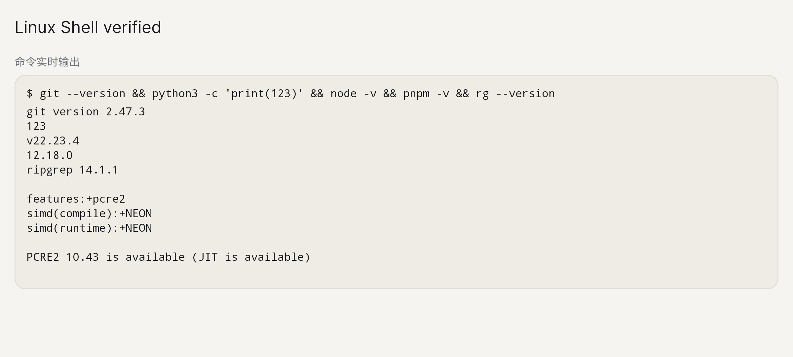

# NSH Linux Shell 验证记录

日期：2026-11-09。Android 设备为魅族 20 Pro，Android 14，ARM64；使用同一真机的 Wi-Fi ADB `192.168.3.123:5555`。iOS 按用户确认范围执行构建检查，没有安装或运行 iPhone 应用，也没有安装模拟器开发包。

## 自动化结果

| 检查 | 结果 |
| --- | --- |
| `nsh-node-compat` Rust 测试 | 8 项通过；覆盖 UTF-8、原子尾块、槽位释放和工作区链接 |
| 桌面 QuickJS 兼容层全套 | 通过；含 Pi SDK 七工具、Durable 崩溃恢复与资源期限 |
| `NshExecutionEnv` 四种回执 | 旧 ETIMEDOUT、新 timedOut、取消、显式 exit 124 均通过 |
| Agent 定向 Shell 测试 | 5 项通过；流式输出、取消尾部、超时、local_auto 与链接产物扫描 |
| 运行时全套 | 85 项通过 |
| NSH 类型检查、应用构建 | 通过 |
| NSH 集成测试 | 26 项通过 |
| Android 签名前插件测试 | 通过 |
| Android 真机完整 CompatProbe | 通过；包括原 SDK 七个默认工具、原生音频与凭据测试槽 |
| iOS `aarch64-apple-ios` | 编译与未签名设备 `.app` 打包通过 |
| iOS `aarch64-apple-ios-sim` | arm64 模拟器 `.app` 打包通过，未运行 |

## Android Linux 专项

专项探针使用真实 Alpine guest 和独立测试数据目录。以下断言已通过：

- 默认 PATH、`HOME=/root`、`command -v apk`，自定义 HOME 和中文环境变量覆盖。
- 文件工具 → guest 和 guest → 文件工具双向即时读写，独立 stdout/stderr 与退出码 7。
- guest 无法看见宿主 `/home/agent` 测试账本。
- `yes work | head -c 50000` 输出恰为 50,000 字节，退出码 0，stderr 为空。
- 中文双流无乱码；正常根命令退出后，后台 `sleep`、`setsid` 后代和中间父进程提前退出的后代均在三秒内回收。
- 手动取消保留 SIGTERM 回执；单命令超时返回 `status=124,timedOut=true`，之后 `echo next` 成功。命令自行 `exit 124` 不标记为超时。
- 取消前向双流各写入 24,010 字节，终态收到完整内容及各自尾部标记；内置 `rg` 显式访问工作区绝对软链接成功。
- 通过硬链接路径写入后，Shell 读取原文件得到同一内容；工作区根目录存在外部链接时，后续硬链接产物仍被 Agent 正常收集。
- 相对软链接、`/workspace/...` 绝对软链接和 PRoot 硬链接经 Shell 与文件桥读写一致；外部链接被文件工具拒绝。
- `local_auto` 审批触发后实际执行 `apk add git python3 nodejs npm ripgrep` 与 `npm install -g pnpm`，随后检查所有工具。

实测工具为 Git 2.47.3、Node v22.23.4、pnpm 12.18.0、ripgrep 14.1.1；Python 命令输出 `123`。这些工具由测试安装，镜像没有预装。

应用进程执行 `force-stop` 与重新启动后，通过安装目录中的 PRoot 再次访问同一 guest，Git 初始化与状态命令、Python、Node、pnpm、ripgrep 均成功。该检查使用 guest 原有宿主路径前缀，保留 PRoot `.l2s.*` 链的路径语义。

详细输出：[Linux 专项](artifacts/nsh-linux-shell/android-linux.log)、[完整兼容层](artifacts/nsh-linux-shell/android-compat.log)、[重启持久化](artifacts/nsh-linux-shell/android-persistence.txt)。

## iOS 构建与源码

设备与模拟器分别链接其 iSH、iSH emu、fakefs 库切片；fakefs 没有带入另一份 SQLite 实现。设备构建通过相应的 Clang compiler-rt 薄切片解决 ONNX 的 `___chkstk_darwin` 引用。两种 `.app` 都含 `alpine-fakefs.tar.gz` 和 Linux Shell 许可证资源。

产物位于 `apps/nsh/.nsh/linux-ios/Super LOOI.app` 与 `apps/nsh/.nsh/linux-ios-simulator/Super LOOI.app`。iPhone 真机运行、iSH 包安装与进程回收尚未执行，后续入口记录在 `todo.md`。

构建、使用与对应源码说明见 [NSH Linux Shell](nsh-linux-shell.md)。两个独立 review 分别检查原生/兼容层和 Agent/UI，已修复其报告的问题并通过终审。
