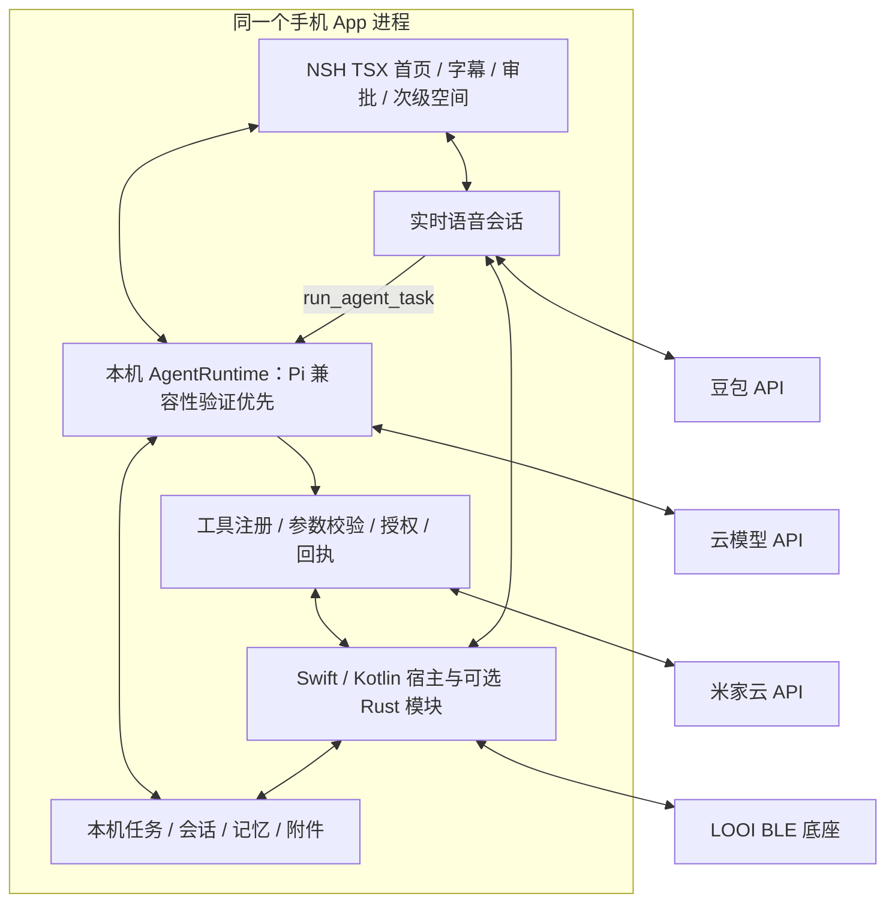

# Native Shell 迁移可行性：Android / iOS 无 Hub 架构

调研日期：2026-11-06（Asia/Taipei）。用户已确认：**不部署自建服务端，允许手机直连模型 API、豆包和米家云。** 本报告为官方文档及静态源码调研，没有安装 NSH、运行迁移 PoC 或完成真机性能验收。

项目基线：`36a7b0653e1c070b69c94e5654e95f86c3a909f7`，同时检查当前工作树；保留既有四个语音相关未提交文件。框架固定为 **NSH v0.4.0 / `e626a8dd8f8d8b277b9507cfd5ac74d0e67020f3`**。官网可能继续更新，下列源码链接固定到该版本。

## 1. 结论与迁移条件

**可以作为目标架构，但属于 UI 重写与运行时迁移，不能当作 Expo 的依赖替换。**

| 用户重点 | 判断 | 条件 |
| --- | --- | --- |
| Android、iOS 双端 | 有官方运行、打包与嵌入实现 | iOS 15+、Android API 28+；本项目硬件、发布流程仍须验收 |
| Agent loop 在手机内执行 | 架构上可行 | 拆开 Pi 循环、Node 工具、任务存储；Pi 1.5.0 在 QuickJS 的兼容性尚未实测 |
| 不需要 Hub / 常驻电脑 | 核心陪伴功能可按此设计 | 直接请求云 API；以本地方法/事件替代 Hub HTTP/WS |
| 首页机器人视觉和动作 | 能重建，风险相对低 | 用 NSH View / Canvas / 原生动画重写，逐端比较渐变、阴影和裁剪 |
| 现有全部桌面工具原样运行 | 无法作为双端承诺 | `/bin/sh`、桌面文件路径、CLI 和其他进程须转为手机专用工具 |
| 锁屏后任意时长运行 agent、规则和感知 | 无法作为双端承诺 | 前台底座驻留优先；后台按平台允许范围继续、暂停和恢复 |

双端最低版本、独立应用与 embedding 的依据是官方 [iOS](https://nsh.dev/docs/ios/) 和 [Android](https://nsh.dev/docs/android/) 文档。可打包不等于已验证本产品生产可用，官网计数器的体积、首帧、120 FPS 数据也不能直接用于本项目预算。

**建议选择“Swift / Kotlin 薄宿主 + NSH TSX 界面 + 手机内运行时”。** Swift/Kotlin 管系统权限、音频、BLE、相机和生命周期；共享业务保留可移植 TypeScript，需要时接 Rust 存储/网络模块。先做小范围验证再替换主 App。NSH 框架和去 Hub 是两个独立决策：现有 Expo 也可以去 Hub，换 NSH 的新增收益主要是其原生 UI、Rust 扩展与渲染模型，新增成本是 UI 和 Expo 能力桥接重写。

## 2. 当前项目哪些已经在手机，哪些还在 Hub

以代码为准，不能从历史 progress 中的 DSH 描述推断当前执行器。

| 能力 | 当前源码事实 | 迁移处理 |
| --- | --- | --- |
| 通用 agent | `apps/hub/src/app.ts` 实例化 `PiAgentExecutor`；依赖 Pi core / ai / schema 1.5.0 | 搬循环与生命周期，重做平台层 |
| 文件与 shell 工具 | `agent/pi-executor.ts` 导入 `node:fs/path/child_process/crypto`；`bash` 启动 `/bin/sh` | 手机沙箱异步文件工具；shell 改成具体业务能力 |
| 任务、审批、问答、取消、恢复 | `agent/executor.ts` 有独立接口；`task-store.ts` 用同步 fs 快照 | 保留数据/事件契约；改本机持久账本与恢复 |
| 家居 | `packages/home-assistant` 已抽取纯 TS 网关、OAuth、MIoT、规则与 HA 传输 | 优先复用，注入网络、存储、crypto |
| 手机本机控制中心 | `local-control-center.ts` 已做 MIoT / 外部 HA / 演示与本机记忆 | 复用业务，替换 Expo 适配器 |
| 本机文字 | `executeText()` 为记忆/设备指令规则匹配 | 不能算通用 agent loop；接入统一 runtime |
| 本机 LIVE | `LocalVoiceSocket` 直连豆包，远端 function-call 触发本地工具 | 已有无 Hub 通路；当前 `voiceTools` 仅家居工具，没有本机 `run_agent_task` |
| PCM 录放音 | `live-voice-client.ts` 用 AudioStudio、expo-audio、expo-file-system | 原生采集/播放/AEC 等重新接线 |
| 密钥与本机文件 | `native-local-center.ts` 用 SecureStore、Crypto、FileSystem 双槽校验 | 换 Keychain / Keystore、受控文件/数据库 adapter |
| LOOI 身体 | `looi-driver` 有纯 TS supervisor、transport 和 NativeBleAdapter 接口 | 可复用策略；目前首页急停接 `local_simulation`，不应算真实 BLE 已验收 |
| 视觉 / 主动观察 | Hub 有 provider 和协调器；首页传感器初始关闭 | 迁移相机采集、上传、预算与回执；不能把模拟结果当真机能力 |
| 次级空间 | 记忆、任务、家居、维修等源码仍保留，主入口当前隐藏 | 按功能清单迁移，不能因首屏隐藏就漏掉存储与业务 |

`CloudVisionProvider` 在缺 Key 或失败时存在模拟返回；`EdgeVisionProvider`、默认模块化语音也不能仅凭类名判为完成真实本地推理。无 Hub 验收应明确区分已实现产品功能、可用业务底座与尚未验收的模拟能力。

已有 [手机端 Agent loop 与去 Hub 调研](mobile-agent-loop-research.md) 针对 Expo；本报告补充 NSH 的运行时及原生适配差异，不把先前 Hermes/Metro 结论套到 QuickJS。

## 3. Agent loop 的接入方案

### 3.1 可用的框架基础

NSH TSX 运行在 QuickJS，组件只执行一次、用 signal 驱动更新，**不是 React runtime**。React hooks、React Native 组件、Expo native module、Reanimated 不能靠修改 import 继续使用。纯 JS/TS npm 包可以打包，但必须符合实际导出和运行时能力；默认选 browser exports，不提供 DOM。[响应式](https://nsh.dev/docs/reactivity/)、[npm 包与解析配置](https://nsh.dev/docs/project-structure/#npm-packages)

v0.4.0 有 11 个 Node-shaped 标准模块子集，包含 Buffer、crypto、path、网络等。因此也不应写成“完全没有 Node API”。真正影响我们的是：

- NSH 的 `fs/promises` 在 iOS / Android 返回 `ERR_FEATURE_UNAVAILABLE_ON_PLATFORM`，且没有现有执行器使用的完整同步 `node:fs`。
- `process.run/spawn` 仅桌面可执行。移动 Rust 能访问自己的沙箱，不代表 TSX 获得 Node fs，也不代表 iOS 获得桌面进程能力。
- TSX 有 fetch 流、ReadableStream、TextDecoder、AbortController，可增量解析模型 SSE；这是网络能力依据，仍需验证具体 provider 的协议。
- 有原生文本/二进制 WebSocket。全局 `new WebSocket()` 没有 RN 的第三参 headers；模块 `connect(url, { headers })` 才支持自定义 header。

依据：[标准模块](https://nsh.dev/modules/standard-modules/)、[流式 fetch](https://nsh.dev/modules/globals/#streaming)，以及固定版本 [fs 平台边界](https://github.com/longbridge/nsh/blob/e626a8dd8f8d8b277b9507cfd5ac74d0e67020f3/crates/nsh-core/src/runtime/fs.rs#L604-L620)、[process 平台边界](https://github.com/longbridge/nsh/blob/e626a8dd8f8d8b277b9507cfd5ac74d0e67020f3/crates/nsh-core/src/runtime/process.rs#L545-L553)。

### 3.2 保留 Pi 是第一候选，不能直接承诺兼容

本仓库安装包 `@earendil-works/pi-agent-core@1.5.0` 的 Agent / loop 支持注入 `streamFn`、工具与调用前钩子，适合作为第一轮迁移候选。但它运行时仍导入 `pi-ai` 根入口；该包有多 provider 依赖、变量动态 import 和专用 Node/OAuth 路径。`pi-ai` 的参数校验、模型存储等还使用 `structuredClone`，需要在 NSH 实测或提供经过数据类型约束的实现，不能随手用 JSON 深拷贝替代全部语义。[Pi v1.5.0 循环源码](https://github.com/earendil-works/pi/blob/v1.5.0/packages/agent/src/agent-loop.ts)

补充候选：新核查的 dsh-Go iOS 分支通过原生宿主内嵌 NodeMobile 运行 DSH，模拟器真实工具闭环已通过 CI。若 Pi 的 QuickJS 兼容成本高，可比较“NSH 界面 + 宿主内嵌 NodeMobile / Pi”，同时核算第二个 JS 引擎、桥接、签名与生命周期成本；这仍是本项目待验证方案。可选 iSH / Alpine guest 也不能视为原生 child_process 已开放。详见 [iOS 分支与 issue #609 调研](dsh-go-ios-branch-research.md)。

第一轮只验证 **Agent + 自定义 streamFn + 两个纯 TS 工具**，随后接真实兼容网关。自定义 streamFn 可通过 NSH fetch 实现 SSE，再转换成 Pi 的事件流，从而避免一开始就引入完整 provider SDK；它不会自动消除 core 的传递依赖，仍须核对 bundle 可达图。

决策顺序：少量、局部适配能通过就保留 Pi；如果必须广泛 fork SDK、伪造 Node 或调整运行时，则比较内嵌 NodeMobile 与独立 Rust agent runtime 的适配成本。候选路线共用任务/工具接口与验收集，首期不同时维护两个循环实现。Rust 扩展可导出异步函数、类和组件，由 TSX 调用。[Rust 扩展官方接口](https://nsh.dev/docs/rust/)

### 3.3 手机专用工具与执行契约

首批工具应是设备查询/控制、沙箱文件读写、显式用户问答，以及按产品范围启用的记忆和 BLE 动作。把“运行某个 shell 命令”转为“执行某个明确动作”，才有双端一致的权限和取消语义。

保留现有 `run/getTask/listTasks/respond/cancel` 和 step 事件接口；不在手机内重建 Fastify 或 localhost Hub。工具边界继续做参数校验、授权、任务预算和真实回执。语音模型发起 `run_agent_task` 后交给同一个本机 AgentRuntime，语音与慢任务不得各执行一遍同一设备动作。

任务、会话、审批意图、工具结果和恢复信息本地持久化。工具派发前记意图，完成后记回执；强退后的未决副作用标记 unknown、先回读。取消必须停止后续派发、终止可取消网络/原生操作并持久化；已发出的物理动作或云请求不一定可撤销，不能直接承诺 cancelled/confirmed。

## 4. 音频、硬件、存储和发布是主要迁移成本

| 模块 | NSH v0.4.0 已有能力 | 本项目需要补充 |
| --- | --- | --- |
| 模型 API | 流式 fetch、Web Streams、abort | provider 适配、SSE tool-call 增量拼接、重连与超时 |
| 豆包 WS | 模块 connect 支持 `X-Api-Key` 等自定义头、文本/二进制 | 重写 RN WebSocket adapter，验证真实握手、节拍、背压、断线零重放 |
| LIVE 全双工 | iOS/macOS 有系统 Speech 听写文本 | 双端 PCM 采集/播放、16k/24k 转换、AEC、打断、音频焦点/路由与来电恢复 |
| BLE | 可桥接 native API | iOS CoreBluetooth、Android GATT adapter、重连、通知、急停与 watchdog 验收 |
| 相机 / VLM | native component、图片/网络接口 | AVFoundation / CameraX 或相应原生采集接口；前台采样、上传、热与隐私策略 |
| 普通本机数据 | Storage 字符串 KV，5 MiB，双端 storage.json | 设置可用 KV；任务/记忆/附件用 Rust/宿主 SQLite 或受控文件接口 |
| 安全凭据 | 未核验到可直接替代 SecureStore 的公开模块 | Keychain / Keystore adapter；用户凭据不落普通 KV |
| 米家 / HA 登录 | WebView、双向消息与导航控制 | 精确 OAuth 回调匹配、state、刷新、冷启动恢复与 crypto 接线 |
| 前台驻留 / 温控 | 生命周期与 UI 环境访问器 | 保持唤醒、原生热状态/电池事件、节流与传感器暂停 |
| 发布 | iOS app/ipa、Android apk、embedding SDK | 自有宿主的签名、权限、商店发布与升级测试 |

以上“需要补充”表示本轮未找到满足业务的公开内置模块，**不表示 NSH 底层无法接入**。[Speech](https://nsh.dev/modules/nsh/#speech) 仅返回听写文本，Android 内置路径不可用；它不能替代现有豆包 PCM 双工链路。[Storage](https://nsh.dev/modules/nsh/#storage) 不是 SQLite 或安全凭据库，且写盘在后台批量发生；关键任务回执应有可确认的事务提交，不能把 KV Promise 直接等同 fsync。

WebSocket 有一个实际限制：模块自定义头拒绝 `Authorization`、`Cookie` 等凭证/握手头；`X-Api-Key` 不在拒绝列表。豆包接入在接口层面可行，仍需真网验证；未来依赖 Bearer WS 的 provider 应走 Rust/宿主网络 adapter。[固定 headers 校验](https://github.com/longbridge/nsh/blob/e626a8dd8f8d8b277b9507cfd5ac74d0e67020f3/crates/nsh-core/src/runtime/websocket.rs#L142-L205)

薄宿主是当前更稳妥的集成方式：官方支持 iOS 的 `NshAppView` / xcframework 与 Android 的 `NshView` / AAR，以及 `host.call`、事件和 native component。相机预览可注册原生视图；音频、存储等无界面服务走宿主方法/Rust module，不必包装成 UI。[原生组件](https://nsh.dev/docs/native-components/)、[宿主通信](https://nsh.dev/modules/nsh/#host)

选择宿主还有发布原因：v0.4.0 CLI 的 Android manifest 模板只有 INTERNET，本轮没有找到直接 AAB 打包实现，不能假定 `nsh.json` 已能注入所有硬件权限与 Service。建议用自有 Android 工程构建 AAB、自有 iOS 工程管理签名和系统配置；这是迁移建议，不是已完成上架验证。[固定 manifest 模板](https://github.com/longbridge/nsh/blob/e626a8dd8f8d8b277b9507cfd5ac74d0e67020f3/crates/nsh-cli/src/android.rs#L283-L306)

另有明确的 Google Play 发布缺口：v0.4.0 CLI 固定 target API 35，而截至调研日，Google 官方要求自 2026-08-31 起普通手机新应用/更新 target API 36+。这不影响侧载 PoC，但独立 CLI 产物不能直接视为满足当前 Play 提交条件；AAR + 自有宿主需设置合适 target 并验证 Android 16 行为变化。[固定 TARGET_SDK](https://github.com/longbridge/nsh/blob/e626a8dd8f8d8b277b9507cfd5ac74d0e67020f3/crates/nsh-cli/src/android.rs#L14-L16)、[Google Play 当前要求](https://developer.android.com/google/play/requirements/target-sdk)

媒体数据平面应留在原生媒体线程：PCM、重采样、AEC、播放队列和高频缓冲不通过 JSON `host.call` 逐帧搬运。TSX 接收控制、字幕、工具回调和限频 RMS；必要时原生媒体模块直接管理语音 WS。这是建议的职责划分，需要 PoC 验证。

当前 Expo 项目继续遵守 `app.json` / config plugin 规则，不修改 prebuild 产物。NSH 验证放在独立目录；后续自有宿主是维护源码的工程，也不能靠修改 NSH 自动生成目录维持权限。

## 5. 首页小机器人能否保留

**可以保留当前设计语言；实现需要重写，像素与性能一致性要双端实测。** 已检查 `RobotFaceView.tsx` 和现有截图 `docs/artifacts/pure-face-minimal-runtime.png`。当前是二维 View 几何，并无 3D、Three.js 或 Skia 依赖：620×340 逻辑画布、两颗 184 直径圆眼、径向渐变、高光/辉光、弧眉/笑嘴、7 根音量条、39×21 点阵、呼吸灯、眨眼、注视、微位移与 avatar 模式。

| 当前效果 | 建议实现 | 注意点 |
| --- | --- | --- |
| 圆眼、笑嘴、眉弧 | View 圆角/裁剪，或 Canvas path | 保持圆眼 1:1、按同一逻辑尺寸缩放 |
| 眼睛渐变、高光、内外阴影 | `backgroundImage` / `boxShadow`；必要时 Canvas 分层 | RN 的 `experimental_backgroundImage` 改为 NSH 属性；Android 阴影和透明底行为需比图 |
| 背景光晕 | 独立 View 径向渐变层 | 先使用内建绘制；特殊动态光效才考虑 Shader |
| 819 个点阵 | 一层静态 Canvas 或预渲染纹理 | 不必保留 819 个独立视图；是否更省电需实测 |
| 眨眼、表情、注视、呼吸 | signal + NSH 原生 Animated / spring / timing | 重写 React effect 与 Animated 生命周期，避免 JS 每帧录制整张脸 |
| 真实音量条 | 原生音频 RMS → signal/动画值 → 7 条 | 限频 UI 更新；采集时钟不由 UI timer 驱动 |
| OLED 微位移、休眠、告警色 | 保留状态机，绑定 transform/opacity/color | 减弱动态效果、隐私暂停和唤醒语义保持 |
| 横屏、安全区、字幕、按钮、审批层 | windowSize / safeArea / Input / Overlay / Sheet | 中文键盘、刘海、字体缩放和触摸目标另验 |
| 小头像的外壳/面罩 | 分层 View 或 Canvas | 首页全屏脸与 avatar 都列入迁移清单 |

NSH 双端 Canvas 有路径、径向渐变、阴影、裁剪与原生动画参数。[Canvas](https://nsh.dev/elements/canvas/)、[样式参考](https://nsh.dev/modules/style-reference/)、[动画](https://nsh.dev/docs/animation/) 支持这个造型所需的基本能力。

保真不能只看 API 名称：Android Canvas 的径向渐变使用末端单圆，和双圆 Canvas 模型不同；Canvas 不支持 `filter`。当前脸可先使用同心渐变及分层辉光规避差异。[Android 渐变源码](https://github.com/longbridge/nsh/blob/e626a8dd8f8d8b277b9507cfd5ac74d0e67020f3/crates/nsh-platform-android/java/com/longbridge/nsh/CanvasBox.java#L599-L606)、[Canvas 支持范围](https://nsh.dev/modules/nsh-canvas/)

Shader 也支持双端，但不是当前外观的必选项：它是 WGSL 二维 GPU 绘制，Android 帧还要回传 Java bitmap。先以 View/Canvas 达到视觉目标，再以真机帧时、电量证据决定是否引入 Shader。[Shader 平台支持](https://nsh.dev/elements/shader/#platforms)、[Android 帧路径](https://github.com/longbridge/nsh/blob/e626a8dd8f8d8b277b9507cfd5ac74d0e67020f3/crates/nsh-platform-android/src/shader.rs#L1-L15)

## 6. “所有功能搬到手机”的硬边界

1. **电脑工作区与任意 shell。** 当前 bash、Mac 路径、CLI、Git/桌面进程任务不能原样成为 iOS/Android 共同功能。改为手机沙箱文件、特定原生动作与云 API；如果坚持相同的桌面执行环境，又禁止电脑/远端执行器，则该要求不成立。Android 可另研究受限解释器，但不能因此声称双端等价。
2. **后台常驻和准点自动化。** 前台底座模式可设计；退后台、锁屏、强退后不能承诺 agent、传感器和任意规则持续运行。iOS 有系统管理的后台/长任务机制，Android 前台服务也受类型、权限和启动条件限制。NSH 的 Rust `background()` 是异步工作机制，不是系统后台执行特权。[NSH 生命周期](https://nsh.dev/docs/device-and-environment/#in-the-background)、[Apple 长任务](https://developer.apple.com/documentation/backgroundtasks/performing-long-running-tasks-on-ios-and-ipados)、[Android 前台服务](https://developer.android.com/develop/background-work/services/fgs/service-types)
3. **外部 Home Assistant。** `external_ha` 仍依赖 HA 服务；严格无自建服务端的默认路径应是米家云直连，外部 HA 只能是用户已有环境的可选集成。共享包名称含 HA，不代表必须在手机装 Python HA。
4. **凭据与推理。** `.env` 用于开发，不把共享模型/语音 Key 编入安装包。无自建后端可采用用户自己的凭据、保存在系统安全存储；若提供方要求不可下发的服务端 secret，该认证方式不满足直连目标，须换可用的客户端认证/提供方。完全离线推理不在本次确认范围。
5. **生成界面不作为去 Hub 的前提。** NSH 的签名模块下发/AI UI 宣传与手机 agent loop 是两件事。首期将固定界面随 App 打包，模型返回数据和工具调用；不要引入一个构建/签名服务反而增加服务端依赖。动态执行新功能另行评估平台规则。[Apple 2.5.2 / 2.5.4](https://developer.apple.com/app-store/review/guidelines/#software-requirements)

## 7. 建议目标结构

这是待实现方案。把运行时放在 App 级容器，UI 页面切换不重建任务；若 Pi 暂放 QuickJS，根引擎/VM 生命周期必须由宿主维持，不能将 view 销毁或热更新当成任务恢复。持久账本负责进程被杀后的恢复，内存 Promise 不负责。

## 8. 分阶段验证与迁移门槛

以下为建议验收目标，不是本轮测得的数据；阶段 0–2 通过之前不删除 Expo 主实现。

| 阶段 | 要验证的结果 | 通过门槛 |
| --- | --- | --- |
| 0：双端宿主与扩展 | 固定 NSH 版本，iOS 模拟器与 Android 安装；host call、事件、原生视图、权限 | Release 能离线启动，调试服务器不是运行依赖；配置在自有工程/插件中可重复生成 |
| 1：无 Hub agent | Pi core + 自定义 streamFn + 纯 TS 工具，再接真实云模型 | 至少两次模型请求构成完整工具闭环；审批拒绝无副作用，abort/预算/坏参数均可控；记录 bundle 和 runtime 的实际失败点 |
| 2：真实 LIVE | 原生 PCM 录放音 + 豆包 + 同一个本机工具/任务 runtime | 连续对话、说话打断、音频焦点中断恢复、断网重连、零重放；验证音频和 agent 并发不阻塞采集 |
| 3：机器人保真 | 同分辨率比较全屏与 avatar，覆盖全部表情/休眠/告警/音量条 | 圆形、色彩、光晕、裁剪和布局通过比图；真机渲染与 LIVE 同时运行，按 60Hz 帧预算记录 p95 和掉帧，不要求未经验证的 120 FPS |
| 4：存储、家居、硬件 | SQLite/文件、系统密钥、米家 OAuth、真实回读、BLE/相机 | 杀进程后回执不丢且不重放；真实开关/急停回执；Android/iOS 真机分别验证 |
| 5：完全退出 Hub | 每个旧 Hub API、持久数据与隐藏页面逐项迁移/替代，发布与升级 | 关闭电脑、无 Hub URL，新装 App 能完成核心闭环；导入旧数据、取消、强退恢复、后台支持范围和双端签名发布、Android AAB / target API 36+ 兼容有验收记录 |

前台持续对话/机器人建议另做至少 30 分钟真机并发观察，记录内存增长、帧时、温度、音频欠载及电量；BLE、AEC、后台和热结论不以模拟器代替。阶段 1 不通过即先解决运行时，阶段 2 不通过即先解决媒体宿主，阶段 3 不通过则调整绘制路径，再决定是否扩大迁移。

本次已完成源码盘点、官方能力核验与独立子 agent 审查；按审查补充 Android target API 发布缺口及原生媒体数据边界。本地 Markdown 目标、远程来源可访问性与 diff 检查通过。仅改文档，未运行应用测试；实施与真机未决项保留在 [todo.md](../todo.md)。
