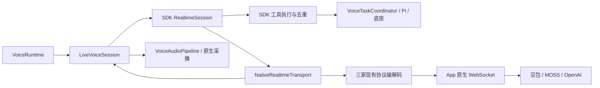

# OpenAI Agents SDK 语音会话接入记录

实现提交：`68d1890`。采用 `@openai/agents-realtime@0.22.0` 与 `@openai/agents-core@0.22.0`，版本和间接依赖由根 `pnpm-lock.yaml` 锁定。设计依据见 [SDK 调研](openai-agents-sdk-realtime-research-2026-11-14.md)，实施边界见 [接入计划](plans/openai-agents-sdk-integration.md)。

## 实际调用链

App 的主页对话和音色试听均创建真正的 `RealtimeAgent` 与 `RealtimeSession`。三家服务共用 SDK 会话契约，经 App 原生连接直连目标服务。



SDK 负责工具注册、执行、调用快照、同连接去重及本地历史。三个业务工具改为返回 Promise 和结构化结果，删除自有名称分派器、调用去重表及各工具重复的执行计数／回执调度。

`NativeRealtimeTransport` 负责原生 socket、发送队列、SDK 事件映射和供应商续答顺序。`LiveVoiceSession` 保留音频身份与播放进度、MOSS 回执、试听、12 秒待机和空闲通知窗口；独立任务仍由 `VoiceTaskCoordinator` 承载。

本次 OpenAI 也复用已有 wire（报文）编解码，保留原生实际播放位置对应的 truncate、鉴权头和握手配置。这样只替换公共会话核心，代价是继续维护这部分 OpenAI 编解码；具体取舍见计划。构建插件只为 SDK `_shims` 选择 React Native 实现，其他依赖继续使用原有解析条件。

## 语义与错误处理

- 用户语音开始时预留 SDK 历史项，stopped／committed 阶段绑定 provider itemId；迟到的转写分别更新原话轮。MOSS 的最终中断文本修订同一 assistant 项，并标为 `incomplete`。
- OpenAI 工具结果先写回，当前回复结束后合并请求续答。豆包沿用服务端自动续答。MOSS 等待工具批次汇总和结果确认，合并 `call_ids`；重复确认不重复请求，不清除其他 run 的语音活动。
- MOSS 的 VAD 通知仍只表示收音活动；明确的 audio stop／interrupted 才停止原生播放。SDK 的生成结束事件没有替代实际播放排空与服务终态。
- SDK 工具错误回调保留 stage、code、message 和 cause，并移除凭据；真实工具回执同时进入既有执行记录。豆包服务错误也保留底层 code。
- 正常关闭等待已受理的尾写；最终回执若返回 `EPIPE`，原会话记录写入真实错误码与 `websocket.write` 阶段。

新增依赖用于替换公共会话核心；适配器中的额外状态用于 SDK 契约没有覆盖的供应商回执、工具批次和原生关闭语义。没有新增产品服务端或开发机中转依赖。

## 验证结果

| 检查 | 结果 |
|---|---|
| 故障与 SDK 边界用例 | 20 项通过，其中 7 项为 SDK 接口回归 |
| 完整语音运行时 | 对话、试听、唤醒、OpenAI 打断、后台任务、重连历史与底座用例通过 |
| QuickJS 语音链路 | 在现有 VM 内执行对话、唤醒、OpenAI、追踪收尾和后台任务用例，通过 |
| 协议与 Langfuse 追踪 | 14 项通过 |
| 类型与构建 | App TypeScript／原生 Rust 检查、兼容层类型检查和 App 完整构建通过 |
| 真实豆包云端 | 新 App 会话代码经 SDK 和真实 WebSocket 返回 479,906 bytes PCM，约 9,998 ms，110 个播放片段，触发完整试听结束回调 |

核心命令：

```sh
pnpm --filter @super-looi/nsh test:voice-runtime
pnpm --filter @super-looi/nsh-node-compat exec node --import tsx scripts/verify.ts voice-runtime
pnpm --filter @super-looi/runtime exec node --test --import tsx test/realtime-protocol.test.ts test/langfuse-telemetry.test.ts
pnpm --filter @super-looi/nsh-node-compat typecheck
pnpm --filter @super-looi/nsh typecheck
pnpm --filter @super-looi/nsh build
```

7 项新增回归位于 [voice-sdk.node.ts](../apps/nsh/tests/voice-sdk.node.ts)：连续晚到 ASR、MOSS 截断文本、尾写错误、OpenAI 同轮多工具、MOSS 早到确认与批次合并、活动语音与汇总的两种顺序、工具错误链及其执行记录。独立审查发现的问题已修复，最终复审通过。

真实豆包检查复用 App `LiveVoiceSession`、SDK、编解码与追踪；音频端口按实时时钟排空队列，没有调用硬件扬声器。原始结果见 [live-doubao.json](artifacts/openai-agents-sdk-integration/live-doubao.json)。使用 `.env` 中的 `DOUBAO_API_KEY` 可复现：

```sh
pnpm exec node --env-file=.env --import tsx docs/artifacts/openai-agents-sdk-integration/live-doubao.mts
```

## 真机验收缺口

本轮 `devicectl` 和 ADB 均未发现连接设备，没有安装开发包或执行模拟器测试。横屏真机的麦克风／扬声器、实际播放回执、家居工具和任务回播仍需验收；MOSS 与 OpenAI 的真实云端 E2E 也保留在 [todo.md](../todo.md)。
