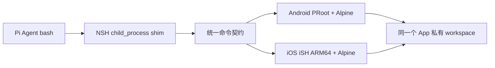

# OpenMinis 手机内 Linux 执行环境：源码分析与 NSH 接入判断

调研日期：2026-11-09。源码固定在 OpenMinis [`1a71df0`](https://github.com/OpenMinis/OpenMinis/tree/1a71df0f381cefde80bf912b723de6f9831bc177)。本文分析的是 Agent `bash` 的执行后端；更广的方案比较见[手机端 Terminal 执行后端调研](mobile-terminal-options-research.md)。OpenMinis 的真机测量均为其源码注释记录，本文未独立复现。

## 判断

**这条路线值得采用为“自包含强 Terminal”的架构参考，但应移植分层设计，不应把 OpenMinis 的 App 或整个执行栈直接搬进 NSH。** 它证明同一款手机 App 可在 Android 用 PRoot、iOS 用 ARM64 iSH 承载 Alpine，向 Agent 提供真实 `/bin/sh`、guest 进程、文件系统与包管理器。对我们的价值是把 `git`、Python、Node 等命令交给 Linux 用户态程序执行，不再逐个用 Rust 实现命令。代价集中在双端 native runtime、rootfs 构建与升级、文件映射、进程回收和 iOS 内存约束。它是两个不同的执行引擎共用一个 Agent 契约，并非一套跨端虚拟机。[项目概述](https://github.com/OpenMinis/OpenMinis/blob/1a71df0f381cefde80bf912b723de6f9831bc177/README.md)、[iOS 架构说明](https://github.com/OpenMinis/OpenMinis/blob/1a71df0f381cefde80bf912b723de6f9831bc177/docs/specs/ios-sandbox-ish-summary.md#L1-L56)

### 真正解决了什么

| 能力 | OpenMinis 的实现 | 对 NSH 的意义 |
| --- | --- | --- |
| 可执行程序 | Android PRoot 对 Linux aarch64 程序做用户态路径与身份适配；iOS iSH 在 App 内仿真 Linux 用户态与内核接口 | `sh` 能调用已安装的真实命令，而非只识别内置命令名 |
| 包与持久数据 | 两端把 Alpine minirootfs 随包分发，首次运行解压到 App 私有目录；guest 根文件系统持久化 | `apk` 可管理与架构兼容的包；镜像本身不等于首次启动预装 Git、Node、Python、`pnpm` |
| Agent 执行 | 两端当前均为每次 Agent 命令新建 `/bin/sh`；输出由 pipe 回传，命令有退出码、超时和停止路径 | 与我们现有 `spawn('/bin/sh', ['-c', ...])` 的调用形态接近 |
| 交互终端 | 独立 PTY（伪终端）路径，与 Agent 的非交互 pipe 路径分开 | 当前 `bash` 的能力升级无需先做完整终端 UI |

以上对应 [Android rootfs](https://github.com/OpenMinis/OpenMinis/blob/1a71df0f381cefde80bf912b723de6f9831bc177/src/android/app/src/main/java/com/openminis/app/sandbox/RootfsManager.kt#L18-L25)、[iOS rootfs](https://github.com/OpenMinis/OpenMinis/blob/1a71df0f381cefde80bf912b723de6f9831bc177/src/ios/iSH/RootfsManager.swift#L35-L55)、[Android fresh process](https://github.com/OpenMinis/OpenMinis/blob/1a71df0f381cefde80bf912b723de6f9831bc177/src/android/app/src/main/java/com/openminis/app/sandbox/FreshProcessShell.kt#L11-L40)、[iOS 执行协调器](https://github.com/OpenMinis/OpenMinis/blob/1a71df0f381cefde80bf912b723de6f9831bc177/src/ios/Agent/ISH/ISHExecutionCoordinator.swift#L121-L171)、[Android PTY](https://github.com/OpenMinis/OpenMinis/blob/1a71df0f381cefde80bf912b723de6f9831bc177/src/android/app/src/main/java/com/openminis/app/sandbox/PtyBridge.kt#L1-L32)。

## 两端的实际命令路径

### Android：PRoot 是每条命令的宿主进程

构建时准备 `alpine-minirootfs.tar.gz` 和 PRoot 原生二进制；运行时 `RootfsManager` 从 APK asset 解压到 `files/alpine-rootfs`，PRoot 放在 Android 可执行的 `nativeLibraryDir/libproot.so`。Android 10+ 不允许直接执行 App 数据目录中解压出来的 guest ELF；OpenMinis 将 loader 也打包进 `nativeLibraryDir`，由 loader 映射 guest 程序。其构建脚本记录了自行编译的 loader 在部分设备上使 guest 首条指令崩溃，当前使用固定 SHA 的 Termux loader。`PRootKernel.kt` 关于“loader 通常不存在”的旧注释与实际构建脚本矛盾，这里以构建脚本和已追踪产物为准。[构建步骤](https://github.com/OpenMinis/OpenMinis/blob/1a71df0f381cefde80bf912b723de6f9831bc177/BUILDING.md#L185-L221)、[rootfs 安装](https://github.com/OpenMinis/OpenMinis/blob/1a71df0f381cefde80bf912b723de6f9831bc177/src/android/app/src/main/java/com/openminis/app/sandbox/RootfsManager.kt#L37-L49)、[loader 实际打包与设备记录](https://github.com/OpenMinis/OpenMinis/blob/1a71df0f381cefde80bf912b723de6f9831bc177/deps/build_proot.sh#L333-L386)

`FreshProcessShell` 给 PRoot 传 `-r <rootfs>`、`-b host:guest`、`-w /root`，在 guest 内执行 `/bin/sh -c`。它为每条命令创建自己的 pipe，读取输出，单独监控超时；优先从 guest 写出的状态文件取回退出码，文件缺失时才取 PRoot 进程退出码，因为 PRoot 可能仍在追踪命令留下的 detached 进程。Android Release 将 stderr 合并进 stdout；这点与 NSH 当前 shim 的双流接口不同。[参数与环境](https://github.com/OpenMinis/OpenMinis/blob/1a71df0f381cefde80bf912b723de6f9831bc177/src/android/app/src/main/java/com/openminis/app/sandbox/FreshProcessShell.kt#L252-L320)、[输出/退出监控](https://github.com/OpenMinis/OpenMinis/blob/1a71df0f381cefde80bf912b723de6f9831bc177/src/android/app/src/main/java/com/openminis/app/sandbox/FreshProcessShell.kt#L101-L200)、[退出码选择](https://github.com/OpenMinis/OpenMinis/blob/1a71df0f381cefde80bf912b723de6f9831bc177/src/android/app/src/main/java/com/openminis/app/sandbox/FreshProcessShell.kt#L364-L385)、[stderr 合流](https://github.com/OpenMinis/OpenMinis/blob/1a71df0f381cefde80bf912b723de6f9831bc177/src/android/app/src/main/java/com/openminis/app/sandbox/FreshProcessShell.kt#L288-L305)

这里有一个重要的源码演进：项目仍有 `PersistentShell` 类和温 Shell 的执行路径，但 [`DEFAULT = FRESH_PROCESS`](https://github.com/OpenMinis/OpenMinis/blob/1a71df0f381cefde80bf912b723de6f9831bc177/src/android/app/src/main/java/com/openminis/app/sandbox/ShellExecutionStrategy.kt#L65-L120)。旧路径把结束标记混在 stdout 中，源码记录过标记跨 read 分包、短输出被缓冲吞掉、超时进程污染下一条命令输出三类故障。作者记录的 Pixel 6 测量是启动 `sh -c 'echo hi'` 约 4.2 ms，而单次工具调用宿主开销约 65–90 ms；这是其设备与实现的数据，不能直接代入我们的延迟预算。[动机与测量](https://github.com/OpenMinis/OpenMinis/blob/1a71df0f381cefde80bf912b723de6f9831bc177/src/android/app/src/main/java/com/openminis/app/sandbox/ShellExecutionStrategy.kt#L4-L56)

### iOS：iSH 内核在 App 进程内，命令是 guest 进程

OpenMinis 使用自己的 ARM64 iSH fork 和 aarch64 Alpine fakefs；首次从随包的 `alpine-rootfs.zip` 安装。`ISHExecutionCoordinator` 对每次 Agent 命令 fork 独立 `/bin/sh`，给它 pipe 与会话文件系统 context，因此同一会话的多个调用也可并发。[rootfs 安装](https://github.com/OpenMinis/OpenMinis/blob/1a71df0f381cefde80bf912b723de6f9831bc177/src/ios/iSH/RootfsManager.swift#L170-L214)、[并发契约](https://github.com/OpenMinis/OpenMinis/blob/1a71df0f381cefde80bf912b723de6f9831bc177/src/ios/Agent/ISH/ISHExecutionCoordinator.swift#L121-L171)、[Agent 调用带 context 的入口](https://github.com/OpenMinis/OpenMinis/blob/1a71df0f381cefde80bf912b723de6f9831bc177/src/ios/Agent/ISH/ISHExecutionCoordinator.swift#L453-L488)

iOS 最具体的运行代价是 guest 进程共享 App 的内存预算。OpenMinis 的 fork guard 注释记录过并行命令把 App 内存推高、Jetsam 结束 App，以及固定内存阈值导致高内存设备每个简单命令平白停顿；当前在系统内存压力下，按设备 RAM 比例设 footprint 阈值，对 fork 最多等待 2 秒，随后仍允许执行。内核在进程中只启动一次，已启动时重置 rootfs 后需重启 App 才能重新挂载。[内存与设备记录](https://github.com/OpenMinis/OpenMinis/blob/1a71df0f381cefde80bf912b723de6f9831bc177/src/ios/iSH/ISHKernel.m#L99-L181)、[重置生命周期](https://github.com/OpenMinis/OpenMinis/blob/1a71df0f381cefde80bf912b723de6f9831bc177/src/ios/iSH/RootfsManager.swift#L252-L260)

项目所称的 Linux Shell 默认是 Alpine `/bin/sh`，不意味着预装 GNU Bash。Android 在识别到 Bash 语法需求时有按需安装 Bash 的实现；我们的 Agent 工具虽叫 `bash`，现有调用实际也是 `/bin/sh -c`，因此第一阶段无需为保持现有契约预装 Bash。需要 Bash 专有语法时，再把 `apk add bash` 和实际运行结果纳入命令能力判断。[Android 按需安装](https://github.com/OpenMinis/OpenMinis/blob/1a71df0f381cefde80bf912b723de6f9831bc177/src/android/app/src/main/java/com/openminis/app/agent/shell/OnDemandBash.kt#L57-L102)、[本仓调用](../packages/looi-runtime/src/agent/pi-executor.ts#L587-L604)

## 文件空间：接入成败的核心

OpenMinis 没让 Agent 复制文件进出 guest。Android 用每个 Shell 的 `-b host:guest` 参数挂载该会话 workspace；iOS 在 iSH fakefs 路径翻译 hook 中用 `fs_context` 把 guest `/var/minis/workspace` 路由到会话目录，fork 的子进程继承 context。两端还将全局目录与会话目录分开，避免后启动的会话改写前一个会话看到的目录。[Android SessionMounts](https://github.com/OpenMinis/OpenMinis/blob/1a71df0f381cefde80bf912b723de6f9831bc177/src/android/app/src/main/java/com/openminis/app/sandbox/SessionMounts.kt#L7-L35)、[iOS MinisFsRouter](https://github.com/OpenMinis/OpenMinis/blob/1a71df0f381cefde80bf912b723de6f9831bc177/src/ios/Agent/ISH/MinisFsRouter.swift#L5-L27)

我们目前的 `NodeCompat` 把虚拟 `/workspace` 放在 App 数据目录 `node-compat/files/workspace`，Agent `bash` 的 `cwd` 已是 `/workspace`，各会话目前共用这一个目录。[NodeCompat 初始化](../apps/nsh/src/compat.rs#L9-L25)、[Sandbox 目录](../packages/nsh-node-compat/rust/src/sandbox.rs#L12-L20)、[Agent 配置](../apps/nsh/runtime/application.ts#L725-L737)。接入时应让两端 guest 的 `/workspace` 指向**同一个宿主目录**，使 `write_file`、`read_file` 和 `bash` 立即看到相同内容。rootfs 的 `/root`、`/usr`、包数据库应与 workspace 分开；否则镜像升级或重置会碰到用户任务文件。若产品以后要求会话级隔离，需同时调整 Pi 的 workspaceRoot 和文件工具目录，不应只在 guest 侧增加映射。这是根据本仓文件布局提出的接入设计，不是 OpenMinis 现成接口。

## 在 NSH 中应接哪一层

当前调用链是 `PiAgentExecutor.bash` → `node:child_process` shim → `NodeCompat` 异步 Shell job → Rust 内置 Shell。`bash` 的描述已明确写出移动端只有固定命令；Rust 遇到未知命令返回 127，默认 1 秒、上限 30 秒。shim 的 PID 是 actor ID，结果完成后才把 stdout/stderr 推给 JS stream，因此 Agent 当前也没有真正的实时输出。[Pi bash](../packages/looi-runtime/src/agent/pi-executor.ts#L587-L643)、[child_process shim](../packages/nsh-node-compat/src/shims/child_process.ts#L20-L35)、[异步返回](../packages/nsh-node-compat/src/shims/child_process.ts#L77-L139)、[Rust Shell](../packages/nsh-node-compat/rust/src/shell_bridge.rs#L645-L712)

推荐保留 Pi Agent 的 `bash` 工具和现有审批/任务停止入口，在 `NodeCompat` 的异步 Shell job 处换成平台执行后端。最小调用契约是 `command`、`cwd`、`env`、`timeout`、`cancel token`，结果沿用 `stdout`、`stderr`、`exitCode` 字段并明确取消/超时状态。若直接沿用 OpenMinis Android Release 的合流方式，可将合并输出放入 `stdout`、`stderr` 留空；若产品需要精确双流，Android 后端还须分别排空两条 pipe，这是额外实现。Android 由 PRoot 进程实现，iOS 由 iSH guest 进程实现。原生模块拥有 rootfs 安装、工作区映射、进程组停止与 App 生命周期；JS shim 只维护 `child_process` 兼容语义。若要让对话中实时展示输出，再扩展 job 为增量事件；这比换执行引擎多一层传输改动，不是跑通真实命令的前提。原生能力应通过 NSH 受支持的插件/注册入口接入。

不要把交互终端 PTY 与 Agent `bash` 合为同一个调用。OpenMinis 分别实现两条路径：Agent 的 pipe 可准确交付退出码，终端的 PTY 负责输入、窗口尺寸和控制字符。当前用户抱怨的是 Agent 命令覆盖率，先解决 pipe 执行能直接命中需求。[iOS Agent](https://github.com/OpenMinis/OpenMinis/blob/1a71df0f381cefde80bf912b723de6f9831bc177/src/ios/Agent/ISH/ISHExecutionCoordinator.swift#L121-L171)、[Android PTY 桥](https://github.com/OpenMinis/OpenMinis/blob/1a71df0f381cefde80bf912b723de6f9831bc177/src/android/app/src/main/java/com/openminis/app/sandbox/PtyBridge.kt#L1-L32)

## 复杂性、可移植性与验证门槛

| 新增部分 | 具体用途 | 维护成本与判断 |
| --- | --- | --- |
| Alpine rootfs | 提供 `/bin/sh`、动态链接器、`apk` 与包生态 | 双端架构与镜像构建、首次解压和升级；若需求仅文件搜索，不值得引入 |
| Android PRoot + loader | 执行普通 Linux aarch64 用户态程序 | 原生构建、Android 10+ 可执行布局、进程/pipe/退出管理；可参考 OpenMinis 构建脚本 |
| iOS ARM64 iSH fork | 在 iOS App 内运行 Linux guest 程序 | C/ObjC/Swift 集成、fakefs、内存与内核生命周期；工程风险和工作量最大 |
| 两端 workspace 映射 | 让 guest 与现有 NSH 文件工具读写同一份文件 | Android bind 参数与 iOS 路径 hook 需要各自实现；共享契约可收敛在 `/workspace` |
| Shell job 适配 | 保留现有 Pi 调用方、取消与结果语义 | 需区分取消、超时和退出码；现有 JS 端流式输出仍需要额外传输层支持 |

OpenMinis 自身把 iSH 和 PRoot fork 纳入构建，README 声明其 App 以 GPLv3 分发。若考虑复用其代码或 fork，这会直接影响我们的依赖与分发决策；应在选定复用边界时核对具体组件许可。这里只转述该项目的实际做法，不把它推论为所有独立实现的许可结论。[OpenMinis 许可说明](https://github.com/OpenMinis/OpenMinis/blob/1a71df0f381cefde80bf912b723de6f9831bc177/README.md#L201-L208)

建议的真机验证是一个窄切片：在 Android 现有魅族真机与一台 iPhone 开发包中，让 guest 与 `NodeCompat` 共用 `/workspace`，依次执行 `pwd`、`git status`、`python3 -c`、`node -v`、`pnpm -v`，再验证长输出、取消、超时及 `write_file`/`read_file` 与 guest 的跨工具读写一致。前五个命令区分“能启动 Shell”与“所需包实际可用”；后四项检查 Agent 已经依赖的执行契约。`pnpm` 需作为包安装结果单独验证，不能从 Alpine 或 Node 的存在推定。若 Android 通过而 iOS 在目标设备上因内存或某个命令包受阻，就把受阻命令和设备测量写回方案后再定交付范围。此处是落地验证建议，尚未在本仓实施。
