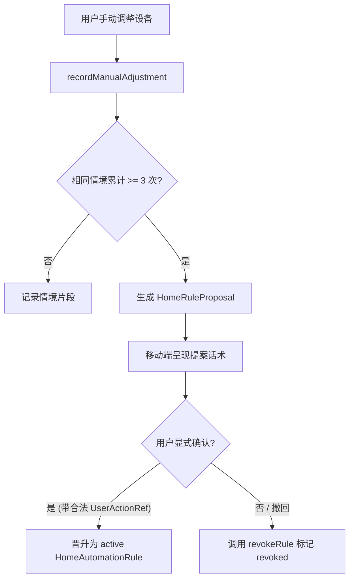

# Phase 4: 情境智能家居闭环 (`HomeGateway` + Home Assistant) 与移动端“维修舱”内页架构与实现文档

## 1. 概述与核心哲学

在家庭智能体与桌面具身机器人联动智能家居的实际场景中，若缺乏严格的物理与协议防护，极易发生以下工程安全隐患与体验割裂：
1. **越权执行高危设施控制**：将门锁、燃气阀、安防警报等高危设备暴露给开放式对话大模型，一旦发生提示词注入或指令误解析，可能导致严重的人身财产安全隐患。
2. **盲猜与非幂等开关震荡 (Toggle Oscillations)**：当用户说“帮我把灯打开”，若书房同时存在吸顶灯与台灯，系统不追问就随机挑选甚至下发非幂等的 `toggle` 指令，导致“本开着的灯被关上，本关着的灯被打开”。
3. **视觉臆测覆盖物理真值**：用多模态大模型“看”画面去猜测环境温湿度或二氧化碳浓度，或者当物理灯具已通电回报开灯但画面因逆光/角度偏暗时，错误推翻设备真实状态。
4. **单绿点粉饰断连 (Single-Green-Dot Masking)**：移动端用一个综合绿点代表“一切正常”，当智能家居网关断开时用户毫不知情，重连时又自动盲目重放旧电机的物理运动。

Super-LOOI Phase 4 彻底确立了**情境智能家居安全闭环**与**第三大内页“维修舱”**：
- **物理安全红线**：代码层硬编码禁止操控门锁 (`lock`)、安防 (`alarm_control_panel`)、燃气 (`gas`)、热水器 (`water_heater`)、车库门 (`garage_door`) 等高危域。
- **实体白名单与歧义消除 (Target Disambiguation)**：严格按白名单过滤；多实体匹配时坦率发起追问澄清，绝不盲猜。
- **No-Toggle 规范与新鲜 No-op**：严禁非幂等 `toggle`；状态新鲜且已匹配目标时直接输出 `verified noop`，避免冗余网络下发。
- **批量执行诚实局部报告 (`outcome: "partial"`)**：并发场景下发时，若某一设备超时或失败，如实上报局部故障与失败明细，严禁用“全部成功”糊弄用户。
- **传感器真值独占与多源证据共存**：环境数值（温湿度、CO2 等）严禁视觉估算，必须来自 `sensor.*`；当物理状态与视觉画面冲突时，保留多源证据输出诚实双源解释。
- **3 次微调规则晋升机制**：用户连续 3 次在相同情境下手动调光，系统主动提案并经由移动端合法 `UserActionRef` 授权后晋升为确定性规则。
- **移动端“维修舱”与离线诚实指示 (Screen 14)**：独立展示 BLE 底座、Hub 主机、HA 网关三路状态，重连时抑制陈旧物理动作，热切换语音/视觉 Provider。

---

## 2. 数据库持久化 Schema (`apps/hub/src/home/schema.sql`)

PostgreSQL DDL 包含 4 张核心表：

```
+------------------------------------+
|           home_entities            |
+------------------------------------+
       |                     |
       v                     v
+--------------------+ +-----------------------+
|home_state_snapshots| | home_automation_rules |
+--------------------+ +-----------------------+
       |
       v
+--------------------+
|home_action_receipts|
+--------------------+
```

1. **`home_entities`**: 记录白名单实体、所属房间、能力域、参数合法区间（如亮度 1..255、色温 2200..6500K）与状态新鲜度阈值（`max_state_age_ms`）。
2. **`home_state_snapshots`**: 缓存各实体的最新遥测快照与变更时间戳。
3. **`home_action_receipts`**: 审计设备控制指令下发、目标状态与 `ReadbackEvidence(kind: "device_state")`。
4. **`home_automation_rules`**: 记录经用户确认的确定性偏好规则。

---

## 3. 智能家居网关 (`HomeAssistantGateway`)

位于 `apps/hub/src/home/gateway.ts`：

### 3.1 高危域拦截与白名单机制
```typescript
export const FORBIDDEN_HIGH_RISK_DOMAINS = new Set([
  "lock",
  "alarm_control_panel",
  "gas",
  "water_heater",
  "garage_door",
]);
```
- 若指令涉及高危域，立即驳回：`ActionReceipt(status: "rejected", reason_code: "forbidden_high_risk_domain")`。
- 若实体未在白名单中，驳回：`ActionReceipt(status: "rejected", reason_code: "entity_not_whitelisted")`。

### 3.2 歧义目标消除 (`resolveTargets`)
当用户发出自然语言指令（例如“把书房灯打开”）：
```typescript
const result = await gateway.resolveTargets("书房灯", "书房");
// 输出:
// {
//   status: "ambiguous",
//   candidates: [light.study_ceiling, light.study_desk],
//   clarificationPrompt: "书房有书房吸顶灯和书房台灯，你想调哪一盏？"
// }
```
系统通过双阶匹配（特定名称优先，泛化类别兜底），若存在多盏灯绝不抛硬币猜选，而是向用户索取澄清。

### 3.3 No-Toggle 与状态回读核验
- **拒绝 Toggle**：`command.service === "toggle"` 强制驳回并提示 `non_idempotent_toggle_forbidden`。
- **新鲜 No-op**：若当前缓存状态在 `max_state_age_ms` 窗口内且已等于目标状态，直接返回 `status: "verified", outcome: "noop"`，节省蜂窝与网关带宽。
- **回读超时**：下发指令后在超时时间内未收到状态同步，返回 `status: "unverified", reason_code: "readback_timeout"`，严禁断连后重连盲目重发。
- **批量部分完成 (`executeBatch`)**：多设备控制时若出现个别设备离线，返回 `outcome: "partial"` 并列出 `failedEntities`。

### 3.4 传感器真值与视觉观测共存
- **环境指标独占**：`readEnvironmentalMetric(metric)` 仅允许从注册的 `sensor.*` 读取带时间戳的真值；无传感器时抛出拒绝，严禁使用摄像头画面估算。
- **物理与视觉调和 (`reconcileDeviceAndVisualState`)**：
  若物理设备遥测回报 `state = "on"`，但 VLM 视觉判定“房间画面偏暗”，系统保留双方事实与时间戳，并输出诚实话术：
  `"书房灯设备已回报开启，但镜头画面仍偏暗（可能受遮挡或曝光影响）。"`
  绝对不以大模型的视觉猜测篡改真实物理遥测。

---

## 4. 偏好规则晋升引擎 (`HomeRulesEngine`)

位于 `apps/hub/src/home/rules-engine.ts`：



- **单次微调不越权**：用户单次调光仅作为行为片段记录，避免过度打扰。
- **3 次一致即提案**：相同情境（如晚间书房台灯设为 30% / 3000K）出现 3 次后生成 `HomeRuleProposal`：
  `"你最近 3 次在 evening_study 都把 light.study_desk 设为相同偏好，要把这个设为默认规则吗？"`
- **显式授权晋升**：调用 `/api/home/rules/:proposalId/confirm` 时必须携带合法且未过期的 `UserActionRef`，晋升为 `HomeAutomationRule`。
- **秒级撤回**：调用 `/api/home/rules/:ruleId/revoke` 即时停用。

---

## 5. 移动端“维修舱”共形内页 (`CabinSpaceController`)

位于 `apps/mobile/src/ui/cabin-space.ts`，补齐了 Super-LOOI 三大核心内页矩阵（**回忆册 / 约定与任务簿 / 维修舱**）：

### 5.1 共形形变状态机
`face_fullscreen` <-> `eyes_closing_to_cabin` <-> `cabin_open` <-> `cabin_converging_to_eyes`。

### 5.2 离线降级诚实指示 (Screen 14)
针对具身设备常见的子系统局部故障，维修舱**独立**展示 3 路核心连接：
1. **LOOI 具身底座 (BLE)**：显示连接状态、最后通信时间戳与状态色。
2. **本地大脑主机 (Hub)**：显示 WebSocket / HTTP 连通状态。
3. **智能家居网关 (Home Assistant)**：显示网关桥接状态。

> [!IMPORTANT]
> **杜绝单绿点粉饰**：若智能家居网关掉线，界面只将 HA 标红 (`#FA8E86`)，底座与主机保持绿色 (`#4ADE80`)，整体状态摘要输出：`"部分系统异常: 智能家居网关未连接"`，绝不以单一综合绿点粉饰断连。

### 5.3 重连动作抑制保护
当 BLE 偶发断连重连后，`handleReconnect` 自动拦截并丢弃在断连期间积压的陈旧移动指令计数，防止下位机突然抽搐重放。

### 5.4 Provider 热切换与传感器指示
- 语音引擎：`doubao` (全双工端到端) <-> `modular` (流式 ASR+LLM+TTS)
- 视觉引擎：`cloud` <-> `lan` <-> `edge`
- 硬件传感器实时工作指示：摄像头采集、麦克风拾音、后台模型推理。

---

## 6. REST API 接口汇总 (`apps/hub/src/app.ts`)

| 路径 | 方法 | 请求体 / 参数 | 说明 |
| :--- | :--- | :--- | :--- |
| `/api/home/entities` | `GET` | - | 获取白名单实体能力清单 |
| `/api/home/resolve` | `GET` | `?q=...&room=...` | 自然语言目标设备歧义消除与追问 |
| `/api/home/execute` | `POST` | `HomeControlCommand` | 显式幂等控制，返回带 ReadbackEvidence 的回执 |
| `/api/home/batch-execute`| `POST`| `{ commands: [...] }` | 批量场景执行，诚实返回 partial 与失败明细 |
| `/api/home/rules` | `GET` | - | 查询生效自动化规则与待确认提案 |
| `/api/home/rules/adjustments` | `POST` | `{ entityId, service, serviceData, contextHint }` | 记录手动调整，触发 3 次自动提案 |
| `/api/home/rules/:proposalId/confirm` | `POST` | `{ userAction: UserActionRef }` | 显式授权确认提案 |
| `/api/home/rules/:ruleId/revoke` | `POST` | - | 即时撤销生效规则 |

---

## 7. 测试与验证结果

Monorepo 工作区全量类型检查、测试与构建 100% 通过：
```bash
pnpm typecheck   # 4 packages: 0 errors
pnpm test        # 78 tests passing (Hub: 39, Mobile: 23, Driver: 11, Contracts: 5)
pnpm build       # Clean ESM build across all workspace packages
```

- **`apps/hub/test/home-gateway-and-rules.test.ts`**:
  - 严拒门锁、安防等高危域及未授权实体。
  - 自然语言目标歧义追问话术核验。
  - 拒绝 `toggle` 指令与参数越界拦截。
  - 新鲜 No-op、真实 applied 与超时 unverified。
  - 批量场景局部失败诚实报告。
  - 传感器真值独占性与物理/视觉画面差异调和。
  - 3 次微调产生提案、显式确认与撤销。
- **`apps/mobile/test/cabin-space.test.ts`**:
  - 维修舱共形展开与收缩动画状态机。
  - 3 独立子系统连接状态指示与非单绿点降级呈现。
  - 重连动作抑制。
  - 语音/视觉 Provider 热切换与传感器指示。
