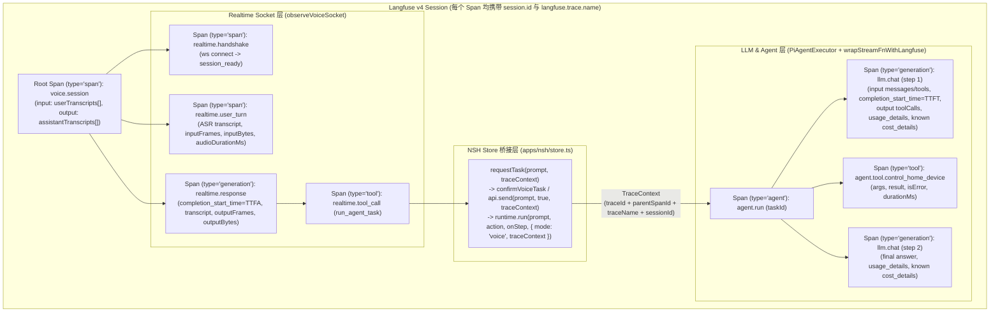

# Langfuse v4 本地调试可观测性平台接入与 Realtime 协议抽象计划 (Plan)

日期：2026-11-08
目标宿主：`packages/looi-runtime` + `apps/nsh`（Native Shell 0.4.0 + QuickJS 运行时）
参考版本：[Langfuse v4 (2026-08-17)](https://langfuse.com/changelog/2026-08-17-langfuse-v4)、[OpenAI Realtime GA Guide](https://developers.openai.com/api/docs/guides/realtime)

---

## 1. 目标与核心设计原则

Super-LOOI 采用 **「端侧 KWS（Keyword Spotting，关键词检测）唤醒 $\rightarrow$ Realtime WebSocket 全双工语音（快交互层） $\rightarrow$ `PiAgentExecutor` / `pi-ai` 多步推理与工具执行（慢执行层）」** 的双层模型架构。本计划达成两个紧密协作的核心目标：

1. **在 `VoiceRuntime` 抽离多厂商 Realtime 协议适配层（`RealtimeProtocolAdapter`）**：
   解除 [`VoiceRuntime`](file:///Users/bugyaluwang/project/super-looi/apps/nsh/runtime/voice/runtime.ts) 对豆包 Duplex V3 单一协议的硬编码耦合，抽象统一的连接握手机制、上下行控制帧编码、16kHz$\rightarrow$24kHz 实时重采样与下行事件归一化模型（`NormalizedRealtimeEvent`），原生内置 **豆包 Duplex V3** 与 **OpenAI Realtime GA API**（同时兼容遵循 OpenAI Realtime 规范的 Qwen-Omni-Realtime / GLM-Realtime 等厂商），并支持后续零侵入扩展新厂商。
2. **引入自托管 Langfuse v4（Observation-Centric + Native OTel）覆盖「Realtime Socket 层 $\rightarrow$ LLM Agent 层」全链路可观测性**：
   - **对齐 Langfuse v4 最新架构**：采用 Langfuse v4 的 **Observation-Centric（以 Observation 为中心）** 模型与原生 **OTLP/HTTP JSON 端点（`POST /api/public/otel/v1/traces` + `x-langfuse-ingestion-version: 4`）**；每个 Observation 统一携带 `session.id` 与 `langfuse.trace.name`（满足 v4 按 Observation 独立筛选的要求），并在根 Observation（`voice.session` / `agent.run`）写入整体 `input` 与最终 `output`；
   - **Realtime 层**：复用 `RealtimeProtocolAdapter` 归一化事件流，在内存做高频音频帧流式折叠（Stream Folding），采集握手耗时、ASR（Automatic Speech Recognition，自动语音识别）转写、首包音频延迟（TTFA, Time To First Audio，写入 `langfuse.observation.completion_start_time`）、下行音频统计与工具调用；
   - **跨层桥接**：通过 `run_agent_task` 的 W3C 标准十六进制 `TraceContext`（32 位 `traceId` + 16 位 `parentSpanId` + `traceName` + `sessionId`），完整穿透 `requestTask` $\rightarrow$ `store.ts (api.send / confirmVoiceTask)` $\rightarrow$ `MobileRuntime.run` $\rightarrow$ `PiAgentExecutor.run`；
   - **LLM 层**：拦截 `StreamFn` 与工具执行，记录 System Prompt、Messages、Thinking 思考过程、Tool Calls、首字延迟（TTFT, Time To First Token）与 Token 消耗（`langfuse.observation.usage_details`）；仅在模型价格已知（Provider 实报成本或内置目录非零单价）时上报 `langfuse.observation.cost_details`，未知价格的自定义模型省略该属性，绝不将未知成本谎报为零；
   - **遥测 UI 0 新增、语音凭据标签对齐与密钥隔离**：Langfuse 遥测不新增任何 UI 组件，仅对 [`VoiceSpaceView.tsx`](file:///Users/bugyaluwang/project/super-looi/apps/nsh/ui/VoiceSpaceView.tsx#L89-L103)、[`ManagementShell.tsx`](file:///Users/bugyaluwang/project/super-looi/apps/nsh/ui/ManagementShell.tsx#L159) 与 [`App.tsx`](file:///Users/bugyaluwang/project/super-looi/apps/nsh/App.tsx#L158) 中硬编码“豆包”的 4 处文案做动态 `voiceProviderLabel()` 绑定（`doubao` 显示 `"豆包"`，`openai` 显示 `"OpenAI"`）；通用构建与发布包（`pnpm build` / `release-ios` / `release-android`）**绝不注入** `LANGFUSE_SECRET_KEY`，仅在 Node 环境变量或显式开启本地调试构建（`LOOI_DEBUG_TELEMETRY=1`）时注入调试配置。

---

## 2. 复杂度与依赖审视（Complexity & Trade-off Review）

| 新增概念/模块 | 具体用途 | 复杂性成本与取舍解释 |
| :--- | :--- | :--- |
| **`docker-compose.langfuse.yml` 本地自托管编排（Langfuse v4）** | 在本机一键启动 **Langfuse v4**（`docker.langfuse.com/langfuse/langfuse:4` + `langfuse-worker:4` + `clickhouse/clickhouse-server:25.12` + `postgres:17` + `redis:7` + `minio/minio`），自动初始化本地项目与固定开发密钥（`pk-lf-super-looi-local` / `sk-lf-super-looi-local`） | 仅新增 1 个独立 Compose 文件与 `.env` 可选变量，与现有 [`docker-compose.home.yml`](file:///Users/bugyaluwang/project/super-looi/docker-compose.home.yml) 保持相同的可选本地基础设施模式。锁定 ClickHouse `25.12` 以支持 Langfuse v4 的原生 JSON 类型与宽表极速检索。 |
| **零依赖 OTLP/JSON 客户端 `LangfuseTracer`（`packages/looi-runtime/src/telemetry/langfuse.ts`）** | 对接 Langfuse v4 原生 `POST /api/public/otel/v1/traces`（携带 `x-langfuse-ingestion-version: 4` 与 `Content-Type: application/json`），批量上报 OTLP `resourceSpans` | **不引入官方 `langfuse` 或 `@opentelemetry/sdk-*` npm 包**。在 Langfuse v4 的 Observation-Centric 模型下，每个已完成的 Observation（`agent` / `tool` / `generation` / `span`）只需在结束时生成 1 条不可变的 OTLP JSON Span（含 `startTimeUnixNano` 与 `endTimeUnixNano`），并自动向每个子 Span 传播 `session.id` 与 `langfuse.trace.name`。未配置密钥时退化为 `NOOP_TRACER`（零内存分配、零网络开销）。 |
| **多厂商 `RealtimeProtocolAdapter`（`packages/looi-runtime/src/voice/realtime-protocol.ts`）** | 集中封装不同厂商 Realtime WebSocket 的鉴权、握手、采样率重采样、工具回执续说、打断与事件归一化 | **深模块设计（Deep Module）**：将豆包 Duplex V3 与 OpenAI Realtime GA 的协议差异收敛在单一模块内，同时服务于 `VoiceRuntime`（业务状态机）和 `RealtimeSessionObserver`（Langfuse v4 观测器），消除重复解析逻辑。OpenAI WebSocket 打断还要求 `VoiceRuntime` 按输出 item 记录实际已播放毫秒，适配器据此编码 `conversation.item.truncate`；增加一组播放归属状态，不新增依赖或独立服务。 |
| **`RealtimeSessionObserver` 与 `wrapStreamFnWithLangfuse`** | 在 WebSocket 接缝与 `StreamFn` 接缝处透明挂载 Langfuse v4 追踪 | 高频音频帧（50fps `input_audio_buffer.append` 与 `output_audio.delta`）在内存中以 $O(1)$ 开销折叠为帧数/字节数/时长/TTFA 指标，不在 QuickJS 中制造事件风暴。 |

---

## 3. 核心架构与模块边界设计（Codebase Design）

### 3.1 方案比选（Design It Twice）

针对如何将多厂商 Realtime 协议与 Langfuse v4 接入 `VoiceRuntime` 及 `PiAgentExecutor`，我们对比了两种模块边界设计：

1. **方案一：业务内联分支与打点（Inline Protocol Branches & Ad-hoc Hooks）**
   - 在 [`VoiceRuntime.read()`](file:///Users/bugyaluwang/project/super-looi/apps/nsh/runtime/voice/runtime.ts#L232) 的每个 `else if (event.type === ...)` 分支中直接判断豆包/OpenAI 事件名并拼装上报请求，在 [`PiAgentExecutor.execute()`](file:///Users/bugyaluwang/project/super-looi/packages/looi-runtime/src/agent/pi-executor.ts#L747) 中穿插上报代码。
   - **淘汰原因**：破坏模块局部性（Locality）。`VoiceRuntime` 已经维护了 5 个计时器、音频播放排空队列与并发代际号（`generation`），若再耦合多厂商协议分支与追踪状态机，认知负担翻倍。
2. **方案二：协议适配器深模块 + 传输层接缝装饰器（Deep Module via `RealtimeProtocolAdapter` & Transport Seams）—— 选定方案**
   - **协议归一化接缝（`RealtimeProtocolAdapter`）**：将所有厂商特有的 URL/Header 构造、握手帧、16kHz$\rightarrow$24kHz 重采样、工具结果续说（`response.create`）及下行事件解析收敛到 `RealtimeProtocolAdapter`。`VoiceRuntime` 只消费统一的 `NormalizedRealtimeEvent`。
   - **Realtime 观测接缝（`observeVoiceSocket`）**：利用 [`VoiceSocket`](file:///Users/bugyaluwang/project/super-looi/apps/nsh/runtime/voice/types.ts)（`read` / `write` / `close`）接缝，在内部复用同一个 `RealtimeProtocolAdapter.parseServerEvent` 完成事件归一化、高频音频流折叠与 OTel Span 生命周期管理。
   - **跨层串联接缝（`TraceContext`）**：当收到 `run_agent_task` 工具调用时，观察器为该 `call_id` 创建 `tool` 类型 Span，并将 `{ traceId, parentSpanId, traceName, sessionId }` 作为 `TraceContext` 传给 `requestTask(prompt, traceContext)` $\rightarrow$ `api.send(prompt, true, traceContext)` $\rightarrow$ `MobileRuntime.run()` $\rightarrow$ `PiAgentExecutor.run()`。
   - **LLM 观测接缝（`wrapStreamFnWithLangfuse`）**：在 `PiAgentExecutor` 内部包装 `StreamFn`，直接拦截传给模型的 `TranscriptContext` 和返回的 `AssistantMessageEventStream`，精确计算 TTFT 并按需提取 Token 与已知 Cost。

### 3.2 核心接缝 1：多厂商 `RealtimeProtocolAdapter` 接口契约

核心实现位于 `packages/looi-runtime/src/voice/realtime-protocol.ts`，并由 [`apps/nsh/runtime/voice/protocol.ts`](file:///Users/bugyaluwang/project/super-looi/apps/nsh/runtime/voice/protocol.ts) 导出：

```typescript
export type RealtimeProviderId = "doubao" | "openai" | (string & {});

export type RealtimeInterruptContext = {
  trigger: "manual" | "server_vad";
  responseId?: string;
  responseInProgress: boolean;
  cancelEventId?: string;
  playback?: { itemId: string; contentIndex: number; playedMs: number };
};

export type NormalizedRealtimeEvent =
  | { kind: "session_ready"; sessionId?: string }
  | { kind: "user_speech_started" }
  | { kind: "user_speech_stopped"; transcript?: string }
  | { kind: "user_transcription_failed"; message?: string }
  | { kind: "response_started"; responseId: string }
  | { kind: "audio_started"; responseId: string; itemId?: string; contentIndex?: number }
  | { kind: "audio_delta"; responseId: string; pcmBase64: string; itemId?: string; contentIndex?: number }
  | { kind: "audio_done"; responseId: string; itemId?: string; contentIndex?: number; statusCode?: string; userQueryExit?: boolean }
  | { kind: "text_delta"; responseId: string; delta: string }
  | { kind: "text_done"; responseId: string; text: string }
  | {
      kind: "tool_calls";
      responseId: string;
      calls: Array<{ callId: string; name: string; argumentsJson: string }>;
    }
  | { kind: "response_cancelled"; responseId: string }
  | { kind: "response_done"; responseId: string; usage?: Record<string, number> }
  | { kind: "error"; message: string; code?: string; clientEventId?: string }
  | { kind: "ignored"; rawType: string };

export interface RealtimeProtocolAdapter {
  readonly providerId: RealtimeProviderId;
  readonly model: string;
  readonly inputSampleRate: 16000 | 24000;
  readonly outputSampleRate: 24000;
  /** 生成 WebSocket URL 与鉴权请求头 */
  connectTarget(apiKey: string): { url: string; headers: Record<string, string> };
  /** 建连后立即发送的初始化帧（豆包为 session.create，OpenAI GA 为 session.update） */
  createHandshakeMessages(tools: VoiceToolSchema[]): Record<string, unknown>[];
  /** 编码 16kHz 采集帧（若目标协议要求 24kHz PCM16，则在适配器内完成 16k->24k 线性插值重采样） */
  encodeAudioAppend(pcm16k: Uint8Array): Record<string, unknown>;
  /** 编码静音状态变更（豆包发 input_audio_mute.commit，OpenAI 发 input_audio_buffer.clear 或 null） */
  encodeMute(muted: boolean): Record<string, unknown> | null;
  /** 编码工具执行结果回传帧（豆包仅发 conversation.item.create；OpenAI 发 function_call_output + response.create） */
  encodeToolReply(callId: string, output: unknown): Record<string, unknown>[];
  /** 根据打断来源、回复状态与实际播放进度编码控制帧 */
  encodeInterrupt(context: RealtimeInterruptContext): Record<string, unknown>[];
  /** 编码会话优雅关闭帧（豆包发 session.close，OpenAI 返回 null 直接关 Socket） */
  encodeSessionClose(): Record<string, unknown> | null;
  /** 将不同厂商的下行 JSON 帧归一化为统一的 NormalizedRealtimeEvent */
  parseServerEvent(event: Record<string, unknown>): NormalizedRealtimeEvent;
}
```

#### 多厂商协议差异收敛对比表（豆包 Duplex V3 vs OpenAI Realtime GA）

| 协议能力 | `doubaoDuplexV3Protocol`（默认） | `openAiRealtimeProtocol`（OpenAI Realtime GA 及兼容厂商） |
| :--- | :--- | :--- |
| **Endpoint & Headers** | `wss://openspeech.bytedance.com/api/v3/duplex/realtime/dialogue`<br>`{ "X-Api-Key": apiKey }` | `${baseUrl}?model=${encodeURIComponent(model)}`（默认 `wss://api.openai.com/v1/realtime?model=gpt-realtime`）<br>`{ Authorization: "Bearer " + apiKey }`（不带已弃用的 `OpenAI-Beta` 头） |
| **Handshake 发送格式** | 发送 `session.create`（含 `session.audio.input/output`, `extension.asr/tts/dialog`） | 发送 OpenAI GA 标准 `session.update`（注意：**不包含 `model` 字段**，因为 OpenAI 规定 `model` 仅由连接 URL 指定，不可通过 `session.update` 更新）：<br>`session: { type: "realtime", output_modalities: ["audio"], instructions, tools, audio: { input: { format: { type: "audio/pcm", rate: 24000 }, transcription: { model: "gpt-4o-mini-transcribe" }, turn_detection: { type: "server_vad" } }, output: { format: { type: "audio/pcm", rate: 24000 }, voice: "marin" } } }` |
| **采集就绪信号 (`session_ready`)** | 收到 `session.created` 时触发 `session_ready` 并启动麦克风采集 | 忽略建连初始的 `session.created`（此时 `session.update` 尚未应用），**必须等待收到 `session.updated`** 才触发 `session_ready` 启动采集 |
| **上行音频采样率** | 原生 `16000 Hz` PCM16 直接 Base64 编码 | 自动将采集的 `16000 Hz` PCM16（320 samples）重采样为 `24000 Hz` PCM16（480 samples / 960 bytes）后 Base64 编码 |
| **音频开始信号 (`audio_started`)** | 收到 `response.output_audio.started` 映射为 `audio_started` | 收到 `response.content_part.added`（`part.type === "audio"`）映射为 `audio_started`；同时 `VoiceRuntime` 在收到某 `responseId` 的首个 `audio_delta` 且尚未处于该响应的 `speaking` 态时自动补齐 `audio_started` 状态流转与 `tools.onAudioStarted(responseId)` |
| **下行音频分片与结束** | `response.output_audio.delta` $\rightarrow$ `audio_delta`<br>`response.output_audio.done` $\rightarrow$ `audio_done` | `response.output_audio.delta`（兼容旧版 `response.audio.delta`）$\rightarrow$ `audio_delta`<br>`response.output_audio.done`（兼容旧版 `response.audio.done`）$\rightarrow$ `audio_done` |
| **下行字幕转写事件** | `response.output_text.delta` $\rightarrow$ `text_delta`<br>`response.output_text.done` $\rightarrow$ `text_done` | `response.output_audio_transcript.delta` / `response.output_text.delta`（兼容旧版 `response.audio_transcript.delta`）$\rightarrow$ `text_delta`<br>`response.output_audio_transcript.done` (`event.transcript`) / `response.output_text.done` (`event.text`) $\rightarrow$ `text_done` |
| **WebSocket 语音打断** | 沿用现有 `response.cancel` 流程 | `response.created` / `response.done` 分别标记生成开始/结束；音频事件保留 `item_id` 与 `content_index`。收到 VAD `speech_started` 时先清空本地播放，再针对当前 assistant 音频 item 发送 `conversation.item.truncate`（即使只播放了 0 ms，`audio_end_ms` 仍取实际听到的毫秒数），由服务端自动取消仍在生成的回复；手动打断仅在生成尚未结束时另发带 `event_id` 的 `response.cancel`。若生成已结束但本地仍在播放，只发送 truncate；对竞态返回的“无活动回复”错误按该 `event_id` 识别为非致命取消结果。 |
| **工具回传与触发口播** | 适配器先执行 `serialized = typeof output === "string" ? output : JSON.stringify(output)`，发送单条 `conversation.item.create` (`role: "tool"`, `content: [{ type: "input_text", text: serialized }]`)，不发 `response.create` | 适配器先执行 `serialized = typeof output === "string" ? output : JSON.stringify(output)`（满足 OpenAI `function_call_output.item.output` 必须为字符串的契约），依次发送 `conversation.item.create` (`item: { type: "function_call_output", call_id, output: serialized }`) 与 `{ type: "response.create" }` |
| **明确结束语信号** | `response.output_audio.done` 中 `status_code === "20000002"` 映射为 `userQueryExit: true` | 统一通过 `end_conversation` 工具调用触发 |

### 3.3 核心接缝 2：Langfuse v4 Observation-Centric OTel 映射与全链路调用树

在 Langfuse v4 中，所有数据统一存储在去范式化的 `events_full` 观测宽表，通过 OTLP/HTTP JSON 发送至 `POST /api/public/otel/v1/traces`（携带请求头 `x-langfuse-ingestion-version: 4`）。

#### Langfuse v4 关键映射规范：
1. **全节点追踪上下文传播（Context Propagation）**：
   - Langfuse v4 按 Observation 筛选时不会自动从根 Span 继承追踪级属性。因此 `TraceContext` 定义为 `{ traceId: string; parentSpanId?: string; traceName: string; sessionId?: string }`，`LangfuseTracer` 在编码**每一条** OTel Span 时，均强制写入 `session.id`（及 `langfuse.session.id`）和 `langfuse.trace.name`。
2. **根 Observation 的整体输入与最终输出**：
   - 语音会话根 Span（`voice.session`）在会话结束时写入整体摘要：
     - `langfuse.observation.input`：`{ trigger: fromWakeWord ? "wake_word" : "manual", providerId: protocol.providerId, model: protocol.model, userTranscripts: string[] }`
     - `langfuse.observation.output`：`{ assistantTranscripts: string[], turnsCount: number, toolCallsCount: number, closeReason: string }`
3. **未知成本保护（Cost Accuracy）**：
   - 仅当 `usage.cost.totalFromProvider === true` 或 `model.cost` 存在大于 0 的目录单价时，才写入 `langfuse.observation.cost_details`；对于单价全为 0 的自定义模型，省略 `langfuse.observation.cost_details`，避免将未知成本覆盖为 `$0.00`。
4. **OTLP 属性值编码契约（OTLP `stringValue` Encoding Contract）**：
   - 遵循 [Langfuse Native OpenTelemetry 映射规范](https://langfuse.com/integrations/native/opentelemetry)，复杂结构属性在 OTLP JSON `attributes` 数组中统一编码为 `{ key, value: { stringValue } }`：
     - `langfuse.observation.input`、`langfuse.observation.output`、`langfuse.observation.usage_details`、`langfuse.observation.cost_details`、`langfuse.observation.model.parameters`：若值非字符串则执行 `JSON.stringify(val)`，统一以 OTLP `stringValue`（JSON 字符串）发送；
     - `langfuse.observation.completion_start_time`：统一格式化为 ISO 8601 字符串（`new Date(ms).toISOString()`）并以 OTLP `stringValue` 发送；
     - `langfuse.observation.metadata.<key>`：标量按 `stringValue` / `intValue` / `doubleValue` / `boolValue` 编码，对象或数组按 `JSON.stringify` 的 `stringValue` 编码。

| 观测节点 | `langfuse.observation.type` | 必带公共属性 | 节点专属 OTel Attributes (`langfuse.*`) |
| :--- | :--- | :--- | :--- |
| **语音会话根 Span** (`voice.session`) | `"span"` | `session.id`, `langfuse.trace.name` | `langfuse.observation.input` (整场用户转写与触发方式), `langfuse.observation.output` (整场回复摘要与关闭原因), `langfuse.observation.metadata.{providerId,model,fromWakeWord}` |
| **WebSocket 握手** (`realtime.handshake`) | `"span"` | `session.id`, `langfuse.trace.name` | `langfuse.observation.input` (握手配置), `langfuse.observation.metadata.handshakeMs` |
| **用户语音轮次** (`realtime.user_turn`) | `"span"` | `session.id`, `langfuse.trace.name` | `langfuse.observation.output` (本轮 ASR 转写文本), `langfuse.observation.metadata.{inputFrames,inputBytes,audioDurationMs}` |
| **Realtime 语音回复** (`realtime.response`) | `"generation"` | `session.id`, `langfuse.trace.name` | `langfuse.observation.model.name`, `langfuse.observation.completion_start_time` (首包音频时刻即 TTFA), `langfuse.observation.output` (回复字幕), `langfuse.observation.metadata.{ttfaMs,outputFrames,outputBytes,audioDurationMs,cancelled,statusCode}` |
| **语音工具调用** (`realtime.tool_call`) | `"tool"` | `session.id`, `langfuse.trace.name` | `langfuse.observation.input` (`{ name, arguments }`), `langfuse.observation.output` (工具回传结果) |
| **Agent 任务执行** (`agent.run`) | `"agent"` | `session.id`, `langfuse.trace.name` | `langfuse.observation.input` (`prompt`), `langfuse.observation.output` (`answer`), `langfuse.observation.metadata.{taskId,mode,toolCallsCount}` |
| **LLM 推理步** (`llm.chat`) | `"generation"` | `session.id`, `langfuse.trace.name` | `langfuse.observation.model.name`, `langfuse.observation.model.parameters`, `langfuse.observation.input` (`messages` + `tools`), `langfuse.observation.completion_start_time` (TTFT), `langfuse.observation.output` (text / thinking / toolCalls), `langfuse.observation.usage_details`, `langfuse.observation.cost_details` *(仅在价格已知时写入)* |
| **Agent 工具执行** (`agent.tool.<name>`) | `"tool"` | `session.id`, `langfuse.trace.name` | `langfuse.observation.input` (`args`), `langfuse.observation.output` (`result`), `langfuse.observation.level` (`ERROR` when `isError`) |



---

## 4. 分模块代码改动清单（Proposed Changes）

### 4.1 本地 Langfuse v4 基础设施与环境配置

1. **新增 [`docker-compose.langfuse.yml`](file:///Users/bugyaluwang/project/super-looi/docker-compose.langfuse.yml)**：
   - 采用 **Langfuse v4** 官方自托管编排（`docker.langfuse.com/langfuse/langfuse:4` + `docker.langfuse.com/langfuse/langfuse-worker:4` + `clickhouse/clickhouse-server:25.12` + `postgres:17` + `redis:7` + `minio/minio`），监听 `127.0.0.1:3000`；
   - 配置 `LANGFUSE_INIT_*` 环境变量，首次启动自动创建组织、项目、本地登录账号及固定开发密钥（`pk-lf-super-looi-local` / `sk-lf-super-looi-local`）。
2. **更新 [`.env.example`](file:///Users/bugyaluwang/project/super-looi/.env.example)**：
   - 增加可选的本地 Langfuse v4 与 Realtime Voice 协议环境变量说明：
     ```dotenv
     # Optional local Langfuse v4 observability (only active in Node or when LOOI_DEBUG_TELEMETRY=1 in local dev builds)
     LOOI_DEBUG_TELEMETRY=0
     LANGFUSE_BASE_URL=http://localhost:3000
     LANGFUSE_PUBLIC_KEY=
     LANGFUSE_SECRET_KEY=

     # Optional Realtime Voice protocol selection ("doubao" | "openai", default: "doubao"; available in all builds)
     VOICE_PROVIDER=doubao
     VOICE_BASE_URL=
     VOICE_MODEL=
     ```

### 4.2 多厂商 Realtime 协议抽象层（`packages/looi-runtime` & `apps/nsh/runtime/voice`）

1. **新增 [`packages/looi-runtime/src/voice/realtime-protocol.ts`](file:///Users/bugyaluwang/project/super-looi/packages/looi-runtime/src/voice/realtime-protocol.ts)**：
   - 定义 `RealtimeProtocolAdapter`、`RealtimeInterruptContext`、`NormalizedRealtimeEvent`、`VoiceToolSchema`；
   - 实现 `createDoubaoDuplexV3Protocol(options?)`（含 `extension.dialog.extra.enable_user_query_exit = true`、`encodeToolReply` 对 `output` 执行 `typeof output === "string" ? output : JSON.stringify(output)`，以及 `status_code === "20000002"` 映射）；
   - 实现 `createOpenAiRealtimeProtocol(options?)`：
     - WebSocket URL 使用 `${baseUrl}?model=${encodeURIComponent(model)}` 指定模型；
     - 采用 OpenAI Realtime GA 握手格式（`session.type = "realtime"`, `output_modalities = ["audio"]`, `session.audio.input/output`，**不包含不可更新的 `model` 字段**）；
     - 忽略 `session.created`，仅在收到 `session.updated` 时返回 `session_ready`；
     - 支持 16kHz$\rightarrow$24kHz PCM16 线性插值重采样；
     - 将 `response.created` 映射为 `response_started`，`response.done` 映射为 `response_done` / `response_cancelled`；将 `response.content_part.added` (`part.type === "audio"`) 映射为 `audio_started`，将 `response.output_audio.delta` / `.done`（兼容 `response.audio.*`）映射为 `audio_delta` / `audio_done`，并从这些音频事件保留 `item_id` 与 `content_index`；将 `response.output_audio_transcript.delta` / `.done` 及 `response.output_text.delta` / `.done` 映射为 `text_delta` / `text_done`；
     - `encodeInterrupt(context)` 在 `server_vad` 时只编码当前 assistant 音频 item 的 `conversation.item.truncate`，在手动打断且 `responseInProgress` 时另编码带 `cancelEventId` 的 `response.cancel`；解析 `error.error.event_id` 为归一化 `clientEventId`，供运行时识别取消竞态；
     - `encodeToolReply(callId, output)` 先将 `output` 序列化为字符串（`typeof output === "string" ? output : JSON.stringify(output)`），再依次返回 `conversation.item.create`（`item: { type: "function_call_output", call_id: callId, output: serialized }`）与 `{ type: "response.create" }`；
   - 实现工厂函数 `resolveRealtimeProtocol(config?)`。
2. **更新 [`apps/nsh/runtime/voice/protocol.ts`](file:///Users/bugyaluwang/project/super-looi/apps/nsh/runtime/voice/protocol.ts)**：
   - 导出 `RealtimeProtocolAdapter` 并使用 `voicePrompts.instructions` 实例化默认的 `doubaoDuplexV3Protocol` 与可切换的 `createVoiceProtocol()`，同时保留 `voiceEndpoint` 和 `createSessionMessage` 导出以保证向后兼容。
3. **更新 [`apps/nsh/runtime/voice/types.ts`](file:///Users/bugyaluwang/project/super-looi/apps/nsh/runtime/voice/types.ts)、[`tools/types.ts`](file:///Users/bugyaluwang/project/super-looi/apps/nsh/runtime/voice/tools/types.ts)、[`tools/index.ts`](file:///Users/bugyaluwang/project/super-looi/apps/nsh/runtime/voice/tools/index.ts)、[`tools/run-agent-task.ts`](file:///Users/bugyaluwang/project/super-looi/apps/nsh/runtime/voice/tools/run-agent-task.ts)**：
   - `VoiceRuntimeOptions` 新增可选 `protocol?: RealtimeProtocolAdapter` 与 `tracer?: LangfuseTracer`；
   - `VoiceSocket` 新增可选 `finalizeSession?(reason?: string): void`，仅 `observeVoiceSocket` 返回的包装 Socket 实现；原始传输仍只需 `read/write/close`。这一可选钩子让 `VoiceRuntime` 在 `endSession()` 脱离 Socket 前同步结束追踪，不引入另一份 Socket 状态或新依赖；
   - `requestTask` 签名扩展为 `(prompt: string, traceContext?: TraceContext) => Promise<string>`；
   - `createVoiceTools` 使用 `protocol.encodeToolReply(callId, output)` 依次发送工具回执帧序列。
4. **更新 [`apps/nsh/runtime/voice/runtime.ts`](file:///Users/bugyaluwang/project/super-looi/apps/nsh/runtime/voice/runtime.ts)、[`apps/nsh/ui/VoiceSpaceView.tsx`](file:///Users/bugyaluwang/project/super-looi/apps/nsh/ui/VoiceSpaceView.tsx)、[`apps/nsh/ui/ManagementShell.tsx`](file:///Users/bugyaluwang/project/super-looi/apps/nsh/ui/ManagementShell.tsx) 与 [`apps/nsh/App.tsx`](file:///Users/bugyaluwang/project/super-looi/apps/nsh/App.tsx)**：
   - **消除构造期 `this.key` 静态缓存，改为按 `providerId` 动态解析凭据并支持运行中热刷新**：
     - 内存中维护 `private apiKeys: Record<string, string> = {}`，初始化读取 `vault.get("voice")` 时合并 `config.apiKeys` 与旧版顶层 `config.apiKey`（若存在则归入 `this.apiKeys.doubao`）；
     - 抽离统一的私有持久化方法 `saveVault()`，使 **`configure(value)` 与 `setWakeEnabled(enabled)` 两条写入路径均通过 `saveVault()` 写回** `{ ...(this.apiKeys.doubao ? { apiKey: this.apiKeys.doubao } : {}), apiKeys: this.apiKeys, wakeEnabled }`，确保切换唤醒开关不会覆盖 `apiKeys` 映射、也不会把 OpenAI Key 写入旧版豆包顶层字段 `apiKey`；
     - **移除仅在构造函数赋值的静态 `this.key` 依赖**，改为每次在 `configuration()`、`setWakeEnabled()`、`enterStandby()` 与 `start()` 中实时调用 `resolveApiKey()`：
       - 当 `this.protocol.providerId === "doubao"` 时，返回 `this.apiKeys.doubao ?? ""`；
       - 当 `this.protocol.providerId !== "doubao"`（如 `"openai"`）时，优先返回 `this.apiKeys[this.protocol.providerId]`（通过语音页 `voice.configure()` 保存的专属 Key），若未设置则实时解析 `this.options.vault.get("model")` 中同厂商的 API Key（如 `credentials.openai?.type === "api_key"` 时的 `key`），**绝不读取 `this.apiKeys.doubao` 或旧顶层 `config.apiKey`**；
     - 新增 `refreshCredentials(): { hasKey: boolean; providerId: string; providerLabel: string }`（由 `store.ts` 在 `saveProviderApiKey` / `removeProviderCredential` 后调用，无需重建 `VoiceRuntime` 实例）：重新执行 `resolveApiKey()`；若凭据被移除导致 `!hasKey` 且当前处于 `standby` 或通话态，立即调用 `this.stop()` 终止旧凭据会话；若新凭据生效（`hasKey === true`）且 `this.state.wakeEnabled === true` 且处于 `idle`/`error`，则自动触发 `void this.enterStandby()`；
     - **全局对齐 Provider 标签文案**：`configuration()` 返回 `{ hasKey, providerId: this.protocol.providerId, providerLabel }`（`doubao` 为 `"豆包"`，`openai` 为 `"OpenAI"`），`store.ts` 暴露 `voiceProviderLabel()`，同步更新 4 处界面文案：
       1. [`VoiceSpaceView.tsx:89`](file:///Users/bugyaluwang/project/super-looi/apps/nsh/ui/VoiceSpaceView.tsx#L89)：`${props.store.voiceProviderLabel()}实时语音凭证`
       2. [`VoiceSpaceView.tsx:102`](file:///Users/bugyaluwang/project/super-looi/apps/nsh/ui/VoiceSpaceView.tsx#L102)：`输入${props.store.voiceProviderLabel()}实时语音 API Key`
       3. [`ManagementShell.tsx:159`](file:///Users/bugyaluwang/project/super-looi/apps/nsh/ui/ManagementShell.tsx#L159)：`${props.store.voiceProviderLabel()}凭证就绪`
       4. [`App.tsx:158`](file:///Users/bugyaluwang/project/super-looi/apps/nsh/App.tsx#L158)：`开启${store.voiceProviderLabel()}实时语音对话`
   - **在 `endSession()` 脱离 `this.socket` 前同步执行观测器收尾**：
     - 现有 [`endSession()`](file:///Users/bugyaluwang/project/super-looi/apps/nsh/runtime/voice/runtime.ts#L492-L517) 会先将 `this.socket = undefined` 清空，并在 `pendingWrites.then(...).finally(() => socket.close())` 中异步关闭底层连接；若此时触发应用 `cleanup`（`voice.close()` + `runtime.close()`），异步 `socket.close()` 可能晚于 `tracer.shutdown()`；
     - 因此 `observeVoiceSocket` 返回的包装 Socket 实现 `VoiceSocket.finalizeSession?`；`VoiceRuntime.endSession()` 在将 `this.socket = undefined` 脱离之前**同步调用 `socket.finalizeSession?.("end_session")`**（`stop()` 同样同步调用 `socket.finalizeSession?.("stop")`），确保无论经由 `endSession()` 还是 `stop()` / `close()` 结束会话，`voice.session` 根 Span 均在同步调用帧内立即入队；
   - 使用 `this.protocol` 驱动建连、握手、归一化事件读取（`parseServerEvent`）、音频帧发送（`encodeAudioAppend`）、静音同步（`encodeMute`）、打断（`encodeInterrupt`）与关闭会话（`encodeSessionClose`）；
   - 在 `audio_delta` 分支中：若当前尚未对该 `responseId` 触发过 `audio_started`（例如 OpenAI Realtime 未先发 `audio_started` 直接推 `output_audio.delta`），自动执行 `pauseIdleTimer()`、`outputStreamDone = false`、`tools.onAudioStarted(responseId)` 与 `publish({ phase: "speaking" })`；
   - **OpenAI WebSocket 打断的状态与播放进度**：
     - 从 `response.created` 到 `response.done` / `response.cancelled` 维护 `responseInProgress`；下行 `audio_started` / `audio_delta` 携带的 `itemId` 与 `contentIndex` 随 PCM 分片进入 `outputFrames`。已交给原生播放器的分片按 item 建立 FIFO 播放归属，结合 `audio.status().queuedPlaybackMs` 计算该 item 实际已播放的毫秒数（包括 0 ms），将提示音、前一 item 与尚在 JS 队列中的分片排除在该值之外；
     - 手动打断与 `user_speech_started` 分别以 `trigger: "manual"` / `"server_vad"` 调用 `encodeInterrupt({ trigger, responseId, responseInProgress, cancelEventId, playback })`：先从原生播放队列读取并冻结 `playedMs`，再立即清空本地播放，然后发送控制帧；OpenAI 有 assistant 音频 item 时发送 `conversation.item.truncate`（`item_id`、`content_index`、`audio_end_ms = playedMs`），手动打断且模型仍在生成时再发送 `response.cancel`；Server VAD 已配置自动取消，客户端不重复发送 cancel。豆包保持现有取消行为；
     - 只有实际等待取消回执时才保留 `discardOutput`；已收到 `response.done` 的本地剩余播放被打断后立即清除该状态，避免吞掉下一轮音频。手动 cancel 与 `response.done` 竞态产生的“无活动回复”错误，用客户端 `event_id` 与归一化错误的 `clientEventId` 对应后作为取消完成处理，不触发 `fail()`；其他 Provider 错误仍沿用原处理。
   - 当 `audio_done` 携带 `userQueryExit: true`（如豆包 `status_code="20000002"`）时，标记在音频播放队列排空后自动执行 `endSession()` 回退待机。

### 4.3 零依赖 Langfuse v4 (OTLP/JSON) 客户端与全链路观测器（`packages/looi-runtime/src/telemetry`）

1. **新增 [`packages/looi-runtime/src/telemetry/langfuse.ts`](file:///Users/bugyaluwang/project/super-looi/packages/looi-runtime/src/telemetry/langfuse.ts)**：
   - 实现 `LangfuseTracer`、`createLangfuseTracer(config)`、`createLangfuseTracerFromEnv(env?)` 与 `NOOP_TRACER`；
   - 生成符合 W3C Trace Context 规范的 32 位十六进制 `traceId` 与 16 位十六进制 `spanId`；
   - 强制在每个 Span 的 `attributes` 中传播 `session.id`、`langfuse.session.id` 与 `langfuse.trace.name`；
   - **严格遵循 Langfuse OTel `stringValue` 编码规范**：将 `langfuse.observation.input`、`langfuse.observation.output`、`langfuse.observation.usage_details`、`langfuse.observation.cost_details`、`langfuse.observation.model.parameters` 序列化为 JSON 字符串并以 OTLP `{ stringValue }` 发送，`langfuse.observation.completion_start_time` 编码为 ISO 8601 字符串并以 `{ stringValue }` 发送；
   - 通过 `POST ${baseUrl}/api/public/otel/v1/traces`（携带 `Authorization: Basic ...`、`Content-Type: application/json`、`x-langfuse-ingestion-version: 4`）批量上报 OTLP `resourceSpans`；
   - 内置有界队列（上限 500 条 Span）、定时非阻塞刷新、显式 `flush(): Promise<void>` 与 `shutdown(): Promise<void>`（停止定时器并等待在途及队列中所有 Span 发送完毕），以及敏感凭据脱敏。
2. **新增 [`packages/looi-runtime/src/telemetry/realtime-observer.ts`](file:///Users/bugyaluwang/project/super-looi/packages/looi-runtime/src/telemetry/realtime-observer.ts)**：
   - 实现 `observeVoiceSocket(socket, { tracer, protocol, sessionId, fromWakeWord })`；
   - 折叠高频音频帧，计算 `inputFrames`、`inputBytes`、`outputFrames`、`outputBytes`、`audioDurationMs` 与 `ttfaMs`；
   - 自动维护 `voice.session` (`span`，结束时写入整场会话的 `input` 用户转写汇总与 `output` 回复汇总) $\rightarrow$ `realtime.handshake` (`span`) / `realtime.user_turn` (`span`) / `realtime.response` (`generation`) / `realtime.tool_call` (`tool`)；
   - **同步完成会话收尾入队（Synchronous Finalization on `endSession` / `close`）**：暴露幂等的同步方法 `finalizeSession(reason)`，在 `VoiceRuntime.endSession()` 脱离 `this.socket` 时以及包装后的 `socket.close()` 调用底层 `rawSocket.close()` **之前**同步执行（立即结束所有未闭合子 Span 与 `voice.session` 根 Span 并同步推入 `tracer` 内存队列），确保即使 `endSession()` 的 `pendingWrites` 尚未排空或 `rawSocket.close()` 尚未完成，根 Span 也已 100% 同步入队；
   - 提供 `getToolTraceContext(callId): TraceContext | undefined` 供 `run_agent_task` 透传给下游。
3. **新增 [`packages/looi-runtime/src/telemetry/llm-observer.ts`](file:///Users/bugyaluwang/project/super-looi/packages/looi-runtime/src/telemetry/llm-observer.ts)**：
   - 实现 `wrapStreamFnWithLangfuse(baseStreamFn, { tracer, getTraceContext })`，记录模型输入 `context.messages`、首个增量块到达时间 `completion_start_time`（TTFT）、输出内容、Thinking、ToolCalls、Token `usage_details`；
   - 检查价格已知性：仅当 `usage.cost.totalFromProvider === true` 或 `model.cost` 存在大于 0 的单价时才上报 `langfuse.observation.cost_details`。
4. **更新 [`packages/looi-runtime/src/agent/executor.ts`](file:///Users/bugyaluwang/project/super-looi/packages/looi-runtime/src/agent/executor.ts) & [`pi-executor.ts`](file:///Users/bugyaluwang/project/super-looi/packages/looi-runtime/src/agent/pi-executor.ts)**：
   - `PiExecutorConfig` 新增可选 `tracer?: LangfuseTracer`，`AgentRunOptions` 新增可选 `traceContext?: TraceContext`；
   - `PiAgentExecutor.execute()` 自动创建或挂载 `agent.run`（`langfuse.observation.type = "agent"`，写入 `input: prompt` 与 `output: finalResponse`），包装 `streamFn`，并在 `tool_execution_start` / `tool_execution_end` 记录子 Span `agent.tool.<toolName>`（`langfuse.observation.type = "tool"`）；
   - `PiAgentExecutor.close()` 在结束时调用 `await this.tracer?.flush()`，确保独立使用 Executor 时也不会丢失尾包 Span。
5. **更新 [`apps/nsh/runtime/application.ts`](file:///Users/bugyaluwang/project/super-looi/apps/nsh/runtime/application.ts)、[`apps/nsh/store.ts`](file:///Users/bugyaluwang/project/super-looi/apps/nsh/store.ts)、[`apps/nsh/scripts/build-env.mjs`](file:///Users/bugyaluwang/project/super-looi/apps/nsh/scripts/build-env.mjs) & [`apps/nsh/scripts/build-runtime.ts`](file:///Users/bugyaluwang/project/super-looi/apps/nsh/scripts/build-runtime.ts)**：
   - **语音协议配置与 Langfuse 密钥解耦 + 模型页凭据热同步**：
     - 非敏感的语音协议配置（`VOICE_PROVIDER`, `VOICE_BASE_URL`, `VOICE_MODEL`）在普通构建与调试构建中均可从 `.env` / 环境变量读取；当用户在「模型空间」保存或移除 API Key 后，`store.ts` 的 `saveProviderApiKey` / `removeProviderCredential` 调用 `voice?.refreshCredentials()` 并更新 `voiceConfigured.set(voice?.configuration().hasKey ?? false)`，使运行中的 `VoiceRuntime` 立即感知新凭据或停止已失效凭据会话；
     - 敏感的 Langfuse 遥测密钥（`LANGFUSE_BASE_URL`, `LANGFUSE_PUBLIC_KEY`, `LANGFUSE_SECRET_KEY`）**仅**在显式开启 `LOOI_DEBUG_TELEMETRY=1`（且非 release 构建）时注入本地开发包，默认构建与发版构建完全剔除；
   - **共享 Tracer 显式传递入口与关闭刷新（Shutdown Flush）**：
     - `MobileRuntime` 创建并持有 `readonly tracer: LangfuseTracer`，并在 `build-runtime.ts` 生成的 `NativeRuntime` 接口中暴露 `readonly tracer: unknown`（或 `LangfuseTracer`），同时 `VoiceRuntime` 构造函数 `options` 声明可选 `tracer?: unknown`；
     - 在 `store.ts`（第 443–449 行）中，`const opened = await openRuntime(...)` 完成后，创建 `new VoiceRuntime({ ..., tracer: opened.tracer })` 显式传入同一个 `tracer` 实例；
     - 在 `store.ts` 的 `cleanup` 流程（第 518–520 行）中，无论此前用户已调用 `endSession()` 还是在清理时直接调用 `voice?.close()`，`observeVoiceSocket` 均已**同步**将 `voice.session` 根 Span 推入 `opened.tracer` 队列；随后 `runtime?.close()`（`MobileRuntime.close()`）在 `await this.executor?.close()` 之后、**`this.releaseHost()` 释放底层 `fetch` 宿主之前**，显式等待 `await this.tracer.shutdown()`（停止定时器并 `await flush()` 排空所有 Voice 与 Agent 尾包 Span）；
   - **完整 `TraceContext` 透传**：在 `store.ts` 中，扩展 `requestTask(prompt, traceContext)`、`pendingVoice`、`confirmVoiceTask` 与 `api.send(prompt, agentOnly, traceContext)`，将 `traceContext` 完整传至 `runtime.run(prompt, action(), onStep, { agentOnly, mode, traceContext })`，并在 `build-runtime.ts` 同步更新生成的 `looi-runtime.d.ts` 类型定义。

---

## 5. 验证计划（Verification Plan）

1. **多厂商 `RealtimeProtocolAdapter` 单元测试**（`packages/looi-runtime/test/realtime-protocol.test.ts`）：
   - 验证 `doubaoDuplexV3Protocol` 的握手、音频帧编码、静音帧、工具回传（`output` 对象序列化为 JSON 字符串，单帧 `role: "tool"`）与 `status_code="20000002"` 退出信号解析；
   - 验证 `openAiRealtimeProtocol` 的 GA `session.update` 结构（`session.type="realtime"`, `output_modalities=["audio"]`, `session.audio.input/output`，且**不含 `model` 字段**）、忽略 `session.created` 并等待 `session.updated` 才返回 `session_ready`、16kHz$\rightarrow$24kHz PCM16 重采样、`response.created` / `response.done` 状态与音频事件的 `item_id` / `content_index` 归一化、`response.output_audio.delta` 与 `response.output_audio_transcript.delta` / `.done` 解析、以及 `function_call_output`（`item.output` 序列化为 JSON 字符串）+ `response.create` 双帧工具回传；
   - 验证 OpenAI 的 `encodeInterrupt` 在 `server_vad` 触发时只发送 `conversation.item.truncate`，在手动打断且回复生成中时发送 truncate 与带 `event_id` 的 `response.cancel`，在回复已结束而本地仍播放时只发送 truncate；`audio_end_ms` 使用已播放时长而非已收到或已排队音频时长。
2. **`VoiceRuntime` 双协议运行时、按 `providerId` 凭据隔离、运行中凭据热更新及 `userQueryExit` 测试**（扩展 `apps/nsh/tests/voice-runtime-cases.ts` & `apps/nsh/tests/voice-wake-cases.ts`）：
   - 验证 `VoiceRuntime` 在默认豆包协议下所有既有测试 100% 通过（`configuration().providerLabel === "豆包"`），且收到 `status_code="20000002"` 时在播放排空后自动发送 `session.close` 回退 `standby`；
   - 验证当 Vault 中已存有旧版豆包 `{ apiKey: "doubao-key" }` 时，使用 `openAiRealtimeProtocol`（`providerId: "openai"`）实例化的 `VoiceRuntime` 不会误读豆包 Key（`configuration().hasKey === false`, `providerLabel === "OpenAI"`）；且在**不重建 `VoiceRuntime` 实例**的前提下，向 `vault.set("model", ...)` 写入、更新或移除 `credentials.openai` 并调用 `voice.refreshCredentials()` 后，`voice.configuration().hasKey` 与后续 `voice.start()` 实际发送的 `Authorization: Bearer ...` 立即随之更新（移除 Key 时自动退出 `standby`）；同时验证调用 `configure("openai-key")` 再调用 `setWakeEnabled(true)` 后，`vault.get("voice")` 中 `apiKeys.openai` 与原豆包 `apiKey` / `apiKeys.doubao` 均完好保留、互不覆盖；
   - 验证 `VoiceRuntime` 注入 `openAiRealtimeProtocol` 时：收到 `session.created` 不会提前启动采集，收到 `session.updated` 才启动采集；直接收到 `response.output_audio.delta`（无前置 `output_audio.started`）时能正确进入 `speaking` 态并触发 `onAudioStarted`；收到 `response.output_audio_transcript.delta` / `.done` 能正确更新字幕；工具调用能发出 `function_call_output`（字符串化 `output`）+ `response.create`。
   - 验证 OpenAI 回复已 `response.done` 但原生播放器仍有排队音频时，手动或 VAD 打断均立即停止本地播放、按该 item 实际已播放毫秒数发送 truncate，且下一轮音频不被 `discardOutput` 丢弃；验证生成中的手动 cancel 与 `response.done` 竞态返回“无活动回复”错误时，会话仍保持可用。
3. **Langfuse v4 OTLP/JSON 客户端、OTLP `stringValue` 编码、同步入队与关闭刷新、未知价格保护与跨层 Trace 串联单测**（`packages/looi-runtime/test/langfuse-telemetry.test.ts`）：
   - 验证 `NOOP_TRACER` 零请求；
   - 验证上报请求发往 `/api/public/otel/v1/traces`，包含 `x-langfuse-ingestion-version: 4` 请求头与合法的 `resourceSpans` OTLP JSON 结构；
   - **验证 OTLP 属性编码格式**：断言 `langfuse.observation.input`、`langfuse.observation.output`、`langfuse.observation.usage_details`、`langfuse.observation.cost_details` 均编码为 `{ stringValue: "<JSON>" }`，`langfuse.observation.completion_start_time` 编码为 ISO 8601 `{ stringValue }`；
   - 验证**每一个**导出的子 Span 均包含 `session.id` 与 `langfuse.trace.name`，且 `voice.session` 根 Span 包含整体 `langfuse.observation.input` 与 `langfuse.observation.output`；
   - 验证高频音频帧折叠（100 帧 `append` + 50 帧 `delta` 不产生单帧上报，仅聚合为 `user_turn` Span 与带 `ttfaMs` / `completion_start_time` 的 `response` Generation）；
   - 验证价格已知模型写入 `langfuse.observation.cost_details`，而单价为 0 的自定义模型**不写入** `langfuse.observation.cost_details`；
   - **验证 `endSession()` 与 `close()` 同步入队**：验证即使 `endSession()` 的 `pendingWrites` 尚未完成或底层 `rawSocket.close()` 是慢速异步 Promise，调用 `voice.endSession()` 或 `voice.close()` 返回的瞬间 `voice.session` 根 Span 也已同步入队，紧接着调用 `await tracer.shutdown()` 能在关闭完成前 100% 发出该根 Span；
   - 验证 `VoiceRuntime` 工具调用派生的 `TraceContext` 传入 `PiAgentExecutor.run()` 后，`agent.run`（`type="agent"`）、`llm.chat`（`type="generation"`）与 `agent.tool.*`（`type="tool"`）共享同一 32 位十六进制 `traceId` 且父子 `spanId` / `parentSpanId` 链条完整。
4. **全工作区构建与回归验证**：
   ```sh
   pnpm typecheck
   pnpm test
   pnpm build
   ```
