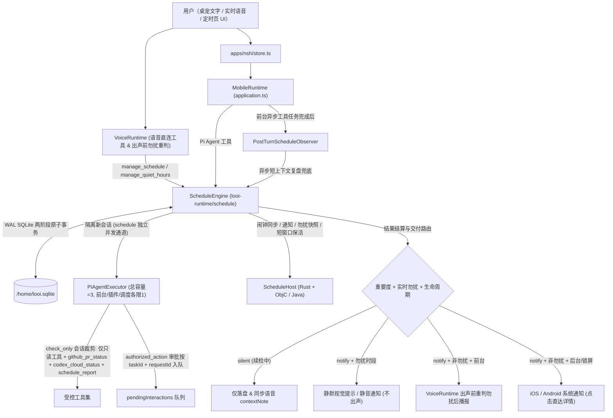

# Super-LOOI 轻量化 Schedule（定时调度）与勿扰模式实施方案

## 1. 目标与核心体验

为 Super-LOOI 构建一套**整体设计轻量、运行于手机本机且在移动端完整可用**的 Schedule（定时调度）与 Quiet Hours（勿扰时段）子系统：

- **静默识别与只读自动跟进**：当用户让 LOOI 执行具有异步外部等待的任务（例如提交 GitHub PR 等待 CI 流水线或 Code Review 评审、提交 Codex Cloud 远端任务等）后，系统不弹窗打扰用户，静默种下一次性只读检查规则（`check_only`），仅闪一条可忽略的轻 toast（轻量提示条）；到点后在隔离的新会话里使用确定性只读状态查询工具自动检查，若远端尚未结束则在次数上限内自动续检，得出明确结果或遇异常时再按分级策略提醒。
- **全形态调度规则**：统一支持一次性（相对延迟 / 绝对定点）、周期性（固定间隔 / 标准 5 段 Cron 定时表达式）以及有上限的链式自动续检。
- **多时段勿扰模式**：支持配置一个或多个可跨午夜（如 `23:00–08:00`）的时间段，既可在独立 UI（用户界面）管理，也可通过实时语音或文字口头直接增删改查；勿扰时段内定时规则照常静默执行，所有语音播报与系统通知均在实际出声／投递时判定并抑制发声。
- **双端移动端生命周期边界**：
  - **前台常亮态**：进程内前瞻单定时器精准触发，三通道独立并发执行。
  - **iOS 后台 / 锁屏**：运行中的检查申请 `beginBackgroundTask` 短收尾窗口尽量跑完当前轮次；未到点规则同步至 `UNUserNotificationCenter` 准点弹系统本地通知，用户点击回前台后立即自动补跑并直达详情，App 重启或回到前台时也会自动补跑宽限期内错过的周期规则。
  - **Android 后台 / 锁屏（目标 API 35 / Android 15+）**：短延迟窗口（存在运行中检查或最近一条待触发活跃规则距今 `<= 30 分钟`）内按需拉起 `ScheduleKeepAliveService`（`dataSync` 前台服务），锁屏后直接静默跑完检查并推送系统结果通知，无短窗口需求时立即自停，严格遵守 Android 15+ 每 24 小时共享 6 小时的 `dataSync` 后台额度与 `onTimeout()` 立即停止约束；超过 30 分钟的长延迟规则、进程被系统回收或 `dataSync` 额度用尽时，统一由 `AlarmManager` 闹钟接收器弹出「到点可执行提醒通知」，引导用户点击回 App 自动补跑。

---

## 2. 模块边界与复杂度审视（Deep Module 深模块设计）

依据 [codebase-design/SKILL.md](../../.agents/skills/codebase-design/SKILL.md) 的深模块原则（把复杂状态机与时序约束封装在清晰的内聚接口之后），本次引入并扩展以下实体，不新增任何第三方调度或 Cron 解析 npm 依赖：

| 新增 / 扩展模块或实体 | 核心职责 | 复杂度成本与引入理由 |
| --- | --- | --- |
| `packages/looi-runtime/src/schedule/` | 单一深模块封装规则与运行契约、零依赖日历跳转 5 段 Cron 与跨午夜勿扰计算、两阶段 SQLite（嵌入式关系数据库）原子事务、状态机与冷启动未确认恢复、单定时器调度循环、`dedupeKey`（去重键）来源隔离合并、自动续检、`check_only` 工具裁剪与策略守卫、`schedule_report` 四级结算，以及回合后轻量复盘器 | 将时间求值、防重入领取、同事务结算与下次排程、异常未确认保护和权限裁剪收敛在一处；上层调用方（`MobileRuntime`、`VoiceRuntime` 与 UI）只面对 `ScheduleEngine` 一个统一接口 |
| `apps/nsh/runtime/tools/github-pr-status.ts` + `CredentialVault` `"github"` 槽位 | App 内置只读 GitHub PR / Checks / Reviews 查询工具与系统级加密令牌槽位（Fine-grained PAT，细粒度个人访问令牌） | 替代开放式 `bash` 探测，保证 `check_only` 对 GitHub 仅能发结构化只读 GET，凭据归 App 自身所有而不依赖开发机登录态 |
| Codex 插件只读子工具 `codex_cloud_status` | 在 [codex/runtime/index.ts](../../apps/nsh/plugins/codex/runtime/index.ts) 新增只读查询工具，调用 App Linux 内置 `codex cloud status -- <TASK_ID>` | 让 `check_only` 仅能按任务 ID 查询云端状态，不再把可写可联网的自然语言子 Agent 工具 `codex_exec` 暴露给自动跟进任务 |
| `ScheduleHost`（`apps/nsh/src/schedule_native/` + `apps/nsh/native/ios/ScheduleNative.m` + `apps/nsh/native/android/...`） | 极薄原生桥接：系统通知权限、OS（操作系统）闹钟同步、结果通知投递、iOS 退后台短收尾窗口、Android 短窗口 `dataSync` 保活服务与到点闹钟通知接收器、原生勿扰快照同步与点击事件队列 | 匹配 iOS 与 Android 15+ 的真实后台物理与配额约束；桌面与无头测试环境提供同契约内存实现，不影响自动化测试 |
| `apps/nsh/ui/SchedulesSpaceView.tsx` | 管理空间第 8 个独立一级入口「定时（Schedules）」，集中管理定时规则、执行记录、多时段勿扰与 GitHub 只读令牌配置 | 承载规则新建/编辑、未确认状态处置、执行历史查看、多段勿扰配置与轻量凭据表单，避免挤压现有「任务」或「设置」空间 |

> [!NOTE]
> **边界与克制**：不引入通用设备事件总线，不引入第三方 Cron 库，也不引入任何桌面中转服务或外部后端守护进程；所有定时计算、模型推理、状态存储与 GitHub / Codex 凭据管理均由手机本机 App 自身承载。

---

## 3. 整体架构链路



---

## 4. 分层详细设计与改动文件

### 第一层：核心调度引擎、持久化与执行隔离（`packages/looi-runtime`）

1. **`packages/looi-runtime/src/schedule/types.ts`（新增）**
   - `ScheduleFailure`：`{ stage: string; code?: string | number; reason: string }`。
   - `ScheduleToolFailure`：`{ callId: string; toolName: string; stage: string; code?: string | number; reason: string }`。
   - `ScheduleTrigger`：`{ kind: "once"; runAt: string }` | `{ kind: "interval"; everySeconds: number }`（最小间隔 60 秒）| `{ kind: "cron"; expr: string }`。
   - `ScheduleExecutionPolicy`（执行权限策略）：`"check_only" | "authorized_action"`。其中 `origin === "agent_inferred"`（由 Agent 静默推断或回合后复盘创建的规则）在引擎层**强制锁定 `"check_only"`**，禁止模型自我提权。
   - `ScheduleRule`：包含 `id`、`title`、`prompt`、`origin`（`"user" | "agent_inferred"`）、`dedupeKey?`、`trigger`、`executionPolicy`、`enabled`、`state`（`"active" | "running" | "paused" | "completed" | "expired" | "cancelled" | "unconfirmed"`）、`activeRunId?`、`nextRunAt`、`lastRunAt?`、`lastRunId?`、`sourceSessionId?`、`sourceTaskId?`、`chain: { rootRuleId, followUpCount, maxFollowUps }`（隐式跟进默认上限 3 次）、`misfireGraceSeconds`（错过触发的补跑宽限期：一次性任务默认 24 小时，周期任务默认 1 小时）、`expiresAt?`（隐式规则默认 24 小时后过期自清理）、`createdAt`、`updatedAt`。
   - `ScheduleRunRecord`：包含 `id`、`ruleId`、`ruleTitle`、`taskId?`、`sessionId?`（本次触发生成的隔离新会话 ID，供「继续此会话」承接）、`triggerReason`（`"scheduled" | "misfire_catchup" | "manual_now"`）、`scheduledFor`、`startedAt`、`finishedAt?`、`status`（`"running" | "succeeded" | "failed" | "awaiting_user" | "result_unconfirmed" | "missed" | "skipped"`）、`sideEffectDispatched`（`boolean`，`authorized_action` 放行可能产生外部副作用的工具前同步落盘为 `true`）、`reportSource?: "schedule_report" | "fallback_answer"`、`importance?: "silent" | "notify"`、`summary?`、`error?: ScheduleFailure`、`toolFailures?: ScheduleToolFailure[]`、`followUpRuleId?`。
   - `QuietHoursWindow`：`{ id, label?, startMinute: 0..1439, endMinute: 0..1439, daysOfWeek?: number[], enabled: boolean }`。
   - `ScheduleSettings`：`{ autoFollowUpEnabled: boolean, maxActiveInferredRules: number, quietHoursEnabled: boolean, quietHours: QuietHoursWindow[] }`。
   - `NativeSchedulePort`：与原生 `ScheduleHost` 对接的最小端口契约（`permissionStatus`、`requestPermission`、`syncUpcomingAlarms`、`cancelAlarm`、`syncQuietHours`、`postNotification`、`setAndroidKeepAlive`、`beginIosBackgroundGrace`、`endIosBackgroundGrace`、`drainEvents`）。

2. **`packages/looi-runtime/src/schedule/cron.ts`（新增）**
   - **零依赖标准 5 段 Cron 解析与日历字段跳转求值器**：
     - 字段顺序：`分 (0–59)` `时 (0–23)` `日 DOM (1–31)` `月 (1–12)` `周 DOW (0–7)`，支持 `*`、`*/n`、`a-b`、`a-b/n`、`a,b,c`；`DOW` 的 `0` 与 `7` 均归一化为周日 `0`。
     - **DOM 与 DOW 匹配语义（POSIX / OpenBSD `crontab(5)` 标准）**：仅字面通配 `*` 视为「未受限」；仅 DOM 受限时匹配 DOM，仅 DOW 受限时匹配 DOW，均为 `*` 时任意日匹配；**当 DOM 与 DOW 同时受限时（如 `0 9 15 * 1` 表示每月 15 日或每周一），按逻辑或（OR：`domMatches || dowMatches`）匹配**。
     - **日历字段跳转算法与 8 年搜索上界**：从 `after + 1 分钟`（秒与毫秒归零）出发，按 `月 → 日 → 时 → 分` 逐级跳至下一个合法日历值，而非逐分钟扫描；最大搜索跨度为 **8 年**，可完整覆盖跨闰年规则（例如 2026 年创建 `0 9 29 2 *` 精确跳至 `2028-02-29 09:00`，以及跨非闰世纪年 `2096 → 2104-02-29`），并按本机当地时间正确处理夏令时（DST）跳变。
     - **错误码**：语法错误抛出 `stage: "schedule.cron.parse"`、`code: "ERR_INVALID_CRON"`；若 `DOW === "*"` 且所有允许的 `(month, dom)` 组合均不存在合法公历日（如 `0 9 31 2 *`、`0 9 31 4 *`），解析期即抛出 `stage: "schedule.cron.parse"`、`code: "ERR_CRON_UNREACHABLE_DATE"`；运行时跳转超出 8 年仍无解抛出 `stage: "schedule.cron.next"`、`code: "ERR_CRON_UNREACHABLE_DATE"`。
   - `isWithinQuietHours(now, settings)`：支持多时段并集与跨午夜区间（`startMinute > endMinute` 表示如 `23:00–次日 08:00`），跨午夜下半段（`00:00..endMinute`）回溯校验“昨天”的星期配置，避免跨天星期误判。

3. **[sqlite.ts](../../packages/looi-runtime/src/storage/sqlite.ts)（修改）**
   - 在现有 `/home/looi.sqlite` 数据库中新增三张表与读写事务方法：
     - `schedule_rules`：按 `(state, next_run_at)` 建立普通索引，并按 `(origin, execution_policy, dedupe_key)` 建立部分唯一索引：
       ```sql
       CREATE UNIQUE INDEX IF NOT EXISTS schedule_rules_active_dedupe
       ON schedule_rules(origin, execution_policy, dedupe_key)
       WHERE state = 'active' AND dedupe_key IS NOT NULL;
       ```
     - `schedule_runs`：按 `(rule_id, started_at DESC)` 建立索引，包含 `side_effect_dispatched INTEGER NOT NULL DEFAULT 0`、`report_source TEXT`、`tool_failures TEXT` 等字段。
     - `schedule_settings`：保存全局自动跟进开关、隐式规则上限与多时段勿扰配置。
   - **冷启动恢复（保留「结果未确认」状态，杜绝自动重做）**：
     - 进程启动初始化时在一个 `BEGIN IMMEDIATE ... COMMIT` 事务内扫描所有遗留为 `running` / `awaiting_user` 的 `schedule_runs`，全部转为 `status = 'result_unconfirmed'`，写入 `error: { stage: "schedule.recover", code: "ERR_SCHEDULE_RESULT_UNCONFIRMED", reason: "App exited before the scheduled run persisted its outcome" }`，**绝不自动重做该次已被领取的触发**。
     - 同一恢复事务内清空对应父规则的 `active_run_id`，并按规则性质分支处理父规则状态：
       - **一次性规则（含隐式自动续检规则）**，或 **`executionPolicy === "authorized_action"` 且 `sideEffectDispatched === true` 的周期规则**：规则置为 `state = 'unconfirmed'`，停止后续自动触发并在 UI 提示用户核对实际外部状态后再手动决定是否「立即运行」或关闭；
       - **`executionPolicy === "check_only"` 的周期规则**（只读无外部副作用）：跳过该次中断轮次，将 `nextRunAt` 推进到当前时间之后严格大于此刻的下一个合法周期点并恢复 `state = 'active'`。

4. **`packages/looi-runtime/src/schedule/check-policy.ts`（新增）**
   - 废除高风险的正则 shell 过滤；`check_only` 采用**会话能力裁剪 + `tool_call` 钩子白名单双层 fail-closed 隔离**：
     - `CHECK_ONLY_ALLOWED_TOOLS` 严格白名单：`read`、`read_file`、`ls`、`find`、`grep`（仅限 `workspaceRoot` 内路径）、`sessions`、`web_search`（若模型支持）、`list_home_devices`（若家居启用）、`github_pr_status`、`codex_cloud_status`、`schedule_report`、`manage_schedule`（仅 `action: "list"`）。
     - **第一层（能力裁剪）**：构造 `check_only` 会话时，不加载 `codemode`、`mcp` 扩展，不注册 `bash`、`write`、`write_file`、`edit`、`codex_exec`、`codex_cloud`、`control_home_device`、`control_looi_body` 及任何写工具，从根源上使模型无法调用任意 Shell 或可写可联网的子 Agent。
     - **第二层（钩子守卫 `evaluateScheduledToolPolicy`）**：
       - `"check_only"`：仅放行白名单工具（对 `read`/`read_file`/`ls`/`find`/`grep` 校验路径必须在 `workspaceRoot` 内，对 `manage_schedule` 校验仅限 `action === "list"`）；任何白名单外工具一律返回 `deny`（`stage: "schedule.policy"`、`code: "ERR_SCHEDULE_CHECK_ONLY_TOOL_DENIED"`），**不弹审批框**。若检查发现需要修改操作，模型通过 `schedule_report` 上报 `importance: "notify"`，由用户决定是否「继续此会话」执行。
       - `"authorized_action"`：具备常规工具集，高危破坏性命令、工作区外路径、需要确认的写操作或插件 `ask` 工具，在非 `yolo` 模式下进入按 `(taskId, requestId)` 队列管理的交互审批，并在 `sideEffectTools` 放行开始执行前同步写入 `markRunSideEffectDispatched(runId)`。

5. **`packages/looi-runtime/src/schedule/engine.ts`（新增）**
   - **来源与权限隔离的去重、合并与限流**：
     - 去重作用域为三元组 `(origin, executionPolicy, dedupeKey)`：**只合并尚未执行的 `state === "active"` 规则**，绝不允许 `agent_inferred` 合并或改写 `user` 创建的 `authorized_action` 规则，也不允许合并正在执行的 `running`、已完成的 `completed` 或 `unconfirmed` 父规则。
     - `autoFollowUpEnabled` 关闭时拒绝创建 `agent_inferred` 规则，返回 `stage: "schedule.create"`、`code: "ERR_AUTO_FOLLOWUP_DISABLED"`。
     - 活跃未触发的 `agent_inferred` 规则超过 `maxActiveInferredRules`（默认 8 条）时，按过期/最早创建时间淘汰最旧的未触发隐式规则。
   - **两阶段 SQLite 原子事务（杜绝丢失与重复）**：
     - **阶段一 · 领取执行权（Claim Transaction）**：执行条件更新 `UPDATE schedule_rules SET state = 'running', active_run_id = ?, updated_at = ? WHERE id = ? AND state = 'active' AND next_run_at <= ?`（`manual_now` 允许 `state IN ('active', 'paused', 'unconfirmed')` 且无活跃运行）；若受影响行数为 0 则放弃以防重入；同一事务插入 `status = 'running'`、`side_effect_dispatched = 0` 的 `schedule_runs` 记录。
     - **阶段二 · 单事务结算与下次排程（Settlement Transaction）**：本次执行回合内调用 `schedule_report` 时，先将结构化报告暂存在当次运行的内存上下文中；在执行器回合结束后、与调度状态推进**在同一 SQLite 事务内原子提交**：
       1. 按「执行器结果 × 工具失败证据链 × `schedule_report`」四级规则（见第 7 条）确定最终 `run.status`、`importance`、`summary`、`error`、`reportSource`、`toolFailures`；
       2. 结算父规则：清空 `active_run_id`、更新 `last_run_at` 与 `last_run_id`；`once` 规则转为 `completed`（后续同 `dedupeKey` 续检不会合并回已执行的父规则）；周期规则（`interval`/`cron`）计算严格大于本次结算完成时刻 `settledAt` 的下一次 `next_run_at` 并恢复 `state = 'active'`；
       3. 若决定自动续检（仅当 `report.outcome === "pending"`、无未恢复工具错误、`followUpCount < maxFollowUps`、父规则未被用户暂停/取消且 `autoFollowUpEnabled === true`）：在同一事务内新建子规则（`state = 'active'`，继承父规则的 `origin`、`executionPolicy`、`rootRuleId`、`dedupeKey`、`sourceSessionId`、`sourceTaskId`，`followUpCount + 1`；若同三元组作用域下已存在更新的 `active` 规则则合并更新）并回填本次 `run.follow_up_rule_id`。
   - **前瞻单定时器与补跑**：
     - `armNextTimer()` 为最近一条到期活跃规则挂一个 `setTimeout(min(delayMs, 60_000))`（60 秒心跳封顶抵抗休眠时钟漂移），同步最近 32 条闹钟与当前勿扰快照至原生层，并按 Android 短延迟窗口规则更新保活开关。
     - 启动、回前台、收到闹钟或通知点击时执行 `reconcileDueRules()`：对 `active` 且 `nextRunAt <= now` 的规则，宽限期内触发 `misfire_catchup` 补跑；超出宽限期标记 `missed` 并将周期规则推进至下一个未来 `nextRunAt`（`unconfirmed` / `running` 规则不自动补跑）。
   - **隔离新会话与上下文回溯**：
     - 每次触发分配全新隔离 `sessionId`（`sched_<uuid>`），通过 `schedule` 并发通道调用 `PiAgentExecutor`。提示词附带 `sourceSessionId` 与目标标识，Agent 按需调用 `sessions` 回查原对话背景，但只使用只读工具完成检查。

6. **`packages/looi-runtime/src/schedule/post-turn-observer.ts`（新增）**
   - **四重严格门控**（普通对话与纯问答零额外开销）：
     1. `settings.autoFollowUpEnabled === true`
     2. 前台用户任务成功完成（`state === "succeeded"`）
     3. 本轮任务未调用 `manage_schedule` 创建或更新规则
     4. 本轮工具调用步骤中包含外部异步动作信号（`bash`、`codex_exec`、`codex_cloud`）
   - **非阻塞后台复盘**：在主回复返回后异步启动，复用 `modelsRegistry`（通过 [model-resolver.ts](../../packages/looi-runtime/src/agent/core/model-resolver.ts) 解析模型），基于压缩摘要（用户请求、关键工具调用与截断回执、最终回复 `<= 2500` 字符）要求模型返回严格 JSON（JavaScript 对象表示法），提取目标对象（如 GitHub PR 的 `owner`/`repo`/`pullNumber` 或 Codex Cloud 的 `taskId`），种下自包含的 `agent_inferred` + `check_only` 规则；自身异常完整保留 `stage`、`code`、`reason` 并写入 Langfuse Span，不影响主对话。

7. **执行器扩展与错误透明链（修改）**
   - 修改 [executor.ts](../../packages/looi-runtime/src/agent/executor.ts)、[pi-executor.ts](../../packages/looi-runtime/src/agent/core/pi-executor.ts)、[pi-session.ts](../../packages/looi-runtime/src/agent/core/pi-session.ts)、[pi-task-runner.ts](../../packages/looi-runtime/src/agent/core/pi-task-runner.ts)、[tool-approval.ts](../../packages/looi-runtime/src/agent/governance/tool-approval.ts)：
   - **分通道并发隔离**：`AgentRunOptions` 新增 `lane?: "foreground" | "plugin" | "schedule"`（默认 `"foreground"`）、`extraTools`、`systemPromptOverrideSuffix`、`scheduleExecutionPolicy`、`onSideEffectBeforeExecute?: () => void`。`PiAgentExecutor`（`maxConcurrentTasks = 3`）同时校验总并发上限 `3` 与每条通道并发上限 `1`（`foreground: 1`、`plugin: 1`、`schedule: 1`）；通道或总容量占满时拒绝并抛出带 `stage: "agent.admission"`、`code: "ERR_AGENT_LANE_BUSY"`（或 `"ERR_AGENT_CAPACITY_REACHED"`）的 `AgentExecutionError`。
   - **工具能力裁剪**：`createPiSession` 接收 `scheduleExecutionPolicy`；当为 `"check_only"` 时不挂入 `createCodemodeExtension()`、`createMcpExtension()`，不加载写类内置工具与 `bash`，确保模型侧与钩子侧能力边界完全对齐。
   - **全链路错误字段与工具失败证据收集（遵守 `AGENTS.md` 规则 16）**：
     - `AgentExecutionError` 新增可选字段 `stage?: string`、`code?: string | number`、`cause?: unknown`；`AgentRunResult` 与 `AgentTask` 新增可选 `failure?: { stage: string; code?: string | number; reason: string }` 与 `toolFailures?: Array<{ callId: string; toolName: string; stage: string; code?: string | number; reason: string }>`。
     - `PiTaskRunner` 在 `tool_execution_end` 监听所有 `isError === true` 或 `details?.failure` / `details?.error` 的工具回执，脱敏（仅移除密钥）后按调用顺序记录至 `toolFailures`；在 `catch` 抛出 `AgentExecutionError` 时按实际触发阶段保留 `stage` 与底层 `code`（仅真实 `deadlineMs` 到期才报 `ERR_AGENT_DEADLINE_EXCEEDED`；模型请求失败保留 HTTP 状态码或 provider code；预算超限、取消、停止未确认分别归属独立阶段与错误码）。
   - **`schedule_report` 与四级确定性结算规则**（在 `ScheduleEngine` 单事务结算中执行）：
     - `schedule_report` 入参契约：`{ outcome: "ok" | "pending" | "failed", importance: "silent" | "notify", summary: string, nextCheckDelaySeconds?: number, nextPrompt?: string, error?: { stage?: string, code?: string | number, reason: string } }`。
     - **四级确定性结算优先级**：
       1. **执行器抛出异常** → `run.status = "failed"`，完整写入 `failure`（`stage`/`code`/`reason`）及已捕获的 `toolFailures`，`importance = "notify"`，不创建自动续检。
       2. **存在未恢复的工具失败**（例如 `github_pr_status` 返回 HTTP `401` 或 `codex_cloud_status` 返回 `authorization_required` / `ERR_CODEX_*`，且本轮后续没有同一工具的成功恢复调用）→ **即使模型文本正常收尾或错误地调用了 `schedule_report({ outcome: "ok", importance: "silent" })`**，引擎强制判为 `run.status = "failed"`、`run.error` 保留最后一条未恢复工具的 `{ stage, code, reason }`、`run.toolFailures` 全量落盘、`run.importance = "notify"`，并对 4xx 鉴权/配置类错误禁止自动续检。
       3. **已调用 `schedule_report` 且无未恢复工具失败** → 按 `reportSource = "schedule_report"` 结算：`outcome === "ok"` 记 `succeeded` 并按 `report.importance` 路由；`outcome === "pending"` 且允许续检时同事务创建下一条隐式规则（原 run 记 `succeeded` + `silent` + `followUpRuleId`），若已达 `maxFollowUps` 上限则停止续检并**强制升级为 `importance = "notify"`** 提示用户；`outcome === "failed"` 记 `failed`、保留 `report.error` 并 `notify`。
       4. **缺少 `schedule_report` 且无执行器异常与未恢复工具失败** → 记 `run.status = "succeeded"`、`reportSource = "fallback_answer"`、`summary` 取清洗截断后的 `result.answer`（`<= 400` 字符）；不靠正则猜测延迟自动续检，默认 `importance = "notify"` 以免遗漏用户规则或终结结果。
   - 在 `packages/looi-runtime/src/index.ts` 与 `packages/looi-runtime/package.json` 导出 `./schedule`。

---

### 第二层：运行时整合、专用只读查询工具与语音链路（`apps/nsh/runtime` & `apps/nsh/plugins/codex`）

1. **`apps/nsh/runtime/tools/github-pr-status.ts`（新增）与 App 内 GitHub 凭据（修改 `credentials.rs`）**
   - 在 [apps/nsh/src/credentials.rs](../../apps/nsh/src/credentials.rs) 的 `validate_key` 槽位白名单新增 `"github"`，用于通过原生 Keychain / Android Keystore 加密存储用户的 GitHub Fine-grained PAT（仅需只读权限 `Pull requests: Read`、`Commit statuses: Read`、`Checks: Read`）；在 [application.ts](../../apps/nsh/runtime/application.ts) 的 `redactSecrets()` 中注册 GitHub 令牌脱敏，并暴露 `githubCredentialStatus()`（仅返回是否已配置与脱敏提示，不回传明文）、`saveGitHubToken(token, action)`、`verifyGitHubToken(action)`、`clearGitHubToken(action)`。
   - 实现 `github_pr_status({ owner, repo, pullNumber })` Pi Agent 工具：
     - 严格校验 `owner`、`repo`（仅允许 `^[A-Za-z0-9._-]+$`）与正整数 `pullNumber`，防路径遍历；
     - 仅向 `https://api.github.com` 发起只读 `GET` 请求读取 PR 元数据（状态、合并状态、`head.sha`、草稿状态）、`check-runs` 与传统 commit `statuses` 汇总、`reviews` 摘要；
     - 公开仓库无令牌时允许匿名请求；私有仓库无令牌、令牌无效或受限（HTTP 401/403/404/429）及网络异常均返回结构化 `isError: true` 回执，完整保留 `stage`（如 `github.pr_status.pr` / `github.pr_status.checks`）、底层 HTTP `code` 与原始原因（仅移除令牌）。

2. **`apps/nsh/plugins/codex/runtime/index.ts` & 插件总线契约（修改）**
   - 在 [apps/nsh/runtime/plugins/contracts.ts](../../apps/nsh/runtime/plugins/contracts.ts) 的 `PluginTaskContext` 与 [apps/nsh/runtime/plugins/ai-bus.ts](../../apps/nsh/runtime/plugins/ai-bus.ts) 的 `evaluateToolCall` 增加可选 `scheduleExecutionPolicy?: "check_only" | "authorized_action"`。
   - 在 [apps/nsh/plugins/codex/runtime/index.ts](../../apps/nsh/plugins/codex/runtime/index.ts) 新增只读工具 **`codex_cloud_status`**：
     - 入参：`taskId: string`（严格校验格式 `^[a-zA-Z0-9_-]{4,128}$`）；
     - 执行：复用 App Linux 私有环境 `/root/.codex/auth.json` 的 Codex 登录态，通过 `this.invoke(context, "cloud.status", ["cloud", "status", "--", params.taskId], signal)` 调用官方内置 Codex CLI 的只读状态子命令 `codex cloud status <TASK_ID>`（仅查询状态与结果摘要，不启动本地读写子 Agent、不应用补丁）；
     - 失败透传：未登录（`codex.auth` / `authorization_required`）、CLI 未就绪或云端返回 HTTP 错误码时，原样保留 `stage`、`code` 与 `reason` 并在 `details.failure` 暴露给工具结果监听器；
   - 更新 `CodexPlugin.tools(context)` 与 `interceptToolCall`：
     - 当 `context.scheduleExecutionPolicy === "check_only"` 时，`tools(context)` **只注册 `codex_cloud_status`**，不再提供 `codex_exec` 与 `codex_cloud`；
     - `interceptToolCall` 免审批放行 `codex_cloud_status`；若外层收到 `check_only` 上下文下的 `codex_exec` / `codex_cloud` 调用，直接返回 `decision: "deny"`（`stage: "codex.policy"`、`code: "ERR_CODEX_CHECK_ONLY_DENIED"`）；普通交互任务中的 `codex_exec` / `codex_cloud` 保持原有 `ask` 审批行为。
   - 更新 Codex `SKILL` 说明：引导在提交 `codex_cloud` 或通过 `codex_exec` 提 PR 后，调用 `manage_schedule` 种下携带精确 `owner`/`repo`/`pullNumber` 或 `taskId` 的 `check_only` 检查规则，并指明后续检查仅使用 `github_pr_status` / `codex_cloud_status`。

3. **`apps/nsh/runtime/tools/schedule-tools.ts`（新增）**
   - 为 Pi Agent 注册 `manage_schedule`（`action: "create" | "list" | "update" | "cancel" | "run_now"`）与 `manage_quiet_hours`（`action: "list" | "add" | "update" | "remove" | "set_enabled"`）。
   - 创建规则自动绑定 `sourceSessionId` 与 `sourceTaskId`；当在 `check_only` 调度会话中注入时，`manage_schedule` 参数校验仅放行 `action: "list"`。

4. **`apps/nsh/runtime/voice/tools/schedule.ts`（新增）与语音实时重判（修改）**
   - 修改 [voice/tools/index.ts](../../apps/nsh/runtime/voice/tools/index.ts)、[voice/tools/types.ts](../../apps/nsh/runtime/voice/tools/types.ts)、[voice/prompts.ts](../../apps/nsh/runtime/voice/prompts.ts)、[voice/types.ts](../../apps/nsh/runtime/voice/types.ts)、[voice/runtime.ts](../../apps/nsh/runtime/voice/runtime.ts)、[voice/live-session.ts](../../apps/nsh/runtime/voice/live-session.ts)。
   - 在实时语音会话挂载 `manage_schedule` 与 `manage_quiet_hours` 两个轻量直连工具；语音工具规范明确下划线工具名口播用空格分隔（如念作 `manage schedule`）。
   - **出声前实时勿扰重判（解决 22:59 入队、23:00 后出声）**：
     - `VoiceRuntimeOptions` 新增 `isQuietHoursNow?: () => boolean` 并透传给 `LiveVoiceSession`；`VoiceProactiveNotice` 新增 `respectQuietHours?: boolean`（定时调度主动播报统一设为 `true`）。
     - 在以下三处出声前临界点执行实时重判（`notice.respectQuietHours && isQuietHoursNow?.()`）：
       1. `VoiceRuntime.speak()` 启动或复用语音会话之前；
       2. `VoiceRuntime` 将 `pendingNotices` 刷入新建 `LiveVoiceSession` 时；
       3. **`LiveVoiceSession.flushNoticeIfIdle()` 将队首 `notice` 出队之后、`encodeProactiveSpeech` 编码上行帧之前**。
     - 若当下处于勿扰时段：仅更新 `latestContextNote` / `contextNote` 使后续语音对话仍知晓该结果，**立即取消本次语音发声**并以 `{ completed: false, interruptedReason: "quiet_hours_suppressed" }` 结算回调；上层 `store.ts` 收到该结果后按静默视觉提示或静音通知兜底。

5. **[application.ts](../../apps/nsh/runtime/application.ts)（修改）**
   - `MobileRuntime` 持有 `ScheduleEngine` 与 `PostTurnScheduleObserver`。
   - 将 `PiAgentExecutor` 配置为 `maxConcurrentTasks: 3`，启用 `foreground`（1）/ `plugin`（1）/ `schedule`（1）三通道独立限额；`foreground` 仅由前台文字和语音委派任务互斥占用（`busy()`），`schedule` 调度不占用 `busy()`。
   - 当 `configure()` / `saveProviderApiKey()` / `selectActiveModel()` / `configureHome()` / `configureBody()` 等操作需要重建 `executor` 时，先有序取消活跃的 `schedule` 任务并等待释放，重建完成后重新 `scheduleEngine.reconcileDueRules()`。
   - 在 `createExecutorForSelection` 的 `systemPrompt` 中补充静默跟进引导：完成提 PR、提交 Codex Cloud 任务、触发构建/部署等异步外部动作后，顺手调用 `manage_schedule`（`origin: "agent_inferred"`, `executionPolicy: "check_only"`, 唯一 `dedupeKey`, 携带明确仓库/PR 号或 Cloud 任务 ID 的自包含检查指令）静默种下后续只读检查。
   - 前台 `run()` 成功返回后异步调用 `postTurnObserver.maybeObserve(...)`。
   - 对 `store.ts` 暴露 `attachNativeSchedule`、`setScheduleForegroundActive`、`scheduleSnapshot`、`subscribeScheduleActivity`、规则/勿扰增删改查、GitHub 只读令牌管理、`respondTask(taskId, requestId, answer)`、`cancelTask(taskId)`、`adoptConversationSession(sessionId, action)` 与 `handleNativeScheduleEvents`；在 `close()` 中清理调度定时器、取消调度任务并销毁原生端口绑定。

6. **[build-runtime.ts](../../apps/nsh/scripts/build-runtime.ts)（修改）**
   - 同步更新生成的 `apps/nsh/generated/looi-runtime.d.ts` 类型声明，暴露调度快照、规则、运行记录、勿扰窗口、GitHub 凭据状态与 `MobileRuntime` / `VoiceRuntime` 新增契约。

---

### 第三层：双端原生桥接与前后台执行边界（`apps/nsh/src/schedule_native/` & 原生层）

#### 双端前后台执行能力边界

| 运行场景 | iOS 行为与保障 | Android（目标 API 35 / Android 15+）行为与保障 |
| --- | --- | --- |
| **App 在前台** | 单定时器精准到期；`schedule` 独立通道立即执行；非勿扰时语音播报 + 桌宠提示 | 单定时器精准到期；`schedule` 独立通道立即执行；非勿扰时语音播报 + 桌宠提示 |
| **退后台时已有检查正在运行** | 申请 `beginBackgroundTask` 系统短收尾窗口尽量完成该次只读检查；完成后发本地结果通知；若窗口到期未完则取消并待下次补跑 | 保留短期 `ScheduleKeepAliveService`（`dataSync`）+ 带上限的部分 `WakeLock`（唤醒锁）跑完本次检查并推结果通知，完成后立即释放并按规则窗口决定自停 |
| **退后台后短延迟规则（`<= 30 分钟`）** | 受系统沙盒限制不驻留后台 JS 定时循环；到点由 `UNUserNotificationCenter` 准点弹系统通知，用户点击回 App 后立即自动补跑 | 当「存在运行中检查」或「距最近一条 `active` 规则触发时间 `<= 30 分钟`」且 24 小时 `dataSync` 累计未达保守上限（5 小时）时，按需运行 `ScheduleKeepAliveService` 锁屏静默跑完并推结果通知；退后台单次保活上限 60 分钟，无短窗口需求立即 `stopSelf()` |
| **长延迟规则（`> 30 分钟`，如锁屏 8 小时/次日 Cron）或进程回收 / `onTimeout()`** | 到点由 `UNUserNotificationCenter` 准点弹系统通知，点击通知或下次主动打开 App 时在宽限期内自动补跑 | **不挂起 `dataSync` 前台服务**（避免耗尽 Android 15 每 24 小时共享 6 小时的 `dataSync` 配额）；统一由 `AlarmManager` 闹钟唤醒 `ScheduleAlarmReceiver` 弹出「到点可执行提醒通知」，引导用户点击回 App 立即自动补跑 |
| **Android 15 `Service.onTimeout()` 触发** | 不适用 | `ScheduleKeepAliveService.onTimeout(startId, fgsType)` 立即释放 `WakeLock`、向 JS 队列写入 `keepalive_timeout` 事件并立即 `stopSelf()`（绝不触发 `RemoteServiceException` 崩溃），后续规则仍由 `AlarmManager` 闹钟提醒接管 |

#### 原生模块实现清单

1. **Rust 统一原生模块（`apps/nsh/src/schedule_native/` & [lib.rs](../../apps/nsh/src/lib.rs)）**
   - 新增 `apps/nsh/src/schedule_native/mod.rs`、`ios.rs`、`android.rs`，在 `super-looi/native` 注册 `ScheduleHost`，暴露统一方法：`permissionStatus`、`requestPermission`、`syncUpcomingAlarms`、`cancelAlarm`、`syncQuietHours`、`postNotification`、`setAndroidKeepAlive`、`beginIosBackgroundGrace`、`endIosBackgroundGrace`、`drainEvents`。
   - 桌面与无头测试宿主提供同契约内存实现，支持通知入队、闹钟镜像与勿扰快照校验。

2. **iOS 原生（`apps/nsh/native/ios/ScheduleNative.m` & [build.rs](../../apps/nsh/build.rs)）**
   - 在 [build.rs](../../apps/nsh/build.rs) 的 iOS 编译列表中加入 `native/ios/ScheduleNative.m` 并链接 `UserNotifications` 框架。
   - **预排通知声音策略**：`syncUpcomingAlarms` 接收最近 32 条闹钟时，每条由引擎按预计触发时刻 `triggerAt` 计算 `silent = isWithinQuietHours(new Date(triggerAt), settings)` 传入原生层，对应设置 `UNMutableNotificationContent.sound` 为 `nil`（勿扰时段）或 `UNNotificationSound.defaultSound`（非勿扰时段）。每当勿扰时段增删改或总开关切换时，引擎立即重算并重新同步全部 32 条预排通知。
   - 仅管理 `looi.sched.<ruleId>` 前缀通知，不误删其他系统通知；提供即时结果通知投递、通知点击委托入队与 `beginBackgroundTaskWithName:expirationHandler:` 短收尾窗口。

3. **Android 原生（`apps/nsh/native/android/com/superlooi/nsh/` & 打包脚本）**
   - 新增 `ScheduleBridge.java`：创建常规提醒渠道（`looi_schedule_alerts`）与静音/低打扰保活渠道（`looi_schedule_silent`）；将精简勿扰快照（`quietHoursEnabled` + 各窗口起止分钟与星期）持久化到原生 `SharedPreferences`，供进程被回收后离线判定。封装通知权限（Android 13+ `POST_NOTIFICATIONS`）、`AlarmManager` 定时闹钟（优先 `setExactAndAllowWhileIdle`，无 `SCHEDULE_EXACT_ALARM` 权限时降级 `setAndAllowWhileIdle` 并把降级状态回传 JS/UI）、结果通知投递与短窗口保活服务启停。
   - 新增 `ScheduleKeepAliveService.java`（`foregroundServiceType="dataSync"`）：仅由 `ScheduleEngine` 在短延迟窗口（运行中检查或 `<= 30 分钟` 内即将触发）按需拉起；追踪 24 小时累计运行与单次退后台驻留时长（回前台重置），仅在真正运行单次检查期间持有带超时上限的部分 `WakeLock`，**必须覆写 `onTimeout(int startId, int fgsType)` 在数秒内完成释放并 `stopSelf()`**。
   - 新增 `ScheduleAlarmReceiver.java`：到点闹钟被系统唤醒时，按**实际触发时刻的本机系统时间 `now`** 读取 `SharedPreferences` 勿扰快照现场重判 `isQuietNow`（抵御 Doze 延迟跨越勿扰边界），据此选择 `looi_schedule_silent` 或 `looi_schedule_alerts` 弹出点击直达 App 触发补跑/看详情的提醒通知。
   - 修改 [SuperLooiApplication.java](../../apps/nsh/native/android/com/superlooi/nsh/SuperLooiApplication.java) 注册 `ScheduleBridge.registerVm()` 并传递通知点击 Intent 参数。
   - 依据插件注册规范修改 [plugins.json](../../apps/nsh/native/plugins.json)、[patch_manifest.py](../../apps/nsh/native/android/patch_manifest.py)（除幂等注入 5 项权限 `POST_NOTIFICATIONS`、`FOREGROUND_SERVICE`、`FOREGROUND_SERVICE_DATA_SYNC`、`WAKE_LOCK`、`SCHEDULE_EXACT_ALARM` 外，扩展 `<service>` 含 `foregroundServiceType="dataSync"`、`exported="false"` 与 `<receiver>` 含 `exported="false"` 节点及属性资源 ID 的二进制 XML 幂等注入）、[native-plugins.mjs](../../apps/nsh/scripts/native-plugins.mjs) 与 [test_plugin.py](../../apps/nsh/native/android/test_plugin.py)（新增 `aapt2 dump xmltree` 校验 `<service>` / `<receiver>` 与二次合包幂等性）。

---

### 第四层：状态编排、并发审批队列与「定时（Schedules）」空间

1. **[store.ts](../../apps/nsh/store.ts) & [App.tsx](../../apps/nsh/App.tsx)（修改）**
   - `AppSpace` 新增 `"schedules"`；启动时挂载 `ScheduleHost` 并监听原生通知点击及保活事件。
   - **修正退后台生命周期逻辑**：退后台时仅取消前台交互任务与语音会话，**不再误杀 `schedule` 通道的后台定时检查**。
   - **多任务交互审批队列（替换单槽 `interaction`）**：
     - 将 `store.ts` 原单槽 `interaction` 信号改为按到达顺序与来源维护的 `pendingInteractions` 队列（主键 `(taskId, id)`，携带 `source: "foreground" | "schedule"`、`ruleId?`、`ruleTitle?`、`expiresAt`），对外派生队首视图 `interaction()`（优先展示前台任务交互，其次定时规则交互，并在弹窗顶部显示队列计数与规则名称归属）。
     - 任一任务（前台或定时）进入 `finally` 结算或被取消时，**只调用 `clearInteractionsForTask(taskId)` 清除该 `taskId` 对应的交互**，绝对不清空并发运行中其他任务的待审批项。
     - `approve(allowed, target?)` 与 `answer(answers, target?)` 显式携带 `(target.taskId, target.id)` 路由至 `runtime.respond(taskId, requestId, ...)`；在弹窗对定时调度点击停止/关闭时，调用 `runtime.cancelTask(taskId)` 仅取消该调度任务而不打断前台交互。
   - **交付路由（`importance × isWithinQuietHours × lifecycle()`）**：
     - 隐式规则创建：不弹窗，仅闪一条轻 toast。
     - `silent` 结果：仅落盘并写入语音 `contextNote`。
     - `notify` + 勿扰时段：更新语音 `contextNote`，前台显示静默视觉提示，后台发静音系统通知，**绝不主动出声**。
     - `notify` + 非勿扰 + 前台：触发桌宠短暂表情与结果提示；语音就绪时带 `respectQuietHours: true` 入队播报（在 `enqueueNotice` / `speak` 及 `flushNoticeIfIdle` 实际出声前再次重判勿扰；若出声前已进入勿扰时段则被拦截并回落为静默视觉提示）。
     - `notify` + 非勿扰 + 后台/锁屏：通过 `ScheduleHost.postNotification` 推送系统通知。
   - 新增 `continueScheduledSession(sessionId)`：切换当前主会话并回到桌宠主页自动展开输入框，让用户直接顺着该次检查继续追问（如授权或手动修复后执行写操作）。

2. **[ManagementShell.tsx](../../apps/nsh/ui/ManagementShell.tsx) & `apps/nsh/ui/SchedulesSpaceView.tsx`（新增）**
   - 左侧极窄导航轨（及窄屏底栏）新增第 8 个入口：`定时`（`testID="nav-schedules"`），存在运行中/待触发规则显示 `verified` 圆点，存在 `unconfirmed` 规则或待确认审批显示 `warning` 圆点。
   - 顶栏 `48pt` 上下文胶囊栏新增 `SchedulesContextBar`：左侧切换 `规则 · N` | `勿扰时段`（勿扰生效中带状态圆点），右侧放置 `自动跟进` 开关胶囊与主动作按钮 `+ 新建规则`（勿扰页切换为 `+ 添加时段`）。
   - **规则子视图（横屏 42% / 58% 主从双栏，各自独立 `<Scroll>`）**：
     - 左栏：来源筛选（`全部 / 用户创建 / 自动跟进`）+ 规则列表行（标题、来源、周期、下次触发时间、`unconfirmed` / `active` / `running` / `completed` 状态点+文案、行尾启停 `Switch`）+ 引导空状态。
     - 右栏：规则详情检视器（操作栏：`立即运行`、`编辑…`、`删除` 配原生 `AlertDialog` 二次确认；对 `unconfirmed` 规则清晰提示「上次进程退出前已发出外部动作或中断，结果未确认，请核对后手动操作」；规则配置、权限标签、完整指令，以及按时间倒序的「执行记录」，显示 `stage`/`code`/`reason`、工具失败摘要，每条带 `查看任务` 与 `继续此会话` 动作）。
   - **勿扰时段与凭据配置子视图（横屏双栏）**：
     - 左栏：勿扰总开关、当前是否处于勿扰状态的实时提示卡片、口头设置示例，以及轻量 **GitHub 只读令牌配置卡片**（提示仅需 `Pull requests / Commit statuses / Checks: Read` 细粒度只读 PAT，支持保存、在线只读校验与清除，永不回显明文；同时展示精确闹钟降级提示，如有必要可引导去系统设置授予精确闹钟权限）。
     - 右栏：多时段卡片列表（时段名、起止时间如 `23:00 – 次日 08:00`、适用星期、独立开关、编辑与删除）。
   - **新建 / 编辑弹窗（`Dialog`）**：规则支持一次性快捷延迟或定点、固定间隔、每日定点、5 段 Cron（含下一次触发实时预览，精确呈现如 `2028-02-29` 等跨年/闰日触发点）及权限级别选择；勿扰时段支持名称、`HH:MM` 起止与星期多选。
   - 样式与规范严格对齐 [theme.json](../../apps/nsh/theme.json)（零硬编码颜色、常规卡片零阴影、圆角填充选中态禁止单侧边条、`44 × 44pt` 以上触控热区、数字对齐 `tabular-nums`），并在 [catalog.ts](../../apps/nsh/i18n/catalog.ts) 与 [runtime-catalog.ts](../../apps/nsh/i18n/runtime-catalog.ts) 补全中英双语文案。

3. **动效清单（Motion Inventory，实施时同步写入 [DESIGN.md](../../apps/nsh/DESIGN.md)）**

| 状态变化类别 | 原生动效工具与令牌参数 | 减少动态效果（`reduceMotion()`） |
| --- | --- | --- |
| 按压与悬停（规则行、筛选胶囊、按钮） | `transition-colors duration-120`；按钮按压 `active:scale-[0.97]`（`duration-180`），列表行仅加深背景不缩放 | `motion-reduce:active:scale-100`，色阶瞬时切换 |
| 图标与标签切换（状态点、规则数、下次触发时间） | 计数与时间使用 `tabular-nums` 防抖动；`立即运行` 加载态复用 `IconButton` 旋转动效 | 立即切换文案与静态图标，停转 |
| 选中态切换（顶栏 `规则 / 勿扰时段`、来源筛选、列表行） | 整块圆角填充色在 `duration-150` 内平滑过渡，行高与对齐轴稳定 | 瞬时切换选中填充 |
| 内容到达与离场（子视图、执行记录） | 子视图用 `RetainedPage` 保持滚动位置；新执行记录就地更新 | 瞬时呈现 |
| 浮层开合（规则/勿扰 `Dialog`、删除 `AlertDialog`） | `Dialog` 使用 `animation={reduceMotion() ? "none" : "fade"}`（`180ms`）；删除走原生 `AlertDialog` | `0ms` 瞬时开合 |
| 布局变化（条目增删） | 在所属 `<Scroll>` 容器内稳定重排，外层无整页跳动 | 瞬时更新 |
| 拖拽与手势 | 仅使用原生 `<Scroll>` 滚动物理回弹，无自定义拖拽 | 原生滚动 |
| 加载与进度（规则执行中） | 状态徽章复用 `LoadingIndicator inline` 旋转圆弧 | 静止圆弧展示 |
| 实时连续状态（勿扰生效态、相对倒计时） | 按分钟边界离散刷新，无高频闪烁 | 同样离散刷新 |

4. **规范与架构文档同步**
   - 更新 [DESIGN.md](../../apps/nsh/DESIGN.md)（补充「定时」空间规范与动效清单）。
   - 更新 [docs/arch/index.html](../arch/index.html)（补充调度核心、分通道并发、工具裁剪与原生边界）。

---

### 第五层：验证方案

#### 5.1 自动化测试

1. **调度核心单元测试（`pnpm --filter @super-looi/runtime test`）**：
   - `cron.test.ts`：标准 5 段 Cron 解析、非法表达式与不可达日期错误码（`ERR_INVALID_CRON` / `ERR_CRON_UNREACHABLE_DATE`）、DOM 与 DOW 同时受限时的 POSIX OR 并集语义（如 `0 9 15 * 1`）、日历字段跳转在跨年与闰日场景的正确性（2026 创建 `0 9 29 2 *` 跳至 `2028-02-29 09:00`）、DST 跳变、多时段勿扰与跨午夜星期回溯判定。
   - `schedule-engine.test.ts`：
     - 来源与权限隔离去重：同 `dedupeKey` 下 `agent_inferred` 不覆盖 `user` 显式规则，续检不合并回 `running`/`completed`/`unconfirmed` 父规则；
     - 两阶段事务原子性：领取 `running` 与单事务「结算父规则 + 推进周期/完成 + 插入续检子规则」；
     - 冷启动恢复：`running`/`awaiting_user` 遗留运行转为 `result_unconfirmed` 且绝不自动重做；`authorized_action` 已发射副作用或一次性规则置为 `unconfirmed`，只读周期规则推进下一轮；
     - 四级结算与错误透明链：工具返回 HTTP 401 时即便模型总结为正常也强制标 `failed` 并透传 `stage`/`code`/`reason` 且禁止自动续检；缺省 `schedule_report` 按 `fallback_answer` + `notify` 结算；执行器异常完整保留 `stage`/`code`/`reason`；
     - 宽限期 misfire 补跑、超窗 `missed`、`maxFollowUps` 硬上限强制升级 `notify`、`autoFollowUpEnabled` 关闭与隐式规则数量裁剪。
   - `check-policy.test.ts`：验证 `check_only` 会话裁剪掉 `bash`/`write`/`edit`/`codemode`/`mcp`/`codex_exec`/`codex_cloud`/`control_home_device`/`control_looi_body`，且钩子对白名单外工具与越界读取、非 `"list"` 的 `manage_schedule` 一律 fail-closed 拦截返回 `ERR_SCHEDULE_CHECK_ONLY_TOOL_DENIED`；`authorized_action` 放行常规动作并触发 `onSideEffectBeforeExecute` 与高危命令审批。
   - `executor-lanes.test.ts`：验证 `maxConcurrentTasks = 3` 下 `foreground`、`plugin`、`schedule` 三通道各限 1 槽、互不抢占、超限返回 `ERR_AGENT_LANE_BUSY`、以及 `PiTaskRunner` 正确收集 `toolFailures` 与保留真实失败阶段及错误码。
   - `post-turn-observer.test.ts`：普通问答不触发；含 `bash`/`codex` 调用且未建规则时异步补种携带结构化目标的 `agent_inferred` + `check_only` 规则；已建规则或失败回合不重复创建；模型失败时完整保留阶段与错误码且不影响主流程。
2. **App 运行时、语音、原生插件与 UI 测试（`pnpm --filter @super-looi/nsh test`）**：
   - `tests/schedule-runtime.node.ts`：验证 `github_pr_status`（公开/私有/401/429 透传）与 `CredentialVault` `"github"` 槽位及 `redactSecrets`；验证 Codex 插件 `codex_cloud_status` 只读查询及 `check_only` 下禁用 `codex_exec` / `codex_cloud`；验证三通道并发隔离；验证勿扰时段在 `VoiceRuntime.speak()`、`pendingNotices` 冲刷与 `LiveVoiceSession.flushNoticeIfIdle()` 三处临界点的实时拦截（22:59 入队、23:00 出声拦截为 `quiet_hours_suppressed`）；验证 `adoptConversationSession` 承接会话；验证重启后多任务审批队列互不误清。
   - `tests/schedule-voice-tools.node.ts`：验证实时语音直接调用 `manage_schedule` 与 `manage_quiet_hours` 增删改查并即时刷新预排闹钟与原生勿扰快照。
   - `SchedulesSpace.test.tsx`：NSH 无头 UI 行为测试，覆盖规则筛选/启停/新建/编辑/删除、`unconfirmed` 态展现、多段勿扰配置、GitHub 只读令牌管理、Cron 下次触发预览、查看任务详情与「继续此会话」，以及多任务 `pendingInteractions` 弹窗切换与隔离响应。
   - `pnpm --filter @super-looi/nsh test:plugins`：校验 Android 清单 5 项权限、`<service>`（`dataSync`）与 `<receiver>` 二进制 XML 节点注入与二次合包幂等性。
3. **全仓构建与检查**：
   - `cargo check`（宿主机及可用移动端目标）
   - `pnpm typecheck`
   - `pnpm test`
   - `pnpm build`

#### 5.2 真机横屏验收与独立 Review

在全新安装的 iOS 与 Android 开发真机（横屏）开发包上逐项核验（不依赖开发机 CLI、凭据或中转服务）：
1. **双主题与 UI 巡检**：核对浅色 / 深色主题下「定时」空间规则列表、详情、`unconfirmed` 提示、新建/编辑弹窗（含闰日 Cron 预览）、勿扰时段与 GitHub 只读令牌配置区的圆角、间距、对齐、触控热区与动效清单。
2. **只读自动跟进端到端场景**：使用 App 内配置的 GitHub 只读令牌或 App 自有 Codex 登录态执行 PR 提交 / Codex Cloud 任务，验证无弹窗静默种下 `check_only` 规则 + 轻 toast → 到点自动拉起隔离新会话仅调用 `github_pr_status` / `codex_cloud_status` 检查 → 尝试越权工具被隔离且未完成时静默续检 → 得出明确结果或遇 401/失败时按勿扰规则在非勿扰时段轻声播报、勿扰时段静默抑制发声。
3. **跨边界勿扰与口头设置**：语音说「晚上十一点到早上八点别出声」验证即时落盘可见；构造 22:59 入队、23:00 后出队场景确认语音被实时抑制不发声。
4. **并发与重启恢复验证**：前台任务与定时调度并发审批时互不误清弹窗；模拟定时检查运行中强退 App，冷启动后确认不会自动重做已领任务，且运行记录呈「结果未确认」。
5. **双端后台与锁屏生命周期验收**：
   - **Android 真机（API 35+ 约束下分场景验收）**：
     - *短延迟场景（`<= 30 分钟`）*：存在近期活跃规则退后台锁屏时按需运行 `ScheduleKeepAliveService`（`dataSync`），到点后台静默跑完只读检查、推结果通知并自停释放额度；
     - *长延迟 / 超窗场景（`> 30 分钟`、进程强杀或触发 `Service.onTimeout()`）*：确认不挂起 `dataSync` 服务、不发生 `RemoteServiceException` 崩溃，由 `AlarmManager` 准点触发 `ScheduleAlarmReceiver` 弹出到点提醒通知（按当时时间重判勿扰声音），用户点击回 App 后立即自动补跑并展示结果。
   - **iOS 真机**：退后台收尾窗口与本地通知按预计触发时刻设定静音/声音属性，锁屏到点收到系统通知后点击回前台立即补跑或直达结果详情。
6. **独立 Review**：由独立子 Agent 对代码架构边界、只读能力隔离、状态机事务一致性、错误透明链与 NSH 设计规范进行完整审查。
