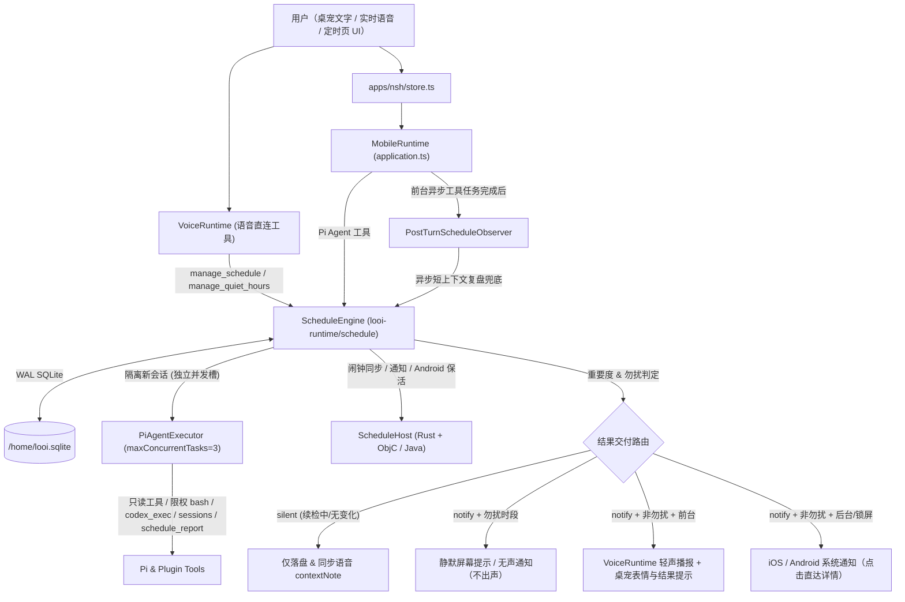

# Super-LOOI 轻量化 Schedule（定时调度）与勿扰模式实施方案

## 1. 目标与核心体验

为 Super-LOOI 构建一套**整体设计轻量、运行于手机本机且在移动端完整可用**的 Schedule（定时调度）与 Quiet Hours（勿扰时段）子系统：

- **静默识别与自动跟进**：当用户让 LOOI 执行具有异步外部等待的任务（例如提交 GitHub PR 等待 CI 流水线或 Code Review 评审、提交 Codex Cloud 远端任务等）后，系统不弹窗打扰用户，静默种下一次性检查规则并仅闪一条可忽略的轻 toast（轻量提示条）；到点后在隔离的新会话里自动检查，若远端尚未结束则在次数上限内自动续检，得出明确结果或异常时再按分级策略提醒。
- **全形态调度规则**：统一支持一次性（相对延迟 / 绝对定点）、周期性（固定间隔 / 标准 5 段 Cron 定时表达式）以及有上限的链式自动续检。
- **多时段勿扰模式**：支持配置一个或多个可跨午夜（如 `23:00–08:00`）的时间段，既可在独立 UI（用户界面）管理，也可通过实时语音或文字口头直接增删改查；勿扰时段内定时规则照常静默执行，但不主动出声播报。
- **双端移动端生命周期保障**：
  - **前台常亮态**：进程内单定时器精准触发。
  - **iOS 后台 / 锁屏**：运行中的检查申请 `beginBackgroundTask` 短收尾窗口；未到点规则同步至 `UNUserNotificationCenter` 准点弹系统本地通知，用户点开回前台后立即自动触发，App 重启或回到前台时也会自动补跑宽限期内错过的任务。
  - **Android 后台 / 锁屏**：存在活跃规则时按需拉起轻量 `Foreground Service`（`dataSync` 前台服务）保活进程，锁屏后直接静默跑完检查并推送系统结果通知，无活跃规则时自动停止以节省电量；同时挂载 `AlarmManager`（系统闹钟管理器）作为进程被系统回收时的兜底触发。

---

## 2. 模块边界与复杂度审视（Deep Module 深模块设计）

依据 [codebase-design/SKILL.md](../../.agents/skills/codebase-design/SKILL.md) 的深模块原则（把复杂逻辑与状态变迁封装在简单内聚的接口之后），本次引入三个高内聚边界，不新增任何第三方调度或 Cron 解析 npm 依赖：

| 新增模块 / 实体 | 核心职责 | 复杂度成本与引入理由 |
| --- | --- | --- |
| `packages/looi-runtime/src/schedule/` | 单一深模块封装数据契约、零依赖 5 段 Cron 与跨午夜勿扰计算、SQLite（嵌入式关系数据库）持久化、单定时器调度循环（Lookahead Timer，前瞻单定时器）、`dedupeKey`（去重键）合并、自动续检上限、分级权限策略与回合后轻量复盘器 | 将时间计算、防重入、补跑恢复、去重和权限校验收敛在一处；上层调用方（`MobileRuntime`、`VoiceRuntime` 与 UI）只面对 `ScheduleEngine` 一个统一接口 |
| `ScheduleHost`（`apps/nsh/src/schedule_native/` + `apps/nsh/native/ios/ScheduleNative.m` + `apps/nsh/native/android/...`） | 极薄原生桥接：系统通知权限、OS（操作系统）闹钟同步、结果通知投递、iOS 退后台短收尾窗口、Android 按需前台保活服务与点击通知事件队列 | 解决移动端退后台冻结进程的物理系统约束；桌面与 headless（无头测试）环境提供同契约内存实现，不影响自动化测试 |
| `apps/nsh/ui/SchedulesSpaceView.tsx` | 管理空间第 8 个独立一级入口「定时（Schedules）」，集中管理定时规则、执行记录与多时段勿扰 | 承载规则新建/编辑、执行历史查看与多段勿扰配置，避免把现有「任务」或「设置」空间挤得过重 |

> [!NOTE]
> **边界与克制**：不引入通用设备事件总线（例如监听家居传感器触发定时规则），不引入第三方 Cron 库，也不引入任何桌面中转服务或外部后端守护进程；全部调度、推理与存储均由手机本机 App 自承载完成。

---

## 3. 整体架构链路

---

## 4. 分层详细设计与改动文件

### 第一层：核心调度引擎与持久化（`packages/looi-runtime`）

1. **`packages/looi-runtime/src/schedule/types.ts`（新增）**
   - `ScheduleTrigger`：`{ kind: "once"; runAt: string }` | `{ kind: "interval"; everySeconds: number }`（最小间隔 60 秒）| `{ kind: "cron"; expr: string }`。
   - `ScheduleExecutionPolicy`（执行权限策略）：`"check_only" | "authorized_action"`。其中 `origin === "agent_inferred"`（由 Agent 静默推断创建的规则）在引擎层**强制锁定 `"check_only"`**，禁止模型自我提权。
   - `ScheduleRule`：包含 `id`、`title`、`prompt`、`origin`（`"user" | "agent_inferred"`）、`dedupeKey?`、`trigger`、`executionPolicy`、`enabled`、`state`（`"active" | "paused" | "completed" | "expired" | "cancelled"`）、`nextRunAt`、`lastRunAt?`、`lastRunId?`、`sourceSessionId?`、`sourceTaskId?`、`chain: { rootRuleId, followUpCount, maxFollowUps }`（隐式跟进默认上限 3 次）、`misfireGraceSeconds`（错过触发的补跑宽限期：一次性任务默认 24 小时，短周期任务默认 1 小时）、`expiresAt?`（隐式规则默认 24 小时后过期自清理）、`createdAt`、`updatedAt`。
   - `ScheduleRunRecord`：包含 `id`、`ruleId`、`ruleTitle`、`taskId?`、`sessionId?`（本次触发生成的隔离新会话 ID，供「继续此会话」承接）、`triggerReason`（`"scheduled" | "misfire_catchup" | "manual_now"`）、`scheduledFor`、`startedAt`、`finishedAt?`、`status`（`"running" | "succeeded" | "failed" | "awaiting_user" | "missed" | "skipped"`）、`importance?: "silent" | "notify"`、`summary?`、`error?: { stage, code?, reason }`、`followUpRuleId?`。
   - `QuietHoursWindow`：`{ id, label?, startMinute: 0..1439, endMinute: 0..1439, daysOfWeek?: number[], enabled: boolean }`。
   - `ScheduleSettings`：`{ autoFollowUpEnabled: boolean, maxActiveInferredRules: number, quietHoursEnabled: boolean, quietHours: QuietHoursWindow[] }`。
   - `NativeSchedulePort`：与原生 `ScheduleHost` 对接的最小端口契约（`permissionStatus`、`requestPermission`、`syncUpcomingAlarms`、`cancelAlarm`、`postNotification`、`setAndroidKeepAlive`、`beginIosBackgroundGrace`、`endIosBackgroundGrace`、`drainEvents`）。

2. **`packages/looi-runtime/src/schedule/cron.ts`（新增）**
   - 零依赖 5 段 Cron（`分 时 日 月 周`）解析与时间求值器：支持 `*`、`*/n`、`a-b`、`a-b/n`、`a,b,c` 语法，按本机当地时间求下一次触发点（带 1 年安全搜索上界防止如 2 月 30 日造成死循环），非法表达式抛出带 `stage: "schedule.cron.parse"` 与 `code: "ERR_INVALID_CRON"` 的错误。
   - `isWithinQuietHours(now, settings)`：支持多时段并集与跨午夜区间（例如 `startMinute > endMinute` 表示 `23:00–次日 08:00`），跨午夜下半段（`00:00..endMinute`）会正确回溯校验“昨天”的星期配置，避免跨天星期误判。

3. **[sqlite.ts](../../packages/looi-runtime/src/storage/sqlite.ts)（修改）**
   - 在现有 `/home/looi.sqlite` 数据库中新增三张表及读写辅助方法：
     - `schedule_rules`（按 `(state, next_run_at)` 与 `(dedupe_key)` 建立索引）
     - `schedule_runs`（按 `(rule_id, started_at DESC)` 建立索引）
     - `schedule_settings`（保存全局自动跟进开关、上限与多时段勿扰配置）
   - 冷启动恢复：将上次进程异常退出遗留为 `running` / `awaiting_user` 的 `schedule_runs` 标记为 `failed`（保留 `stage: "schedule.recover"`、`code: "ERR_SCHEDULE_RUNTIME_RESTARTED"`），避免冷重启后阻塞调度队列。

4. **`packages/looi-runtime/src/schedule/check-policy.ts`（新增）**
   - `isReadOnlyShellCommand(command, workspaceRoot)`：拦截所有重定向写入（`>`、`>>`）、高危破坏性命令（复用 [tool-approval.ts](../../packages/looi-runtime/src/agent/governance/tool-approval.ts) 规则）、写类子命令（`rm`/`mv`/`cp`/`chmod`、`git commit/push/checkout/reset/rebase/merge`、`gh pr merge/close/create/edit/comment`、`curl -X POST/PUT/DELETE/PATCH/-d/--data`、`apk/npm/pnpm install/add` 等）；放行明确只读检查命令（如 `gh pr view/checks/status/list/diff`、`gh run view/list`、`gh issue view/list`、`git status/log/diff/show/branch/rev-parse`、`ls/cat/head/tail/wc/grep/rg/find/pwd/date` 及 `curl` 只读 GET 查询等）。
   - `evaluateScheduledToolPolicy(policy, context)`：
     - `"check_only"`：免审批直接放行 `read`、`read_file`、`ls`、`find`、`grep`、`sessions`、`web_search`、`list_home_devices`、`schedule_report`、合规 `manage_schedule`（仅查询或限次只读续检）、只读 `codex_exec` 查询及通过只读检查的 `bash`；遇到 `write`、`write_file`、`edit`、`control_home_device`、`control_looi_body`、`codex_cloud` 或非只读 `bash` 时，一律转入 `awaiting_approval` 挂起等待并通知用户确认。
     - `"authorized_action"`：放行用户显式创建规则时已授权的常规工作区读写、命令执行、家居控制和底座控制；高危破坏性 shell 命令（`rm -rf`、`git push --force`、`sudo` 等）在非 `yolo` 模式下仍需用户确认。

5. **`packages/looi-runtime/src/schedule/engine.ts`（新增）**
   - **规则管理、去重与限流**：
     - 同一 `dedupeKey`（例如 `pr:owner/repo#42`、`codex-cloud:<taskId>`）的活跃规则自动合并更新其 `prompt`/`nextRunAt`/`title` 并刷新原生闹钟，避免为同一个目标重复堆积多个定时器。
     - `autoFollowUpEnabled` 关闭时拒绝创建 `agent_inferred` 规则，返回明确错误阶段与错误码 `ERR_AUTO_FOLLOWUP_DISABLED`。
     - 未触发的 `agent_inferred` 规则超过 `maxActiveInferredRules`（默认 8 条）时，按过期/最早创建时间自动淘汰最旧的未触发隐式规则。
   - **单定时器前瞻调度与补跑**：
     - `armNextTimer()` 只为最近一条即将到期的活跃规则挂一个 `setTimeout(min(delayMs, 60_000))`（60 秒心跳封顶可抵抗移动设备休眠时钟漂移），同时同步最近 32 条闹钟至原生层并按活跃规则数量控制 Android 前台保活开关。
     - 启动、回到前台、收到 OS 闹钟或通知点击时触发 `reconcileDueRules()`：宽限期内到期的规则入队补跑（`misfire_catchup`），超出宽限期则记录 `missed` 并推进周期规则的下一轮触发时间。
   - **隔离新会话执行与结构化汇报工具 `schedule_report`**：
     - 每次定时触发通过串行调度队列分配全新隔离 `sessionId`（`sched_<uuid>`），调用宿主 `runScheduledTask` 运行。
     - 动态注入 `schedule_report({ importance: "silent" | "notify", summary, nextCheckDelaySeconds?, nextPrompt? })` 工具：当检查发现任务仍在运行且 `followUpCount < maxFollowUps` 时，原子种下一条继承 `rootRuleId`、`dedupeKey`、`sourceSessionId` 且 `followUpCount + 1` 的续检规则，并在原 run 记录写入 `followUpRuleId`。
     - 提示词中附带 `sourceSessionId`，Agent 需要更多上下文时可按需调用既有 [sessions.ts](../../packages/looi-runtime/src/agent/tools/sessions.ts) 工具回查原会话。
     - 所有运行失败、模型未配置、超时与挂起错误均完整保留 `stage`、`code` 和 `reason` 写入 `ScheduleRunRecord.error`。

6. **`packages/looi-runtime/src/schedule/post-turn-observer.ts`（新增）**
   - **四重严格门控**（普通对话与纯问答零额外开销）：
     1. `settings.autoFollowUpEnabled === true`
     2. 前台用户任务成功完成（`state === "succeeded"`）
     3. 本轮任务未调用 `manage_schedule` 创建或更新规则
     4. 本轮工具调用步骤中包含外部异步动作信号（`bash`、`codex_exec`、`codex_cloud`）
   - **非阻塞后台复盘**：在主回复返回给用户后异步启动，复用 App 当前配置的 `modelsRegistry`（通过 [model-resolver.ts](../../packages/looi-runtime/src/agent/core/model-resolver.ts) 解析模型），以单轮压缩上下文（用户请求、关键工具调用与截断回执、最终回复摘要 `<= 2500` 字符）要求模型返回严格 JSON（JavaScript 对象表示法），决定是否种下 `agent_inferred` 的 `check_only` 规则；执行过程与异常保留完整阶段和错误码并写入 Langfuse 观测 Span。

7. **执行器扩展（修改）**
   - [executor.ts](../../packages/looi-runtime/src/agent/executor.ts)、[pi-executor.ts](../../packages/looi-runtime/src/agent/core/pi-executor.ts)、[pi-task-runner.ts](../../packages/looi-runtime/src/agent/core/pi-task-runner.ts)、[tool-approval.ts](../../packages/looi-runtime/src/agent/governance/tool-approval.ts)：
     - 为 `AgentRunOptions` 增加 `extraTools`、`systemPromptOverrideSuffix` 与 `scheduleExecutionPolicy`。
     - 在 `PiTaskRunner` 的 `tool_call` 钩子中，对带有 `scheduleExecutionPolicy` 的任务先执行 `evaluateScheduledToolPolicy`，并将 `scheduleExecutionPolicy` 透传给 `beforeToolCall` 插件上下文。
   - 在 `packages/looi-runtime/src/index.ts` 与 `packages/looi-runtime/package.json` 导出 `./schedule`。

---

### 第二层：运行时整合、双通道工具与 Codex 协同（`apps/nsh/runtime` & `apps/nsh/plugins/codex`）

1. **`apps/nsh/runtime/tools/schedule-tools.ts`（新增）**
   - 为 Pi Agent 注册 `manage_schedule`（`action: "create" | "list" | "update" | "cancel" | "run_now"`）与 `manage_quiet_hours`（`action: "list" | "add" | "update" | "remove" | "set_enabled"`）。
   - 创建规则时自动绑定当前任务所属的 `sourceSessionId` 与 `sourceTaskId`；创建 `check_only` 规则无需弹窗审批。

2. **`apps/nsh/runtime/voice/tools/schedule.ts`（新增）与语音链路集成（修改）**
   - 修改 [voice/tools/index.ts](../../apps/nsh/runtime/voice/tools/index.ts)、`apps/nsh/runtime/voice/tools/types.ts`、[voice/prompts.ts](../../apps/nsh/runtime/voice/prompts.ts)、[voice/runtime.ts](../../apps/nsh/runtime/voice/runtime.ts)、[voice/live-session.ts](../../apps/nsh/runtime/voice/live-session.ts)。
   - 在实时语音会话直接挂载 `manage_schedule` 与 `manage_quiet_hours` 两个轻量工具，用户口头说「十分钟后帮我查一下 PR 过了没」「晚上十一点到早上八点别出声」「取消刚才那个检查」直接毫秒级落盘生效，不触发重型 Pi Agent 任务启动开销。
   - 更新语音系统提示词工具规范，明确下划线工具名口播时当作空格分隔（如念作 `manage schedule`）。

3. **[application.ts](../../apps/nsh/runtime/application.ts)（修改）**
   - `MobileRuntime` 持有 `ScheduleEngine` 与 `PostTurnScheduleObserver`。
   - 将 `PiAgentExecutor` 的 `maxConcurrentTasks` 从 `2` 提升至 `3`（1 前台交互 + 1 插件后台 + 1 定时调度，互不抢占并发槽）。
   - 在 `createExecutorForSelection` 的 `systemPrompt` 中补充静默跟进引导：完成提 PR、提交远端 Codex Cloud 任务、触发构建/部署等异步外部动作后，顺手调用 `manage_schedule`（`origin: "agent_inferred"`, `executionPolicy: "check_only"`, 唯一 `dedupeKey`, 自包含检查指令）静默种下后续检查。
   - 在前台 `run()` 成功返回后异步触发 `postTurnObserver.maybeObserve(...)`。
   - 对 `store.ts` 暴露 `attachNativeSchedule`、`setScheduleForegroundActive`、`scheduleSnapshot`、`subscribeScheduleActivity`、规则/勿扰增删改查方法、`adoptConversationSession(sessionId, action)`（支持「继续此会话」切换当前主对话 ID）与 `handleNativeScheduleEvents`；在 `close()` 中清理全部定时器与调度资源。

4. **[apps/nsh/plugins/codex/runtime/index.ts](../../apps/nsh/plugins/codex/runtime/index.ts)（修改）**
   - 在 Codex `SKILL` 说明中引导 Agent 在调用 `codex_cloud` 提交远端任务或通过 `codex_exec` 创建 PR 后，优先用 `manage_schedule` 静默种下带 `dedupeKey`（如 `codex-cloud:<taskId>` 或 `pr:<repo>#<num>`）的延迟复查规则。
   - 更新 `interceptToolCall` 钩子：当调用来自 `schedule_check_only` 时，免弹窗放行只读状态查询类 `codex_exec`，同时继续拦截 `codex_cloud`（防止在检查模式擅自提交新的远端写任务）。

5. **[build-runtime.ts](../../apps/nsh/scripts/build-runtime.ts)（修改）**
   - 同步更新生成的 `apps/nsh/generated/looi-runtime.d.ts` 类型声明，暴露定时快照、规则、运行记录、勿扰窗口、原生端口以及 `MobileRuntime` / `VoiceRuntime` 新增接口。

---

### 第三层：双端原生桥接（iOS 本地通知与收尾窗口 + Android 前台服务保活与闹钟）

1. **Rust 统一原生模块（`apps/nsh/src/schedule_native/` & [lib.rs](../../apps/nsh/src/lib.rs)）**
   - 新增 `apps/nsh/src/schedule_native/mod.rs`、`ios.rs`、`android.rs`，并在 `super-looi/native` 模块注册 `ScheduleHost`，提供跨平台统一 API：`permissionStatus`、`requestPermission`、`syncUpcomingAlarms`、`cancelAlarm`、`postNotification`、`setAndroidKeepAlive`、`beginIosBackgroundGrace`、`endIosBackgroundGrace`、`drainEvents`。
   - 桌面与无头宿主提供同签名内存实现，保证事件入队与测试可执行。

2. **iOS 原生（`apps/nsh/native/ios/ScheduleNative.m` & [build.rs](../../apps/nsh/build.rs)）**
   - 在 [build.rs](../../apps/nsh/build.rs) 的 iOS 编译列表中加入 `native/ios/ScheduleNative.m` 并链接 `UserNotifications` 框架。
   - 实现 `UNUserNotificationCenter` 权限申请、按 `looi.sched.<ruleId>` 前缀同步最近 32 条定时本地通知（仅替换本前缀通知，不误删其他系统通知）、即时结果通知（`silent = true` 时静音无声）、通知点击委托入队，以及 `UIApplication beginBackgroundTaskWithName:expirationHandler:` 短收尾窗口保护。

3. **Android 原生（`apps/nsh/native/android/com/superlooi/nsh/`）**
   - 新增 `ScheduleBridge.java`：创建常规提醒渠道（`looi_schedule_alerts`）与静音/保活渠道（`looi_schedule_silent`）；提供 JNI（Java 本地接口）封装通知权限申请（Android 13+ `POST_NOTIFICATIONS`）、`AlarmManager` 定时闹钟（优先精确闹钟，无精确权限时退回 `setAndAllowWhileIdle` 并明确回传状态）、结果通知投递（带 `PendingIntent` 打开主 Activity 并携带 `ruleId`/`runId`/`taskId`/`sessionId`）与保活服务启停。
   - 新增 `ScheduleKeepAliveService.java`（`foregroundServiceType="dataSync"`）：仅在存在活跃定时规则时按需运行，所有规则关闭或完成后自动 `stopSelf()`；仅在单次定时检查运行 LLM / Shell 期间持有带超时上限的部分 `WakeLock`（唤醒锁），执行完毕立即释放。
   - 新增 `ScheduleAlarmReceiver.java`：作为进程被系统回收后到点闹钟的兜底接收器，弹出点击直达 App 触发检查的提醒通知。
   - 修改 [SuperLooiApplication.java](../../apps/nsh/native/android/com/superlooi/nsh/SuperLooiApplication.java) 注册 `ScheduleBridge.registerVm()` 并捕获通知点击 Intent 参数。
   - 依据插件注册规范修改 [plugins.json](../../apps/nsh/native/plugins.json)、[patch_manifest.py](../../apps/nsh/native/android/patch_manifest.py)（幂等注入 5 项权限 `POST_NOTIFICATIONS`、`FOREGROUND_SERVICE`、`FOREGROUND_SERVICE_DATA_SYNC`、`WAKE_LOCK`、`SCHEDULE_EXACT_ALARM` 及 `<service>` / `<receiver>` 节点）、[native-plugins.mjs](../../apps/nsh/scripts/native-plugins.mjs) 与 [test_plugin.py](../../apps/nsh/native/android/test_plugin.py)。

---

### 第四层：状态编排、结果交付与独立「定时（Schedules）」空间

1. **[store.ts](../../apps/nsh/store.ts) & [App.tsx](../../apps/nsh/App.tsx)（修改）**
   - `AppSpace` 新增 `"schedules"`；启动时挂载 `ScheduleHost` 并监听原生通知点击事件。
   - **修正退后台生命周期逻辑**：退后台时仅停止前台用户交互任务与语音会话，**不再误杀运行中的定时调度后台检查**（Android 在前台服务保活下继续跑完并推送通知；iOS 向系统申请收尾窗口尽量完成当前步骤）。
   - 按 `importance × isWithinQuietHours × lifecycle()` 进行交付路由：
     - 隐式规则创建：不弹窗，仅闪一条轻 toast。
     - `silent` 结果：仅落盘并写入语音 `contextNote`（背景上下文笔记）。
     - `notify` + 勿扰时段：更新语音 `contextNote`，前台仅显示静默视觉提示，后台发静音系统通知，**绝不主动出声**。
     - `notify` + 非勿扰 + 前台：触发桌宠短暂表情 + 结果提示；语音就绪时通过 `enqueueNotice`（对话中）或 `speak({ capturePolicy: "muted_broadcast", closeToStandbyOnComplete: true })`（待机中）轻声播报摘要。
     - `notify` + 非勿扰 + 后台/锁屏：通过 `ScheduleHost.postNotification` 推送系统通知。
   - 新增 `continueScheduledSession(sessionId)`：切换当前主会话并回到桌宠主页自动展开输入框，让用户直接顺着该次检查继续追问。
   - 若定时检查遇到需要用户授权的工具调用，复用全局审批弹窗并清晰标明规则名称与操作参数。

2. **[ManagementShell.tsx](../../apps/nsh/ui/ManagementShell.tsx) & `apps/nsh/ui/SchedulesSpaceView.tsx`（新增）**
   - 左侧极窄导航轨（及窄屏底栏）新增第 8 个入口：`定时`（`testID="nav-schedules"`），存在运行中/待触发规则显示 `verified` 圆点，存在待确认审批显示 `warning` 圆点。
   - 顶栏 `48pt` 上下文胶囊栏新增 `SchedulesContextBar`：左侧切换 `规则 · N` | `勿扰时段`（勿扰生效中带状态圆点），右侧放置 `自动跟进` 开关胶囊与主动作按钮 `+ 新建规则`（勿扰页切换为 `+ 添加时段`）。
   - **规则子视图（横屏 42% / 58% 主从双栏，各自独立 `<Scroll>`）**：
     - 左栏：来源筛选（`全部 / 用户创建 / 自动跟进`）+ 规则列表行（标题、来源、周期、下次触发时间、状态点+文案、行尾启停 `Switch`）+ 引导空状态。
     - 右栏：规则详情检视器（操作栏：`立即运行`、`编辑…`、`删除` 配原生 `AlertDialog` 二次确认；规则配置、权限标签、完整指令，以及按时间倒序的「执行记录」，每条带 `查看任务` 与 `继续此会话` 动作）。
   - **勿扰时段子视图（横屏双栏）**：
     - 左栏：勿扰总开关、当前是否处于勿扰状态的实时提示卡片与口头设置示例。
     - 右栏：多时段卡片列表（时段名、起止时间如 `23:00 – 次日 08:00`、适用星期、独立开关、编辑与删除）。
   - **新建 / 编辑弹窗（`Dialog`）**：规则支持一次性快捷延迟或定点、固定间隔、每日定点、5 段 Cron（含下一次触发实时预览）及权限级别选择；勿扰时段支持名称、`HH:MM` 起止与星期多选。
   - 样式与规范严格对齐 [theme.json](../../apps/nsh/theme.json)（零硬编码颜色、常规卡片零阴影、圆角填充选中态禁止单侧边条、`44 × 44pt` 以上触控热区、数字对齐 `tabular-nums`），并在 [catalog.ts](../../apps/nsh/i18n/catalog.ts) 与 [runtime-catalog.ts](../../apps/nsh/i18n/runtime-catalog.ts) 补全中英双语文案。

3. **动效清单（Motion Inventory，实施时同步写入 [DESIGN.md](../../apps/nsh/DESIGN.md)）**

| 状态变化类别 | 原生动效工具与令牌参数 | 减少动态效果（`reduceMotion()`） |
| --- | --- | --- |
| 按压与悬停（规则行、筛选胶囊、按钮） | `transition-colors duration-120`；按钮按压 `active:scale-[0.97]`（`duration-180`），列表行仅加深背景不缩放 | `motion-reduce:active:scale-100`，色阶瞬时切换 |
| 图标与标签切换（状态点、规则数、下次触发时间） | 计数与时间使用 `tabular-nums` 防抖动；`立即运行` 加载态复用 `IconButton` 旋转动效 | 立即切换文案与静态图标，停转 |
| 选中态切换（顶栏 `规则 / 勿扰时段`、来源筛选、列表行） | 整块圆角填充色在 `duration-150` 内平滑过渡，行高与对齐轴稳定 | 瞬时切换选中填充 |
| 内容到达与离场（子视图、执行记录） | 子视图用 `RetainedPage` 保持滚动位置；新执行记录就地更新 | 瞬时呈现 |
| 浮层开合（规则/勿扰 `Dialog`、删除 `AlertDialog`） | `Dialog` 使用 `animation={reduceMotion() ? "none" : "fade"}`（`180ms`）；删除走原生 `AlertDialog` | `0ms` 瞬时开合 |
| 布局变化（条目增删） | 在所属 `<Scroll>` 容器内稳定重排，外层无整页跳动 | 瞬时更新 |
| 拖拽与手势 | 仅使用原生 `<Scroll>` 滚动物理回弹，无自定义拖拽 | 原生滚动 |
| 加载与进度（规则执行中） | 状态徽章复用 `LoadingIndicator inline` 旋转圆弧 | 静止圆弧展示 |
| 实时连续状态（勿扰生效态、相对倒计时） | 按分钟边界离散刷新，无高频闪烁 | 同样离散刷新 |

4. **规范与架构文档同步**
   - 更新 [DESIGN.md](../../apps/nsh/DESIGN.md)（补充「定时」空间规范与动效清单）。
   - 更新 [docs/arch/index.html](../arch/index.html)（补充调度核心、回合后复盘器与原生通知/保活链路）。

---

## 5. 验证方案

### 5.1 自动化测试

1. **调度核心单元测试（`pnpm --filter @super-looi/runtime test`）**：
   - `cron.test.ts`：5 段 Cron 解析、非法表达式错误码、跨月/跨年/闰日边界、多时段勿扰与跨午夜星期回溯判定。
   - `schedule-engine.test.ts`：SQLite 持久化与冷重启恢复（`running` 清理）、`dedupeKey` 合并去重、一次性/周期触发、宽限期 misfire 补跑与超窗标记 `missed`、`schedule_report` 静默/提醒分级、自动续检达 `maxFollowUps` 硬上限停止、`autoFollowUpEnabled` 关闭与隐式规则数量上限裁剪。
   - `check-policy.test.ts`：`check_only` 放行只读工具与只读 shell（`gh pr checks`、`git status`），准确拦截写文件、重定向、高危命令、家居控制和 `codex_cloud`；`authorized_action` 放行常规动作并拦截高危破坏性命令。
   - `post-turn-observer.test.ts`：普通问答不触发；含 `bash`/`codex` 调用且未建规则时异步补种 `agent_inferred` 规则；已建规则或失败回合不重复创建；模型失败时完整保留阶段与错误码且不影响主流程。
2. **App 运行时、语音、原生插件与 UI 测试（`pnpm --filter @super-looi/nsh test`）**：
   - `tests/schedule-runtime.node.ts`：验证 Pi Agent 静默建规则、隔离新会话与前台任务并发执行、勿扰时段抑制出声但保留 `contextNote`、非勿扰时段触发 `voice.speak`、`adoptConversationSession` 承接会话，以及 Codex 插件在 `check_only` 下的免审批查询。
   - `tests/schedule-voice-tools.node.ts`：验证实时语音直接调用 `manage_schedule` 与 `manage_quiet_hours` 增删改查。
   - `SchedulesSpace.test.tsx`：NSH 无头 UI 行为测试，覆盖规则筛选/启停/新建/编辑/删除、多段勿扰配置、查看任务详情与「继续此会话」。
   - `pnpm --filter @super-looi/nsh test:plugins`：校验 Android 清单权限、`<service>` 与 `<receiver>` 注入及二次打包幂等性。
3. **全仓构建与检查**：
   - `cargo check`（宿主机及可用移动端目标）
   - `pnpm typecheck`
   - `pnpm test`
   - `pnpm build`

### 5.2 真机横屏验收与独立 Review

在连接的 iOS 与 Android 开发真机（横屏）安装开发包后逐项核验：
1. **双主题与 UI 巡检**：核对浅色 / 深色主题下「定时」空间规则列表、详情、新建/编辑弹窗与勿扰时段页的圆角、间距、对齐、触控热区与动效清单全部条目。
2. **端到端核心场景**：让 LOOI 执行创建 PR 或同类带异步外部等待的任务，验证无弹窗静默种下规则 + 轻 toast 提示 → 到点自动拉起隔离新会话检查 → 未结束时静默续检 → 得出结果后非勿扰时段轻声播报、勿扰时段静默不发声。
3. **口头设置勿扰**：语音说「晚上十一点到早上八点别出声」，验证实时语音直接落盘并在「定时 → 勿扰时段」即时可见。
4. **后台与锁屏保障**：
   - **Android 真机**：存在活跃规则时出现轻量保活前台服务通知，锁屏到点后在后台静默跑完检查并推送结果通知，点击通知直达详情；无活跃规则时服务自动退出。
   - **iOS 真机**：锁屏到点收到本地通知，点击通知回前台自动补跑或直达结果详情。
5. **独立 Review**：由独立子 Agent 对代码架构边界、权限安全、错误透明链与 NSH 设计规范进行完整审查。
