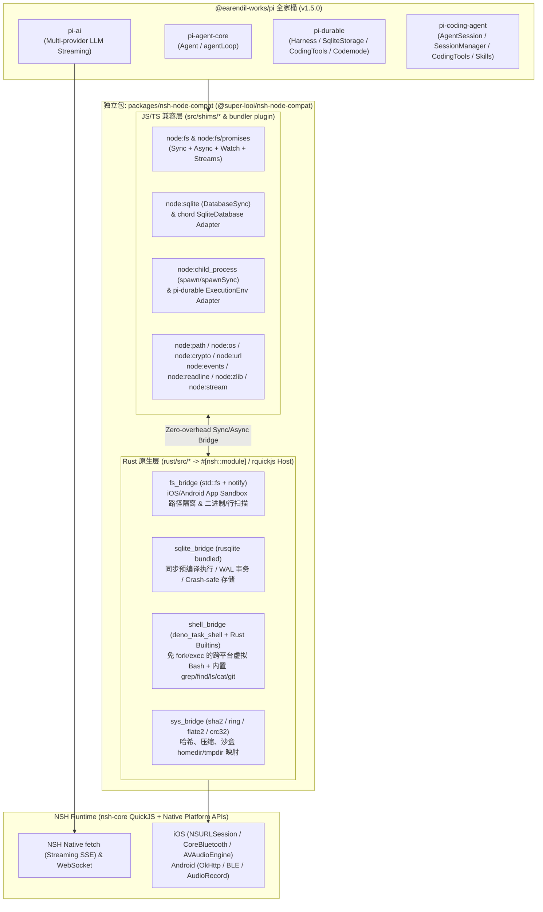

# NSH + Rust/QuickJS 独立 Node.js 兼容层包设计与 `pi-*` 全家桶验证方案

> **目标**：取消 `apps/hub` 桌面端服务端依赖，将 `super-looi` 演进为基于 [NSH (`nsh.dev`)](https://nsh.dev/) 的独立移动端应用（iOS / Android）。通过构建一个独立的 **Rust + QuickJS 混合式 Node.js 兼容层包 (`@super-looi/nsh-node-compat`)**，在移动端沙盒内完整跑通并验证 `@earendil-works/pi-agent-core`、`@earendil-works/pi-ai`、`@earendil-works/pi-durable`、`@earendil-works/pi-coding-agent` 四大核心包。

---

## 1. 核心架构：Rust + QuickJS 混合式独立 Node.js 兼容层包 (`@super-looi/nsh-node-compat`)

在 NSH (`nsh.dev` v0.4.0) 架构下，QuickJS 引擎负责运行业务与 Agent 编排逻辑，而 Rust (`#[nsh::module]`) 负责提供无锁、跨平台（iOS / Android / Desktop）的系统级原生能力。

我们将 **Node.js 兼容层** 抽取为一个完全独立、可复用的双层包 **`packages/nsh-node-compat`**（包含 Rust crate `nsh_node_compat` 与 TypeScript/JS `node:*` 模块垫片 + 打包器插件），既能挂载在 NSH 宿主中运行，也能直接通过内置的 `rquickjs` 原生测试宿主在 CI/本地命令行中独立验证。



---

## 2. 为什么需要 Rust + QuickJS 混合兼容层？（NSH 原生缺口对标）

通过对 NSH v0.4.0 运行时与 `@earendil-works/pi-*` 源码的逐文件审计，NSH 默认只提供 11 个受限模块（`buffer`, `console`, `crypto`, `fs/promises`, `net`, `os`, `path`, `process`, `url`, `websocket`, `zlib`），在移动端存在 **4 个关键缺口**，正好由 `packages/nsh-node-compat` 补齐：

| 能力域 | NSH v0.4.0 默认现状 | `pi-*` 全家桶的实际需求 | `@super-looi/nsh-node-compat` (Rust + QuickJS) 解决方案 |
| :--- | :--- | :--- | :--- |
| **文件系统 (`node:fs` / `node:fs/promises`)** | ❌ 移动端禁用 `fs/promises`（返回 `ERR_FEATURE_UNAVAILABLE_ON_PLATFORM`）；完全没有同步 `node:fs` (`readFileSync` 等) | `pi-coding-agent`（25 处 `node:fs` + 12 处 `node:fs/promises`）和 `pi-durable/env/node` 重度依赖同步/异步文件读写、偏移读取、`watch` | **Rust `fs_bridge` + JS `node:fs` 垫片**：在 QuickJS 注入同步 Host Function (`__nsh_compat_fs_*`) 与异步 Bridge，将根路径锚定在 App 沙盒 (`Documents/workspace`)，完整支持 `readFileSync`、`writeFileSync`、`statSync`、`readdirSync`、`open/read` 分块读取及 `notify` 文件监听 |
| **SQLite (`node:sqlite`)** | ❌ 无内置 `node:sqlite` | `pi-durable/storage/sqlite/node` 与 `@earendil-works/chord/sqlite/node` 直接 `import { DatabaseSync } from "node:sqlite"` | **Rust `sqlite_bridge` (`rusqlite` bundled)**：在 QuickJS 中直接暴露同步 `DatabaseSync` 类（支持 `exec`、`prepare`、`run`、`get`、`all` 及事务），同时提供 `chord/sqlite` 原生适配器 |
| **子进程与 Shell (`node:child_process`)** | ❌ 移动端禁用 `process.run/spawn`；iOS 系统沙盒内核级禁止 `fork`/`exec` `/bin/sh` | `pi-durable` 的 `BashTool` / `NodeExecutionEnv` 与 `pi-coding-agent` 的 `bash` / `grep` / `find` 依赖 `spawn` / `spawnSync` | **Rust `shell_bridge` (`deno_task_shell`)**：在 Rust 层嵌入 Deno 官方跨平台 Shell 解析执行引擎 `deno_task_shell`，配合 Rust 内置命令集（`cat`, `ls`, `grep`/`ignore`, `find`, `mkdir`, `rm`, `cp`, `mv`, `head`, `tail`, `wc`, `sed`, `echo`, `pwd`, `env`），无需 OS `fork/exec` 即可在 iOS/Android 沙盒内执行复杂管道、重定向与脚本 |
| **Node 核心工具模块** | ⚠️ 仅有基础 `buffer`, `path`, `url`, `crypto`, `zlib` | `pi-coding-agent` 依赖 `node:readline`, `node:events`, `node:string_decoder`, `node:os` (`homedir`/`tmpdir`), `node:zlib` (`crc32`/`deflateRawSync`) | **JS 纯垫片 + Rust 加速原语**：内置 `EventEmitter`、`StringDecoder`、基于流/缓冲区的 `readline.createInterface`，以及由 Rust 加速的 `crc32`/`deflateRawSync`/`createHash` |

---

## 3. `@earendil-works/pi@1.5.0` 四大目标包逐一可行性审计与适配矩阵

我们对 `@earendil-works/pi-*@1.5.0` 四个核心包（及其内部依赖 `@earendil-works/pi-schema`、`@earendil-works/chord`、`@earendil-works/pi-codemode`）的编译产物进行了完整的 AST / 导入扫描，结论如下：

### 3.1 `@earendil-works/pi-agent-core@1.5.0` —— ✅ 100% 原生可行（零修改）
* **源码审计**：
  * 包含 `dist/agent.js`、`dist/agent-loop.js`、`dist/stream-fn.js`、`dist/proxy.js`、`dist/types.js`。
  * **`node:*` 导入数量：0**。
  * 依赖的 `@earendil-works/pi-schema@1.5.0` 同样为 **0 个 `node:*` 导入**，且不使用 `new Function` / `eval`，完全兼容 QuickJS。

### 3.2 `@earendil-works/pi-ai@1.5.0` —— ✅ 100% 可行（仅需轻量全局补丁 + 打包裁剪）
* **源码审计**：
  * 主入口 `dist/index.js`、`dist/models.js`、`dist/compat.js` 及主流 Provider（`openai-completions.js`, `openai-responses.js`, `anthropic-messages.js`, `google-generative-ai.js`）均基于 Web 标准 `fetch`、`ReadableStream`、`TextDecoder`、`AbortController`。
  * 仅以下非移动端模块引用了 Node API：
    1. `dist/auth/oauth/callback-server.js` 与 `openai-chatgpt.js`（引用 `node:http`、`node:crypto` 起本地回调服务器，移动端 OAuth 走 DeepLink 或直接用 API Key）。
    2. `dist/api/bedrock-converse-stream.js`（引用 `@smithy/node-http-handler`）。
* **兼容层处理**：
  * 在 `nsh-node-compat` 的 `polyfill.ts` 中注入 `globalThis.structuredClone` 与 `globalThis.crypto.randomUUID`。
  * 在 Bundler 插件中将 `bedrock-converse-stream.js`（若不用 AWS Bedrock）指向轻量 stub，保留 OpenAI / Anthropic / Gemini / DeepSeek / 豆包等全部主流 Provider。

### 3.3 `@earendil-works/pi-durable@1.5.0` —— ✅ 100% 可行（双路径完美契合）
* **源码审计**：
  * `pi-durable` 的核心模块（`dist/index.js`、`dist/env/index.js`、`dist/tools/*`、`dist/storage/sqlite/index.js`、`dist/storage/jsonl/index.js`、`dist/storage/memory/index.js`、`dist/tool-search/index.js`、`dist/codemode/index.js`）**全部是 0 个 `node:*` 导入的纯接口驱动架构**！
  * 它的 Node 绑定被严格隔离在两个薄封装子路径中：
    1. `@earendil-works/chord/sqlite/node`：仅 88 行代码，唯一导入是 `import { DatabaseSync } from "node:sqlite"`。
    2. `@earendil-works/pi-durable/env/node`：实现 `ExecutionEnv` 接口（文件读写、目录遍历、`watch`、`exec`），导入 `node:fs`、`node:fs/promises`、`node:child_process`、`node:path`、`node:os`。
    3. `@earendil-works/pi-codemode`：专门提供了 `./portable` 入口（`InProcessCodemodeSandbox` / `RemoteCodemodeSandbox`），**0 个 `node:*` 导入**，可在 QuickJS 内部直接执行 Codemode 工具编排。
* **兼容层处理**：
  * **路径 A（透明兼容）**：由于 `nsh-node-compat` 提供了基于 Rust `rusqlite` 的 `node:sqlite` (`DatabaseSync`) 以及 `node:fs` + `node:child_process`，`pi-durable` 的标准 Node 用法可以直接运行。
  * **路径 B（极致性能原生接口）**：`nsh-node-compat` 同时导出直接调用 Rust 的 `NshExecutionEnv`（实现 `pi-durable/env` 的 `ExecutionEnv`，行扫描 `scanLines` 直接走 Rust 零拷贝）和 `NshSqliteDatabase`（实现 `chord/sqlite` 的 `SqliteDatabase`）。

### 3.4 `@earendil-works/pi-coding-agent@1.5.0` —— ✅ SDK 与全套工具模式 100% 可行
* **源码审计**：
  * `pi-coding-agent` 分为两部分：
    1. **桌面终端 CLI/TUI 层** (`dist/cli.js`, `dist/modes/interactive/*`, `@earendil-works/pi-tui`, `jiti`, `@silvia-odwyer/photon-node` 原生 C++ 插件)：面向桌面终端 TTY。
    2. **核心 SDK 与 Coding Tools 层** (`dist/core/sdk.js` -> `createAgentSession`, `AgentSession`, `SessionManager`, `SettingsManager`, `ModelRuntime`, `compaction`, `skills` 以及 `dist/core/tools/*` -> `read`, `write`, `edit`, `grep`, `find`, `ls`, `bash`)：
       * 仅依赖 `node:path` (30处)、`node:fs` (25处)、`node:fs/promises` (12处)、`node:os` (9处)、`node:crypto` (7处)、`node:child_process` (5处)、`node:url` (4处)、`node:readline` (3处)、`node:events`、`node:string_decoder`、`node:zlib`。
       * **而且** `dist/core/tools/*` 的每个工具（`createReadTool`, `createWriteTool`, `createEditTool`, `createGrepTool`, `createFindTool`, `createLsTool`, `createBashTool`）都支持注入自定义的 `Operations` 接口（`ReadOperations`, `BashOperations` 等）。
* **兼容层处理**：
  * 通过 `nsh-node-compat` 提供的 `node:fs`、`node:fs/promises`、`node:child_process` (`deno_task_shell`)、`node:readline`、`node:zlib` 等模块，`createAgentSession`、`SessionManager`（JSONL 会话持久化与树状分支）、`SettingsManager`、`compaction` 以及 7 大内置工具（`read`/`write`/`edit`/`grep`/`find`/`ls`/`bash`）均可直接在 QuickJS 中运行。
  * Bundler 别名自动将桌面专属的 `@earendil-works/pi-tui`、`jiti`（移动端改用预编译扩展注册）与 `@silvia-odwyer/photon-node` 替换为轻量移动端垫片。

---

## 4. 独立兼容层包 `packages/nsh-node-compat` 详细目录与接口设计

我们将兼容层设计为 Monorepo 下的独立包 `packages/nsh-node-compat`（包名 `@super-looi/nsh-node-compat`），结构如下：

```text
packages/nsh-node-compat/
├── package.json                  # 导出 node:* 垫片、Bundler 别名插件、Pi 适配器
├── tsconfig.json
├── rust/                         # Rust 原生核心 crate: nsh-node-compat-rs
│   ├── Cargo.toml                # 依赖: rquickjs, rusqlite (bundled), deno_task_shell, notify, sha2, flate2, crc32fast, ignore
│   └── src/
│       ├── lib.rs                # 统一导出: 既可作为 #[nsh::module] 挂载，也可直接注入 rquickjs::Ctx
│       ├── sandbox.rs            # 沙盒路径解析与越权防护 (将 /、~、tmpdir 映射到沙盒目录)
│       ├── fs_bridge.rs          # 同步/异步 FS 原语 + 流式偏移读取 + 行扫描 (scan_lines) + notify watch
│       ├── sqlite_bridge.rs      # 基于 rusqlite 的同步预编译 SQLite 引擎 (支撑 node:sqlite DatabaseSync)
│       ├── shell_bridge.rs       # 基于 deno_task_shell 的虚拟 Shell + 内置 Rust Coreutils (ls/cat/grep/find/rm/cp/mv/head/tail/wc)
│       ├── crypto_zlib_bridge.rs # 哈希 (sha256/sha1/md5/hmac)、随机字节、deflateRawSync/crc32
│       └── bin/
│           └── qjs_runner.rs     # 独立 QuickJS + Rust 兼容层 CLI 测试宿主，用于直接运行打包后的 JS 验证套件！
├── src/                          # TypeScript/JS 模块垫片层
│   ├── index.ts                  # 初始化入口 (installNodeCompatGlobals) & Pi 原生适配器导出
│   ├── bundler.ts                # Rolldown / esbuild / Vite 别名插件: getNshNodeCompatAliases()
│   ├── polyfills.ts              # structuredClone, TextEncoderStream, process, Buffer, timers 增强
│   ├── shims/
│   │   ├── fs.ts                 # node:fs (readFileSync, writeFileSync, existsSync, statSync, readdirSync, createWriteStream, watch...)
│   │   ├── fs-promises.ts        # node:fs/promises (readFile, writeFile, stat, readdir, mkdir, rm, open...)
│   │   ├── sqlite.ts             # node:sqlite (DatabaseSync, StatementSync) -> 桥接 sqlite_bridge.rs
│   │   ├── child_process.ts      # node:child_process (spawn, spawnSync, execFile) -> 桥接 shell_bridge.rs
│   │   ├── path.ts               # node:path (POSIX 完整实现)
│   │   ├── os.ts                 # node:os (homedir, tmpdir, platform, arch, EOL, cpus)
│   │   ├── crypto.ts             # node:crypto (createHash, createHmac, randomUUID, randomBytes)
│   │   ├── readline.ts           # node:readline & node:readline/promises (createInterface 逐行流读取)
│   │   ├── events.ts             # node:events (EventEmitter)
│   │   ├── stream.ts             # node:stream & node:string_decoder
│   │   ├── zlib.ts               # node:zlib (deflateRawSync, inflateRawSync, crc32)
│   │   ├── url.ts                # node:url (fileURLToPath, pathToFileURL)
│   │   └── stubs.ts              # jiti / photon-node / pi-tui / http-callback 移动端安全替身
│   └── adapters/
│       ├── pi-durable-env.ts     # NshExecutionEnv (直接实现 @earendil-works/pi-durable/env ExecutionEnv)
│       └── chord-sqlite.ts       # NshSqliteDatabase (直接实现 @earendil-works/chord/sqlite SqliteDatabase)
└── test/                         # 完整验证套件 (在真实 QuickJS + Rust 宿主中执行)
    ├── verify-node-shims.ts      # 验证 fs / sqlite / child_process (deno_task_shell) / crypto / readline
    ├── verify-pi-agent-core.ts   # 验证 @earendil-works/pi-agent-core (Agent + tool loop + steering)
    ├── verify-pi-ai.ts           # 验证 @earendil-works/pi-ai (Model registry + SSE 流式解析 + 真实/Mock LLM 调用)
    ├── verify-pi-durable.ts      # 验证 @earendil-works/pi-durable (Harness + SqliteStorage 持久化恢复 + CodingTools + Codemode)
    └── verify-pi-coding-agent.ts # 验证 @earendil-works/pi-coding-agent (createAgentSession + SessionManager + 7 大工具)
```

---

## 5. 分阶段执行与验证计划 (Step-by-Step)

按照 **先构建并验证独立兼容包 + 四大 `pi-*` 包，再迁移 LOOI 业务并移除 `apps/hub`** 的顺序推进：

### Phase 1：构建 `@super-looi/nsh-node-compat` 独立包（Rust 原生层 + JS `node:*` 垫片）
1. **初始化 `packages/nsh-node-compat`**：
   * 创建 Rust crate (`packages/nsh-node-compat/rust`)，引入 `rquickjs`、`rusqlite` (bundled)、`deno_task_shell`、`ignore` (ripgrep 核心目录遍历/正则匹配库)、`sha2`、`flate2`、`crc32fast`。
   * 实现 **同步 + 异步双模注入机制**：在 QuickJS `Ctx` 中挂载 `__nsh_compat` 原生对象（让 `readFileSync`、`DatabaseSync`、`spawnSync`、`createHash` 具备零延迟同步调用能力，同时支持异步 Promise 回调与 NSH `#[nsh::module]` 导出）。
2. **实现 `shell_bridge.rs` 虚拟 Shell (`deno_task_shell` + 内置工具)**：
   * 利用 `deno_task_shell::execute` 解析任意 Bash 语法（管道 `|`、逻辑与或 `&&`/`||`、环境变量、重定向 `>`/`>>`、子命令）。
   * 内置纯 Rust 实现的常用命令：`ls`, `cat`, `grep` (基于 `regex` + `ignore`), `find`, `mkdir`, `rm`, `cp`, `mv`, `echo`, `pwd`, `head`, `tail`, `wc`, `sed`, `true`, `false`，让 Agent 的 `bash` 工具在 iOS/Android 沙盒中无需 `/bin/sh` 即可丝滑工作。
3. **实现 TypeScript `node:*` 垫片与 Bundler 插件**：
   * 完成 `node:fs`、`node:fs/promises`、`node:sqlite`、`node:child_process`、`node:path`、`node:os`、`node:crypto`、`node:readline`、`node:events`、`node:zlib`、`node:url`、`node:string_decoder` 及 `getNshNodeCompatAliases()`。
   * 编写 `qjs_runner`（Rust QuickJS CLI 宿主），支持将任意 TS/JS 入口通过 `rolldown`/`esbuild` 打包后直接在纯 QuickJS + Rust 兼容层中运行测试。

### Phase 2：在 QuickJS + Rust 兼容层中逐一验证四大 `pi-*` 目标包
使用 `qjs_runner` 在真实的 QuickJS 引擎（无 Node.js 宿主参与！）中运行 4 个端到端验证套件：
1. **验证 1：`@earendil-works/pi-agent-core@1.5.0`**
   * 在 QuickJS 中实例化 `new Agent(...)`，挂载多步工具（计算、文件读写）与 `followUp` / `steer` 队列，验证 `agentLoop` 事件流完整闭环。
2. **验证 2：`@earendil-works/pi-ai@1.5.0`**
   * 在 QuickJS 中加载 `getModel` / `streamSimple`，验证 SSE 流式解析、Tool Call 参数流式 JSON 解析，以及通过 `.env` 配置的真实 LLM API 调用。
3. **验证 3：`@earendil-works/pi-durable@1.5.0`**
   * 在 QuickJS 中通过 `node:sqlite` (`rusqlite`) 初始化 `SqliteStorage` (`migrate()`)。
   * 启动 `Harness` + `Conversation` + `createCodingTools(env)`（测试 `read`、`write`、`edit`、`bash` 管道命令）+ `InProcessCodemodeSandbox`。
   * 模拟中途中断并重新打开 SQLite 数据库，验证 Durable Journal 状态恢复与继续执行。
4. **验证 4：`@earendil-works/pi-coding-agent@1.5.0`**
   * 在 QuickJS 中调用 `createAgentSession({ cwd, sessionManager: SessionManager.create(cwd), tools: codingTools })`。
   * 驱动全部 7 个内置工具（`read`, `write`, `edit`, `ls`, `find`, `grep`, `bash`）对沙盒工作区进行代码检索、修改与 Shell 命令验证，并验证 `SessionManager` 的 JSONL 会话落盘与重载。

### Phase 3：基于 NSH + `@super-looi/nsh-node-compat` 完成 LOOI 单体 App 迁移与去 Hub 化
1. 在单包应用层集成 `@super-looi/nsh-node-compat` 与验证通过的 Pi 运行时（替代原 `apps/hub/src/agent/pi-executor.ts`）。
2. 将 LOOI 的领域能力封装为标准 Pi `AgentTool` / Durable Tool：
   * 硬件控制工具（桥接 `@super-looi/looi-driver` / BLE 表情、动作、激光、头部姿态）
   * 智能家居工具（桥接 `@super-looi/home-assistant` REST/WebSocket）
   * 本地记忆账本工具（基于兼容层 SQLite / 文件系统的 `MemoryLedger`）
3. 语音双工链路与 UI 面板直接对接本地 Agent Runtime，彻底解耦并移除 `apps/hub`，实现真正的 Standalone LOOI App。
4. 整理完整架构与验证报告落地到 `docs/`，更新 `progress.md` 与 `todo.md`。

---

## 6. 旧代码迁移、复用、归档与删除范围（Legacy Code Governance）

旧代码的**迁移、归档与删除明确包含在本 Plan 的范围内**（位于 Phase 3 收尾阶段），并严格遵循 **「先复用纯逻辑包 → 再迁移宿主耦合层 → 打归档分支 → 满足替代门禁后物理删除」** 的净室原则：

### 6.1 现有模块处置矩阵（保留 vs 迁移 vs 删除）

| 现有目录 / 模块 | 处置策略 | 具体迁移与清理动作 |
| :--- | :--- | :--- |
| [`packages/contracts`](file:///Users/bugyaluwang/project/super-looi/packages/contracts) | ✅ **100% 原样保留** | 零 Node 依赖的纯 TypeScript 契约库，直接在 NSH 应用与 Agent 工具中复用。 |
| [`packages/home-assistant`](file:///Users/bugyaluwang/project/super-looi/packages/home-assistant) | ✅ **100% 原样保留** | 已在 Phase H1/H2 完成去 Node 化（基于标准 `fetch`/`WebSocket` 与 MIoT 直连），直接在 NSH QuickJS 中运行。 |
| [`packages/looi-driver`](file:///Users/bugyaluwang/project/super-looi/packages/looi-driver) | 🔄 **保留核心 + 补齐 NSH BLE 桥** | `BodySupervisor`、租约互斥、脱座急停与 `SelfEventWindow` 100% 保留；仅新增对接 NSH Rust CoreBluetooth / Android BLE 的 `Transport` 实现。 |
| [`packages/nsh-node-compat`](file:///Users/bugyaluwang/project/super-looi/packages/nsh-node-compat) | 🆕 **新增核心底座包** | 独立维护 Rust 原生桥接 + `node:*` 垫片 + Pi 全家桶适配器。 |
| [`apps/hub`](file:///Users/bugyaluwang/project/super-looi/apps/hub) | 🗑️ **提炼核心逻辑后彻底删除** | 1. **Agent 层** (`src/agent/pi-executor.ts`) 升级迁入端侧 NSH Pi Runtime；<br>2. **记忆账本** (`src/memory/*`) 从 PostgreSQL 迁入端侧 `rusqlite` / 本机文件存储；<br>3. **48 条验收套件** (`src/acceptance/*`) 迁入端侧可独立执行的测试包；<br>4. Fastify 路由、Web 控制台 (`console-html.ts`)、PostgreSQL Schema 及根目录 `docker-compose.yml` **全部归档并从主分支物理删除**。 |
| [`apps/mobile`](file:///Users/bugyaluwang/project/super-looi/apps/mobile) (Expo/RN) | 🔄 **纯状态机复用 + 视图/原生壳替换为 NSH** | 1. **直接复用**：`src/shell/presence-state.ts`、`robot-face.ts`、`longevity-supervisor.ts`、`light-toast-queue.ts`、`src/runtime/*`（本机控制中心、豆包直连语音协议、本机记忆存储）等零 RN 依赖模块 100% 迁入 NSH 应用；<br>2. **重写/替换**：将 React Native 视图组件 (`RobotFaceView` 等) 迁移为 NSH TSX 视图，并用 NSH Rust 模块替代 `expo-*` 原生依赖；<br>3. 完成后归档并移除旧 Expo/Metro 工程壳。 |

### 6.2 归档与物理删除的硬门禁（Deletion Hard Gates）

为防止“旧代码删了但新宿主还没完全跑通”导致的工程断层，执行 `git rm -rf apps/hub` 与清理旧 Expo 壳之前，必须满足以下 **4 条硬门禁**：

1. **归档快照先行**：参照 Phase 0 规范，先创建 `archive/legacy-hub-and-expo` Git 归档分支/Tag，确保所有历史服务端与 Expo 代码 100% 可追溯。
2. **Pi 四包全路径闭环**：`@earendil-works/pi-agent-core`、`pi-ai`、`pi-durable`（含本机隔离 VM 的 `Codemode`）、`pi-coding-agent`（含完整 `createAgentSession` 与 7 大工具）在 `@super-looi/nsh-node-compat` 中全部通过真 QuickJS 验收。
3. **端侧业务全量接管**：NSH 宿主已完成本机 Agent 执行、豆包实时双工语音、米家/HA 直连控制、本机记忆账本与 `RobotFaceView` 首屏交互闭环。
4. **测试与安全门禁不退化**：原 `apps/hub` 承载的 48 条核心安全验收用例及业务回归测试已迁入新架构并 100% 通过。
