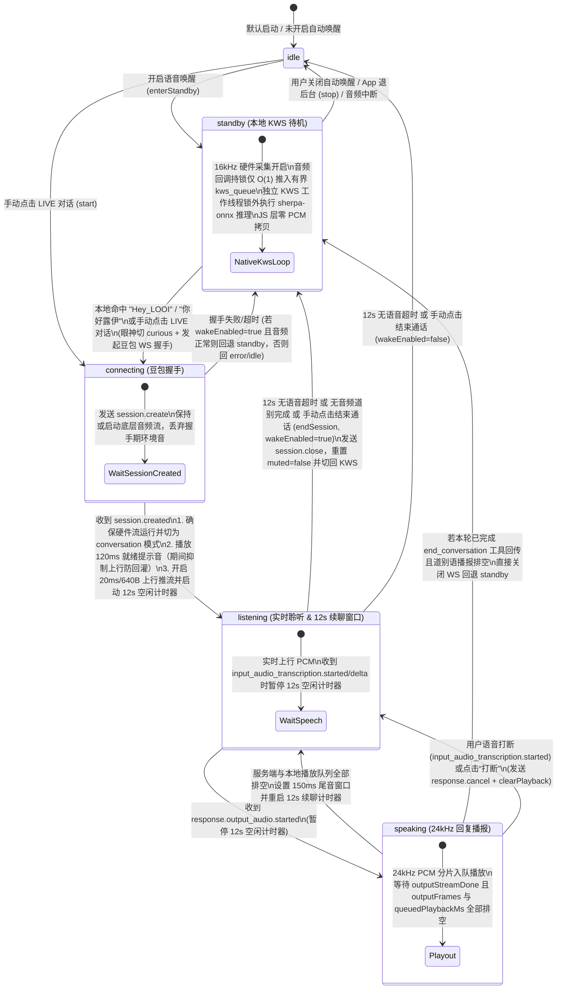

# NSH 自动语音唤醒 → 豆包 Realtime 全双工对话实施方案（稳健基线版）

日期：2026-11-07
目标宿主：`apps/nsh`（Native Shell 0.4.0 + Rust 原生音频层 + QuickJS 运行时）
关联调研：[自动语音唤醒 → 豆包 Realtime 开源社区项目与架构深度调研](../voice-wake-realtime-community-research.md)

---

## 1. 目标与边界

### 1.1 首版核心目标（稳健基线）
在 `apps/nsh` 端打通 **「喊 `"Hey LOOI"` / `"你好露伊"` $\rightarrow$ 眼神聚焦与就绪提示音（Cue） $\rightarrow$ 豆包 Duplex V3 多轮实时对话 $\rightarrow$ 12s 无交互自动休眠回本地待机」** 完整闭环：

1. **单一原生音频流无缝切换**：复用 [`apps/nsh/src/audio.rs`](file:///Users/bugyaluwang/project/super-looi/apps/nsh/src/audio.rs) 现有的 16kHz 采集与 24kHz 播放通道，从“本地唤醒监听（`standby`）”切入“豆包实时对话（`connecting` $\rightarrow$ `listening`）”时**不断开、不重开硬件音频流**，消除 iOS `AVAudioEngine` / Android `AAudio` 重置带来的 `300ms+` 物理卡顿；同时兼容从 `idle` 手动点击开启 `LIVE 对话`。
2. **两阶段确定性就绪反馈（Wake $\rightarrow$ Cue $\rightarrow$ Speak）**：
   - 本地 KWS（Keyword Spotting，关键词检测）命中瞬间：LOOI 立即切为 `curious` 眼神聚焦，并发起豆包 WebSocket `session.create` 握手；
   - 收到豆包 `session.created` 瞬间：通过原生 24kHz 播放通道合成输出 `120ms` 清脆双音提示音（Ready Chime），在提示音窗口内抑制上行采集防回灌，清空握手期旧麦克风缓存后开启 `20ms/640B` 实时上行推流，大脸切为 `listening`（实时聆听中）。
3. **真实播放排空判定、多轮对话与 12s 自动休眠（Auto-Sleep）**：
   - 收到网络帧 `response.output_audio.done` 时仅标记服务端音频流下发完毕（`outputStreamDone = true`），保持 `speaking` 状态直到 JS 层 `outputFrames` 与 Rust 原生层 `queuedPlaybackMs` **全部排空**后，才切回 `listening` 续聊窗口；
   - 在 `listening` 窗口内，若连续 **12 秒**未检测到用户开口（收到豆包 Duplex 下行 `conversation.item.input_audio_transcription.started` / `delta` 时立即暂停该空闲计时器，防止用户说长句中途被误休眠）且无正在执行的本机 Agent 任务，或用户说出结束指令触发 `end_conversation` 工具并完成道别回复，自动关闭豆包 WebSocket 会话，无缝退回本地 KWS 待机监听（`standby`）。

### 1.2 备选增强方案（记录至 `todo.md`，视首版实机体验按需启用）
- **方案 B1（冷启动有界 FIFO 先进先出队列 + 1.8x 加速节拍追赶）**：支持用户不等待提示音直接连说 `"Hey LOOI 打开台灯"`，在握手期间缓存唤醒词尾后的音频（上限 3 秒），`session.created` 后将 Pacer（节拍器）从 `20ms` 临时提速至 `11ms` 排空积压帧后恢复 `20ms`。
- **方案 B2（Warm Session 静音热备）**：在活跃交互期预先建立豆包 WebSocket 并保持 `input_audio_mute.commit`，唤醒词命中瞬间仅发送 `input_audio_unmute.commit` 实现 `0ms` 握手。

---

## 2. 复杂度与依赖审视

| 新增项 | 具体用途 | 复杂性成本与取舍理由 |
| :--- | :--- | :--- |
| **`sherpa-onnx` C API + ONNX Runtime 跨端原生库与 `sherpa-onnx-kws-zipformer-zh-en-3M-2025-12-20` 模型** | 在 Rust 音频线程内直接对 16kHz PCM 帧做流式关键词检测（支持 `"Hey LOOI"` 与 `"嘿露伊"` / `"你好露伊"`） | 1. **Rust FFI 封装**：新增 `apps/nsh/src/audio/kws.rs`（约 180 行 C FFI 外部函数接口与生命周期封装）；<br>2. **跨端构建与装包配置（必要交付成本）**：不同于 Android 系统自带的 `libaaudio.so`，`sherpa-onnx` 与 `onnxruntime` 属于第三方原生库，必须补齐产物拉取校验脚本（`apps/nsh/scripts/prepare-sherpa-kws.mjs`）、Cargo 编译期链接脚本（`apps/nsh/build.rs`，区分 iOS 真机 `ios-arm64` 与模拟器 `ios-arm64_x86_64-simulator` 静态库切片，以及 Android 三架构动态库）和 APK 注入脚本（扩展 [`apps/nsh/native/android/merge_apk.py`](file:///Users/bugyaluwang/project/super-looi/apps/nsh/native/android/merge_apk.py) 以 `ZIP_STORED` 方式注入 `lib/<abi>/libsherpa-onnx-c-api.so` 与 `libonnxruntime.so` 并保持 16KB 页对齐）；<br>3. **包体积成本**：模型资产共 **~5.23MB**（`INT8 encoder` 4.4MB + `FP32 decoder` 743KB + `INT8 joiner` 85KB + `tokens.txt` 1.9KB），加上 `sherpa-onnx` + `onnxruntime` 原生库（单 ABI 约 8~14MB）。换取 Apache-2.0 协议、零商业 Key 依赖、零训练开放词表（改 `keywords.txt` 即可调词），并避免在 QuickJS 层每 20ms 跨线程拷贝 PCM。 |
| **`VoiceAudio` 原生 KWS 专用工作线程、有界 PCM 队列与合成提示音** | 在不重启硬件麦克风的前提下切换“KWS 唤醒监听”与“上行豆包队列”，将 ONNX 模型推理时延彻底隔离出实时音频回调与 `SharedAudio` 互斥锁，并在就绪时播放 120ms 提示音 | 新增 1 个原生 KWS 工作线程（`JoinHandle`）+ `Condvar` + 有界 `VecDeque`（上限 50 包 / 约 1 秒 PCM）+ `kws_epoch: u64` 代际号（约 35 行标准库代码，零第三方 crate）；音频 tap / `AAudio` 回调持锁仅做 O(1) 内存入队并微秒级释锁，避免 `SherpaOnnxDecodeKeywordStream` 推理阻塞 iOS `AVAudioEngine` tap、Android 采集/播放线程或 JS `status()` 轮询；提示音由 20 行纯数学正弦波生成（880Hz $\rightarrow$ 1320Hz 包络）。 |
| **`end_conversation` 语音工具** | 用户说“没事了 / 退下吧 / 再见”时，让豆包在播完道别语后立即挂断回待机 | 在 [`VoiceRuntime`](file:///Users/bugyaluwang/project/super-looi/apps/nsh/runtime/voice.ts#L171) 的 `tools` 数组增加 1 个零参数工具定义，消除多轮对话结束后还需等待 12 秒才关麦的延迟。 |

---

## 3. 架构与状态流转设计

### 3.1 完整状态机



---

## 4. 分模块代码改动清单

### 4.1 跨平台原生库链接与模型资产打包管线（iOS 真机 / iOS 模拟器 / Android）

> **为什么不能只写 `kws.rs` + `dlopen`？**
> [`apps/nsh/src/audio/android.rs`](file:///Users/bugyaluwang/project/super-looi/apps/nsh/src/audio/android.rs#L144) 中的 `dlopen("libaaudio.so")` 之所以免打包可用，是因为 `libaaudio.so` 是 Android 系统预装在 `/system/lib64/` 的 OS 级系统库；而 **`sherpa-onnx` 与 `onnxruntime` 是第三方 C/C++ 库**，系统镜像中并不存在：
> - **iOS 端**：[官方 `build-ios.sh`](https://github.com/k2-fsa/sherpa-onnx/blob/master/build-ios.sh) 通过 `libtool -static` 将 `libsherpa-onnx-c-api.a`、`libsherpa-onnx-core.a`、`libkaldi-native-fbank-core.a` 等合并为单一静态库 `libsherpa-onnx.a`，连同 `ios-onnxruntime` 封装为静态 XCFramework（含 `ios-arm64` 真机切片与 `ios-arm64_x86_64-simulator` 模拟器切片）。静态库 `.a` 无法在运行时 `dlopen`，必须在 Cargo 编译期通过 `build.rs` 静态链接进 `nsh-ios-host` / `nsh-ios-app` Mach-O 可执行文件。
> - **Android 端**：NSH 编译生成 `lib/{arm64-v8a,armeabi-v7a,x86_64}/libnsh.so` 后，通过 [`apps/nsh/scripts/native-plugins.mjs`](file:///Users/bugyaluwang/project/super-looi/apps/nsh/scripts/native-plugins.mjs#L147) 拦截 `apksigner` 调用 [`apps/nsh/native/android/merge_apk.py`](file:///Users/bugyaluwang/project/super-looi/apps/nsh/native/android/merge_apk.py) 重打包并执行 `zipalign -P 16 -f 4`。若不在 `merge_apk.py` 中把 `lib/<abi>/libonnxruntime.so` 与 `lib/<abi>/libsherpa-onnx-c-api.so` 注入 APK 对应 ABI 目录，运行期必报 `library not found`。
> - **模型打包**：NSH 的 iOS 打包器生成的 `NshDev.app` 仅包含 `Info.plist`、`_CodeSignature` 和单一可执行文件 `nsh-ios-host`，没有 Xcode Copy Bundle Resources 阶段；而 `SherpaOnnxCreateKeywordSpotter` 仅接受磁盘文件路径（`*const c_char`），因此必须显式设计模型打包与沙盒释放路径。

1. **新增产物拉取与 SHA256 校验脚本 `apps/nsh/scripts/prepare-sherpa-kws.mjs`（由 [`apps/nsh/scripts/nsh.ts`](file:///Users/bugyaluwang/project/super-looi/apps/nsh/scripts/nsh.ts) 在构建前自动调用）**：
   - 与 `nsh.ts` 缓存 `~/.cache/super-looi/nsh/<revision>` 机制一致，固定 `sherpa-onnx` 版本号与 SHA256 摘要，将三类产物拉取并缓存至 `~/.cache/super-looi/sherpa-onnx/<version>/`：
     1. **模型包**：`sherpa-onnx-kws-zipformer-zh-en-3M-2025-12-20.tar.bz2`，解压保留 4 个核心文件（`encoder-epoch-13-avg-2-chunk-16-left-64.int8.onnx`、`decoder-epoch-13-avg-2-chunk-16-left-64.onnx`、`joiner-epoch-13-avg-2-chunk-16-left-64.int8.onnx`、`tokens.txt`，合计 `~5.23 MB`）；
     2. **iOS 原生静态 XCFramework**（来自官方 `sherpa-onnx-v<version>-ios.tar.bz2` 或 `build-ios.sh` 产物）：包含 `sherpa-onnx.xcframework`（`ios-arm64/libsherpa-onnx.a` 与 `ios-arm64_x86_64-simulator/libsherpa-onnx.a`）及 `ios-onnxruntime` 的 `onnxruntime.xcframework`（`ios-arm64` 与 `ios-arm64_x86_64-simulator`）；
     3. **Android 原生动态库**（来自官方 `sherpa-onnx-v<version>-android.tar.bz2` 或 NDK r27+ 16KB 页对齐编译产物）：包含 `jniLibs/{arm64-v8a,armeabi-v7a,x86_64}/{libsherpa-onnx-c-api.so,libonnxruntime.so}`。**16KB ELF 页对齐强制校验**：Android 15/16 的 [16KB 页面大小要求](https://developer.android.com/guide/practices/page-sizes#elf-alignment)包含两个独立条件——（a）`.so` 内部 ELF `PT_LOAD` 段对齐必须满足 `p_align >= 16384 (0x4000)`（编译期开启 `-Wl,-z,max-page-size=16384` / `ANDROID_SUPPORT_FLEXIBLE_PAGE_SIZES=ON`），（b）APK 内文件偏移按 16KB 对齐（`ZIP_STORED` + `zipalign -P 16`）。`prepare-sherpa-kws.mjs` 在校验 SHA256 的同时，直接解析 `arm64-v8a` / `x86_64` 下两个 `.so` 的 ELF Program Header，强制断言所有 `PT_LOAD` 段的 `p_align >= 0x4000`（若上游预编译包未达标，则使用带 `-DCMAKE_SHARED_LINKER_FLAGS="-Wl,-z,max-page-size=16384"` 编译的固定产物）。
   - 在 [`apps/nsh/scripts/native-plugins.mjs`](file:///Users/bugyaluwang/project/super-looi/apps/nsh/scripts/native-plugins.mjs#L38) 的 `nativePluginEnvironment()` 中注入环境变量 `LOOI_SHERPA_CACHE_DIR`，供 `apps/nsh/build.rs` 与 `merge_apk.py` 消费。

2. **新增 Cargo 编译期跨端链接脚本 `apps/nsh/build.rs`**：
   - **iOS 真机（`CARGO_CFG_TARGET_OS == "ios"` 且 `CARGO_CFG_TARGET_ABI == ""`）**：
     - 选用切片目录 `ios-arm64`：
       - `cargo:rustc-link-search=native=<cache>/ios/sherpa-onnx.xcframework/ios-arm64`
       - `cargo:rustc-link-lib=static=sherpa-onnx`
       - `cargo:rustc-link-search=native=<cache>/ios/onnxruntime.xcframework/ios-arm64`（或 `framework=`）
       - `cargo:rustc-link-lib=static=onnxruntime`（或 `framework=onnxruntime`）
       - `cargo:rustc-link-lib=c++`、`cargo:rustc-link-lib=framework=Foundation`、`cargo:rustc-link-lib=framework=Accelerate`
   - **iOS 模拟器（`CARGO_CFG_TARGET_OS == "ios"` 且 `CARGO_CFG_TARGET_ABI == "sim"`，对应 `aarch64-apple-ios-sim` / `x86_64-apple-ios`）**：
     - 选用切片目录 `ios-arm64_x86_64-simulator`，输出相同的静态链接指令。由于 `libsherpa-onnx.a` 与 `onnxruntime` 均静态链接进 `nsh-ios-host` / `nsh-ios-app` 二进制，无需向 `NshDev.app` 额外拷贝或重签 `.dylib`，`extern "C"` 符号在编译期直接绑定。
   - **Android（`CARGO_CFG_TARGET_OS == "android"`，对应 `aarch64-linux-android` / `armv7-linux-androideabi` / `x86_64-linux-android`）**：
     - 将 `CARGO_CFG_TARGET_ARCH` 映射为 Android ABI 目录（`aarch64` $\rightarrow$ `arm64-v8a`，`arm` $\rightarrow$ `armeabi-v7a`，`x86_64` $\rightarrow$ `x86_64`）；
     - 输出 `cargo:rustc-link-search=native=<cache>/android/jniLibs/<abi>`、`cargo:rustc-link-lib=dylib=sherpa-onnx-c-api`、`cargo:rustc-link-lib=dylib=onnxruntime`。
   - **宿主机单元测试（`macos` / `linux` 运行 `cargo test`）**：
     - 在非 `ios`/`android` 目标且未显式开启宿主机原生库时，不强链接移动端库，`kws.rs` 通过条件编译 `#[cfg(any(target_os = "ios", target_os = "android"))]` 绑定 `extern "C"` FFI，宿主机测试使用可注入的测试桩或宿主机动态库，保证 `cargo test` 零障碍运行。

3. **扩展 Android APK 重打包管线（[`apps/nsh/scripts/native-plugins.mjs`](file:///Users/bugyaluwang/project/super-looi/apps/nsh/scripts/native-plugins.mjs)、[`apps/nsh/native/android/merge_apk.py`](file:///Users/bugyaluwang/project/super-looi/apps/nsh/native/android/merge_apk.py)、[`SuperLooiApplication.java`](file:///Users/bugyaluwang/project/super-looi/apps/nsh/native/android/com/superlooi/nsh/SuperLooiApplication.java)）**：
   - 在 [`merge_apk.py`](file:///Users/bugyaluwang/project/super-looi/apps/nsh/native/android/merge_apk.py) 中：扫描原 APK 中实际存在的 `lib/<abi>/libnsh.so` 架构目录（当前为 `arm64-v8a`、`armeabi-v7a`、`x86_64`），从 `LOOI_SHERPA_CACHE_DIR/android/jniLibs/<abi>/` 将对应的（已通过 ELF `PT_LOAD` `p_align >= 16384` 校验的）`libonnxruntime.so` 与 `libsherpa-onnx-c-api.so` 以 **`compress_type=zipfile.ZIP_STORED`（不压缩存储）** 写入 APK 的 `lib/<abi>/` 目录，配合紧随其后的 `zipalign -P 16 -f 4` 共同满足 Android 15/16 16KB Page Size 的“内部 ELF 段对齐 + 外部 ZIP 偏移对齐”双重条件。
   - 在 `assets/super-looi-native-plugin.json` 中记录插件注入的 `native_libs` 列表及其 SHA256，保证 `merge_apk.py` 重复执行时的幂等替换与完整性校验（同步扩展 [`apps/nsh/native/android/test_plugin.py`](file:///Users/bugyaluwang/project/super-looi/apps/nsh/native/android/test_plugin.py) 单测）。
   - 在 [`SuperLooiApplication.java`](file:///Users/bugyaluwang/project/super-looi/apps/nsh/native/android/com/superlooi/nsh/SuperLooiApplication.java#L33) 的 `onCreate()` 中，在 `System.loadLibrary("nsh")` 之前依次调用 `System.loadLibrary("onnxruntime")` 与 `System.loadLibrary("sherpa-onnx-c-api")`，确保各版本 Android 动态链接器按依赖拓扑顺序完成符号解析。

4. **跨端统一的模型资产打包与沙盒释放机制（`~5.23 MB`）**：
   - 鉴于 NSH 的 iOS 打包器仅将编译后的单一 Mach-O 二进制写入 `NshDev.app/nsh-ios-host`，在 `apps/nsh/build.rs` 中校验模型文件 SHA256 后导出 `cargo:rustc-env=LOOI_KWS_MODEL_DIR=<cache>/model/sherpa-onnx-kws-zipformer-zh-en-3M-2025-12-20`，由 `apps/nsh/src/audio/kws.rs` 在移动端目标上通过 `include_bytes!` 将 4 个模型文件（共 `5.23 MB`）内嵌进二进制只读数据段（`__TEXT,__const` / `.rodata`）。
   - 参照 [`CredentialVault::new(sys: System)`](file:///Users/bugyaluwang/project/super-looi/apps/nsh/src/credentials.rs#L34)，将 [`VoiceAudio::new`](file:///Users/bugyaluwang/project/super-looi/apps/nsh/src/audio.rs#L135) 升级为接收 `sys: System`（获取宿主私有存储目录 `sys.data_dir` 并完成 `sys.access.authorize_file_with_paths` 授权）。
   - 首次初始化 `KeywordSpotter` 时，将内嵌的 4 个模型文件与 `keywords.txt` 原子释放至 `<data_dir>/kws/sherpa-onnx-kws-zipformer-zh-en-3M-2025-12-20/`（若目录下文件已存在且字节长度与版本标记一致则直接复用，避免重复写盘），随后将真实的沙盒文件绝对路径传给 `SherpaOnnxCreateKeywordSpotter`。该方案在 **iOS 真机、iOS 模拟器、Android** 三端完全同构，无需维护两套异构的 Bundle / AssetManager 读取代码。

---

### 4.2 Rust 原生音频与 KWS 层（`apps/nsh/src/audio*`）

1. **新增 `apps/nsh/src/audio/kws.rs`**：
   - **明确官方模型版本、Chunk 规格与文件组合**（对齐 [官方发布产物 `sherpa-onnx-kws-zipformer-zh-en-3M-2025-12-20`](https://k2-fsa.github.io/sherpa/onnx/kws/pretrained_models/index.html)）：
     - **Chunk 规格选择**：官方同时提供 `chunk-16-left-64`（解码窗口延迟 `320ms`，准确率更高）与 `chunk-8-left-64`（解码窗口延迟 `160ms`，延迟更低但准确率略降）。首版稳健基线选用 **`chunk-16-left-64`** 以优先保障抗误唤醒率（后续测试连说备选方案时可对比 `chunk-8-left-64`）。
     - **精确加载文件清单（总计约 `5.23 MB`）**：官方对 Stateless Decoder 未导出 `.int8.onnx`（量化收益极小，仅提供 FP32 `decoder`），因此必须按以下混合精度文件组合初始化 `SherpaOnnxKeywordSpotterConfig`：
       1. `encoder-epoch-13-avg-2-chunk-16-left-64.int8.onnx`（INT8，`4.4 MB`）
       2. `decoder-epoch-13-avg-2-chunk-16-left-64.onnx`（FP32，`743 KB`）
       3. `joiner-epoch-13-avg-2-chunk-16-left-64.int8.onnx`（INT8，`85 KB`）
       4. `tokens.txt`（`1.9 KB`）
       5. `keywords.txt`（应用内置唤醒词规则，`< 1 KB`；官方包内 `3.2 MB` 的 `en.phone` 仅在开发期运行 `sherpa-onnx-cli text2token` 生成音素序列时使用，不随移动端分发）
   - **封装 `KeywordSpotter` 与完整 C API 生命周期（防内存泄漏）**：
     - 内置默认 `keywords.txt` 规则：
       ```text
       HH EY1 L UW1 IY0 @Hey_LOOI :1.5 #0.25
       h ēi l ù y ī @嘿露伊 :1.5 #0.25
       n ǐ h ǎo l ù y ī @你好露伊 :1.5 #0.25
       ```
     - `accept_pcm16(&mut self, pcm_le_bytes: &[u8]) -> Option<String>`：
       1. 将每次重采样回调产出的 `pcm_le_bytes`（支持任意偶数字节切片，如 iOS 48kHz 1024 帧重采样后的 ~341 samples，无需强制切为 320 samples）归一化为 `f32 (-1.0..1.0)`，调用 `SherpaOnnxOnlineStreamAcceptWaveform(stream, 16000, samples.as_ptr(), samples.len() as i32)`；
       2. 循环检查 `while SherpaOnnxIsKeywordStreamReady(spotter, stream) != 0`，调用 `SherpaOnnxDecodeKeywordStream(spotter, stream)`；
       3. 每次 decode 后调用 `let r = SherpaOnnxGetKeywordResult(spotter, stream)`，读取 `(*r).keyword` 字符串（若非空则记录命中），**无论是否命中均立即调用 `SherpaOnnxDestroyKeywordResult(r)` 释放 C 结构体内存**；
       4. 若命中关键词，立即调用 `SherpaOnnxResetKeywordStream(spotter, stream)` 清空流历史并返回关键词名称。
     - `reset(&mut self)`：调用 `SherpaOnnxResetKeywordStream(spotter, stream)` 清空解码状态。
     - `Drop` 实现：依次调用 `SherpaOnnxDestroyOnlineStream(stream)` 与 `SherpaOnnxDestroyKeywordSpotter(spotter)`。

2. **扩展 [`apps/nsh/src/audio.rs`](file:///Users/bugyaluwang/project/super-looi/apps/nsh/src/audio.rs)（专用 KWS 工作线程与锁外推理隔离）**：
   - **为什么必须将 KWS 推理移出 `captured()` 与 `SharedAudio` 锁？**
     - 在 [`apps/nsh/src/audio/ios.rs`](file:///Users/bugyaluwang/project/super-looi/apps/nsh/src/audio/ios.rs#L214) 中，`installTapOnBus:0` 回调直接在 CoreAudio 实时 I/O 队列持 `capture_shared.lock()` 调用 `state.captured(&bytes)`；在 [`apps/nsh/src/audio/android.rs`](file:///Users/bugyaluwang/project/super-looi/apps/nsh/src/audio/android.rs#L352-L394) 中，采集线程与播放线程每 20ms 竞争同一个 `shared.lock()`，且 JS 主线程的 `status()` / `set_capture_mode()` / `enqueue_playback()` 同样竞争该锁。
     - `chunk-16-left-64` 每攒够 16 帧（`160ms`）会触发一次 Zipformer ONNX 前向计算（`SherpaOnnxDecodeKeywordStream`）。若在 `captured()` 持锁期间同步推理，不仅违反 CoreAudio 实时回调禁止耗时计算与内存分配的铁律，还会直接卡住播放线程与 JS 状态轮询。
   - **有界队列 + 专用 KWS 工作线程设计**：
     - 在 `AudioBuffers` 中增加轻量同步字段（**不在 `AudioBuffers` 内直接持有 `KeywordSpotter`**）：
       - `mode: CaptureMode`（`KwsStandby | RealtimeCapture`）
       - `kws_queue: VecDeque<Vec<u8>>`（有界队列，上限 `MAX_KWS_CHUNKS = 50`，约 1 秒音频；满时 `pop_front()` 丢弃最旧帧，绝不阻塞采集线程）
       - `kws_epoch: u64`（每次切换 `mode`、进入 `suppress_until_sample` 窗口或命中重置时自增，用于通知工作线程调用 `kws.reset()` 并丢弃跨代际的在途推理结果）
       - `detected_wake_word: Option<String>`
       - `suppress_until_sample: u64`（统一用于播放 120ms 提示音期间防上行回灌，以及 TTS 结束后的 `150ms` 尾音防自唤醒窗口）
     - 修改 `AudioBuffers::captured(&mut self, bytes: &[u8])`（**持锁仅做 O(1) 内存入队，微秒级释锁**）：
       - 若 `self.muted`：累加 `self.captured_samples += (bytes.len() / 2) as u64`，清空 `self.partial` 与 `self.kws_queue`，递增 `self.kws_epoch`，直接返回（注意：`muted` 仅允许在实时通话 `RealtimeCapture` 期间置为 `true`；切回 `KwsStandby` 时强制重置 `muted = false`）；
       - 若 `self.captured_samples < self.suppress_until_sample`：累加 `self.captured_samples += (bytes.len() / 2) as u64`，清空 `self.partial` 与 `self.kws_queue`，递增 `self.kws_epoch`，直接返回；
       - 若 `mode == CaptureMode::KwsStandby`：累加 `self.captured_samples += (bytes.len() / 2) as u64`，不往 `self.capture` 队列推包；将 `bytes.to_vec()` 推入有界 `self.kws_queue`（超限则丢弃队首），随后立即释锁并 `Condvar::notify_one()` 唤醒 KWS 工作线程；
       - 若 `mode == CaptureMode::RealtimeCapture`：按原逻辑切分为 `640B`（20ms）包推入 `self.capture` 并累加 `self.captured_samples`。
     - **KWS 专用工作线程（`KwsWorker`）主循环**：
       - 由 `VoiceAudio` 持有工作线程句柄与 `Arc<Condvar>`，独占 `kws::KeywordSpotter` 实例；
       - 循环等待 `Condvar`：短暂加锁一次性 `drain` 出 `(kws_epoch, kws_queue)` 后**立即释放 `shared.lock()`**；
       - 若发现 `kws_epoch != worker_seen_epoch`，在锁外调用 `spotter.reset()` 并更新 `worker_seen_epoch`；
       - 在**完全无锁**状态下逐块调用 `spotter.accept_pcm16(&chunk)` 执行 Fbank 提取与 ONNX 推理；
       - 若返回 `Some(keyword)`，短暂获取 `shared.lock()`，仅当当前 `buffers.kws_epoch == worker_seen_epoch && buffers.mode == CaptureMode::KwsStandby` 时写入 `buffers.detected_wake_word = Some(keyword)`；
       - `VoiceAudio::stop()` 或 `Drop` 时置停止标志并 `notify_all()` + `join()` 回收线程。
   - 在 `VoiceAudioStatus` 中新增字段：
     - `capture_mode: String`（`"idle" | "kws" | "conversation"`）
     - `wake_word: String`（当检测到唤醒词时被 `take()` 一次性消费返回给 JS，平时为空字符串 `""`）
     - `kws_ready: bool`（反映底层 `sherpa-onnx` KWS 工作线程是否已成功加载模型并就绪）
   - 在 `VoiceAudio` 新增方法：
     - `set_capture_mode(&mut self, mode: String) -> Result<(), String>`：
       - 若硬件尚未启动（`self.native.is_none()`），内部自动调用 `self.start(true)` 启动硬件采集；
       - 若切入 `"kws"` 且 KWS 工作线程尚未启动（或模型加载失败），返回明确 `Err`（绝不在无 KWS 引擎时伪装成 `"kws"` 待机）；
       - 切换时强制重置 `buffers.muted = false`、清空 `buffers.capture` / `buffers.partial` / `buffers.kws_queue` / `buffers.detected_wake_word`、递增 `buffers.kws_epoch`（触发工作线程重置 KWS 流），并设置 `suppress_until_sample = buffers.captured_samples + 2400`（150ms @ 16kHz 静默保护窗口）。
     - `play_ready_cue(&mut self) -> Result<(), String>`：
       - 生成一段 `120ms`（24kHz 采样率共 2880 samples，前 60ms `880Hz` A5、后 60ms `1320Hz` E6，带汉宁窗淡入淡出包络）的 PCM16 提示音并推入硬件播放；
       - 同时将 `buffers.suppress_until_sample` 设为 `buffers.captured_samples + 3200`（`200ms` @ 16kHz），确保这 `120ms` 提示音不会被麦克风录回并上行发给豆包；
       - 提示音不计入 `buffers.pending_samples`（或单独标记），避免 `status().queued_playback_ms > 0` 误触发后续 `interrupt()`。

### 4.3 TypeScript 语音运行时层（[`apps/nsh/runtime/voice.ts`](file:///Users/bugyaluwang/project/super-looi/apps/nsh/runtime/voice.ts)）

1. **状态与接口扩展**：
   - `VoiceState.phase` 扩展为：`"idle" | "standby" | "permission" | "connecting" | "listening" | "speaking" | "error"`。
   - `VoiceState` 新增 `wakeEnabled: boolean`（用户是否开启自动唤醒待机）。
   - 偏好持久化：在 `vault` 的 `"voice"` 槽位 JSON 中保存 `{ apiKey, wakeEnabled }`，提供 `setWakeEnabled(enabled: boolean): void`。

2. **明确拆分 `endSession()`、`stop()` 与通话静音（`muted`）语义**：
   - `endSession()`：结束当前豆包实时语音通话（关闭 WebSocket、清空播放与工具状态）；若此时 `this.wakeEnabled && !this.closed`，则调用 `this.enterStandby()` 切回 `"standby"` 本地唤醒监听（内部会验证 `status.kwsReady` 并重置 `muted = false`），否则调用 `this.stop()` 释放硬件回 `"idle"`。
   - `stop()`：**无条件释放 WebSocket 与底层 `audio.stop()` 硬件麦克风**，清除所有定时器并将状态置为 `"idle", muted: false`（专供 App 退后台 `lifecycle() !== "active"`、米家 OAuth 登录、关闭自动唤醒或组件销毁时调用）。
   - **静音（`muted`）与待机唤醒的边界约定**：
     - `toggleMute()` 仅在实时通话态（`phase === "listening" || phase === "speaking"`）生效，用于通话中途临时闭麦防上传云端；
     - 一旦通话结束（手动挂断、12s 超时或 `end_conversation`）退回 `"standby"`，`setCaptureMode("kws")` 与 `enterStandby()` **强制重置 `muted = false`**，确保退回待机后一定能正常响应 `"Hey LOOI"`，绝不出现“UI 显示待机听唤醒词、但底层因残留 `muted = true` 丢弃音频而无法唤醒”的静默死锁；
     - 若用户希望在待机期彻底禁止麦克风唤醒，应关闭 `wakeEnabled`（进入 `idle` 并调用 `audio.stop()` 释放麦克风，UI 显示 `"陪伴待机"` / `"待机（未占用麦克风）"`）。

3. **待机唤醒轮询、KWS 引擎就绪校验与无缝建连（`standby` $\rightarrow$ `connecting` $\rightarrow$ `listening`）**：
   - `enterStandby()`：
     - 检查 `this.key` 与 `this.wakeEnabled`；若权限尚未授予则请求权限，若返回 `"undetermined"`（iOS 首次异步授权弹窗期间）则轮询等待用户授权结果；
     - 权限 `"granted"` 后调用 `this.options.audio.setCaptureMode("kws")`，随后**必须读取 `const st = this.options.audio.status()` 显式校验 `st.state === "running" && st.captureMode === "kws" && st.kwsReady === true`**：
       - 仅当三者同时满足时，才发布 `phase: "standby", muted: false, error: ""`（界面显示 `"待机 · 听 Hey LOOI"`）；
       - 若 `!st.kwsReady`（如模型文件损坏或 KWS 引擎未就绪），立即调用 `this.options.audio.stop()` 释放麦克风，并发布 `phase: "error", error: st.error || "本地语音唤醒引擎未就绪"`，绝不在 KWS 不可用时占着麦克风虚报 `"听 Hey LOOI"`。
     - 启动 `60ms` 轻量状态轮询（仅调 `audio.status()`，零 PCM 拷贝）：
       - 每次轮询同样检查 `st.state === "running" && st.captureMode === "kws" && st.kwsReady`（若运行中途异常失焦或 `kwsReady` 变 `false`，立即停止麦克风并报错/退回 `idle`）；
       - 当 `st.wakeWord` 非空时，立即调用 `this.start({ fromWakeWord: true })`。
   - 升级 `start()` 兼容 `idle` 与 `standby` 双入口：
     - 允许从 `"idle" | "standby" | "error" | "permission"` 启动；
     - 若从 `"standby"` 进入，**不调用 `this.stop()`**（保持底层硬件音频流存活），直接停止待机轮询、置 `phase: "connecting"` 并发起豆包 WebSocket 连接；
     - 收到豆包 `session.created` 时：
       1. 调用 `this.options.audio.setCaptureMode("conversation")`（若从 `idle` 启动则内部自动开启硬件流，若从 `standby` 启动则 0ms 原子切流、重置 `muted = false` 并清空旧缓冲）；
       2. 调用 `this.options.audio.playReadyCue()` 播放 `120ms` 提示音；
       3. 发布 `phase: "listening", muted: false`，置内部说话状态 `this.turnActivity = "waiting_user"`，启动 `20ms` `tick()` 循环与 `12s` 空闲休眠计时器。

4. **真实播放排空判定、12s 阶段化空闲计时器（对齐豆包 Duplex V3 真实事件）与 `end_conversation` 闭环**：
   - **三条件播放完成判定（对应回复流已结束 + JS 队列排空 + 原生队列排空，道别收尾独立于 `speaking`）**：
     - 现有实现先把服务端发来的音频分片推入 JS 侧 `this.outputFrames`，再由 `20ms` `tick()` 节拍器送入原生播放队列。若服务端连续下发最后几帧音频和 `response.output_audio.done`，在下一次 `tick()` 运行前原生 `queuedPlaybackMs` 可能恰好为 `0`，但音频仍留在 `this.outputFrames` 中。
     - 因此，判定一轮回复或道别收尾完毕必须**同时满足以下 3 个条件**：
       1. **对应回复流已结束**：普通轮次 `this.outputStreamDone === true`（收到当轮 `response.output_audio.done`）；对于 `end_conversation`，必须是回传 `conversation.item.create` **之后的新一轮道别回复**收到 `response.output_audio.done` 或无音频的 `response.done`（即 `this.farewellStreamDone === true`）；
       2. **JS 待发帧队列已排空**：`this.outputFrames.length === 0`；
       3. **Rust 原生播放缓冲已排空**：`this.options.audio.status().queuedPlaybackMs <= 0`。
     - 在 `tick()` 中拆分为两条独立收尾分支（**解决无音频道别停留在 `listening` 无法触发结束的问题**）：
       - **分支 A（`end_conversation` 收尾判断，不限制 `phase === "speaking"`）**：只要 `this.closingAfterFarewell && this.farewellStreamDone && this.outputFrames.length === 0 && this.options.audio.status().queuedPlaybackMs <= 0`，无论该轮道别是走 `speaking` 有声播报还是停留在 `listening` 直接收到无音频 `response.done`，都**立即调用 `this.endSession()` 退回 `standby`**，无需苦等 5s 超时；
       - **分支 B（普通有声回复播报完成判断）**：当 `!this.closingAfterFarewell && this.state.phase === "speaking" && this.outputStreamDone && this.outputFrames.length === 0 && this.options.audio.status().queuedPlaybackMs <= 0` 时，清空 `this.responseId = ""`、发布 `phase: "listening"`、置 `this.turnActivity = "waiting_user"` 并启动 12s 空闲休眠计时器。
   - **修复 `interrupt()` 误判条件与豆包 Duplex V3 打断事件对齐**：
     - 当收到豆包 Duplex V3 下行用户开口事件 `conversation.item.input_audio_transcription.started`（同时兼容测试桩 `input_audio_buffer.speech_started`）时：
       - 先置 `this.turnActivity = "user_speaking"` 并暂停 12s 空闲计时器；
       - 仅当 `this.state.phase === "speaking" || this.outputFrames.length > 0 || this.responseId !== ""` 时才调用 `this.interrupt()` 发送 `response.cancel` 并启动 4s 取消确认定时器；若用户在刚进入 `listening` 时立刻开口，绝不误发 `response.cancel`。
   - **12s 空闲休眠计时器：显式映射豆包 Duplex V3 下行事件至 `turnActivity` 三态（内部记录，不增 UI 状态）**：
     - [豆包 Duplex V3 官方接口](https://docs.volcengine.com/docs/doubao-voice/end-to-end-real-time-voice-full-duplex-version?lang=zh)实际下发的用户侧 ASR / VAD 事件为 `conversation.item.input_audio_transcription.started`、`delta`、`completed`、`failed` 与 `input_audio_buffer.committed`（而非另一套 RTC 标准协议中的 `speech_started/stopped`）。因此在 `VoiceRuntime` 内部维护 `private turnActivity: "waiting_user" | "user_speaking" | "awaiting_reply" = "waiting_user"`，按如下精确事件表流转：
       1. **`"waiting_user"`（等待用户开口，计时器运行）**：进入 `listening` 或上一轮 `speaking` 三条件排空回到 `listening` 时进入该子状态，启动 `12_000ms` 空闲休眠计时器；若 12s 到期仍无语音活动且 `this.toolRuns === 0`，调用 `this.endSession()` 发送 `session.close` 并退回 `standby`。
       2. **`"user_speaking"`（用户正在说话，计时器暂停）**：收到 **`conversation.item.input_audio_transcription.started`** 或 **`conversation.item.input_audio_transcription.delta`**（并兼容 `input_audio_buffer.speech_started`）时，置 `this.turnActivity = "user_speaking"` 并**立即清除（暂停）12s 空闲计时器**（而非重置），确保用户连续说超过 12 秒长句期间绝不会被中途挂断。
       3. **`"awaiting_reply"`（用户停止说话、等待模型回复或工具执行，计时器按条件恢复）**：
          - 收到 **`input_audio_buffer.committed`** 或 **`conversation.item.input_audio_transcription.completed`**（并兼容 `input_audio_buffer.speech_stopped`）时，若当前尚未进入 `speaking`，置 `this.turnActivity = "awaiting_reply"` 并保持 12s 用户空闲计时器暂停；
          - 在模型思考生成回复或执行本机 Agent 工具（`this.toolRuns > 0`）期间，**不运行 12s 用户空闲计时器**；
          - **恢复 `"waiting_user"` 计时的条件**：
            - **正常有声回复路径**：服务端下发 `response.output_audio.started` 进入 `speaking`，待该轮回复三条件全部排空切回 `listening` 时，置 `this.turnActivity = "waiting_user"` 并重新启动完整 12s 计时器；
            - **转写失败 / 无音频完成 / 杂音误触发路径**：若收到 **`conversation.item.input_audio_transcription.failed`**（转写失败/无效语音且未进入 `speaking` 且 `this.toolRuns === 0`），或收到无音频的 **`response.done`**（未进入 `speaking` 且 `this.toolRuns === 0`），立即将 `this.turnActivity` 切回 `"waiting_user"` 并恢复启动完整 12s 计时器；同时在进入 `"awaiting_reply"` 时设一个 12s 静默兜底恢复（若服务端在 `committed` / `completed` 后既不下发 `output_audio.started` 也不下发 `response.done` 且 `this.toolRuns === 0`，则恢复 `"waiting_user"` 空闲超时判定），防止连接因单次杂音而永久挂起。
   - **`end_conversation` 工具跨轮次同步（兼容有声道别与无音频 `response.done`）**：
     - 在 `session.create` 的 `tools` 中新增 `end_conversation`；
     - 当收到 `response.function_call_arguments.done`（`name === "end_conversation"`）时：
       1. 先置 `this.closingAfterFarewell = true, this.farewellStreamDone = false, this.outputStreamDone = false`（显式忽略工具调用当轮自身的 `output_audio.done`）；
       2. 通过 `conversation.item.create` 回传 `{ status: "ending", instruction: "请用简短自然的一句话向用户道别" }`；
       3. 当回传之后收到**新一轮道别回复**的 `response.output_audio.done` 或无音频 `response.done` 时，置 `this.farewellStreamDone = true, this.outputStreamDone = true`；
       4. 在 `tick()` 分支 A（或收到无音频 `response.done` 当刻）确认 `this.closingAfterFarewell && this.farewellStreamDone && this.outputFrames.length === 0 && queuedPlaybackMs <= 0` 全部满足后立即调用 `this.endSession()`（同时保留 5s 兜底超时防止服务端彻底静默不回包）。

### 4.4 状态管理与 UI 层（[`apps/nsh/store.ts`](file:///Users/bugyaluwang/project/super-looi/apps/nsh/store.ts)、[`apps/nsh/App.tsx`](file:///Users/bugyaluwang/project/super-looi/apps/nsh/App.tsx)、[`apps/nsh/ui/VoiceSpaceView.tsx`](file:///Users/bugyaluwang/project/super-looi/apps/nsh/ui/VoiceSpaceView.tsx)）

1. **状态展示与前后台/米家登录生命周期联动（[`apps/nsh/store.ts`](file:///Users/bugyaluwang/project/super-looi/apps/nsh/store.ts)）**：
   - `store.status()` 增加 `voiceState().phase === "standby"` 分支，返回 `"待机 · 听 Hey LOOI"`；`phase === "connecting"` 返回 `"LIVE 连接中"`；
   - 大脸表情联动：`standby` 态保持 `neutral`（自然呼吸与眨眼），`connecting` 态切为 `curious`（专注抬眼），`listening` 态切为 `listening`；
   - **生命周期与 `homeLoggingIn()` 挂起/恢复闭环（防米家登录期间自动重开麦克风）**：
     - 直接复用 [`store.ts`](file:///Users/bugyaluwang/project/super-looi/apps/nsh/store.ts#L479) 现有的 `homeLoggingIn()` 信号納入响应式 `effect()` 条件，无需新增状态实体：
       - **挂起条件**：当 `lifecycle() !== "active" || homeLoggingIn()` 时，若 `voiceState().phase !== "idle"`，立即调用 `voice?.stop()` 彻底停止 WebSocket 与原生麦克风；
       - **恢复条件**：仅当 `lifecycle() === "active" && !homeLoggingIn() && ready() && voiceState().wakeEnabled && voiceState().phase === "idle"` 时，才自动调用 `voice?.enterStandby()` 恢复前台本地唤醒监听（保证米家登录弹窗在前台打开期间不会因 `phase === "idle"` 而被立即重新开麦，且登录完成或取消后 `homeLoggingIn()` 变回 `false` 时自动恢复待机监听）。
   - 区分操作方法：`store.stopVoice()` 调用 `voice?.endSession()`（结束实时通话，若开启了唤醒则退回 `standby`）；新增 `store.setWakeEnabled(enabled: boolean)`。

2. **首屏胶囊与唤醒引导栏（[`apps/nsh/App.tsx`](file:///Users/bugyaluwang/project/super-looi/apps/nsh/App.tsx) & [`apps/nsh/ui/Controls.tsx`](file:///Users/bugyaluwang/project/super-looi/apps/nsh/ui/Controls.tsx#L109)）**：
   - 右上角 `LIVE 对话` 胶囊：
     - 在 `idle` 或 `standby` 态点击：立即调用 `store.startVoice()` 手动发起豆包实时对话；
     - 在 `connecting` 或 `listening` 态点击：调用 `store.stopVoice()`（即 `endSession()`，退回 `standby` 或 `idle`）；
     - 在 `speaking` 态点击：调用 `store.interruptVoice()` 打断播报。
   - 底部 [`WakeGuideBar`](file:///Users/bugyaluwang/project/super-looi/apps/nsh/ui/Controls.tsx#L109)：
     - 首次使用且 `!compose()` 时，`standby` 显示 `"说 Hey LOOI 唤醒我 · 轻触开启 LIVE 对话"`；点击后保存已读状态，后续待机不再显示引导。
     - 首次使用且处于 `idle`（未开启唤醒或未配置 Key）时，文案显示 `"轻触开启 LIVE 实时语音对话"`，点击后同样保持隐藏。

3. **独立语音管理空间（[`apps/nsh/ui/VoiceSpaceView.tsx`](file:///Users/bugyaluwang/project/super-looi/apps/nsh/ui/VoiceSpaceView.tsx)）**：
   - 更新 `phaseDescription()`（第 16-31 行）：新增 `case "standby": return "待机监听唤醒词（本地离线 KWS）";`，仅在 `idle` 时显示 `"待机（未占用麦克风）"`；
   - 在右侧「会话控制与隐私保护」卡片中新增 **「开启 `"Hey LOOI"` 自动语音唤醒」** 开关按钮（绑定 `store.voiceState().wakeEnabled` 与 `store.setWakeEnabled`）；
   - 更新隐私说明文案，如实反映：“开启自动唤醒后，前台待机仅在设备本地运行离线唤醒词检测，绝不上传环境音频；切到后台或中断后自动释放麦克风。”

---

## 5. 分步执行计划（Steps）

- **Step 1：跨端原生库准备（含 Android 16KB ELF 段对齐校验）、Cargo `build.rs` 链接与 APK/模型打包配置 (`apps/nsh/scripts/prepare-sherpa-kws.mjs`, `apps/nsh/build.rs`, `apps/nsh/scripts/native-plugins.mjs`, `apps/nsh/native/android/*`)**
  - 实现 `apps/nsh/scripts/prepare-sherpa-kws.mjs`，按固定版本与 SHA256 拉取校验 `sherpa-onnx-kws-zipformer-zh-en-3M-2025-12-20` 模型文件（`~5.23 MB`）、iOS `sherpa-onnx.xcframework` + `onnxruntime.xcframework`（含 `ios-arm64` 真机与 `ios-arm64_x86_64-simulator` 模拟器切片）及 Android `jniLibs/{arm64-v8a,armeabi-v7a,x86_64}/{libsherpa-onnx-c-api.so,libonnxruntime.so}`，并解析 64 位 `.so` 的 ELF Program Header 强制校验 `PT_LOAD` `p_align >= 16384 (0x4000)`。
  - 编写 `apps/nsh/build.rs` 完成 iOS 真机、iOS 模拟器与 Android 三架构的编译期链接配置及 `LOOI_KWS_MODEL_DIR` 注入。
  - 扩展 [`apps/nsh/native/android/merge_apk.py`](file:///Users/bugyaluwang/project/super-looi/apps/nsh/native/android/merge_apk.py)（以 `ZIP_STORED` 方式注入 `.so` 并通过 `zipalign -P 16` 对齐）与 [`SuperLooiApplication.java`](file:///Users/bugyaluwang/project/super-looi/apps/nsh/native/android/com/superlooi/nsh/SuperLooiApplication.java)，并通过 `pnpm --filter @super-looi/nsh test:plugins` 验证 APK 重打包幂等性。
- **Step 2：集成 `sherpa-onnx` 轻量双语 KWS FFI、专用推理工作线程与 Rust 原生音频无缝切流 (`apps/nsh/src/audio*`)**
  - 实现 `apps/nsh/src/audio/kws.rs`，完成模型内嵌与 `<data_dir>/kws/` 沙盒原子释放，接入 `sherpa-onnx` C API 与 `chunk-16-left-64` 混合精度模型配置（`"Hey_LOOI"` / `"嘿露伊"` / `"你好露伊"`），严格落实 `SherpaOnnxDestroyKeywordResult` 与 `Drop` 释放。
  - 升级 [`apps/nsh/src/audio.rs`](file:///Users/bugyaluwang/project/super-looi/apps/nsh/src/audio.rs) 实现有界 `kws_queue` + `Condvar` + 专用 KWS 工作线程（锁外推理 + `kws_epoch` 代际隔离），支持 `CaptureMode::KwsStandby` 与 `CaptureMode::RealtimeCapture` 原子切换、全分支 `captured_samples` 累加、`suppress_until_sample` 防回灌/防自唤醒窗口、切流重置 `muted = false` 及 `play_ready_cue()` 120ms 双音提示音合成。
  - 编写并通过 Rust 单元测试（验证 KWS 模式下 `captured()` 仅入队有界 `kws_queue` 不阻塞锁且不积压 `capture` 队列、`kws_epoch` 跨代际重置丢弃旧推理结果、`captured_samples` 单调递增解封抑制窗口、切流重置 `muted` 与清空旧帧、提示音采样生成）。
- **Step 3：升级 `VoiceRuntime` 实现「唤醒 $\rightarrow$ 提示音 $\rightarrow$ 多轮对话 $\rightarrow$ 12s 自动休眠」闭环 (`apps/nsh/runtime/voice.ts`, `scripts/build-runtime.ts`)**
  - 实现 `standby` 状态、`enterStandby()`（显式校验 `status.kwsReady && status.captureMode === "kws" && status.state === "running"`，未就绪则停麦报错）、`endSession()` vs `stop()` 拆分（切回待机强制重置 `muted = false`）、60ms 轻量唤醒轮询、命中后自动发起豆包 `session.create`、`session.created` 后播放提示音并开启上行推流。
  - 实现三条件播放完成判定（普通回复与独立于 `speaking` 的 `end_conversation` 道别收尾）、基于豆包 Duplex V3 真实事件（`conversation.item.input_audio_transcription.started/delta/completed/failed`、`input_audio_buffer.committed`）的 `turnActivity` 三阶段 12s 空闲休眠计时器与 `end_conversation` 跨轮次安全退下工具。
  - 重新构建 `generated/looi-runtime.js` 与类型声明。
- **Step 4：连接 `store.ts`、`App.tsx` 与 `VoiceSpaceView.tsx` 界面交互**
  - 对齐左上角状态文案（`"待机 · 听 Hey LOOI"` / `"LIVE 连接中"` / `"实时聆听中"`）、前后台与 `!homeLoggingIn()` 生命周期自动挂起与恢复、[`WakeGuideBar`](file:///Users/bugyaluwang/project/super-looi/apps/nsh/ui/Controls.tsx#L109) 诚实引导文案，以及 [`VoiceSpaceView.tsx`](file:///Users/bugyaluwang/project/super-looi/apps/nsh/ui/VoiceSpaceView.tsx) 的唤醒开关与状态说明。
- **Step 5：自动化测试、iOS 模拟器/Android 构建验证与独立子 Agent Review**
  - 扩展 [`apps/nsh/tests/voice-runtime-cases.ts`](file:///Users/bugyaluwang/project/super-looi/apps/nsh/tests/voice-runtime-cases.ts) 与 `apps/nsh/App.test.tsx`，使用豆包 Duplex V3 真实事件名覆盖：
    1. 本地唤醒命中（校验 `kwsReady === true`） $\rightarrow$ 豆包 `session.create` $\rightarrow$ `session.created` 播放提示音并切流 `listening`（紧接着触发 `conversation.item.input_audio_transcription.started` 不误发 `response.cancel`）；
    2. 多轮对话收到 `output_audio.done` 后必须等待 `outputFrames` 与 `queuedPlaybackMs` 全部排空才切回 `listening` 并启动 12s 计时器；用户说超 12s 长句期间（`input_audio_transcription.started/delta` 到 `input_audio_buffer.committed` / `input_audio_transcription.completed`）暂停计时不休眠，收到 `input_audio_transcription.failed` 或无音频 `response.done` 后恢复 12s 计时；12s 无输入自动发 `session.close` 并退回 `standby`（通话期即使开过静音，退回 `standby` 也强制重置 `muted = false`）；
    3. `end_conversation` 工具触发后，覆盖“有声道别三条件排空退回 `standby`”与“无音频 `response.done` 立即退回 `standby`（不等 5s）”两条路径；
    4. 退后台或 `homeLoggingIn() === true` 时调用 `stop()` 彻底释放麦克风回 `idle` 且不被自动恢复抵消，回前台或米家登录结束后自动恢复 `standby`；若 `kwsReady === false` 则停止麦克风并报错，绝不虚标 `"听 Hey LOOI"`。
  - 在 iOS 模拟器（`aarch64-apple-ios-sim`）、iOS 真机编译目标（`aarch64-apple-ios`）及 Android APK 构建管线验证原生链接与模型加载，交由独立子 Agent Review 并提交 Git Commit。
