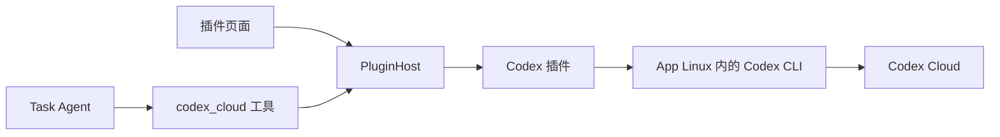

# 插件系统与 Codex Cloud 工具方案

## 1. 用户操作与调用关系

用户在「插件 → Codex」完成官方 Codex 登录，随后向 LOOI 描述任务。Task Agent 调用专用 `codex_cloud` 工具，插件在 App 内的 Linux 中执行官方 CLI，将云端任务回执返回 Task Agent。



登录和工具执行进入同一个 Codex 插件，使用同一份 `CODEX_HOME=/root/.codex`。CLI 随 App 的 Linux 运行环境打包。账号、进程、配置和凭据均属于 App；开发机仅负责构建、安装与调试。

## 2. 正常登录与登录态复用

默认使用官方 `codex login` 浏览器登录流程：

1. 用户点击插件页的「登录 Codex」。
2. 插件在 Linux 中启动 `codex login`，接收该进程产生的登录链接，并以 `AuthChallenge` 事件交给界面。
3. App 打开系统浏览器；官方 CLI 负责 OAuth 回调、换取令牌及保存凭据。
4. CLI 成功退出后，插件显示已登录。后续 `codex cloud ...` 进程使用相同的 `CODEX_HOME` 和凭据存储配置。
5. 令牌刷新由官方 CLI 管理；用户退出账号时执行 `codex logout`。

配置采用官方 `cli_auth_credentials_store="file"`，凭据存入 App 私有 Linux guest 的 `/root/.codex/auth.json`。插件页面和模型输入使用账号状态、登录链接、进程结果，不传递 token。这里复用的是 Codex 插件自己完成的登录态；现有模型 API 页的 ChatGPT 授权继续使用自己的流程。

浏览器、Linux CLI 的回调监听端口及 App 前后台切换须先在 iOS 模拟器走通。登录属于插件自己的操作，生命周期由 `AuthSession` 管理，使用官方登录期限；不占用 Task Agent 的 Shell 命令期限。

实现取舍：

| 方式 | 调用方获得什么 | 复杂度 | 选择 |
| --- | --- | --- | --- |
| 官方 CLI 子命令适配 | 正常登录、Cloud 命令、原始进程回执 | 固定版本的登录链接和命令输出解析；复用现有进程管道 | 首版采用，与最终执行路径一致 |
| 官方 app-server JSON-RPC | 结构化账号请求和登录事件 | 需要双向 stdin 管道或额外本地传输；现有 Shell 仅有输出管道 | 等实际需要其会话 API 时引入，插件公开接口保持稳定 |

CLI 的文本格式解析集中在 Codex 适配器中，版本固定为 `0.167.2`。界面与插件宿主不解析终端文本。

## 3. 插件的公共契约

扩展点分成定义、运行实例和能力贡献。插件宿主不理解 Codex 命令或 OAuth 字段。

```ts
interface PluginDefinition {
  id: string;
  name: string;
  description: string;
  create(context: PluginContext): PluginRuntime;
}

interface PluginRuntime {
  snapshot(): PluginSnapshot;
  start(): Promise<void>;
  stop(reason: "disabled" | "app_shutdown"): Promise<void>;
  readonly auth?: PluginAuth;
  readonly tools: readonly AgentTool[];
}

interface PluginAuth {
  begin(): Promise<{ sessionId: string }>;
  cancel(sessionId: string): Promise<void>;
  logout(): Promise<void>;
}
```

`AgentTool` 直接复用现有 Pi 工具类型。`PluginContext` 只提供已有能力的入口：Linux 进程执行、插件配置存储、本地 trace 和状态／授权事件发布。浏览器操作由界面响应 `AuthChallenge` 事件执行。

`begin()` 在登录进程受理后返回会话 ID，授权是否结束通过事件通知；页面不需要等待整个登录过程才能显示内容。事件按插件 ID 和会话／调用 ID 关联：

| 事件 | 输出 | 使用方 |
| --- | --- | --- |
| `state_changed` | 最新 `PluginSnapshot` | 插件目录、详情与工具可用状态 |
| `auth_challenge` | `sessionId`、`kind:"browser"`、官方登录 URL | 插件授权界面和系统浏览器 |
| `auth_completed` | `sessionId`、实际授权结果、账号摘要或失败回执 | 插件账号状态 |
| `execution_output` | 调用 ID、stdout／stderr、文本块 | 执行详情与现有 trace |
| `execution_finished` | 调用 ID、结构化结果与 CLI 回执 | Task Agent 或发起操作的界面 |

这些事件通过宿主提供的回调发布，不增加独立消息服务。插件页的输入是启用／停用、开始／取消登录、退出账号和修改插件配置；Agent 的输入是下文定义的工具参数。

`PluginSnapshot` 分开保存生命周期、启用设置、授权状态与可展示信息：

```ts
interface PluginSnapshot {
  id: string;
  enabled: boolean;
  lifecycle: "registered" | "starting" | "active" | "stopping" | "stopped" | "failed";
  auth?: {
    state: "signed_out" | "authorizing" | "signed_in" | "reauth_required";
    accountLabel?: string;
    challenge?: AuthChallenge;
  };
  lastError?: PluginFailure;
}
```

没有账号的插件可以不贡献 `auth`。配置、认证、工具贡献各自有边界，后续增加 GitHub、部署服务等插件时可以复用同一宿主和页面。新增插件通过静态定义注册；有状态的插件适配器自己持有登录进程和执行句柄。

`PluginHost` 由 `MobileRuntime` 持有，每个插件在同一个 App 运行期只有一个实例。采用普通定义对象和工厂函数声明插件，采用运行实例管理持续存在的资源；无需继承公共基类。

新增结构的用途与成本：

| 新增部分 | 具体用途 | 成本 |
| --- | --- | --- |
| 插件定义与 `PluginHost` | 将页面、账号操作和工具注册指向同一实例，统一启停 | 一份静态目录、实例表与少量生命周期代码 |
| Codex 适配器 | 集中处理 CLI 版本、登录流程、参数映射、输出解析和错误 | 一处需要跟随官方 CLI 变更的实现 |
| 插件页及 Codex 配置面板 | 展示账号状态、登录／取消／退出、默认环境与分支 | 增加一个管理空间，复用现有控件和主题 |

首版沿用 monorepo、SQLite、Pi 工具和 Linux 执行接口；插件定义随 App 发布。引入这些边界的收益是新增插件可以独立提供账号和工具能力，调用方保持一致。

## 4. 生命周期与状态所有权

| 触发 | 插件宿主／适配器行为 | 登录态与云端任务 |
| --- | --- | --- |
| App 启动 | 读取插件定义及启用配置；先建立可展示的状态 | Linux guest 保留，CLI 凭据不重建 |
| 打开插件详情或首次调用工具 | 按需 `start()`，检查当前 CLI 及账号状态 | 已登录账号直接可用 |
| 开始登录 | 创建插件自己的 `AuthSession`，持有 CLI 子进程和结果监听 | 官方 CLI 完成授权及落盘 |
| 离开插件页面 | 界面解除订阅，插件实例继续持有登录会话 | 返回页面可以继续显示同一次登录 |
| 用户取消登录 | 中止该登录进程，等待实际退出后执行同一目录下的 `login status` | 根据 CLI 实际落盘结果更新账号状态 |
| 启用插件 | 为后续 Task Agent 轮次提供工具贡献 | 未登录时工具返回 `authorization_required` |
| 停用插件 | 后续轮次不再注册其工具；取消当前本地调用并等待退出 | 已提交的 Cloud 任务保持云端状态 |
| 退出账号 | 先结束并等待正在进行的登录，再由 CLI 执行 `logout` | 启用设置与环境配置保留；旧登录进程已无法再次写入凭据 |
| App 关闭 | `stop("app_shutdown")`，结束本地进程，完成 trace 后释放存储与 Shell | 已提交的 Cloud 任务可以稍后按 ID 查询 |
| App 或 CLI 更新 | 更新内置二进制，继续使用持久化 guest 与 `CODEX_HOME` | 用户无需因工具文件替换而重新登录 |

登录状态由插件适配器发布，页面只订阅状态，不保存第二份账号真相。CLI 可能在进程退出前就保存新凭据，因此取消后的状态来自实际 `login status`，不恢复旧快照。取消和关闭须等待进程退出；旧进程的回调不能覆盖新的登录会话。

工具列表在每轮任务开始时从 `PluginHost` 取一次。当前 `additionalTools` 是创建执行器时固定的数组，需要增加按任务取工具的入口，避免每次授权或启停插件都重建 Pi 执行器。工具执行时仍查询所属插件的当前启用状态。

## 5. Task Agent 专用工具

首版提供一个 `codex_cloud` 工具，参数是明确的 Cloud 操作。Codex 适配器将参数转换成 CLI argv；Task Agent 不需要生成 Shell 命令。

| action | 输入 | 执行命令 | 返回内容 |
| --- | --- | --- | --- |
| `submit` | `prompt`、`environment`、`branch`，可选 `attempts` | `codex cloud exec --env ... --branch ... --attempts ... <prompt>` | 已受理、task ID、链接 |
| `list` | 可选 `environment`、`limit`、`cursor` | `codex cloud list --json ...` | 任务列表和分页游标 |
| `status` | `taskId` | `codex cloud status <taskId>` | CLI 提供的云端状态及改动统计 |
| `diff` | `taskId`，可选 `attempt` | `codex cloud diff <taskId> ...` | unified diff（统一差异补丁） |

默认环境和分支来自插件配置；调用参数可以覆盖。`environment` 可以是 CLI 支持的唯一环境名，用户当前选择的 `video2rig` 可直接作为配置值。

调用示例：

```json
{
  "action": "submit",
  "environment": "video2rig",
  "branch": "main",
  "prompt": "定位导入视频时报错的原因，修复后运行相关测试。"
}
```

提交成功的工具返回示例：

```json
{
  "pluginId": "codex",
  "action": "submit",
  "outcome": "accepted",
  "task": {
    "id": "<CLI 返回的 task ID>",
    "url": "<CLI 返回的任务链接>"
  },
  "execution": {
    "stage": "cloud.submit",
    "exitCode": 0,
    "stdout": "<原始 CLI 标准输出>",
    "stderr": ""
  }
}
```

`outcome` 采用有明确语义的结果：`accepted`、`ok`、`authorization_required`、`configuration_required`、`plugin_disabled`、`submission_unconfirmed`、`failed`、`cancelled`。查询操作返回 `ok` 表示查询成功，云端任务状态单独放在 `task.providerStatus` 中。

退出码按具体子命令解释。固定版 `cloud status` 在成功读取到 `pending`、`applied` 或 `error` 状态时也会返回退出码 1，只有 `ready` 返回 0。因此正常查询到这些状态应返回 `outcome:"ok"`，同时保留 `providerStatus` 与真实 `execution.exitCode`。读取请求本身失败才返回 `failed`；不能通过“退出码非零”统一判断所有 Cloud 操作失败。

`accepted` 只说明提交获受理。Task Agent 随后可以继续交流；用户追问时通过相同工具查询状态和差异。远程 task ID 和工具回执进入现有任务记录与会话历史，重新打开 App 后仍可使用该 ID 查询。

固定版 CLI 的 `list` 有 JSON 输出，`submit`／`status` 的文本输出由版本适配器解析，`diff` 保留补丁内容。该版本的非交互命令尚未输出助手完整文字，`summary` 实际是改动统计。首版输出契约因此承诺任务受理、状态和代码差异；完整助手回答的采集需另行找到官方非交互出口。

固定版 CLI 没有 `cloud cancel` 或 Cloud 追问子命令。插件的本地取消会停止当前 CLI 调用，不能据此报告云端任务已停止。提交已经开始、但在受理回执返回前中断时，返回 `outcome:"submission_unconfirmed"` 以及原始进程结果，不自动重提；`cancelled` 用于已确认未发出的提交或被取消的读取操作。

## 6. 页面、持久化与执行记录

「插件」页显示插件目录、启用状态、授权状态；Codex 详情提供登录、取消、退出账号及默认环境／分支配置。授权失败显示实际原因，并可展开执行详情。其他插件可以贡献各自的配置面板，运行时接口不依赖 TSX 组件。

启用设置和普通配置使用现有 SQLite；CLI 凭据由其官方存储机制持久化。工具调用沿用现有 Agent trace，插件页面发起的登录等操作也写入相同 observation 体系。

失败保留 `pluginId`、`operation`、失败 `stage`、CLI 退出码、signal、实际超时标记、标准输出／错误输出，以及服务实际提供的错误码和原因。只移除凭据。CLI 只返回发送失败时，记录其原文；诊断信息不足不改写成超时，也不推断一个未返回的服务错误码。

## 7. 模块落点与实施顺序

模块落点：

- `apps/nsh/runtime/plugins/contracts.ts`：插件定义、快照、授权事件与宿主能力契约。
- `apps/nsh/runtime/plugins/host.ts`：实例、启用设置、订阅和工具贡献。
- `apps/nsh/runtime/plugins/codex/`：CLI 进程、官方登录、Cloud 参数和回执适配。
- `apps/nsh/ui/PluginsSpaceView.tsx`：目录与详情，复用现有管理壳和控件。
- `apps/nsh/runtime/application.ts`：持有宿主，向界面及每轮 Agent 提供插件能力。
- `packages/looi-runtime/src/agent/core/`：仅增加每轮获取宿主工具的入口。

实施顺序：

- [ ] Step 1：在 iOS 模拟器中完成官方浏览器登录，确认同一 `CODEX_HOME` 下的 `cloud list` 可用；保留已有设备码请求发送失败的底层诊断。
- [ ] Step 2：落地插件契约与宿主，接入每轮工具贡献和启停行为。
- [ ] Step 3：实现 Codex 的四种工具操作、结构化回执和本地任务关联。
- [ ] Step 4：实现横屏插件页，接通登录状态、默认环境／分支配置及执行详情。
- [ ] Step 5：在模拟器完成登录 → 提交 → 查询 → 差异读取，以及重启复用登录态；独立 review 后交付。

验收围绕实际行为：同一登录态用于 Cloud 命令；界面离开后授权会话继续；取消后旧回调不覆盖新会话；启停插件影响后续工具贡献；受理与完成分开呈现；真实失败可定位。

## 8. 来源

- [Codex Authentication](https://learn.chatgpt.com/docs/auth)：官方登录、`CODEX_HOME`、凭据存储及刷新。
- [Codex App Server](https://learn.chatgpt.com/docs/app-server)：结构化账号操作和传输方式，用于比较接口取舍。
- [CLI 命令参考](https://learn.chatgpt.com/docs/developer-commands?surface=cli)：Cloud 子命令及列表输出。
- [固定版 Cloud 命令实现](https://github.com/openai/codex/blob/rust-v0.167.2/codex-rs/cloud-tasks/src/lib.rs)：唯一环境名解析、状态及差异输出。
- [固定版 Cloud 子命令定义](https://github.com/openai/codex/blob/rust-v0.167.2/codex-rs/cloud-tasks/src/cli.rs)：首版工具实际支持的操作。
- [CLI 内置 Linux 方案](codex-cli-bundled-linux-plan.md)：发行包、安装与现有 guest 的升级方式。
