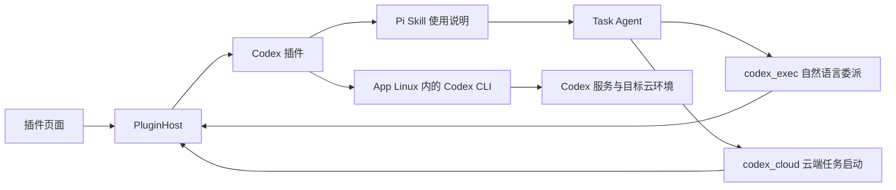

# 插件系统与 Codex Cloud 工具方案

## 1. 用户操作与调用关系

用户在「插件 → Codex」完成官方 Codex 登录，随后向 LOOI 描述任务。Codex 插件向 Task Agent 提供两个工具：`codex_exec` 用自然语言委派给普通 Codex，`codex_cloud` 直接启动 Cloud 任务。插件集中管理账号、进程、配置和执行记录。



登录和工具执行进入同一个 Codex 插件，使用同一份 `CODEX_HOME=/root/.codex`。CLI 随 App 的 Linux 运行环境打包。账号、进程、配置和凭据均属于 App；开发机仅负责构建、安装与调试。

插件通过普通 Codex 会话承接任务，能力随 Codex 及其可用工具扩展。环境创建等目标直接交给 Codex，工具接口不枚举业务操作。

## 2. 正常登录与登录态复用

默认使用官方 `codex login` 浏览器登录流程：

1. 用户点击插件页的「登录 Codex」。
2. 插件在 Linux 中启动 `codex login`，接收该进程产生的登录链接，并以 `AuthChallenge` 事件交给界面。
3. App 打开系统浏览器；官方 CLI 负责 OAuth 回调、换取令牌及保存凭据。
4. CLI 成功退出后，插件显示已登录。后续 `codex exec ...` 与 `codex cloud exec ...` 进程使用相同的 `CODEX_HOME` 和凭据存储配置。
5. 令牌刷新由官方 CLI 管理；用户退出账号时执行 `codex logout`。

配置采用官方 `cli_auth_credentials_store="file"`，凭据存入 App 私有 Linux guest 的 `/root/.codex/auth.json`。插件页面和模型输入使用账号状态、登录链接、进程结果，不传递 token。这里复用的是 Codex 插件自己完成的登录态；现有模型 API 页的 ChatGPT 授权继续使用自己的流程。

浏览器、Linux CLI 的回调监听端口及 App 前后台切换须先在 iOS 模拟器走通。登录属于插件自己的操作，生命周期由 `AuthSession` 管理，使用官方登录期限；不占用 Task Agent 的 Shell 命令期限。

实现取舍：

| 方式 | 调用方获得什么 | 复杂度 | 选择 |
| --- | --- | --- | --- |
| 官方 CLI 子命令适配 | 正常登录、自然语言任务、JSONL 执行事件 | 登录链接解析与 JSONL 事件适配；复用现有进程管道 | 首版采用，与最终执行路径一致 |
| 官方 app-server JSON-RPC | 结构化账号请求和登录事件 | 需要双向 stdin 管道或额外本地传输；现有 Shell 仅有输出管道 | 执行中交互需要双向会话时引入，保留任务委派接口 |

CLI 版本固定为 `0.167.2`。登录链接解析和任务 JSONL 事件适配集中在 Codex 适配器中；原始输出始终保留。界面与插件宿主不解析终端文本。

## 3. 插件的公共契约

扩展点分成定义、运行实例和能力贡献。插件宿主不理解 Codex 命令或 OAuth 字段。

```ts
import type { DefaultResourceLoaderOptions } from "@earendil-works/pi-coding-agent";

interface PluginDefinition {
  id: string;
  name: string;
  description: string;
  resources?: Pick<DefaultResourceLoaderOptions, "additionalSkillPaths">;
  create(context: PluginContext): PluginRuntime;
}

interface PluginRuntime {
  snapshot(): PluginSnapshot;
  start(): Promise<void>;
  stop(reason: "disabled" | "app_shutdown"): Promise<void>;
  readonly auth?: PluginAuth;
  readonly tools: readonly AgentTool[];
}

interface PluginAuth {
  begin(): Promise<{ sessionId: string }>;
  cancel(sessionId: string): Promise<void>;
  logout(): Promise<void>;
}
```

`AgentTool` 直接复用现有 Pi 工具类型。`PluginContext` 只提供已有能力的入口：Linux 进程执行、插件配置存储、本地 trace 和状态／授权事件发布。浏览器操作由界面响应 `AuthChallenge` 事件执行。

使用说明采用 Pi 标准 `SKILL.md`，随插件发布，`PluginDefinition.resources.additionalSkillPaths` 声明其路径；宿主按启用状态聚合后交给 Pi 的 `DefaultResourceLoader`。Skill 解释两个工具的选择、默认环境／分支、会话继续和云端受理回执；工具负责执行。沿用 [Pi SDK 生态接入方案](pi-ecosystem-runtime-plan.md) 的加载方式，`PluginHost` 只管理 App 账号、启停和资源贡献，不新增技能协议或技能加载器。

`begin()` 在登录进程受理后返回会话 ID，授权是否结束通过事件通知；页面不需要等待整个登录过程才能显示内容。事件按插件 ID 和会话／调用 ID 关联：

| 事件 | 输出 | 使用方 |
| --- | --- | --- |
| `state_changed` | 最新 `PluginSnapshot` | 插件目录、详情与工具可用状态 |
| `auth_challenge` | `sessionId`、`kind:"browser"`、官方登录 URL | 插件授权界面和系统浏览器 |
| `auth_completed` | `sessionId`、实际授权结果、账号摘要或失败回执 | 插件账号状态 |
| `execution_output` | 调用 ID、stdout／stderr、文本块 | 执行详情与现有 trace |
| `execution_finished` | 调用 ID、结构化结果与 CLI 回执 | Task Agent 或发起操作的界面 |

这些事件通过宿主提供的回调发布，不增加独立消息服务。插件页的输入是启用／停用、开始／取消登录、退出账号和修改插件配置；Agent 的输入是下文定义的工具参数。

`PluginSnapshot` 分开保存生命周期、启用设置、授权状态与可展示信息：

```ts
interface PluginSnapshot {
  id: string;
  enabled: boolean;
  lifecycle: "registered" | "starting" | "active" | "stopping" | "stopped" | "failed";
  auth?: {
    state: "signed_out" | "authorizing" | "signed_in" | "reauth_required";
    accountLabel?: string;
    challenge?: AuthChallenge;
  };
  lastError?: PluginFailure;
}
```

没有账号的插件可以不贡献 `auth`。配置、认证、工具贡献各自有边界，后续增加 GitHub、部署服务等插件时可以复用同一宿主和页面。新增插件通过静态定义注册；有状态的插件适配器自己持有登录进程和执行句柄。

`PluginHost` 由 `MobileRuntime` 持有，每个插件在同一个 App 运行期只有一个实例。采用普通定义对象和工厂函数声明插件，采用运行实例管理持续存在的资源；无需继承公共基类。

新增结构的用途与成本：

| 新增部分 | 具体用途 | 成本 |
| --- | --- | --- |
| 插件定义与 `PluginHost` | 将页面、账号操作和工具注册指向同一实例，统一启停 | 一份静态目录、实例表与少量生命周期代码 |
| Codex 适配器 | 集中处理 CLI 版本、登录流程、会话委派、云端启动、进程记录与回执适配 | 保留任务委派契约；事件适配跟随官方 CLI 版本 |
| Codex Skill | 告诉 Task Agent 如何选择工具、提供上下文、继续会话和读取云端回执 | 一份随 CLI 版本维护的标准说明；复用 Pi 加载机制 |
| 插件页及 Codex 配置面板 | 展示账号状态、登录／取消／退出、默认环境与分支 | 增加一个管理空间，复用现有控件和主题 |

首版沿用 monorepo、SQLite、Pi 工具和 Linux 执行接口；插件定义随 App 发布。引入这些边界的收益是新增插件可以独立提供账号和工具能力，调用方保持一致。

## 4. 生命周期与状态所有权

| 触发 | 插件宿主／适配器行为 | 登录态与云端任务 |
| --- | --- | --- |
| App 启动 | 读取插件定义及启用配置；先建立可展示的状态 | Linux guest 保留，CLI 凭据不重建 |
| 打开插件详情或首次调用工具 | 按需 `start()`，检查当前 CLI 及账号状态 | 已登录账号直接可用 |
| 开始登录 | 创建插件自己的 `AuthSession`，持有 CLI 子进程和结果监听 | 官方 CLI 完成授权及落盘 |
| 离开插件页面 | 界面解除订阅，插件实例继续持有登录会话 | 返回页面可以继续显示同一次登录 |
| 用户取消登录 | 中止该登录进程，等待实际退出后执行同一目录下的 `login status` | 根据 CLI 实际落盘结果更新账号状态 |
| 启用插件 | 为后续 Task Agent 轮次提供工具与 Skill | Codex 执行任务时使用当前 CLI 登录态 |
| 停用插件 | 后续轮次不再贡献其工具与 Skill；取消插件持有的本地调用并等待退出 | 已提交的 Cloud 任务保持云端状态 |
| 退出账号 | 先结束并等待正在进行的登录，再由 CLI 执行 `logout` | 启用设置与环境配置保留；旧登录进程已无法再次写入凭据 |
| App 关闭 | `stop("app_shutdown")`，结束本地进程，完成 trace 后释放存储与 Shell | 已提交的 Cloud 任务可以稍后按 ID 查询 |
| App 或 CLI 更新 | 更新内置二进制，继续使用持久化 guest 与 `CODEX_HOME` | 用户无需因工具文件替换而重新登录 |

登录状态由插件适配器发布，页面只订阅状态，不保存第二份账号真相。CLI 可能在进程退出前就保存新凭据，因此取消后的状态来自实际 `login status`，不恢复旧快照。取消和关闭须等待进程退出；旧进程的回调不能覆盖新的登录会话。

工具与资源贡献在每轮任务开始时从 `PluginHost` 取一次，通过 Pi 标准入口注册。当前固定 `additionalTools` 接线改为按任务获取，避免每次授权或启停插件都重建 Pi 执行器。工具执行时仍查询所属插件的当前启用状态。

停用影响插件贡献和插件持有的进程。Linux 中已经安装的 CLI 与文件继续存在；停用设置不承担撤销整个 Linux Shell 执行权限的职责。退出账号由官方 `logout` 处理。

## 5. Task Agent 的两个 Codex 工具

### 5.1 工具分工

| 工具 | 用途 | 输入 | 输出 |
| --- | --- | --- | --- |
| `codex_exec` | 普通 Codex 的自然语言处理、复杂任务规划和会话继续 | `prompt`，可选 `sessionId`、`cwd` | 回答、进度、Codex 会话 ID 与实际执行结果 |
| `codex_cloud` | 已知环境下直接启动云端任务 | `prompt`，可选 `environment`、`branch`、`attempts` | 云端受理状态、Cloud task ID、任务链接与实际 CLI 回执 |

两个工具由同一个 Codex 插件实例提供，共用内置 CLI、登录态和 trace。增加第二个工具的收益是，明确的云端启动请求可以直接执行一次 Cloud 提交，不需要先启动普通 Codex 的规划轮次；成本是一处 `cloud exec` 参数映射和受理回执适配，不增加服务或执行框架。

需要创建环境、组织复杂步骤或追问结果时使用 `codex_exec`；环境已选定且目标就是启动云端任务时使用 `codex_cloud`。若普通 Codex 已经提交任务，后续使用它返回的 Cloud task ID 继续处理，不再为同一请求另行提交一次。

### 5.2 `codex_exec` 输入与职责

Task Agent 将自然语言目标交给普通 Codex，由 Codex 自行规划并使用其工具完成。创建环境、准备依赖、提交云端任务或继续处理结果，都可以作为任务描述；不需要为每个目标设计对应 action。

工具名为 `codex_exec`：

```ts
interface CodexExecInput {
  prompt: string;
  sessionId?: string; // 指定 Codex 会话，继续该会话；不传则新建
  cwd?: string;       // guest 工作目录，默认当前任务工作区
}
```

代表性调用：

```json
{"prompt":"为这个仓库创建并配置一个 Codex Cloud 环境，完成后告诉我环境名称和结果。"}
{"prompt":"在 video2rig 环境定位视频导入失败的原因，修复后运行相关测试。"}
{"sessionId":"<上次返回的 Codex 会话 ID>","prompt":"继续处理刚才失败的测试，并告诉我最终结果。"}
```

插件负责账号、进程、会话标识和回执；Codex 负责执行任务的规划与工具选择。Task Agent 可以补充上下文、接收结果并继续追问。Codex 使用 App Linux 的工具、文件、登录与网络能力。

这一层复用官方 Codex 执行循环，不新增 Agent 框架或另一套业务操作路由。Pi Skill 说明如何委派、传递上下文、继续会话和读取结果；工具说明提供实际账号状态、默认环境／分支与 CLI 版本。

### 5.3 `codex_exec` 执行与会话继续

首版使用 App Linux 内的官方 `codex exec --json`。任务描述作为单个参数传入现有 `spawn(file,args)` 接口，不需要可写 stdin 或终端输入。管理类任务可在没有本地 Git 仓库的工作目录运行，使用官方 `--skip-git-repo-check`；不为此新建占位仓库。

- 新建：`codex exec --json --skip-git-repo-check <prompt>`。
- 继续：`codex exec --json --skip-git-repo-check resume <sessionId> <prompt>`。
- CLI 配置与登录继续使用同一 `CODEX_HOME=/root/.codex`；会话文件由官方 CLI 保存，不启用 ephemeral（临时会话）模式。
- 明确传入返回的会话 ID，避免用 `--last` 选中其他任务的会话。App 现有任务记录保存 Task Agent 调用与 Codex 会话的关联。

执行配置由当前任务上下文传入，覆盖 CLI 默认只读配置：只读任务使用 `read-only`，允许工作区修改的任务使用 `workspace-write`，已允许完整 guest 操作的任务使用 `danger-full-access`；网络配置沿用该任务实际允许的范围。App 的 `ask` 模式仍走已有工具授权入口，`codex_exec` 委派注册到相同规则；`yolo` 模式沿用既有直接执行行为。非交互 `exec` 设置 `approval_policy="never"`，在外层已授予的范围执行，不额外建立插件审批流程。需要执行中逐项交互时接入下述 app-server；实现时在模拟器实际验证命令执行、文件写入和网络请求，底层执行失败保留真实原因。

官方 JSONL（逐行 JSON）事件用于输出适配：`thread.started` 提供会话 ID，`item.*` 提供消息与执行进度，`turn.completed`／`turn.failed` 提供轮次结束信息。完整回答来自 `agent_message`；不再用 `cloud list/status` 的改动统计代替 Codex 回答。

当实际交互需要双向输入、执行中追问或结构化用户提问时，使用同一内置 CLI 的 `app-server` 接口承载持续会话。它需要补齐现有 Shell 的双向传输；不因此增加开发机服务。

### 5.4 `codex_exec` 输出与生命周期

```ts
interface CodexExecResult {
  sessionId?: string;
  outcome: "completed" | "failed" | "cancelled" | "timed_out" | "stop_unconfirmed";
  answer?: string;
  execution: {
    state: "not_started" | "exited" | "start_failed" | "cancelled" | "timed_out" | "stop_unconfirmed";
    exitCode: number | null;
    signal?: string;
    stdout: string;
    stderr: string;
    outputFiles?: { events?: string; stderr?: string };
  };
  failure?: { stage: string; code?: string | number; reason: string };
}
```

执行进度沿用插件输出事件和现有 trace。回答返回 Task Agent，完整事件流与大输出保存在任务可读取的文件中；保留真实阶段、CLI 退出码及服务错误，失败轮次不因进程退出而标记完成。

工具调用期间由插件持有 Codex 子进程，Task Agent 取消、插件停用或 App 关闭时停止该本地调用并等待实际结果。已结束的 Codex 会话保留，可按 ID 再次继续；本地取消不代表 Codex 已提交的远端任务停止。登录会话仍由插件页的 `AuthSession` 管理，与执行会话分别持有资源。

Codex 本轮结束与远端 Cloud 任务完成分别表达。例如 Codex 回答“已提交，任务仍在运行”时，工具可以结束本轮委派，Task Agent 之后继续同一会话询问结果。插件不另建 Cloud 操作状态机。

### 5.5 `codex_cloud` 直接启动云端任务

```ts
interface CodexCloudInput {
  prompt: string;
  environment?: string;
  branch?: string;
  attempts?: 1 | 2 | 3 | 4;
}

interface CodexCloudResult {
  outcome: "accepted" | "not_submitted" | "submission_unconfirmed";
  task?: { id: string; url?: string };
  execution: CodexExecResult["execution"];
  failure?: { stage: string; code?: string | number; reason: string };
}
```

适配器直接执行 `codex cloud exec --env <environment> --branch <branch> --attempts <n> <prompt>`，不启动普通 Codex 的本地规划轮次。参数通过现有 `spawn(file,args)` 逐项传入；`environment` 和 `branch` 优先采用调用参数，其次使用插件配置；分支仍未指定时交给官方 CLI 解析。`attempts` 不传时沿用 CLI 默认值 1。

环境必须有值；缺少配置时不启动 CLI，返回 `outcome:"not_submitted"`、`execution.state:"not_started"`、`exitCode:null`，以及 `cloud.configuration` 阶段和具体缺少项。用户选定的 `video2rig` 可作为默认环境名，由 CLI 按实际账号解析。

调用与成功回执示例：

```json
{"prompt":"修复视频导入错误并运行相关测试。","environment":"video2rig","branch":"main"}
```

```json
{
  "outcome":"accepted",
  "task":{"id":"<Cloud task ID>","url":"<CLI 返回的任务链接>"},
  "execution":{"state":"exited","exitCode":0,"stdout":"<原始 CLI 输出>","stderr":""}
}
```

`accepted` 必须包含从实际 CLI 受理回执取得的 task ID 和链接，只表示云端已接收。收到受理后等待当前 CLI 退出，保存真实进程回执并返回；不等待云端任务执行完成。后续可通过 `codex_exec` 描述该 task ID 查询或继续处理。Codex 会话 `sessionId` 和 Cloud `task.id` 分别关联，不能互相作为续接参数。

已确认未发出的本地失败或明确的服务拒绝返回 `not_submitted`，保留失败阶段、原始错误和退出码。请求发出后若在受理结果到达前中断，且无法确认是否创建，返回 `submission_unconfirmed`；能确定 task ID 时保留它，不自动重提。取消、超时或清理未确认的真实原因保存在执行回执和 `failure` 中；本地停止不代表远端任务停止。

这个工具只包装云端启动。普通 Codex 的自然语言入口继续承接环境管理及其他复杂处理，不重新加入固定的提交／列表／状态／差异 action 路由。

### 5.6 环境创建作为委派场景

“创建并配置一个新的云环境”直接作为普通 Codex 的任务描述。插件保留 Codex 自身可用的工具与能力，由它选择执行路径；不将存在专门的 `cloud env create` 子命令或 App 自行实现环境管理 API 作为前置条件。

验证使用实际任务：同一 App 账号登录后，要求 Codex 创建／配置环境并报告结果，再继续会话要求使用该环境执行任务。执行中实际缺少的能力、依赖或访问条件按原始回执处理。环境操作的实现由 Codex 的实际执行路径确定，不在插件宿主中逐项重做。

### 5.7 A2A 协议适用性

Task Agent 委派给 Codex 已属于 Agent 间协作。标准 A2A（Agent2Agent）进一步约定 Agent Card（能力描述）、消息、任务、上下文、产物和状态更新，适合接入不同团队或框架提供的 Agent 服务。它提供通信与任务语义，具体执行仍由被调用的 Agent 完成。

对本项目比较两种接入：

| 接入 | 具体用途 | 新增成本 | 取舍 |
| --- | --- | --- | --- |
| Codex 原生 `exec`／`app-server` | 调用 App 内已打包的 Codex，取得回答、会话与进度 | CLI 进程和事件适配；app-server 还需双向传输 | 当前 Codex 插件使用 |
| A2A 客户端与 Agent 服务 | 发现并调用原生支持 A2A 的不同执行 Agent | Agent Card、任务／上下文关联、协议传输与状态映射 | 出现此类实际插件时接入 |

已核实的 Codex 官方嵌入接口是 `exec`、SDK 和 `app-server`；未找到官方原生 A2A 端点说明。若现在让本地 Codex 对外说 A2A，需要在 App 内另做协议适配端点，将 A2A Task／Context 映射到 Codex 轮次／会话，并处理任务查询、流式输出及取消。此时还需要原生 Codex 接入，A2A 层增加的成本暂时无法换来其他实际调用方的互通收益。

因此，当前保持自然语言任务委派与原生 Codex 会话；后续接入原生 A2A Agent 时，通过现有插件工具贡献接入标准客户端。A2A 的 `contextId`／`taskId` 与 Codex 会话、App 任务 ID 分别保存关联，不混用标识。App 自有的适配与客户端均在 App 内运行，直接连接目标 Agent，不依赖 Mac 服务。

## 6. 页面、持久化与执行记录

「插件」页显示插件目录、启用状态、授权状态；Codex 详情提供登录、取消、退出账号及默认环境／分支配置。授权失败显示实际原因，并可展开执行详情。其他插件可以贡献各自的配置面板，运行时接口不依赖 TSX 组件。

启用设置和普通配置使用现有 SQLite；CLI 凭据由其官方存储机制持久化。工具调用沿用现有 Agent trace，插件页面发起的登录等操作也写入相同 observation 体系。

失败保留 `pluginId`、`operation`、失败 `stage`、CLI 退出码、signal、实际超时标记、标准输出／错误输出，以及服务实际提供的错误码和原因。只移除凭据。CLI 只返回发送失败时，记录其原文；诊断信息不足不改写成超时，也不推断一个未返回的服务错误码。

## 7. 模块落点与实施顺序

模块落点：

- `apps/nsh/runtime/plugins/contracts.ts`：插件定义、快照、授权事件与宿主能力契约。
- `apps/nsh/runtime/plugins/host.ts`：实例、启用设置、订阅和工具贡献。
- `apps/nsh/runtime/plugins/codex/`：CLI 进程、官方登录、双工具、JSONL／Cloud 回执适配和标准 Skill。
- `apps/nsh/ui/PluginsSpaceView.tsx`：目录与详情，复用现有管理壳和控件。
- `apps/nsh/runtime/application.ts`：持有宿主，向界面及每轮 Agent 提供插件能力。
- `packages/looi-runtime/src/agent/core/`：通过 Pi 标准入口接收每轮插件工具与资源贡献。

实施顺序：

- [ ] Step 1：在 iOS 模拟器完成官方登录与普通 Codex 的真实执行。
  - [ ] 同一 `CODEX_HOME` 下运行 `codex exec --json`，取得实际回答和会话 ID，保留已有登录请求失败的底层诊断。
  - [ ] 使用会话 ID 继续任务，读取进度、完整回答和原始失败回执。
  - [ ] 用 `codex_exec` 以自然语言要求创建／配置环境，再用 `codex_cloud` 直接提交任务，取得真实 task ID 与链接。
- [ ] Step 2：落地插件契约与宿主，通过 Pi 接入两个工具、Skill 和启停行为。
- [ ] Step 3：实现 `codex_exec(prompt,sessionId?,cwd?)` 与 `codex_cloud(prompt,environment?,branch?,attempts?)`，接通 JSONL／受理回执、完整输出读取及本地任务关联。
- [ ] Step 4：实现横屏插件页，接通登录状态、默认环境／分支及执行详情。
- [ ] Step 5：在模拟器完成登录 → 自然语言委派 → 继续会话 → Cloud 启动与回执 → 结果读取，以及重启复用登录态；独立 review 后交付。

验收围绕实际行为：同一登录态用于两个工具；自然语言目标能进入真实执行；显式会话 ID 可继续普通 Codex 任务；Cloud 启动返回真实 task ID 和链接；进度和完整回答可读取；界面离开后授权会话继续；取消后旧回调不覆盖新会话；启停影响后续插件贡献；Codex 本轮结束与远端任务完成分别呈现；真实失败可定位。

## 8. 来源

- [Codex Authentication](https://learn.chatgpt.com/docs/auth)：官方登录、`CODEX_HOME`、凭据存储及刷新。
- [Codex App Server](https://learn.chatgpt.com/docs/app-server)：结构化账号操作和传输方式，用于比较接口取舍。
- [CLI 命令参考](https://learn.chatgpt.com/docs/cli/reference)：CLI 命令发现、Cloud 子命令及列表输出。
- [Cloud 环境](https://learn.chatgpt.com/docs/environments/cloud-environments)：创建、配置、发布与新版／Legacy 的区分。
- [固定版 Cloud 命令实现](https://github.com/openai/codex/blob/rust-v0.167.2/codex-rs/cloud-tasks/src/lib.rs)：唯一环境名解析、状态及差异输出。
- [非交互任务与 JSONL 事件](https://learn.chatgpt.com/docs/non-interactive-mode)：自然语言输入、会话继续与完整回答。
- [A2A 概览](https://a2a-protocol.org/latest/topics/what-is-a2a/)及[任务生命周期](https://a2a-protocol.org/latest/topics/life-of-a-task/)：跨 Agent 通信、上下文和任务语义。
- [固定版 Cloud 子命令定义](https://github.com/openai/codex/blob/rust-v0.167.2/codex-rs/cloud-tasks/src/cli.rs)：CLI 实际具有的 Cloud 操作。
- [固定版 app-server 环境类型](https://github.com/openai/codex/blob/rust-v0.167.2/codex-rs/app-server-protocol/src/protocol/v2/environment.rs)：执行服务连接与状态接口，不能当作 Cloud 创建／发布接口。
- [CLI 内置 Linux 方案](codex-cli-bundled-linux-plan.md)：发行包、安装与现有 guest 的升级方式。
