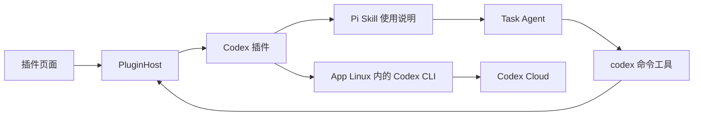

# 插件系统与 Codex Cloud 工具方案

## 1. 用户操作与调用关系

用户在「插件 → Codex」完成官方 Codex 登录，随后向 LOOI 描述任务。Codex 插件向 Task Agent 提供 `codex` 命令工具和使用说明；Agent 可以读取帮助、组合参数并执行内置 CLI 支持的非交互命令。插件集中管理账号、进程、配置和执行记录。



登录和工具执行进入同一个 Codex 插件，使用同一份 `CODEX_HOME=/root/.codex`。CLI 随 App 的 Linux 运行环境打包。账号、进程、配置和凭据均属于 App；开发机仅负责构建、安装与调试。

工具公开 CLI 参数，不以提交／列表／状态／差异四种业务操作作为能力上限。Cloud 环境创建与发布需要另外核实其实际接口；CLI 命令开放与 Cloud 全部功能覆盖是两个独立验收项，见第 5 节。

## 2. 正常登录与登录态复用

默认使用官方 `codex login` 浏览器登录流程：

1. 用户点击插件页的「登录 Codex」。
2. 插件在 Linux 中启动 `codex login`，接收该进程产生的登录链接，并以 `AuthChallenge` 事件交给界面。
3. App 打开系统浏览器；官方 CLI 负责 OAuth 回调、换取令牌及保存凭据。
4. CLI 成功退出后，插件显示已登录。后续 `codex cloud ...` 进程使用相同的 `CODEX_HOME` 和凭据存储配置。
5. 令牌刷新由官方 CLI 管理；用户退出账号时执行 `codex logout`。

配置采用官方 `cli_auth_credentials_store="file"`，凭据存入 App 私有 Linux guest 的 `/root/.codex/auth.json`。插件页面和模型输入使用账号状态、登录链接、进程结果，不传递 token。这里复用的是 Codex 插件自己完成的登录态；现有模型 API 页的 ChatGPT 授权继续使用自己的流程。

浏览器、Linux CLI 的回调监听端口及 App 前后台切换须先在 iOS 模拟器走通。登录属于插件自己的操作，生命周期由 `AuthSession` 管理，使用官方登录期限；不占用 Task Agent 的 Shell 命令期限。

实现取舍：

| 方式 | 调用方获得什么 | 复杂度 | 选择 |
| --- | --- | --- | --- |
| 官方 CLI 子命令适配 | 正常登录、Cloud 命令、原始进程回执 | 固定版本的登录链接和命令输出解析；复用现有进程管道 | 首版采用，与最终执行路径一致 |
| 官方 app-server JSON-RPC | 结构化账号请求和登录事件 | 需要双向 stdin 管道或额外本地传输；现有 Shell 仅有输出管道 | 等实际需要其会话 API 时引入，插件公开接口保持稳定 |

CLI 版本固定为 `0.167.2`。登录链接和已知 Cloud 回执的文本解析集中在 Codex 适配器中；原始输出始终保留。界面与插件宿主不解析终端文本。

## 3. 插件的公共契约

扩展点分成定义、运行实例和能力贡献。插件宿主不理解 Codex 命令或 OAuth 字段。

```ts
import type { DefaultResourceLoaderOptions } from "@earendil-works/pi-coding-agent";

interface PluginDefinition {
  id: string;
  name: string;
  description: string;
  resources?: Pick<DefaultResourceLoaderOptions, "additionalSkillPaths">;
  create(context: PluginContext): PluginRuntime;
}

interface PluginRuntime {
  snapshot(): PluginSnapshot;
  start(): Promise<void>;
  stop(reason: "disabled" | "app_shutdown"): Promise<void>;
  readonly auth?: PluginAuth;
  readonly tools: readonly AgentTool[];
}

interface PluginAuth {
  begin(): Promise<{ sessionId: string }>;
  cancel(sessionId: string): Promise<void>;
  logout(): Promise<void>;
}
```

`AgentTool` 直接复用现有 Pi 工具类型。`PluginContext` 只提供已有能力的入口：Linux 进程执行、插件配置存储、本地 trace 和状态／授权事件发布。浏览器操作由界面响应 `AuthChallenge` 事件执行。

使用说明采用 Pi 标准 `SKILL.md`，随插件发布，`PluginDefinition.resources.additionalSkillPaths` 声明其路径；宿主按启用状态聚合后交给 Pi 的 `DefaultResourceLoader`。Skill 解释命令发现、默认环境／分支、回执含义和真实能力缺口；工具负责执行。沿用 [Pi SDK 生态接入方案](pi-ecosystem-runtime-plan.md) 的加载方式，`PluginHost` 只管理 App 账号、启停和资源贡献，不新增技能协议或技能加载器。

`begin()` 在登录进程受理后返回会话 ID，授权是否结束通过事件通知；页面不需要等待整个登录过程才能显示内容。事件按插件 ID 和会话／调用 ID 关联：

| 事件 | 输出 | 使用方 |
| --- | --- | --- |
| `state_changed` | 最新 `PluginSnapshot` | 插件目录、详情与工具可用状态 |
| `auth_challenge` | `sessionId`、`kind:"browser"`、官方登录 URL | 插件授权界面和系统浏览器 |
| `auth_completed` | `sessionId`、实际授权结果、账号摘要或失败回执 | 插件账号状态 |
| `execution_output` | 调用 ID、stdout／stderr、文本块 | 执行详情与现有 trace |
| `execution_finished` | 调用 ID、结构化结果与 CLI 回执 | Task Agent 或发起操作的界面 |

这些事件通过宿主提供的回调发布，不增加独立消息服务。插件页的输入是启用／停用、开始／取消登录、退出账号和修改插件配置；Agent 的输入是下文定义的工具参数。

`PluginSnapshot` 分开保存生命周期、启用设置、授权状态与可展示信息：

```ts
interface PluginSnapshot {
  id: string;
  enabled: boolean;
  lifecycle: "registered" | "starting" | "active" | "stopping" | "stopped" | "failed";
  auth?: {
    state: "signed_out" | "authorizing" | "signed_in" | "reauth_required";
    accountLabel?: string;
    challenge?: AuthChallenge;
  };
  lastError?: PluginFailure;
}
```

没有账号的插件可以不贡献 `auth`。配置、认证、工具贡献各自有边界，后续增加 GitHub、部署服务等插件时可以复用同一宿主和页面。新增插件通过静态定义注册；有状态的插件适配器自己持有登录进程和执行句柄。

`PluginHost` 由 `MobileRuntime` 持有，每个插件在同一个 App 运行期只有一个实例。采用普通定义对象和工厂函数声明插件，采用运行实例管理持续存在的资源；无需继承公共基类。

新增结构的用途与成本：

| 新增部分 | 具体用途 | 成本 |
| --- | --- | --- |
| 插件定义与 `PluginHost` | 将页面、账号操作和工具注册指向同一实例，统一启停 | 一份静态目录、实例表与少量生命周期代码 |
| Codex 适配器 | 集中处理 CLI 版本、登录流程、参数执行、进程记录与已知回执提取 | 保留通用执行契约；仅已知回执解析需要跟随 CLI 变更 |
| Codex Skill | 告诉 Agent 如何发现和组合 CLI 能力，解释环境管理入口 | 一份随 CLI 版本维护的标准说明；复用 Pi 加载机制 |
| 插件页及 Codex 配置面板 | 展示账号状态、登录／取消／退出、默认环境与分支 | 增加一个管理空间，复用现有控件和主题 |

首版沿用 monorepo、SQLite、Pi 工具和 Linux 执行接口；插件定义随 App 发布。引入这些边界的收益是新增插件可以独立提供账号和工具能力，调用方保持一致。

## 4. 生命周期与状态所有权

| 触发 | 插件宿主／适配器行为 | 登录态与云端任务 |
| --- | --- | --- |
| App 启动 | 读取插件定义及启用配置；先建立可展示的状态 | Linux guest 保留，CLI 凭据不重建 |
| 打开插件详情或首次调用工具 | 按需 `start()`，检查当前 CLI 及账号状态 | 已登录账号直接可用 |
| 开始登录 | 创建插件自己的 `AuthSession`，持有 CLI 子进程和结果监听 | 官方 CLI 完成授权及落盘 |
| 离开插件页面 | 界面解除订阅，插件实例继续持有登录会话 | 返回页面可以继续显示同一次登录 |
| 用户取消登录 | 中止该登录进程，等待实际退出后执行同一目录下的 `login status` | 根据 CLI 实际落盘结果更新账号状态 |
| 启用插件 | 为后续 Task Agent 轮次提供工具与 Skill | 帮助等本地命令无需登录；服务命令使用当前 CLI 登录态 |
| 停用插件 | 后续轮次不再贡献其工具与 Skill；取消插件持有的本地调用并等待退出 | 已提交的 Cloud 任务保持云端状态 |
| 退出账号 | 先结束并等待正在进行的登录，再由 CLI 执行 `logout` | 启用设置与环境配置保留；旧登录进程已无法再次写入凭据 |
| App 关闭 | `stop("app_shutdown")`，结束本地进程，完成 trace 后释放存储与 Shell | 已提交的 Cloud 任务可以稍后按 ID 查询 |
| App 或 CLI 更新 | 更新内置二进制，继续使用持久化 guest 与 `CODEX_HOME` | 用户无需因工具文件替换而重新登录 |

登录状态由插件适配器发布，页面只订阅状态，不保存第二份账号真相。CLI 可能在进程退出前就保存新凭据，因此取消后的状态来自实际 `login status`，不恢复旧快照。取消和关闭须等待进程退出；旧进程的回调不能覆盖新的登录会话。

工具与资源贡献在每轮任务开始时从 `PluginHost` 取一次，通过 Pi 标准入口注册。当前固定 `additionalTools` 接线改为按任务获取，避免每次授权或启停插件都重建 Pi 执行器。工具执行时仍查询所属插件的当前启用状态。

停用影响插件贡献和插件持有的进程。Linux 中已经安装的 CLI 与文件继续存在；停用设置不承担撤销整个 Linux Shell 执行权限的职责。退出账号由官方 `logout` 处理。

## 5. Task Agent 的 Codex 入口与能力覆盖

### 5.1 接口选择

代表性任务包括：提交代码任务、查询状态、将结果应用到本地仓库、读取新增子命令帮助、创建并发布一个新的 Cloud 环境。用这些任务比较三种入口：

| 入口 | 调用示例 | 收益与成本 | 选择 |
| --- | --- | --- | --- |
| 固定业务 action | `{action:"submit", ...}` | 常见操作参数简短；每加入命令或选项都要修改 schema、映射与说明，已经遗漏 `cloud apply` | 移除 |
| 现有 `bash` + Codex Skill | `codex cloud apply <id>` | 复用全部 Shell 能力；Agent 负责 Shell 引号，插件无法直接持有这次工具进程，记录是普通 Shell 回执 | 保持现有 Shell 可用，不以此实现专用入口 |
| 结构化 CLI 工具 + Codex Skill | `{args:["cloud","apply","<id>"],cwd:"/workspace/repo"}` | 直接表达官方 argv；插件持有进程、关联账号和回执；成本是一层复用 Linux 进程接口的适配 | 采用 |

专用工具的价值是处理账号、进程与执行记录的关联，以及给出无需 Shell 引号的参数接口。官方命令语法仍由 CLI 定义，适配器不维护业务操作白名单。CLI 新增非交互命令后，更新内置二进制及 Skill 即可使用，无需扩展工具参数枚举。

### 5.2 输入与发现

工具名为 `codex`，可执行文件固定为 App Linux 内的 `/usr/local/bin/codex`：

```ts
interface CodexCommandInput {
  args: string[];
  cwd?: string; // guest 中的工作目录，默认当前任务工作区
}
```

`args` 通过现有 `spawn(file,args)` 接口交给执行层；NSH 兼容层已有逐参数引用后调用 Linux Shell 的实现，Agent 无需构造 Shell 命令。适配器不隐式插入 Cloud 环境或分支参数。插件配置提供默认环境与分支，Skill 指导 Agent 在需要时显式带上参数。账号状态只影响需要登录的操作；`--version`、`--help` 等命令在未登录时也能执行。

每轮任务生成工具说明时带上 CLI 版本、账号状态摘要、默认环境／分支和 Skill 路径，使 Agent 能取得实际配置值；不增加一套独立配置查询协议。

使用路径：

```json
{"args":["--help"]}
{"args":["cloud","--help"]}
{"args":["cloud","exec","--help"]}
{"args":["cloud","exec","--env","video2rig","--branch","main","定位导入视频时报错的原因，修复后运行相关测试。"]}
{"args":["cloud","list","--json"]}
{"args":["cloud","apply","<task-id>"],"cwd":"/workspace/repo"}
```

这些是用法示例，不构成可执行命令清单。`cloud apply` 等命令仍需工作目录内有 Git 仓库及相应依赖，直接保留 CLI 报告的实际失败。

现有 Linux 进程桥接没有可写 stdin 或 PTY（伪终端）。该工具承载非交互命令；无子命令的 `codex` 或 `codex cloud` 交互界面需要另行实现终端输入。登录由插件的 `AuthSession` 承载，不占用 Agent 工具会话；不能因参数开放就宣称 TUI（终端交互界面）也已接通。

账号命令共享 Codex 适配器内的账号协调实例：页面的 `auth.begin()` 用默认参数开始登录，工具的 `login ...` 将原始参数交给同一个登录入口，并返回 `authSessionId`、`process.state:"running"` 及空退出码；授权链接和最终进程结果继续通过该会话的事件发布。Agent 任务结束不销毁这个登录会话。`login status` 及帮助命令按普通只读命令执行；`logout` 先结束并等待正在进行的登录，再执行真实退出命令。登录会话的取消、离开页面、停用和 App 关闭均沿用第 4 节，工具不能另起页面无法管理的登录进程。

### 5.3 输出与命令语义

通用输出保留实际进程结果；对于识别到的官方回执，附加结构化信息供界面和 Agent 使用：

```ts
interface CodexCommandResult {
  pluginId: "codex";
  args: string[];
  cwd: string;
  authSessionId?: string;
  process: {
    state: "running" | "exited" | "start_failed" | "cancelled" | "timed_out" | "stop_unconfirmed";
    exitCode: number | null;
    signal?: string;
    stdout: string;
    stderr: string;
    outputFiles?: { stdout?: string; stderr?: string };
  };
  cloud?: {
    submission?: "accepted" | "unconfirmed";
    task?: { id: string; url?: string; providerStatus?: string };
  };
  failure?: { stage: string; code?: string | number; reason: string };
}
```

`process.state:"running"` 用于转交插件管理的登录会话；`exitCode` 为 `null`，最终输出沿相同 `authSessionId` 归档。`process.state:"exited"` 只描述进程退出，不等同于业务成功。`cloud` 是对已知输出的补充，不是执行命令的前提。未接入结构化解析的子命令照常执行并返回真实退出码、双流输出；新命令不会因为适配器不认识而失去可用性。工具消息的错误标记按已识别的子命令语义设置，其他命令按实际退出码生成错误标记并保留原文。现有执行层返回清理未确认时，保留 `stop_unconfirmed` 及底层原因，不能改写成已取消。

固定版 `cloud status` 成功读取到 `pending`、`applied` 或 `error` 时也返回退出码 1，只有 `ready` 返回 0。适配器必须保留真实退出码，同时区分“查询读到了任务错误状态”和“查询请求失败”。`cloud list --json` 返回任务列表与分页游标；`cloud diff` 返回补丁；当前非交互命令没有助手完整文字出口，列表中的 `summary` 是改动统计。

输出沿用现有 trace。超过工具消息容量的帮助、JSON 或补丁保存到任务可读取的文件，`outputFiles` 返回路径，消息注明截取范围；Agent 可以用文件工具继续读取全文。不能只返回最后 4 KiB 导致命令帮助或差异内容丢失。

已受理的 Cloud task ID 和链接进入现有会话与任务记录；进程退出不代表云端任务完成。提交开始后若未收到受理回执便中断，返回 `cloud.submission:"unconfirmed"`，以及实际可判定的 `cloud.task`；拿不到 ID 时省略 `task`，`failure` 仍保留 `cloud.submit` 阶段及原因，不自动重提。固定版 CLI 没有 Cloud 取消或追问子命令，本地进程取消不产生“云端任务已取消”的结论。

### 5.4 环境创建与发布

当前官方文档支持在网页或桌面端选择 **Create environment**，配置仓库、完成初始化，再 **Publish**；也可以从 **Settings → Codex Cloud → Environments** 进入。固定版 CLI 的 Cloud 子命令只有 `exec/status/list/apply/diff`，没有创建环境、发布或独立的非交互环境列表命令。`codex cloud` 的交互选择界面也不能作为已有非交互入口。

因此，创建环境需要接通 Cloud 的实际管理入口。通用 argv 修复工具层的裁剪，无法补出服务端操作：

- 官方网页是已核实的环境管理入口。插件详情应提供环境管理入口；它属于用户交互流程，不计作 Task Agent 已具备自主创建环境的能力。网页会话与 CLI 凭据分别由官方登录流程建立，不能假设 `auth.json` 会自动变成网页登录 Cookie。
- Agent 自主创建／编辑／发布环境，需要验证 App 能直接调用的服务接口，或建立 App 自有的网页操作能力。找到实际入口后，由 Codex 插件贡献相应的 Pi 工具与 Skill；现有工具数组已支持多个工具，无需另建操作路由或让 `codex` 假装存在 `cloud env create`。
- 核对程序化入口时，要走通创建 → 配置 → 发布 → CLI 可选用 → 提交任务。当前网页区分 Codex Cloud 与 Legacy（旧版），CLI 按名称解析成功的实现，不能证明它一定能使用新版网页创建的环境；必须以同一账号的实际提交结果确定兼容性。

接入成本的比较：官方程序化管理接口若可用，适配服务请求与回执即可；使用未文档化端点需要持续跟随服务协议；网页自动化需要 App 内的页面控制、网页会话及交互处理。目前尚未核实可直接用于该 App 的公开 Cloud 环境管理 API，不能把本项目的 CLI 工具写成完整 Cloud 管理 API。环境管理缺口进入实施 Step 1，不通过固定 `video2rig` 配置将其隐藏。

## 6. 页面、持久化与执行记录

「插件」页显示插件目录、启用状态、授权状态；Codex 详情提供登录、取消、退出账号及默认环境／分支配置。授权失败显示实际原因，并可展开执行详情。其他插件可以贡献各自的配置面板，运行时接口不依赖 TSX 组件。

启用设置和普通配置使用现有 SQLite；CLI 凭据由其官方存储机制持久化。工具调用沿用现有 Agent trace，插件页面发起的登录等操作也写入相同 observation 体系。

失败保留 `pluginId`、`operation`、失败 `stage`、CLI 退出码、signal、实际超时标记、标准输出／错误输出，以及服务实际提供的错误码和原因。只移除凭据。CLI 只返回发送失败时，记录其原文；诊断信息不足不改写成超时，也不推断一个未返回的服务错误码。

## 7. 模块落点与实施顺序

模块落点：

- `apps/nsh/runtime/plugins/contracts.ts`：插件定义、快照、授权事件与宿主能力契约。
- `apps/nsh/runtime/plugins/host.ts`：实例、启用设置、订阅和工具贡献。
- `apps/nsh/runtime/plugins/codex/`：CLI 进程、官方登录、通用命令工具、已知回执和标准 Skill。
- `apps/nsh/ui/PluginsSpaceView.tsx`：目录与详情，复用现有管理壳和控件。
- `apps/nsh/runtime/application.ts`：持有宿主，向界面及每轮 Agent 提供插件能力。
- `packages/looi-runtime/src/agent/core/`：通过 Pi 标准入口接收每轮插件工具与资源贡献。

实施顺序：

- [ ] Step 1：在 iOS 模拟器完成官方登录及真实 Cloud 接口验证。
  - [ ] 同一 `CODEX_HOME` 下的 `cloud list` 可用；保留已有设备码请求发送失败的底层诊断。
  - [ ] 核实 App 自有的环境管理程序化入口及其认证方式；独立记录网页管理与 Agent 自主管理各自能完成的操作。
  - [ ] 走通新环境创建／发布后供 CLI 提交的链路，核对新版 Cloud 与 CLI 的兼容性。
- [ ] Step 2：落地插件契约与宿主，通过 Pi 接入工具、Skill 和启停行为。
- [ ] Step 3：实现通用 `codex(args,cwd)`、完整输出读取、已知回执及本地任务关联；使用 `--help` 和 `cloud apply --help` 验证工具没有四操作限制。
- [ ] Step 4：实现横屏插件页，接通登录状态、默认环境／分支、环境管理入口及执行详情；程序化环境管理按 Step 1 核实的接口接入。
- [ ] Step 5：在模拟器完成登录 → 帮助发现 → 环境管理 → 提交 → 查询 → 差异／结果读取，以及重启复用登录态；独立 review 后交付。

验收围绕实际行为：同一登录态用于 Cloud 命令；未登录时可读取帮助；CLI 支持的非交互参数可直接执行；大输出能继续读取；环境管理有真实入口并明确 Agent 能完成的操作；界面离开后授权会话继续；取消后旧回调不覆盖新会话；启停影响后续插件贡献；受理与完成分开呈现；真实失败可定位。

## 8. 来源

- [Codex Authentication](https://learn.chatgpt.com/docs/auth)：官方登录、`CODEX_HOME`、凭据存储及刷新。
- [Codex App Server](https://learn.chatgpt.com/docs/app-server)：结构化账号操作和传输方式，用于比较接口取舍。
- [CLI 命令参考](https://learn.chatgpt.com/docs/cli/reference)：CLI 命令发现、Cloud 子命令及列表输出。
- [Cloud 环境](https://learn.chatgpt.com/docs/environments/cloud-environments)：创建、配置、发布与新版／Legacy 的区分。
- [固定版 Cloud 命令实现](https://github.com/openai/codex/blob/rust-v0.167.2/codex-rs/cloud-tasks/src/lib.rs)：唯一环境名解析、状态及差异输出。
- [固定版 Cloud 子命令定义](https://github.com/openai/codex/blob/rust-v0.167.2/codex-rs/cloud-tasks/src/cli.rs)：CLI 实际具有的 Cloud 操作。
- [固定版 app-server 环境类型](https://github.com/openai/codex/blob/rust-v0.167.2/codex-rs/app-server-protocol/src/protocol/v2/environment.rs)：执行服务连接与状态接口，不能当作 Cloud 创建／发布接口。
- [CLI 内置 Linux 方案](codex-cli-bundled-linux-plan.md)：发行包、安装与现有 guest 的升级方式。
