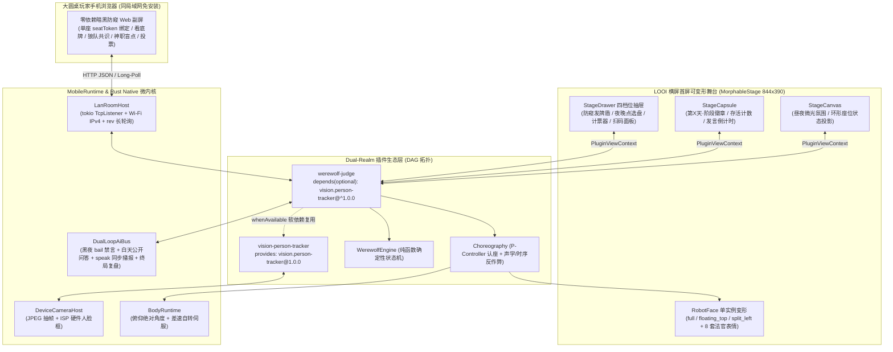
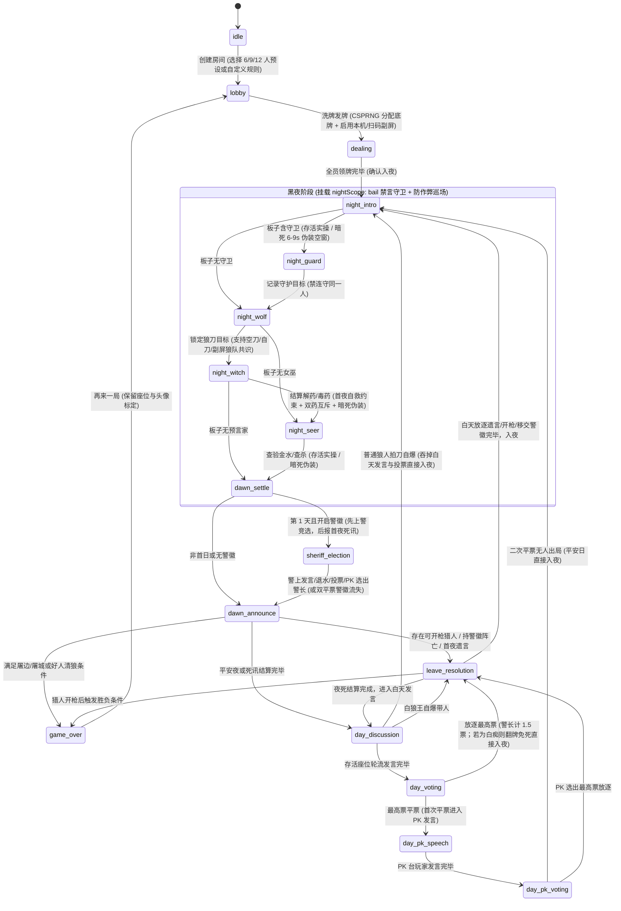
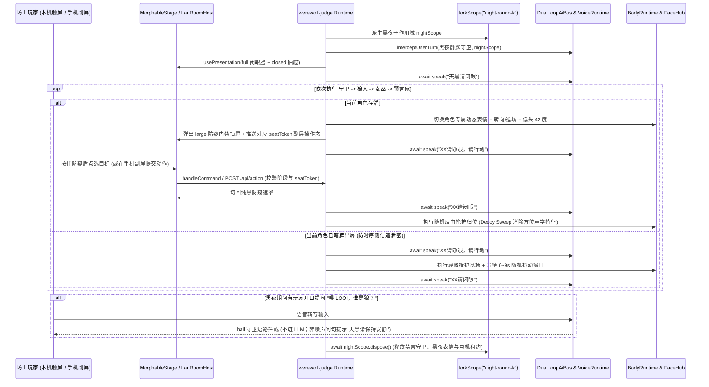

# Super LOOI 具身狼人杀上帝裁判与视觉座位追踪双插件架构方案

## 目标与背景

依托 **插件系统 v2 与横屏可变形首屏舞台（Morphable Stage）**（见 [plugin-system-v2-architecture-plan.md](plugin-system-v2-architecture-plan.md)），面向 6–12 人线下桌面聚会场景构建跨插件具身桌游生态：

1. **底层感知服务插件 `vision-person-tracker`（`vision_motion` 类别）**：
   - 接入手机相机 ISP（Image Signal Processor，图像信号处理器）硬件级零体积人脸检测（iOS `AVCaptureMetadataOutput` + Android Camera2 `STATISTICS_FACE_DETECT_MODE`），不引入第三方深度学习模型或额外安装包体积；
   - 采用**引用计数按需开流（Reference-Counted On-Demand Streaming）**对外导出 `vision.person-tracker@1.0.0` 服务：仅在上层插件持有活跃追踪作用域或开启校准预览时点亮前置摄像头，最后一个作用域释放后立即关闭底层相机流。
2. **聚会桌游插件 `werewolf-judge`（“狼人杀 AI 法官”，`games_social` 类别）**：
   - **纯函数确定性状态机（FSM，Finite State Machine）**：由 TypeScript 确定性维护底牌洗牌（CSPRNG）、6 人欢乐屠城局 / 9 人标准屠边局 / 12 人进阶警长局（预女猎守 / 预女猎白 + 自定义角色与规则微调）、同守同救（奶穿）、女巫首夜自救与双药互斥、猎人毒死禁枪、首日先上警竞选再报死讯、警长 `1.5` 票权重与平票 PK；
   - **反侧信道作弊的具身演出（Side-Channel-Safe Embodied Choreography）**：发牌阶段结合视觉人脸偏移 `offsetX` 做比例闭环（P-Controller）对准玩家并抓拍内存态座位头像；夜晚阶段执行**声学掩护旋转（Acoustic Decoy Sweep）**与**阵亡神职随机抖动伪装停留（Timing Mask）**，消除闭眼玩家通过电机运转时长或环节耗时推断身份的侧信道；
   - **本机首屏触控 + 局域网手机扫码副屏双模（Dual-Surface Interaction）**：支持直接在 LOOI 横屏首屏 `StageDrawer`（配合长按防窥盾 `Hold-to-Reveal`）点选，或开启 App 内置 Rust `LanRoomHost` 局域网房间，供玩家扫码在手机浏览器私密看底牌、狼队协同点刀、神职盲操与放逐暗投；
   - **双环 AI 融合**：黑夜挂载 `interceptUserTurn` 确定性短路守卫；白天仅将公开台面事件注入 `ContextSlice`（底牌与提示词物理隔离），支持语音查询公开票型与存活座位；终局揭晓底牌后通过后台任务生成结合真实战报的 AI 法官 MVP 复盘点评。

---

## 核心架构决策

### 1. 关键接口方案对比（Design-It-Twice）

#### 决策 A：移动端实时人脸方位检测方案

| 方案 | 实现机制 | 体积与运行时成本 | 结论 |
| --- | --- | --- | --- |
| **方案 1：打包第三方 ONNX / MediaPipe 人脸模型** | 在 Rust 或 JS 中集成推理引擎对每帧 JPEG 解码后再跑神经网络 | 安装包增加 `4–12 MB`，挤占双工语音 CPU/内存预算，增加跨端编译维护成本 | **不采用** |
| **方案 2：复用手机系统相机 ISP 硬件人脸元数据** | iOS 挂载 `AVCaptureMetadataOutput`（`AVMetadataObjectTypeFace`），Android 开启 `CaptureRequest.STATISTICS_FACE_DETECT_MODE`，硬件流水线随帧产出归一化 `[offsetX, offsetY, width, height, trackId]` | **0 KB 包体增量，近乎 0% 额外 CPU 开销**，与横屏旋转及前摄镜像一致对齐 | **采用** |

#### 决策 B：局域网手机扫码副屏通信架构

| 方案 | 实现机制 | 真实聚会体验与复杂度 | 结论 |
| --- | --- | --- | --- |
| **方案 1：公网中转服务器或自定义 WebSocket 子协议** | 玩家扫码连云端房间或手写 RFC 6455 WebSocket 帧解析 | 无外网环境不可用；内置浏览器锁屏切回后易断连丢状态 | **不采用** |
| **方案 2：App 内置 Rust `LanRoomHost`（HTTP/1.1 + `rev` 版本号长轮询 + 单座防篡改令牌）** | 复用已链接的 `tokio::net::TcpListener` 监听本机局域网随机端口，`libc::getifaddrs` 获取手机 Wi-Fi / 热点 IPv4；提供单文件零外链暗黑防窥 HTML 副屏，`/api/wait?sinceRev=<n>` 在状态变更时即时唤醒 | 由手机 App 自身承载（零云端依赖、零 Cargo 新增依赖）；锁屏唤醒后按 `rev` 续接，单座绑定 `seatToken` 隔离其他玩家底牌 | **采用** |

#### 决策 C：无偏航编码器（No Yaw Encoder）底座的认座与防作弊转向

| 方案 | 运动方式 | 桌面聚会表现 | 结论 |
| --- | --- | --- | --- |
| **方案 1：固定毫秒数开环直转 + 阵亡角色跳过** | 按固定时长直转至目标座位；角色阵亡后跳过该夜间环节 | 不同桌面摩擦系数导致累积偏航；闭眼玩家可通过电机时长和环节缺失反推神职座位与生死 | **不采用** |
| **方案 2：`speed = 0` 纯原地自转 + 发牌视觉闭环认座 + 黑夜声学/时序双掩护** | 禁止前后移动防跌落；开局顺时针发牌时用人脸 `offsetX` 微调居中；本机触控夜采用“随机相位切入 + 闭眼后反向随机掩护归位”，副屏夜采用“匀速对称巡场”；暗牌阵亡神职保留 `6–9s` 随机抖动窗口 | 兼顾桌面防跌落、不同材质认座对准精度，以及面杀声学/时序反侧信道要求 | **采用** |

---

### 2. 新增概念与复杂度成本核算

| 新增模块 / 概念 | 具体用途 | 复杂度成本与删除测试结果 |
| --- | --- | --- |
| 原生相机 `DetectedCameraFace` 元数据扩展 | 在 `DeviceCameraFrame` 中附带硬件 ISP 检测到的归一化人脸框与 `trackId` | Objective-C / Java / Rust 合计约 130 行；删除后上层插件无法获知人脸水平/垂直偏移，无法闭环对准玩家或眼神追随 |
| `LanRoomHost` & `"network.lan_room"` 权限 | 为聚会类插件提供绑定 `EffectScope` 与前后台生命周期的本机局域网 HTTP 房间能力 | Rust 约 180 行 + TS `LanRoomBroker` 约 120 行，零新增第三方依赖；承载大圆桌扫码盲操及后续多人聚会插件复用 |
| 宿主舞台桥接补齐（`openStage` / `onHostExit`） | 支持从插件设置页切回首屏舞台，并在用户点击顶栏宿主 `退出舞台` 时通知插件回收前台硬件与禁言租约 | `ui-contracts.ts`、`stage-manager.ts`、`store.ts` 合计约 25 行；消除前后台切换与手动退出舞台时的租约残留 |
| `vision-person-tracker` 独立基础插件 | 封装相机权限引导、主目标 EMA 滤波、引用计数按需开流与内存态座位头像抓拍，导出 `vision.person-tracker` 服务 | 约 250 行；解耦传感器采集与具体桌游/伴随业务编排 |
| `WerewolfEngine` 纯函数状态机 | 独立于 UI 与硬件，纯数据驱动管理 6–12 人角色分配、夜晚技能结算、警徽流、投票 PK 与胜负判定 | 约 480 行纯 TypeScript；支持确定性单测覆盖边界判例 |
| `QrCodeCanvas` 纯算法二维码组件 | 将局域网房间 URL 编码为二维码矩阵并在原生 `<Canvas>` 用语义 Token 绘制 | 约 170 行零依赖 Byte-Mode Reed-Solomon 实现；适配明暗双主题且不引入外部 DOM/SVG 包 |

---

## 系统全景与状态机架构

### 1. 跨插件拓扑与双模交互全景图

### 2. 狼人杀全生命周期确定性状态机（`WerewolfEngine`）

### 3. 黑夜防泄密与双模协同序列图

---

## 模块边界与接口设计

### 组件 1：宿主微内核、原生相机 ISP 人脸框与局域网房间底座

#### `apps/nsh/runtime/plugins/shared-types.ts` & `contracts.ts`
- 在 `PLUGIN_PERMISSIONS` 中新增 `"network.lan_room"`。
- 为相机帧定义硬件人脸检测输出结构 `DetectedCameraFace`（`trackId`, `offsetX`, `offsetY`, `width`, `height`, `confidence`），挂载于 `DeviceCameraFrame.faces` 与 `NativeDeviceCameraFrame.faces`。
- 在 `PluginStageCapability` 中增加 `onHostExit(listener: () => void, scope?: EffectScope): Dispose`。
- 新增 `PluginLanRoomCapability`（挂载于 `PluginContext.lan`，需 `"network.lan_room"` 权限），支持 `openRoom`、`notifyRevision`、`refreshAddresses` 与 `close`。

#### `apps/nsh/ui/plugins/ui-contracts.ts`、`stage-manager.ts` & `store.ts`
- 在 `PluginViewContext` 中补充 `openStage: () => void` 与 `openPluginSettings: () => void`。
- 在 `PluginStageManager.exitPluginStage(pluginId)` 中触发 `onHostExit` 回调。

#### `DeviceCamera.m`、`DeviceCameraBridge.java`、`src/device_camera/mod.rs` & `runtime/device-camera.ts`
- **iOS (`DeviceCamera.m`)**：配置 `AVCaptureMetadataOutput`（`AVMetadataObjectTypeFace`），复用 `LCApplyLandscapeConnection` 同步横屏旋转与前摄镜像，缓存前 8 张按面积降序排列的归一化人脸坐标。
- **Android (`DeviceCameraBridge.java`)**：开启 `STATISTICS_FACE_DETECT_MODE`，读取 `CaptureResult.STATISTICS_FACES` 并结合 `SENSOR_INFO_ACTIVE_ARRAY_SIZE`、横屏旋转角与前摄镜像换算为 `[-1, 1]` 坐标。
- **Rust & TS 桥接**：透传 `faces` 数组，并在模拟流（Sample Stream）中提供确定性模拟人脸坐标供无头测试与模拟器调试使用。

#### `src/lan_room.rs`、`runtime/lan-room.ts` & `src/lib.rs`
- 在 `super-looi/native` 注册 `LanRoomHost` 原生类：
  - 使用 `tokio::net::TcpListener::bind("0.0.0.0:0")` 绑定空闲端口，限制单房间并发连接上限（`<= 24`）与请求体上限（`<= 16 KiB`）；
  - 使用 `libc::getifaddrs`（iOS 优先 `en0` / `bridge100`，Android 优先 `wlan0` / `ap0`，回退 UDP 路由探测与 `127.0.0.1`）读取局域网或手机热点 IPv4；
  - 内置 `/api/wait` `tokio::sync::watch` 修订号长轮询唤醒通道，其余 HTTP 路由桥接至 TS 插件 `onRequest`；
  - 在 `EffectScope` 析构或 App 退后台时立即关闭监听 Socket 与活跃连接。

---

### 组件 2：底层视觉追踪服务插件 `vision-person-tracker`

- **静态清单**：`id: "vision-person-tracker"`, `version: "1.0.0"`, `category: "vision_motion"`, `icon: "eye"`, `permissions: ["camera.front"]`, `provides: [{ id: "vision.person-tracker", version: "1.0.0" }]`。
- **`PersonTrackerService`**：
  - **引用计数按需开流**：待机时 `streaming: false`；仅当存在活跃 `acquireTracking` 订阅者或配置页校准预览开启时向 `VisionBroker` 订阅前摄流，最后一个订阅释放后立即关流；
  - **主目标锁定与 EMA 平滑**：按 `trackId` 连续性与中心/面积综合得分选取 `primaryTarget`，对 `offsetX / offsetY` 执行指数移动平均滤波（默认 `alpha = 0.45`）；
  - **内存态头像抓拍（`capturePortrait`）**：采集 `320px` 前摄帧并编码为 `data:image/jpeg;base64,...` 内存缩略图，不写入磁盘。
- **配置页 `SettingsView.tsx`**：展示相机权限状态与授权入口、`<DeviceCameraPreview />` 横屏实时校准取景框、实时人脸数与偏移坐标读数，以及平滑系数和帧率控制。

---

### 组件 3：狼人杀确定性引擎与具身裁判运行时 `werewolf-judge/runtime`

#### 安全状态投影不变量（Secret Isolation Invariant）
- 引擎完整真值（`rolesBySeat`、`wolfTarget`、`witchPotions`、`guardTarget`）封装在 `runtime/engine.ts` 内部；
- 对局未结束（`phase !== "game_over"`）时，前台 `WerewolfPublicState` 默认绝不包含玩家真实底牌（仅白痴翻牌后公开 `"idiot"`、发牌长按期间单座临时可见、夜晚对应角色解锁门禁期间可见单角色上下文，松手或确认即刻擦除）；
- 局域网副屏 `/api/state` 按单座加密随机 `seatToken` 独立裁剪响应，物理阻断跨座抓包看牌。

#### 核心规则覆盖清单
1. **三档经典预设 + 自定义微调（6–12 人）**：
   - `6p_joy`：2 狼 + 预言家 + 女巫 + 2 平民（`slaughter_all`，无警徽）；
   - `9p_standard`：3 狼 + 预言家 + 女巫 + 猎人 + 3 平民（`slaughter_side`）；
   - `12p_guard` / `12p_idiot`：4 狼（支持含白狼王）+ 预言家 + 女巫 + 猎人 + 守卫/白痴 + 4 平民（`slaughter_side`，默认开启首日警长竞选与同守同救奶穿）。
2. **关键结算判例**：
   - 同守同救（奶穿）：`guardTarget === wolfTarget && witchSaved && rules.sameGuardSameSaveDies` 时判定倒牌；
   - 猎人开枪约束：死因含女巫毒药时 `canShoot = false`，被刀或公投放逐时 `canShoot = true`；
   - 首日警徽标准时序：第 1 夜结算后先执行 `sheriff_election`（报名 → 随机起始位发言/退水 → 警下投票 → 平票 PK → 双平票警徽流失），再进入 `dawn_announce` 播报首夜死讯；警长放逐计 `1.5` 票；
   - 白痴免死：公投最高票时翻牌免死并失去后续投票权；
   - 狼人自爆：校验座位确为狼人后立即中断白天进入黑夜（白狼王在非警上自爆可带走一人）。

---

### 组件 4：横屏首屏可变形舞台 UI 与动效规范

全部表现层颜色取自 `apps/nsh/theme.json` 语义 Token，所有触控热区 `>= 44 × 44pt`，最小字号 `12pt`（`text-xs`），所有动效均提供 `reduceMotion()` 降级分支，同步记录于 `apps/nsh/DESIGN.md` 第 6 节。

---

## 实施里程碑划分

1. **Milestone 1**：宿主微内核补齐（`openStage` / `openPluginSettings` / `onHostExit`）、原生相机 ISP `DetectedCameraFace` 元数据透传与 Rust `LanRoomHost` 服务。
2. **Milestone 2**：`vision-person-tracker` 基础感知插件（引用计数按需开流、EMA 主目标平滑、内存头像抓拍与横屏校准配置页）。
3. **Milestone 3**：`werewolf-judge` 确定性规则引擎、反作弊具身编排、移动端局域网防窥 Web 副屏与双环 AI 接线。
4. **Milestone 4**：NSH TSX 首屏舞台 UI、`<QrCodeCanvas />`、自动化单测与无头 UI 回归、iOS 模拟器横屏开发包安装与端到端联调、架构文档同步。

---

## 验证方案

1. **Node 确定性引擎、跨插件引用计数与安全不变量测试**（`apps/nsh/tests/werewolf-plugin.node.ts`）：覆盖 6/9/12 人全流程、同守同救、毒闷猎人、首日警选与 1.5 票、白痴免死、狼人自爆、底牌零泄漏、副屏 `seatToken` 隔离、黑夜语音短路拦截与 `onHostExit` 租约回滚。
2. **Rust 原生单测**（`cargo test --manifest-path apps/nsh/Cargo.toml --lib`）：验证 `LanRoomHost` 端口绑定、并发请求、`/api/wait` 长轮询唤醒、请求体大小上限与切后台断连。
3. **QuickJS 横屏无头 UI 回归**（`apps/nsh/WerewolfStage.test.tsx` & `app_ui`）：在 `844 × 390` 横屏 Light / Dark / `reduceMotion` 下验证舞台姿态变形、防窥长按显隐、夜晚点选、计票与终局复盘。
4. **iOS 模拟器横屏开发包安装与 E2E 联调**：在横屏 iOS 模拟器中安装开发包并启用双插件，通过真实 HTTP 客户端连入模拟器内 `LanRoomHost` 完成 6 座领牌、夜间行动、白天发言公投与终局复盘全链路校验并留存横屏截图。
