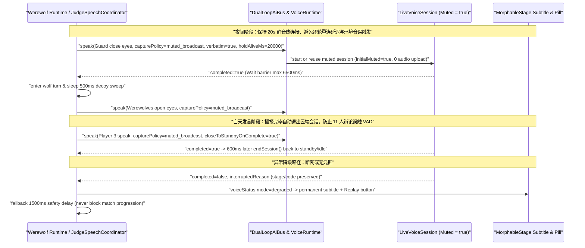
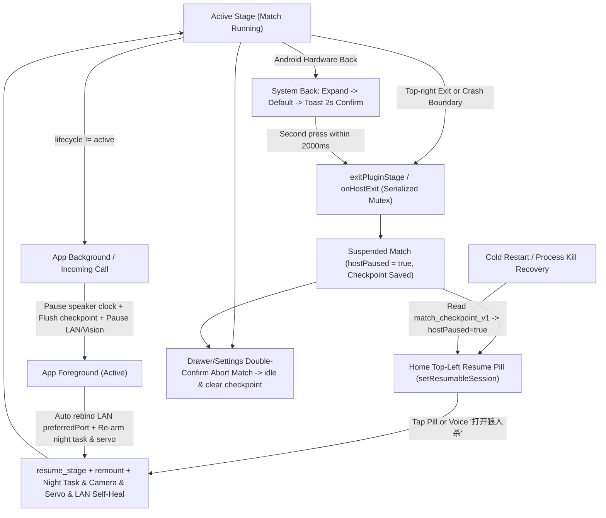

# 狼人杀法官插件（`werewolf-judge`）容灾、抗中断与舞台重入架构方案（v2）

## 1. 现状根因定位（Root-Cause Audit，5 个维度 15 处代码实证）

通过对宿主微内核（`PluginHost`）、可变形舞台（`MorphableStage`）、实时语音会话（`VoiceRuntime` / `LiveVoiceSession`）、原生局域网房间（`LanRoomHost` / `LanRoomBroker`）及狼人杀插件运行时（`werewolf-judge`）的逐行排查，当前缺少容灾与页面重入的故障由以下 15 处具体代码缺陷共同导致：

### 1.1 插件生命周期、误关舞台与重入空白（维度 A）

1. **`on_demand` 插件未经 `start()` 即响应命令（微内核生命周期漏斗）**
   - 位置：[manifest.ts](file:///Users/bugyaluwang/project/super-looi/apps/nsh/plugins/werewolf-judge/manifest.ts#L36)、[host.ts](file:///Users/bugyaluwang/project/super-looi/apps/nsh/runtime/plugins/host.ts#L792-L806)。
   - 根因：`werewolf-judge` 声明为 `activation: "on_demand"`，`startStartupPlugins()` 在冷启动时跳过激活；而 `PluginHost.sendCommand()` 未检查 `record.lifecycle === "registered"` 便直接调用 `record.instance.handleCommand(command)`。
   - 后果：[index.ts](file:///Users/bugyaluwang/project/super-looi/apps/nsh/plugins/werewolf-judge/runtime/index.ts#L259-L300) 的 `start()` 在正常启动路径下从未执行：`ctx.stage.onHostExit`（第 281 行）未注册、视觉追踪服务 `vision.person-tracker` 未订阅、发言倒计时 `speakerInterval` 未挂起、语音工具 `werewolf_open_lobby` 与 `werewolf_host_control` 未注册。
2. **设置页「回到牌局舞台」仍呈空白的真实根因：快照缓存短路 + 异步退出竞态**
   - 位置：[SettingsView.tsx](file:///Users/bugyaluwang/project/super-looi/apps/nsh/plugins/werewolf-judge/ui/SettingsView.tsx#L133-L158)、[ui-contracts.ts](file:///Users/bugyaluwang/project/super-looi/apps/nsh/ui/plugins/ui-contracts.ts#L52)、[index.ts](file:///Users/bugyaluwang/project/super-looi/apps/nsh/plugins/werewolf-judge/runtime/index.ts#L281-L283)、[index.ts](file:///Users/bugyaluwang/project/super-looi/apps/nsh/plugins/werewolf-judge/runtime/index.ts#L872-L905)、[index.ts](file:///Users/bugyaluwang/project/super-looi/apps/nsh/plugins/werewolf-judge/runtime/index.ts#L1132-L1160)。
   - 根因：虽然 `SettingsView` 的 `werewolf-launch-stage-btn` 已调用 `sendCommand({ type: "resume_stage" })` 并触发 `props.ctx.openStage()` 切回 `"face"` 空间，但仍存在两重失效路径：
     1. 点击右上角「退出舞台」后 `PluginStageManager` 清空了舞台栈，而因 `onHostExit` 未注册（或尚未跑完），插件内部仍缓存着旧 `lastPresentationJson` 与非空 `stagePresentationDispose`。此时执行 `resume_stage` 调用 `syncStagePresentation()`（第 889 行），命中 `if (serialized === this.lastPresentationJson && this.stagePresentationDispose) return;`——它**未检查宿主 `this.ctx.stage.currentPresentation() !== null`** 即短路退出，舞台无法重新挂载，切回首屏后只有空白表情；
     2. `onHostExit` 回调 `void this.handleHostStageExited()` 横跨 6 个 `await` 节点且与 `handleCommand` 无串行互斥：快速退回再重开会触发竞态，尾随收尾的 `handleHostStageExited()` 会反手销毁刚重建的 `matchStageScope` 并将 `hostPaused` 改回 `true`。
   - 补充：[SettingsView.tsx](file:///Users/bugyaluwang/project/super-looi/apps/nsh/plugins/werewolf-judge/ui/SettingsView.tsx#L161-L176) 的 `结束重置当前对局` 按钮缺少双点二次确认，误点一下即执行 `exit_to_idle` 清空牌局。
3. **底部抽屉收起后连同拖拽把手一起从渲染树卸载**
   - 位置：[MorphableStage.tsx](file:///Users/bugyaluwang/project/super-looi/apps/nsh/ui/stage/MorphableStage.tsx#L592-L718)。
   - 根因：在 `allowUserSwipeCollapse: true` 阶段点击 `stage-drawer-collapse` 或下拉手势把 `userDetentOverride` 置为 `"closed"` 后，第 592 行 `effectiveDrawerDetent() !== "closed"` 为假直接卸载整个 `<StageDrawer>`（包含顶部把手）。同阶段内 `userDetentOverride` 不会重置且页面无任何展开按钮，用户被困在无抽屉的舞台上无法推进流程。
4. **首屏缺少挂起态重入胶囊 + 返回键一触即退 + 语音「打开狼人杀」误清盘**
   - 位置：[MorphableStage.tsx](file:///Users/bugyaluwang/project/super-looi/apps/nsh/ui/stage/MorphableStage.tsx#L743-L842)、[App.tsx](file:///Users/bugyaluwang/project/super-looi/apps/nsh/App.tsx#L12)、[store.ts](file:///Users/bugyaluwang/project/super-looi/apps/nsh/store.ts#L1454-L1462)、[index.ts](file:///Users/bugyaluwang/project/super-looi/apps/nsh/plugins/werewolf-judge/runtime/index.ts#L1210-L1227)。
   - 根因：对局中按一次系统返回键 `store.goBack()` 立即退出舞台；回到首屏后界面无挂起对局重入入口；当用户对着语音说「打开狼人杀 / 回到狼人杀」试图唤出刚关掉的舞台时，`werewolf_open_lobby` 无条件调用 `open_lobby` 重洗或重置牌局，直接销毁正在进行的对局；而房主确实想作废重开时抽屉内缺少「终止本局」出口。
5. **UI 插槽渲染异常后的状态孤岛**
   - 位置：[MorphableStage.tsx](file:///Users/bugyaluwang/project/super-looi/apps/nsh/ui/stage/MorphableStage.tsx#L164-L188)、[host.ts](file:///Users/bugyaluwang/project/super-looi/apps/nsh/runtime/plugins/host.ts#L808-L827)。
   - 根因：`PluginStageSlotBoundary` 捕获 UI 崩溃调用 `reportStageCrash` 退出舞台；若无串行化 `onHostExit` 与首屏恢复胶囊，单帧 UI 异常即令玩家失去重连渠道。

### 1.2 桌面多人语音全双工灾难、队列积压与单次报错失声（维度 B）

6. **全双工麦克风与云端 `server_vad` 在多人桌面场景下的双重灾难**
   - 位置：[runtime.ts](file:///Users/bugyaluwang/project/super-looi/apps/nsh/runtime/voice/runtime.ts#L214-L241)、[live-session.ts](file:///Users/bugyaluwang/project/super-looi/apps/nsh/runtime/voice/live-session.ts#L1245-L1335)、[index.ts](file:///Users/bugyaluwang/project/super-looi/apps/nsh/plugins/werewolf-judge/runtime/index.ts#L914-L935)。
   - 根因：`VoiceRuntime.speak()` 自动拉起 `muted = false` 的实时会话并激活云端语音端点检测（`server_vad`）：
     - **夜间自打断**：桌边任何咳嗽或挪椅子都会触发 `user_speech_started` -> `this.interrupt("server_vad")` 当场掐断法官口令；`500ms` 后 `user_speech_stopped` 命中插件 `nightScope.interceptUserTurn`，以 `delivery: "interrupt"` 播放 `"天黑请保持安静"`，反手清空下一角色的睁眼广播，且夜间桌面音频持续上传云端；
     - **白天辩论被 AI 持续插嘴劫持**：法官播报 `"请 3 号玩家发言"` 后，`LiveVoiceSession` 在 `listening` 且 `muted = false` 状态保留 `12_000ms` 超时。人类玩家立刻向全桌 11 名队友辩论发言，每次换气停顿触发 `server_vad` 都会引起 LOOI 自动接话插嘴，且持续人声令 12 秒静默计时无法到期休眠。
7. **`delivery: "when_idle"` 队列积压导致的跨阶段串台泄密**
   - 位置：[index.ts](file:///Users/bugyaluwang/project/super-looi/apps/nsh/plugins/werewolf-judge/runtime/index.ts#L754-L791)、[index.ts](file:///Users/bugyaluwang/project/super-looi/apps/nsh/plugins/werewolf-judge/runtime/index.ts#L830-L855)、[index.ts](file:///Users/bugyaluwang/project/super-looi/apps/nsh/plugins/werewolf-judge/runtime/index.ts#L1336-L1347)、[live-session.ts](file:///Users/bugyaluwang/project/super-looi/apps/nsh/runtime/voice/live-session.ts#L627-L660)。
   - 根因：`speakJudgeLine` 全部采用 `void` 异步触发并传 `delivery: "when_idle"`。冷启动建连加 TTS 单句播报耗时 `2.5s–4s`，而 `nightIntroDelayMs` 仅等 `1200ms`，角色行动后的声学掩护仅 `0–500ms`。结果 `noticeQueue` 堆积 3–4 句台词或因 `turnActivity !== "waiting_user"` 被卡住，屏幕已进入女巫阶段，扬声器仍在喊 `"守卫请睁眼"`。
8. **`VoiceRuntime.speak()` 单次出错永久锁死 + OpenAI 协议自由改写法官口令**
   - 位置：[runtime.ts](file:///Users/bugyaluwang/project/super-looi/apps/nsh/runtime/voice/runtime.ts#L218)、[realtime-protocol.ts](file:///Users/bugyaluwang/project/super-looi/packages/looi-runtime/src/voice/realtime-protocol.ts#L212-L257)。
   - 根因：第 218 行仅允许 `["idle", "standby"].includes(this.state.phase)` 自动重连，漏掉了 `"error"` 态（尽管第 323 行 `start()` 明确支持从 `"error"` 恢复），导致一次 Wi-Fi 抖动即可使整局余下时间永久失声；权限为 `"undetermined"` 时也只返回 `"session_inactive"` 吞掉原因。此外，OpenAI 协议 `encodeProactiveSpeech`（第 228 行）提示模型自由总结润色，可能篡改或遗漏严格法官口令。

### 1.3 异步夜晚重入死锁、前后台断崖与崩溃失忆（维度 C）

9. **异步夜晚阶段挂起后恢复（`resume_stage`）永久死锁**
   - 位置：[index.ts](file:///Users/bugyaluwang/project/super-looi/apps/nsh/plugins/werewolf-judge/runtime/index.ts#L362-L376)、[index.ts](file:///Users/bugyaluwang/project/super-looi/apps/nsh/plugins/werewolf-judge/runtime/index.ts#L798-L855)。
   - 根因：在 `night_intro`（入夜缓冲）或亡神假动作掩护（`isCurrentNightStepDecoy() === true`）期间退出舞台，`handleHostStageExited()` 会中止 `nightTaskAbort`；但 `resume_stage` 只恢复舞台挂载，未重启 `scheduleNightIntroAdvance()` 或 `scheduleDeadRoleDecoyMask()`。由于这两个状态关闭了玩家提交按键，恢复后对局永久停死。
10. **切后台 / 来电引发的状态脱节与底座舵机租约永久失效**
    - 注：iOS [keep_awake.rs](file:///Users/bugyaluwang/project/super-looi/apps/nsh/src/keep_awake.rs#L26) 与 Android [SuperLooiApplication.java](file:///Users/bugyaluwang/project/super-looi/apps/nsh/native/android/com/superlooi/nsh/SuperLooiApplication.java#L63) 已分别实现前台屏幕常亮，无需重复建设。
    - 问题集中在来电或锁屏触发 `lifecycle() !== "active"`（[store.ts](file:///Users/bugyaluwang/project/super-looi/apps/nsh/store.ts#L851-L889)）时：
      1. `PluginHost` 未向插件同步前后台切换，`speakerInterval`（[index.ts](file:///Users/bugyaluwang/project/super-looi/apps/nsh/plugins/werewolf-judge/runtime/index.ts#L1162-L1178)）在后台继续扣减发言秒数；
      2. 切后台或手动点击语音球打断触发 `stopBodyNow()`（[store.ts](file:///Users/bugyaluwang/project/super-looi/apps/nsh/store.ts#L1774-L1777)），导致 `BodyServoLease.onPreempted` 将 `servoPreempted` 置为 `true` 却未将 `this.activeServoLease` 置空（[choreography.ts](file:///Users/bugyaluwang/project/super-looi/apps/nsh/plugins/werewolf-judge/runtime/choreography.ts#L376-L395)），后续 `acquireMatchLeases()` 因 `if (!this.activeServoLease)` 恒为假而在剩余整局彻底丧失舵机控制权。
11. **全内存牌局无持久化断点快照**
    - 位置：[index.ts](file:///Users/bugyaluwang/project/super-looi/apps/nsh/plugins/werewolf-judge/runtime/index.ts#L1349-L1351)。
    - 根因：`ctx.storage` 仅持久化 `rules_v1`。进程被杀、崩溃或重载后，全盘底牌、存活、药水、警长、投票与手机副屏 `seatTokens` 全部归零。

### 1.4 单机传阅真人手滑容错缺失（维度 D）

12. **传阅发牌阶段连点两下「记住了，下一位」直接跳过下一名玩家**
    - 位置：[engine.ts](file:///Users/bugyaluwang/project/super-looi/apps/nsh/plugins/werewolf-judge/runtime/engine.ts#L710-L749)、[StageCanvas.tsx](file:///Users/bugyaluwang/project/super-looi/apps/nsh/plugins/werewolf-judge/ui/StageCanvas.tsx#L402-L420)。
    - 根因：`on_device` 传阅时传递手机极易误连点确认按钮导致跳过某位玩家。在尚未进入 `beginFirstNight()` 前，缺少受防窥盾保护的「退回上一位重看（`step_back_deal`）」能力。

### 1.5 局域网手机副屏（LAN Companion）断连锁死与应急控制（维度 E）

13. **主机切后台销毁监听后僵尸房间占位且重开端口漂移**
    - 位置：[lan_room.rs](file:///Users/bugyaluwang/project/super-looi/apps/nsh/src/lan_room.rs#L131-L148)、[lan-room.ts](file:///Users/bugyaluwang/project/super-looi/apps/nsh/runtime/lan-room.ts#L100-L116)、[index.ts](file:///Users/bugyaluwang/project/super-looi/apps/nsh/plugins/werewolf-judge/runtime/index.ts#L1074-L1103)。
    - 根因：切后台销毁底层 TCP socket 后，`this.lanSession` 仍非空；解锁回前台后不重开，且 `RoomSession::bind` 写死 `"0.0.0.0:0"` 随机端口，重开导致全场二维码与页面 URL 失效。
14. **手机副屏遇瞬时断连或 `503` 自删本地凭证导致全员 `403` 锁死**
    - 位置：[lan-companion.ts](file:///Users/bugyaluwang/project/super-looi/apps/nsh/plugins/werewolf-judge/runtime/lan-companion.ts#L457-L477)、[lan-companion.ts](file:///Users/bugyaluwang/project/super-looi/apps/nsh/plugins/werewolf-judge/runtime/lan-companion.ts#L669-L686)。
    - 根因：`refresh()` 的 `catch` 未区分 HTTP `401` 与断网/`503`，一遇错误便执行 `localStorage.removeItem(STORE_KEY)` 删除选座 `token`，主机恢复后重选原座位触发 `403 ERR_LAN_SEAT_ALREADY_CLAIMED`；同时 `watchLoop()` 断连恢复后未立即触发 `refresh()` 对齐版本。
15. **缺单人手机换机解绑与局域网本机应急面板尺寸裁切**
    - 位置：[StageDrawer.tsx](file:///Users/bugyaluwang/project/super-looi/apps/nsh/plugins/werewolf-judge/ui/StageDrawer.tsx#L491-L524)、[StageCanvas.tsx](file:///Users/bugyaluwang/project/super-looi/apps/nsh/plugins/werewolf-judge/ui/StageCanvas.tsx#L424-L468)。
    - 根因：缺少单独释放单个座位凭证的命令；局域网发牌阶段无本机按住防窥看牌兜底；局域网夜晚抽屉默认 `peek`（约 86pt），点「应急本机操作」未主动请求展开至 `large`。

---

## 2. 核心架构设计与方案取舍（Design-It-Twice & Deep Modules）

### 2.1 五项核心设计取舍对比

| 决策域 | 备选方案 A（拒绝） | 采用方案 B（深模块收敛方案） | 取舍依据 |
| :--- | :--- | :--- | :--- |
| **桌面多人语音通道** | 沿用 `duplex` 全双工麦克风 + 插件拦截器拦截夜间语音 | 新增 `capturePolicy: "muted_broadcast"` 与 `verbatim: true` | 方案 A 无法阻止 `user_speech_started` 在服务端打断 TTS，也无法阻止白天 11 人对话触发插嘴。方案 B 复用现有 `LiveVoiceSession.muted`，从物理上置零上行音频包与 VAD 误打断。 |
| **法官台词与流程协同** | 所有 `speak()` 全部强阻塞主状态机 | `JudgeSpeechCoordinator`：闭眼有界屏障（`maxWaitMs = 6500ms`）+ 睁眼/白天按 `epoch` 排队，断网立即按 `1500ms` 降级 | 全阻塞会因一次断网让每次操作卡顿 15 秒；全不阻塞会导致前句闭眼被下句睁眼掐断。 |
| **首屏挂起与恢复契约** | `PluginStageManager` 隐式记录退出历史并硬编码命令 | `ctx.stage.setResumableSession(descriptor \| null)` 显式契约 | 冷启动恢复快照时尚未挂载过舞台，隐式记录无法生效；显式注册让宿主零硬编码且支持多插件扩展。 |
| **LAN 房间前后台自愈** | 插件自己保存旧端口并在返回前台后重建会话 | `LanRoomHost` 支持 `preferred_port` + `LanRoomBroker` 透明挂起与同端口重绑 | 对齐既有 `VisionBroker` 模式，使插件持有的 `LanRoomSession` 句柄与原本二维码端口跨锁屏保持恒定。 |
| **对局持久化模型** | Event Sourcing（命令事件重放） | 单键结构化状态快照 `match_checkpoint_v1`（剥离 `portraitDataUri`，约 `2–4 KB`） | 洗牌与伪装延时依赖真随机数与墙钟，重放日志复杂；离散状态转移与挂起时落盘足以实现 `O(1)` 无损恢复且天然隔绝非公开底牌。 |

### 2.2 新增概念与复杂度成本审视表（`AGENTS.md` Rule 12）

| 新增/扩展概念 | 归属文件 | 具体用途 | 复杂度成本与边界约束 |
| :--- | :--- | :--- | :--- |
| `ResumableStageSessionDescriptor` 与 `setResumableSession` | [contracts.ts](file:///Users/bugyaluwang/project/super-looi/apps/nsh/runtime/plugins/contracts.ts)、[stage-manager.ts](file:///Users/bugyaluwang/project/super-looi/apps/nsh/runtime/plugins/stage-manager.ts)、[MorphableStage.tsx](file:///Users/bugyaluwang/project/super-looi/apps/nsh/ui/stage/MorphableStage.tsx) | 舞台收起与崩溃冷启动后在首屏左上角提供统一、可点的重入入口 | `PluginStageManager` 内增 1 个 `Map` 与变化通知，首屏仅增 1 个胶囊按钮；零插件专属逻辑。 |
| `onAppForegroundChange`（微内核前后台通知） | [contracts.ts](file:///Users/bugyaluwang/project/super-looi/apps/nsh/runtime/plugins/contracts.ts)、[host.ts](file:///Users/bugyaluwang/project/super-looi/apps/nsh/runtime/plugins/host.ts)、[application.ts](file:///Users/bugyaluwang/project/super-looi/apps/nsh/runtime/application.ts) | 让插件在来电/锁屏切后台时即时冻结计时器、落盘快照并在回前台后重启异步任务与舵机 | 复用 `store.ts` 既有的 `lifecycle()` `effect`，宿主仅透传布尔值到已注册监听器。 |
| `requestDetent` 与底部 `stage-drawer-reopen` 胶囊 | [ui-contracts.ts](file:///Users/bugyaluwang/project/super-looi/apps/nsh/ui/plugins/ui-contracts.ts)、[MorphableStage.tsx](file:///Users/bugyaluwang/project/super-looi/apps/nsh/ui/stage/MorphableStage.tsx) | 解决收起抽屉后失去把手、以及局域网夜晚「应急本机操作」被锁死在 `peek` 高度被裁切的问题 | 仅读写宿主现有的 `userDetentOverride` 信号。 |
| `PluginSpeakOptions`（`capturePolicy` / `verbatim` / `holdAliveMs` / `closeToStandbyOnComplete`） | [realtime-protocol.ts](file:///Users/bugyaluwang/project/super-looi/packages/looi-runtime/src/voice/realtime-protocol.ts)、[live-session.ts](file:///Users/bugyaluwang/project/super-looi/apps/nsh/runtime/voice/live-session.ts)、[runtime.ts](file:///Users/bugyaluwang/project/super-looi/apps/nsh/runtime/voice/runtime.ts) | 将法官广播与人机全双工自由对话物理隔离，并保障云端严格逐字朗读台词 | 全部默认值向后兼容现有 `speak()` 调用，利用已有的 `LiveVoiceSession.muted` 门控与豆包静音帧。 |
| `JudgeSpeechCoordinator` 与 `WerewolfJudgeVoiceStatus` | 新建 `speech-coordinator.ts`、[contracts.ts](file:///Users/bugyaluwang/project/super-looi/apps/nsh/plugins/werewolf-judge/contracts.ts) | 统一收敛法官播报排队、闭眼屏障、手动静音、一键重播及真实底层失败原因透出 | ~180 行内聚模块，替换原先散落各处的 `void speakJudgeLine` 与手写 `catch {}` 吞错逻辑。 |
| `WerewolfMatchCheckpointV1` | [engine.ts](file:///Users/bugyaluwang/project/super-looi/apps/nsh/plugins/werewolf-judge/runtime/engine.ts)、[lan-companion.ts](file:///Users/bugyaluwang/project/super-looi/apps/nsh/plugins/werewolf-judge/runtime/lan-companion.ts) | 支持进程崩溃/杀后台后无损续接牌局与手机端令牌 | 复用既有的 `ctx.storage`（SQLite KV），无需新建数据库表或迁移脚本。 |
| `preferred_port`（Rust + TS `LanRoomBroker` 自愈） | [lan_room.rs](file:///Users/bugyaluwang/project/super-looi/apps/nsh/src/lan_room.rs)、[lan-room.ts](file:///Users/bugyaluwang/project/super-looi/apps/nsh/runtime/lan-room.ts) | 锁屏返回前台后优先绑定原端口、保持局域网二维码 URL 不失效 | Rust 侧约 15 行 `TcpListener::bind` 优先绑定逻辑与冲突回退；TS 侧仅在 Broker 内部维护会话列表。 |

**明确拒绝的过度设计（Rejected Over-Engineering）**：
- 不新建独立原生 TTS 音频栈；
- 不新增冗余 Android Keep-Awake Rust/JNI 桥（`SuperLooiApplication.java` 已持 `FLAG_KEEP_SCREEN_ON`）；
- 不支持跨越已进入首夜的全局指令 undo 栈，仅允许 `dealing` 阶段前防窥回退一位。

---

## 3. 分阶段详细改造步骤（Ordered Implementation Steps）

### Step 1：微内核生命周期、前后台通知与可恢复舞台契约
- 更新 [shared-types.ts](file:///Users/bugyaluwang/project/super-looi/apps/nsh/runtime/plugins/shared-types.ts)、[contracts.ts](file:///Users/bugyaluwang/project/super-looi/apps/nsh/runtime/plugins/contracts.ts)、[ui-contracts.ts](file:///Users/bugyaluwang/project/super-looi/apps/nsh/ui/plugins/ui-contracts.ts)：添加 `ResumableStageSessionInput`、`setResumableSession`、`onAppForegroundChange`、`confirmSystemBackExit`、`requestDetent` 及 `PluginSpeakOptions` 协议类型；
- 更新 [stage-manager.ts](file:///Users/bugyaluwang/project/super-looi/apps/nsh/runtime/plugins/stage-manager.ts) 与 [host.ts](file:///Users/bugyaluwang/project/super-looi/apps/nsh/runtime/plugins/host.ts)：修复 `PluginHost.sendCommand()` 对 `registered` 状态 `on_demand` 插件未调 `activateInternal()` 的漏洞；增加 `PluginHost.setForegroundActive(active)` 与 `resumableSessions` 维护及清理；
- 更新 [application.ts](file:///Users/bugyaluwang/project/super-looi/apps/nsh/runtime/application.ts)、[store.ts](file:///Users/bugyaluwang/project/super-looi/apps/nsh/store.ts)、[MorphableStage.tsx](file:///Users/bugyaluwang/project/super-looi/apps/nsh/ui/stage/MorphableStage.tsx)、[App.tsx](file:///Users/bugyaluwang/project/super-looi/apps/nsh/App.tsx)：
  - 接线 `runtime.setPluginsForegroundActive(active)` 与 `resumableStage` 信号；
  - `MorphableStage` 添加 `stage-drawer-reopen` 底部胶囊（允许收起时必现展开按钮）、左上角 `stage-resumable-pill` 恢复胶囊并透传 `requestDetent`；
  - `store.goBack()` 实行「抽屉收缩 -> 2000ms 双击返回确认退出」分级策略。

### Step 2：桌面静音广播（`muted_broadcast`）、逐字提示与 `VoiceRuntime` 错误自愈
- 更新 [realtime-protocol.ts](file:///Users/bugyaluwang/project/super-looi/packages/looi-runtime/src/voice/realtime-protocol.ts)：为 `RealtimeProactiveSpeech` 增加 `verbatim?: boolean`，OpenAI 协议启用严格逐字播报提示词；
- 更新 [live-session.ts](file:///Users/bugyaluwang/project/super-looi/apps/nsh/runtime/voice/live-session.ts) 与 [runtime.ts](file:///Users/bugyaluwang/project/super-looi/apps/nsh/runtime/voice/runtime.ts) 与 [ai-bus.ts](file:///Users/bugyaluwang/project/super-looi/apps/nsh/runtime/plugins/ai-bus.ts)：
  - `LiveVoiceSessionOptions` 支持 `initialMuted?: boolean`，握手后立即下发静音控制并在 `tick()` 保持 0 音频发包；
  - `VoiceRuntime.speak()` 允许从 `"error"` 状态自动恢复建连，保留精准失败阶段/原因，支持 `capturePolicy: "muted_broadcast"`、`holdAliveMs` 热连接保持与白天 `closeToStandbyOnComplete` 自动切回本地 `standby`（彻底消除 11 人发言触发云端 VAD 插嘴）。

### Step 3：法官语音协调器、串行锁、断点快照与舵机自愈
- 更新 [manifest.ts](file:///Users/bugyaluwang/project/super-looi/apps/nsh/plugins/werewolf-judge/manifest.ts) 设为 `activation: "startup"`；
- 更新 [contracts.ts](file:///Users/bugyaluwang/project/super-looi/apps/nsh/plugins/werewolf-judge/contracts.ts) 增加 `WerewolfJudgeVoiceStatus` 及重播/静音/发牌回退/解绑/终止本局指令；
- 新建 `apps/nsh/plugins/werewolf-judge/runtime/speech-coordinator.ts` 实现 `speakBarrier`（闭眼安全屏障）、`speakSequential`（按 `epoch` 排队）、降级延时及完整 `{ stage, code, reason }` 保留；
- 更新 [engine.ts](file:///Users/bugyaluwang/project/super-looi/apps/nsh/plugins/werewolf-judge/runtime/engine.ts) 实现 `WerewolfMatchCheckpointV1`（剥离头像大图）的 `exportCheckpoint` / `restoreCheckpoint` 及 `stepBackDeal()`；
- 更新 [choreography.ts](file:///Users/bugyaluwang/project/super-looi/apps/nsh/plugins/werewolf-judge/runtime/choreography.ts)：在 `BodyServoLease.onPreempted` 中清空 `this.activeServoLease` 并释放旧租约以便恢复；为活跃对局返回 `confirmSystemBackExit: true`；
- 更新 [index.ts](file:///Users/bugyaluwang/project/super-looi/apps/nsh/plugins/werewolf-judge/runtime/index.ts)：引入全操作单通道 `enqueueOperation` 互斥锁，修复 `syncStagePresentation()` 检查宿主 `currentPresentation() !== null`、增加 `resumeActivePhaseSideEffects()` 修复异步夜晚卡死、按需运行 `speakerInterval`、接入快照读写与恢复胶囊、`werewolf_open_lobby` 存在活跃对局时不误清盘。

### Step 4：局域网房间优先端口自愈与副屏网页令牌韧性
- 更新 [lan_room.rs](file:///Users/bugyaluwang/project/super-looi/apps/nsh/src/lan_room.rs) 与 [lan-room.ts](file:///Users/bugyaluwang/project/super-looi/apps/nsh/runtime/lan-room.ts)：支持 `preferred_port` 优先绑定与前后台自动重绑及 `revision` 续传；
- 更新 [lan-companion.ts](file:///Users/bugyaluwang/project/super-looi/apps/nsh/plugins/werewolf-judge/runtime/lan-companion.ts)：增加 `exportSeatTokens` / `restoreSeatTokens` / `releaseSeatToken`；网页脚本仅在 HTTP `401` 时清空本地选座凭证，断网与 `503` 保留 `token` 并重连后自动调用 `refresh()`。

### Step 5：舞台 UI、设置页与自动化/真机横屏验证
- 更新 [StageCapsule.tsx](file:///Users/bugyaluwang/project/super-looi/apps/nsh/plugins/werewolf-judge/ui/StageCapsule.tsx)、[StageCanvas.tsx](file:///Users/bugyaluwang/project/super-looi/apps/nsh/plugins/werewolf-judge/ui/StageCanvas.tsx)、[StageDrawer.tsx](file:///Users/bugyaluwang/project/super-looi/apps/nsh/plugins/werewolf-judge/ui/StageDrawer.tsx)、[SettingsView.tsx](file:///Users/bugyaluwang/project/super-looi/apps/nsh/plugins/werewolf-judge/ui/SettingsView.tsx)：添加全阶段法官字幕与降级指示、胶囊「重播 / 静音」、发牌「上一位重看」与无手机看牌开关、局域网夜晚「应急本机操作」主动 `requestDetent("large")`、单座位解绑与双点确认终止/重开按钮；
- 编写 [werewolf-resilience.node.ts](file:///Users/bugyaluwang/project/super-looi/apps/nsh/tests/werewolf-resilience.node.ts) 并运行 `pnpm --filter @super-looi/nsh typecheck`、`pnpm --filter @super-looi/nsh test:werewolf`、`pnpm --filter @super-looi/nsh test:plugin-host`、`pnpm --filter @super-looi/nsh test:voice-runtime` 与 `cargo test --manifest-path apps/nsh/Cargo.toml lan_room`，最后完成横屏真机全链路联调。
