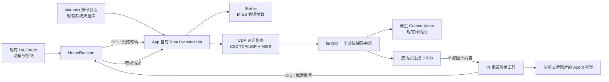

# 米家摄像头原生接入：实时预览与 Agent 取帧

设计日期：2026-11-10。用户确认首版同时支持实时预览与 Agent 按需取帧。本文给出拟实施的接口与决策；当前完成的是 [三台设备的 Mac 协议实测](../xiaomi-camera-community-verification.md)，手机代码尚未改动。

## 推荐方案

把已验证的云账号、CS2 与 MISS 协议移植到 App 自有 Rust 模块。每台摄像头由一个原生会话完成接收、解密和解码，预览与 Agent 共用解码结果。TSX 管理界面与任务；持续视频留在原生侧，只有 Agent 请求的单张 JPEG 进入模型上下文。



现有两台 `isa.camera.hlc7` 与一台 `chuangmi.camera.039a01` 已验证 H.265、CS2/TCP。CS2 仍需先向设备 UDP 32108 发送探测并协商连接，不能因为媒体最终走 TCP 而删掉 UDP 建连部分。云登录和会话参数仍需互联网；媒体使用本机与摄像头的局域网连接。

## 现有代码的接入位置

| 位置 | 当前行为 | 拟改动 |
| --- | --- | --- |
| `apps/nsh/runtime/home.ts` | `startCamera/stopCamera` 串行管理一个 MIoT HLS 句柄 | 管理预览句柄；另提供按 DID 取帧的调用入口，注入原生 CameraHost 契约 |
| `apps/nsh/store.ts` | 用 URL 标识播放器，只有 `playbackKind=hls` 才启动 | 改为原生会话 ID；界面状态跟随原生媒体状态，设备轮询不改变会话身份 |
| `apps/nsh/ui/HomeSpaceView.tsx` | `CameraMonitor` 使用 `<Video src>` | 保留现有监控卡和控件，显示区改为 App 自有 `CameraVideo` |
| `packages/home-devices/src/types.ts` | `playbackKind` 仅有 hls/p2p_pending/unsupported | 增加原生显示后端值，原生能力不再由 HLS 动作是否存在决定 |
| `apps/nsh/runtime/tools/home-tools.ts` | 家居工具结果统一转成文本 JSON | 增加一个返回实际图片内容的 `get_home_camera_frame` 工具 |
| `apps/nsh/src/lib.rs` | 注册 App 自有原生 class | 注册一个 `XiaomiCameraHost`，通过 App 插件注册原生显示组件 |
| `apps/nsh/src/credentials.rs` | Keychain / AndroidKeyStore，允许固定槽名 | 沿用同一后端，增加一个 `camera` 槽，由 Rust 拥有视频账号数据 |
| `apps/nsh/native/android` 与 `scripts/native-plugins.mjs` | App 自有 Java/JNI 与构建插件 | 加入媒体会话、显示组件与注册适配；插件生成阶段接线 |

`playbackKind` 的新原生值表达路由到哪个显示后端；实际厂商协议由 native 会话协商，取帧可用状态来自视频账号的设备发现与实际连接。云端发现中的 DID 与现有卡片关联，不把“存在 HLS action”继续当作原生取流前提。

源码依据：[HomeRuntime](../../apps/nsh/runtime/home.ts)、[store](../../apps/nsh/store.ts)、[详情监控卡](../../apps/nsh/ui/HomeSpaceView.tsx)、[家居工具](../../apps/nsh/runtime/tools/home-tools.ts)、[原生注册](../../apps/nsh/src/lib.rs)、[凭据库](../../apps/nsh/src/credentials.rs)。

现有 `Video` 的 iOS 后端为 URL 驱动的 AVPlayer，Android 为 MediaPlayer；两端都没有编码帧入口。原生组件、显示层与 Android 注册顺序的固定源码证据见 [原生媒体研究](../xiaomi-camera-mobile-native-research.md)。

## 模块职责与协议移植选择

新增实现放在现有 `apps/nsh/src/camera/` 内，按账号云请求、协议加密、CS2、MISS、会话与平台媒体适配分开；不新建 workspace package。对 App 公开一个有状态 class 和一个显示组件，协议结构保持内部实现。

| 选择 | 调用方需要知道什么 | 维护与运行成本 | 结论 |
| --- | --- | --- | --- |
| Rust 协议与原生媒体 | DID、账号状态、预览 ID、单张 JPEG | 移植公开协议；维护两端媒体适配，帧与资源生命周期留在原生侧 | 推荐 |
| TypeScript 协议 + 原生网络／加密原语 | 同样的业务接口，但实现跨 JS 与多个宿主接口 | 还需接入 dgram/net、Node 密钥和 raw ChaCha20 接口；视频包进入 QuickJS 再送回原生解码 | 增加的通用兼容接口多于本需求所需 |
| 嵌入 Go 协议库 | 原生桥接口 | 复用较成熟协议，但增加 Go runtime、跨语言链接及移动打包链 | 当前约束下不采用 |

Rust 模块的收益来自把账号、协议与资源生命周期集中在一个可理解的接口后面。它不扩展成通用媒体框架，也不要求家居数据包依赖 NSH。`packages/home-assistant` 继续提供 MIoT 设备／控制；平台媒体属于 App 原生层。

协议参考固定的 [Python 0.3.10 源码](https://github.com/Kosztyk/xiaomi_camera_native/tree/d1479e4c1f95c37abc9f7774b0d1e2a0dffe4a23/custom_components/xiaomi_camera_native/protocol) 与 go2rtc 的 MIT 源码，保留上游许可和归属。移植包括 RC4 云签名、X25519 后的 HSalsa20 派生、8 字节 nonce 的 raw ChaCha20、CS2 序号与分片、MISS 命令与帧头。不能把 X25519 原始输出或 ChaCha20-Poly1305 当作当前媒体密钥／算法的替代。

## 账号连接

### 两套业务会话的关系

现有 HA OAuth 继续提供设备目录和控制。视频需要 `xiaomiio` 会话中的账号 ID、passToken、serviceToken、cUserId 与 ssecurity；这套会话不能由现有 HA access token 直接生成。

首版选用本次成功的账号／图片验证码／短信或邮箱验证码流程。入口放在现有「家居 → 服务绑定」的米家卡片中，用「连接摄像头视频」表达用途；连接失败只影响视频状态。详情页未连接时指向同一入口。页面复用现有字段、按钮、内联错误和主题，不暴露协议名称、端口或公钥。

视频账号按当前地区发现可访问摄像头，再用 DID 关联现有家居设备；不新增一个重复的家居来源。`HomeEntityDefinition.device_id` 已携带 MIoT DID，可供工具和详情页使用。当前 OAuth 凭据没有保存可直接比较的小米账号 ID，因此不假设两次登录天然属于同一账号；DID 发现结果决定视频账号实际可读哪些设备。

首次原生账号实现优先验证本次使用的中国大陆地区，其他地区按其账号／云端真实响应扩展。既有 HA OAuth 地区配置继续保留。

### 登录成功与续用

- Rust 独占登录尝试及 HTTP Cookie／重定向状态，TSX 只传用户输入、显示挑战和结果。密码只用于当前交互；保存可续用的会话字段。
- 中国区账号请求与重定向统一处理 `account.xiaomi.com` / `cn.account.xiaomi.com`，完整走完身份验证和 STS。当前探针的「验证码成功但回调失败」证明，字段出现不等于视频账号已经可用。
- 成功终态由本来就需要的摄像头发现请求给出：取得真实设备清单后保存账号，不额外增加一轮校验请求。
- 网络错误保留当前回调继续位置；用户点「重试连接」续做这一步，不重新提交密码或自动重发短信。验证码错误保留挑战，允许重新输入；过期时再请求新验证码。
- 登录尝试在 App 暂时切到短信应用时保留内存中的挑战，按尝试期限过期；视频流退后台的释放不清除这段登录交互。关闭登录界面则取消当前尝试。
- `camera` 槽复用系统凭据后端。它与 TS 管理的 `home` JSON 分开，使两个写入方不会覆盖对方保存的数据；不新增数据库或账号存储服务。
- 明确「断开摄像头视频」只清除视频账号；现有「断开米家」应同时结束控制与视频连接，避免同一操作留下用户看不见的账号状态。

从既有网页登录窗口读取 passport Cookie 以减少一次登录，是另一种接口设计：iOS 可以从 WKHTTPCookieStore 读取 Cookie，Android 有 CookieManager。但当前 `MiotLoginBrowser.open` 只接受 OAuth 流程，且本项目未实测该流程能取得所需 passToken；iOS 窗口还使用临时数据存储。首版不依赖这个未验证前提，也不同时维护两套视频登录入口。[现有登录类](../../apps/nsh/src/login_browser.rs)、[iOS Cookie API](https://developer.apple.com/documentation/webkit/wkhttpcookiestore/getallcookies(_:))。

### 云请求模板

移植以 [实际有效的请求组合](../artifacts/camera-cs2-direct/request-comparison.json) 为起点：显式三个账号 Cookie、隔离账号与设备 API 的 Cookie 容器、`Go-http-client/1.1`、不加 `MIOT-ENCRYPT-ALGORITHM` 与 `Accept-Encoding: identity`。成功探针实际使用 HTTP/1.1，aiohttp 默认 `Accept: */*`、`Accept-Encoding: gzip, deflate`。

Rust HTTP 客户端需要明确这些行为和响应解压，再在真机重放同一接口。原探针组合返回 `-12 / throttle deny`，换组合后成功，再切回原组合仍失败；这确定了可工作的组合，未单独定位某一个头的因果关系。云拒绝、登录过期和局域网失败应分别保留错误类别，不能一律要求用户重登。

## 原生会话与两类消费者

### 拟新增的 App 契约

以下是拟议接口，不是当前 NSH 已有导出。由 Rust 导出可生成的 class 方法与数据结构，TS 侧只依赖这个窄接口：

```ts
type CameraAccountStatus = {
  state: "disconnected" | "ready" | "expired";
  region: string;
  accountLabel?: string;
};
type CameraSignInInput = { region: string; username: string; password: string };
type CameraSignInAnswer = { attemptId: string; answer: string };
type CameraSignInStep = {
  attemptId: string;
  kind: "ready" | "captcha" | "verification" | "connection_error";
  image?: string;
  destination?: string;
};
type CameraPreview = { sessionId: string; deviceId: string };
type CameraFrame = {
  deviceId: string;
  mimeType: "image/jpeg";
  data: string;                 // 这一次请求的 JPEG base64
  width: number;
  height: number;
  receivedAt: string;           // 本机收到对应解码帧的时间
};

interface NativeCameraHost {
  accountStatus(): CameraAccountStatus;
  signIn(input: CameraSignInInput): Promise<CameraSignInStep>;
  answerSignIn(input: CameraSignInAnswer): Promise<CameraSignInStep>;
  resumeSignIn(input: { attemptId: string }): Promise<CameraSignInStep>;
  cancelSignIn(input: { attemptId: string }): void;
  signOut(): Promise<void>;
  openPreview(input: { deviceId: string }): Promise<CameraPreview>;
  closePreview(input: { sessionId: string }): Promise<void>;
  capture(input: { deviceId: string; requestId: string }): Promise<CameraFrame>;
  cancelCapture(input: { requestId: string }): void;
  close(): void;
}
```

`CameraSignInStep` 表达 ready、captcha、verification、可续做的网络错误，携带当前 attemptId、挑战图片／掩码收件目标；不把视频账号凭据返回给 TS。`openPreview` 分配会话身份后尽快返回，云配置、连接与解码状态异步更新；不会等出现首帧才允许挂载原生视图。

`HomeRuntime` 包装这些业务调用并关联现有 connectionId。既有 cameraAttempt 保留为 UI 旧响应隔离；实际 socket、解码器与取消的所有权在 Rust。无需再增加一个只转发方法的 TS CameraManager class。

### 持有和释放

- 每个 DID 一个底层传输／解码会话，内部记录预览消费者与待完成的取帧请求。
- 同 DID 的预览和 Agent 请求复用同一连接与 decoder。Agent 请求下一张实际解码帧，完成 JPEG 后释放自己的持有。
- Agent 请求另一台摄像头时，建立短会话，完成后关闭，不打断当前预览。首版按现有单预览、Pi 顺序执行工具的调用形态，最多需要一个预览会话加一个不同 DID 的取帧会话；不发展成多路监控系统。
- `closePreview` 只解绑显示和预览消费者；当前 Agent 请求仍可完成。没有消费者时关闭 socket、解码和像素／纹理资源。
- Agent AbortSignal 映射到 `cancelCapture(requestId)`；取消该请求不关闭仍在预览的同 DID 会话。
- App 退到后台、断开相关账号、关闭原生 Host 时结束所有媒体请求。原生生命周期钩子负责实际释放，即使 JS 已暂停也能执行。App 前台、未打开详情是允许取帧的正常场景。

初次握手超时可在同一请求期限内重新发现地址、获取会话参数并重连一次，依据是天台本次首次超时后重试成功。中途断流先结束失效会话并显示现有重连操作，不加入无期限后台重连。

## 一次解码，分别输出预览和 JPEG

### iOS

采用 `VTDecompressionSession → CVPixelBuffer`。相同像素缓冲一路组装未压缩 CMSampleBuffer 交 AVSampleBufferDisplayLayer，一路在实际取帧请求到达时经 `VTCreateCGImageFromCVPixelBuffer + ImageIO` 编码 JPEG。显示层不再重复解码压缩码流。

最小原生验证可选择支持 CGImage 转换的 BGRA 输出，先证实预览／JPEG 都能工作；它比 NV12 增加像素带宽，后续是否改用更低带宽格式由实测决定。JPEG 不需要单独引入 CoreImage。工作队列持有解码／图像引用，UI 主线程只做视图和显示层操作。

当前生成的开发宿主最低 iOS 为 15.0。共享显示路径应使用该基线可用接口；`sampleBufferRenderer` 是 iOS 17+、`isReadyForDisplay` 是 17.4+。将首次解码、提交显示和实际显示就绪分开记录：17.4+ 可额外观察显示就绪；较早版本不填一个由解码时间冒充的呈现时间。无需为该指标提高整个 App 的系统下限。

### Android

采用 `MediaCodec → 会话自有 SurfaceTexture → EGL`。解码输出 Surface 不属于详情页，媒体线程维持离屏目标；预览可挂载或卸载一个 TextureView window surface。请求 JPEG 时，将同一纹理绘制到离屏目标后 `glReadPixels → Bitmap JPEG`。

这条路径的成本是一个 EGL/OES shader 和离屏／窗口目标的适配；收益是预览期间不逐帧搬运 YUV 到 CPU，同时 Agent 在未打开详情时也能取图。Rust→Java 首版可复制编码包，按需 readback；不先加入共享内存和逐帧 JS 通道。需要在同一媒体线程处理纹理矩阵、时间戳和读回方向，确保预览与 JPEG 的颜色和方向一致。

无 Surface 的 MediaCodec/getOutputImage、ImageReader Surface 与这条路线的具体成本和 AOSP CTS 依据，见 [原生媒体研究](../xiaomi-camera-mobile-native-research.md)。

### 编码包与时间轴

原生内部保留 codec、序号、毫秒 PTS 和 Annex B 字节。平台适配提取 VPS/SPS/PPS，整理访问单元与参数集变化，按会话重建本地时间基。帧队列按实际积压约束；丢弃不能解码的中间依赖帧后等待新的随机访问帧，不能靠无限排队补回延迟。当前三台输入是 H.265，先用这两种实际尺寸验证。

取帧以请求后收到的解码帧完成，不返回上一轮会话的旧图片。`receivedAt` 是本机接收／解码侧时间，不冒充摄像头曝光时间。JPEG 首版限制长边 1024、保持比例、不放大小图，控制模型输入体积；只在请求时编码，不维护持续 JPEG 缓存。

## 预览组件与宿主插件

`CameraVideo` 只接受 sessionId、内容缩放等显示属性，通过一个小状态事件通道向 store 报告连接、解码、显示尺寸与错误。状态由原生会话拥有，组件将状态传给界面；不再用 URL、onLoad 或媒体进度替代实际解码证据。

- iOS：使用固定 NSH 支持的 `#[native_components(ios)]` 和 App 自有 UIView，增加同提交 `nsh-platform-ios` 直接依赖。
- Android：使用 NshView 实例级 `registerComponent`。在现有 SuperLooiApplication 的 `onActivityCreated` 中排队注册，依据固定宿主先 super.onCreate、后 new NshView/load，以及 mount 批次始终 main.post 的执行链。该时序须在首次开发／打包启动中验证。
- 当前 Android 插件 javac classpath 只有 android.jar。优先沿既有反射方式做小型注册适配，媒体本体只引用 Android API；反射不进入逐帧通道。若静态接线已有匹配 runtime jar，则可用 compile-only 输入，避免复制 NSH 接口源码。
- iOS 本地网络访问需要 NSLocalNetworkUsageDescription，通过 `native/plugins.json` 和现有签名前插件写入。CS2 使用云发现 IP 的 UDP 单播／TCP，无需为此新增 Bonjour 浏览。
- 固定 NSH Android target SDK 为 35，已声明 INTERNET；按当前目标不新增 ACCESS_LOCAL_NETWORK。系统文档明确该权限只应在目标 SDK 37+ 请求。

源码与平台依据：[原生注册研究](../xiaomi-camera-mobile-native-research.md)、[现有插件](../../apps/nsh/scripts/native-plugins.mjs)、[Apple 局域网访问范围](https://developer.apple.com/forums/thread/663874)、[Android 本地网络权限](https://developer.android.com/privacy-and-security/local-network-permission)。源代码放在 App 自有 Rust／Java 和插件目录，生成的 `.nsh` 宿主作为构建产物。

## Agent 工具接线

在 `createHomeTools` 中新增 `get_home_camera_frame({ device_id, connectionId })`。设备 ID 来自现有 `list_home_devices`，列表补充该设备是否具备真实摄像头取帧能力。HomeRuntime 将 DID 交给原生 Host；知道镜头关闭时返回相应状态，不以读图请求改写镜头电源或隐私设置。

返回的模型内容形状如下；元数据和实际图片是两个内容块，图片不是放进 JSON 的文字说明：

```ts
return {
  content: [
    { type: "text", text: JSON.stringify({ device_id, received_at, width, height }) },
    { type: "image", data: frame.data, mimeType: "image/jpeg" },
  ],
  details: { device_id, received_at, width, height },
};
```

现用 Pi 1.5.0 的 AgentToolResult 已接受 TextContent/ImageContent；其 Responses 适配会将工具图片转为 input_image。当前 `home-tools.ts` 的文本 result helper 必须为此工具保留图片块。当前 Agent 工具顺序执行，可直接复用请求取消与任务生命周期；取帧按现有只读工具方式注册。

模型入口也必须接通：只有当前模型注册信息含 `input: image` 才启用取帧工具。Pi Responses 适配对 text-only 模型会把图像降成文本占位，这不构成看图；现有自定义模型 metadata 默认 text-only，需依真实能力配置。首版先以现有注册表中的视觉模型验收，沿用用户选定的模型与凭据。

仓库 `vision/provider.ts` 不是当前 NSH Pi 家居工具链，且含未配置时返回模拟识别结果的路径；本接入直接使用 Pi 图片内容，不增加第二套 VLM 配置。现有 SessionTranscriptStore 会保存工具图像内容，沿用其会话语义即可；Langfuse 的工具输出和 LLM 输入当前会记录整段内容，需要在两处观测转换中把图片数据替换成尺寸／类型／字节数元数据，避免重复导出大段 base64，不改变发送给模型的内容。

本地依据：[家居工具](../../apps/nsh/runtime/tools/home-tools.ts)、[模型执行入口](../../packages/looi-runtime/src/agent/core/pi-task-runner.ts)、[模型 metadata](../../packages/looi-runtime/src/agent/llm-providers.ts)、[既有视觉实现](../../packages/looi-runtime/src/vision/provider.ts)、[工具观测](../../packages/looi-runtime/src/agent/core/pi-task-runner.ts)、[LLM 观测](../../packages/looi-runtime/src/telemetry/llm-observer.ts)。Pi 类型与图片转换依据为已安装 1.5.0 的 `pi-agent-core/dist/types.d.ts`、`pi-ai/dist/types.d.ts` 和 `pi-ai/dist/api/openai-responses-shared.js`。

## 依赖与新增成本

| 增量 | 具体用途 | 复杂度成本 |
| --- | --- | --- |
| `XiaomiCameraHost` 与一个 camera 凭据槽 | 一处拥有账号、DID 会话与两类消费者 | 一组原生 class 契约与持有计数；复用既有凭据后端 |
| Rust HTTP／网络 | 云请求、UDP 建连、协商后的媒体连接 | 直接声明现已在锁文件中的 reqwest/tokio，启用需要的网络和响应解压功能；控制 Cookie/重定向行为 |
| Rust 协议密码原语 | 与已成功协议逐字节兼容 | 显式声明锁文件已有的 X25519、ChaCha20、SHA/MD5 依赖；RC4 与 HSalsa20 可用小型 rc4/salsa20 crate，成本是两个直接依赖，协议适配仍由本模块维护 |
| iOS 系统绑定 | 解码、像素缓冲、预览与 JPEG | VideoToolbox/CoreMedia/CoreVideo/AVFoundation/ImageIO 绑定与引用生命周期；无新解码 runtime |
| Android 媒体适配 | 独立纹理、预览输出和按需 JPEG | MediaCodec/EGL/SurfaceTexture/Bitmap 的 App 自有适配与 JNI 接线；使用系统 API |
| 一个 Pi 图片工具 | 让现有 Agent 真正收到拍摄图像 | 工具结果支持图片、模型能力判断与轻量观测转换，沿用现有模型服务 |

RustCrypto 的 [HSalsa20 API](https://docs.rs/salsa20/0.11.0/salsa20/) 和 [RC4 API](https://docs.rs/rc4/0.2.0/rc4/) 提供需要的原语。锁文件已有 x25519-dalek 3.0.0、chacha20 0.10.2、reqwest 0.12.28 等版本，但仍需在所属 crate 明确直接依赖；传递依赖存在不等于当前 App 已经有对应导入接口。

## 实施顺序

- [ ] Step 1：两端最小原生媒体验证
  - [ ] 从调试沙盒读取已有实际 H.265 样本，在真机开发包验证「不打开详情 → 取得 JPEG」；样本不作为发布资源。
  - [ ] 挂载预览并再次取 JPEG，确认同一个 decoder、正确方向与颜色；验证首次组件注册。
  - [ ] 用不同 DID 的两个样本验证一个预览加一个临时取帧会话的解码器分配和资源释放。
  - [ ] 记录所选解码器、输出格式、首张 JPEG、解码和显示各自可观测的耗时。
- [ ] Step 2：Rust 协议与账号
  - [ ] 移植云加密、CS2、MISS；用固定公开密码向量与协议输入验证字节兼容。
  - [ ] 在真机完成中国区账号／验证码／STS 和一次真实设备发现，保存并恢复视频会话。
  - [ ] 对三台摄像头取得 CS2 参数并把实时 H.265 送入同一媒体路径。
- [ ] Step 3：App 与 Agent 联调
  - [ ] 替换详情的 HLS/URL 身份为原生预览句柄，保留现有电源与设备控件。
  - [ ] 接入图片工具和视觉模型；在主页／语音交互中取帧，不要求先进入摄像头详情。
  - [ ] 验证同 DID 共用解码；另一 DID 的单次取帧不打断预览；取消取帧不关闭预览。
  - [ ] 覆盖返回详情、App 退后台、账号断开后的媒体释放与重新进入。
- [ ] Step 4：清理与验收
  - [ ] 移除这条直连路径不再使用的 HLS 会话、URL 状态及过期测试；不在预览失败后自动转回已知 404 的云 HLS。
  - [ ] 用三台真实摄像头完成连续预览和多次按需看图，观察帧率、取帧耗时、播放与退出内存、CPU、重连；指标取自手机。
  - [ ] 更新架构文档、原生插件说明和 MIT 来源归属，完成独立 review 后分阶段提交。

首先验证的工程难点是两端原生组件和「无预览取帧」，然后接通协议和账号，最后迁移页面／Agent。这样媒体验证可以直接使用已经得到的编码样本，不必每改一次显示代码都重新登录和取云端会话参数。执行时开发包安装到真机，原生配置由现有插件生成。
