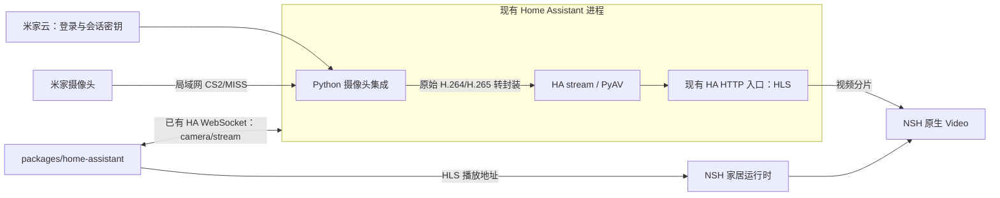

# 米家摄像头取流与 HA 包集成：不新增常驻进程

调研日期：2026-11-10。目标设备：卧室、天台的两台 `isa.camera.hlc7`，大厅的 `chuangmi.camera.039a01`。

## 1. 约束与推荐方向

**不得新增常驻进程。** 采用现有 Home Assistant 进程内的米家取流集成，通过 HA 标准摄像头接口供 `packages/home-assistant` 使用，再交给 NSH 已有原生 `Video` 播放。

优先验证开源项目 `Kosztyk/xiaomi_camera_native` 的 **Original（保留原始编码）模式**。它在 Python 中实现 Xiaomi 云授权、CS2/MISS 会话与 MPEG-TS 转封装，由现有 HA `stream` 集成提供 HLS；无需新建 go2rtc 服务、桥接容器或 Miloco SDK。[固定源码 README](https://github.com/Kosztyk/xiaomi_camera_native/blob/d1479e4c1f95c37abc9f7774b0d1e2a0dffe4a23/README.md)

这是符合约束的实现候选，两个目标型号尚未在该项目完成验证。调研依据和其他路线的源码分析见 [一手证据](../xiaomi-camera-streaming-research.md)。



首版使用 HLS 而非自建 WebRTC 服务，代价是分片与播放器缓存带来的延迟，需要实测。原始码流保留 H.265 时，由手机原生播放器解码；能收到媒体包与手机能实际播放分别验收。

## 2. 本次补充调查的关键结论

### 2.1 当前 HA 已有 go2rtc，但不能直接推导为米家取流可用

只读检查本机 `super-looi-homeassistant` 容器发现：HA 已管理一个 go2rtc `1.9.15` 子进程。无需也不再建议另开一个常驻实例。

不过，HA 的 `_APP_MODULES` 明确只加载通用媒体模块，不含 `xiaomi`；HA YAML 的公开选项也没有追加模块的入口。go2rtc 按该列表初始化，因此“现有进程版本够新”仍不意味着 `xiaomi://` 可用。覆盖 HA 核心代码或临时生成配置会增加版本耦合，不选为首要实现。[HA 2026.11.0 server.py](https://github.com/home-assistant/core/blob/2026.11.0/homeassistant/components/go2rtc/server.py)、[HA 配置入口](https://github.com/home-assistant/core/blob/2026.11.0/homeassistant/components/go2rtc/__init__.py)、[go2rtc 模块初始化](https://github.com/AlexxIT/go2rtc/blob/v1.9.15/main.go)

本方案通过 HA `camera/stream` 请求 HLS，不依赖现有 go2rtc 子进程新增 Xiaomi 模块。

### 2.2 Python 进程内实现可以避免额外 daemon

`xiaomi_camera_native` 调研版本为 `0.3.10`、commit `d1479e4c1f95c37abc9f7774b0d1e2a0dffe4a23`，MIT 许可。其 `protocol/cs2.py`、`miss.py`、`cloud.py` 实现取流，`media.py` 直接封装编码帧；`LoopbackServer` 是 HA 事件循环中的 aiohttp 服务，绑定 `127.0.0.1`，不是新进程。[协议目录](https://github.com/Kosztyk/xiaomi_camera_native/tree/d1479e4c1f95c37abc9f7774b0d1e2a0dffe4a23/custom_components/xiaomi_camera_native/protocol)、[许可证](https://github.com/Kosztyk/xiaomi_camera_native/blob/d1479e4c1f95c37abc9f7774b0d1e2a0dffe4a23/License)

**不能照用上游默认设置。** 默认 H.264 模式会启动 FFmpeg 编码器；Original 模式直接在 HA 进程内转封装。快照实现也会短时启动 FFmpeg。首轮固定 Original，仅请求 HLS 视频，不调用上游快照接口。需要缩略图时，将其 `async_camera_image` 改接 HA 现有 `Camera.async_create_stream()` → `Stream.async_get_image()`；HA 在工作线程中用 PyAV/TurboJPEG 解码并生成单帧，无需新解码器或子进程。[会话实现](https://github.com/Kosztyk/xiaomi_camera_native/blob/d1479e4c1f95c37abc9f7774b0d1e2a0dffe4a23/custom_components/xiaomi_camera_native/protocol/session.py)、[摄像头与快照调用](https://github.com/Kosztyk/xiaomi_camera_native/blob/d1479e4c1f95c37abc9f7774b0d1e2a0dffe4a23/custom_components/xiaomi_camera_native/camera.py)、[HA 现有图片接口](https://github.com/home-assistant/core/blob/2026.11.0/homeassistant/components/stream/__init__.py)、[HA 单帧转换](https://github.com/home-assistant/core/blob/2026.11.0/homeassistant/components/stream/core.py)

正式部署适配必须替换上游覆盖的 `NativeXiaomiCamera.async_camera_image`，不能仅靠应用不主动请求快照，因为 HA UI 本身也可能请求图片。两个 async 方法在 HA 事件循环中依次 `await`，由 HA 内部安排解码线程；外层无需再套线程池。这个小范围补丁随固定版本一起管理。

该项目已验证的设备为 `029a02`、`046c04`、`c301`；不能将它们替换成我们的两种型号。其发现与选择流程允许其他 `.camera.` 设备，`TARGET_MODELS` 只用于显示名，不需要为了选择 hlc7/039a01 修改白名单。`hlc7` 在 go2rtc 有 CS2 成功记录，`039a01` 有另一项目的 CS2 实机报告，足以支持针对性实验，尚不足以确认此 Python 实现兼容。[发现逻辑](https://github.com/Kosztyk/xiaomi_camera_native/blob/d1479e4c1f95c37abc9f7774b0d1e2a0dffe4a23/custom_components/xiaomi_camera_native/protocol/cloud.py)、[go2rtc 型号表](https://github.com/AlexxIT/go2rtc/issues/1982)、[039a01 原始记录](https://github.com/Mi-Bee-Studio/MiBeeNvr/issues/167)

取流集成仍需独立的小米账号会话，现有官方 Xiaomi Home OAuth 不能直接替代。米家云用于登录与建连密钥，视频走局域网。应用侧继续只使用已有 HA 地址和令牌，无需再配置一个媒体服务账号。

## 3. 备选实现比较与复杂性成本

| 路线 | 满足约束的方式 | 实际成本与判断 |
|---|---|---|
| HA 进程内 Python CS2/MISS + Original | 增加一个 HA 自定义集成；取流、转封装复用现有 Python 进程 | 推荐先验证。需要固定上游版本、核对三台固件，以及维护少量配置/型号适配 |
| MIoT `start-hls-stream` 获取摄像头直放地址 | 仅通过云动作返回 URL，调用链最短 | `hass-xiaomi-miot` 有实现，但规格声明不代表动作可用，部分 hlc7 记录存在取流/续流失败；作为有限实验项目，不承诺产品路径 |
| 复用 HA 已有 go2rtc 并启用 Xiaomi | 进程数量不增加 | 当前无公开追加模块配置；若需覆盖 HA 内部启动器，升级维护成本高于独立自定义摄像头集成 |
| 将 go2rtc Go 协议库嵌入 Python/Rust | C ABI 动态库在宿主进程运行 | 上游 Go 库可复用，但需自行写 cgo 桥接、整合 internal 云授权逻辑并处理跨平台构建；有 Python 实现候选后不优先引入 Go runtime |
| 手机原生层直接取流 | 会话仅随应用页面存在 | 双平台协议桥接、登录和编码帧呈现都需适配；相比复用现有 HA，新增维护面更大 |

不新增 workspace 包。TS 接口、HA 端固定版本及部署适配归 `packages/home-assistant` 管理；HA 自定义集成代码安装到已有的 `data/home-assistant/custom_components/`，由现有容器加载。包内的 Python 目录是部署资产，不进入手机 JS bundle。它的具体用途是执行 HA 宿主侧取流，成本是维护一个固定版本的集成，而不是多维护一个服务。

Miloco SDK 仍不作为实现基础：其许可范围限于 Miloco 非商业使用，明确未授权开发其他 App/Web 服务，摄像头文件头也引用该许可。[许可证与 SDK](https://github.com/XiaoMi/xiaomi-miloco/blob/05cdb1c77310afcfb77e64349bfb5efbeebded05/LICENSE.md)

## 4. 包接口与职责

### 4.1 `packages/home-assistant` 封装现有 HA 摄像头接口

推荐接口如下，均为拟议 API：

```ts
interface HomeCameraPlayback {
  entityId: string;
  format: "hls";
  url: string;
}

interface HomeCameraClient {
  start(
    entityId: string,
    options?: { signal?: AbortSignal },
  ): Promise<HomeCameraPlayback>;
}

declare function createHaCameraClient(options: {
  url: string;
  token: string;
  createWebSocket: (url: string) => HomeRegistrySocket;
}): HomeCameraClient;
```

`start` 通过 HA 认证后的 WebSocket 发送 `{ type: "camera/stream", entity_id, format: "hls" }`，取得 `{ url }` 后，以现有 HA base URL 解析为绝对地址。HA 已实现流访问 token；NSH `Video.src` 使用返回的播放地址，不在 URL 拼入 HA 长期令牌。[HA 命令实现](https://github.com/home-assistant/core/blob/2026.11.0/homeassistant/components/camera/__init__.py)、[流入口](https://github.com/home-assistant/core/blob/2026.11.0/homeassistant/components/camera/helper.py)、[HLS 输出](https://github.com/home-assistant/core/blob/2026.11.0/homeassistant/components/stream/hls.py)

可以沿用注册表客户端已有的 WebSocket 工厂与认证处理。第一版创建函数封装请求即可，无需全局会话 class。临时播放地址随运行时会话存在，不存入设备状态快照；`HaTransportAdapter` 继续只负责设备属性与控制。

代表性调用方：`apps/nsh/runtime/home.ts` 在进入摄像头详情时调用 `cameraClient.start(binding.cameraEntityId)`，把结果交给 NSH `Video`。界面离开/退后台时卸载播放器并中止未完成的请求。停止读取后，由 HA stream 和 Python 摄像头会话各自的空闲机制释放资源，不宣称关页面瞬间所有上游连接已经关闭。[HA stream 生命周期](https://github.com/home-assistant/core/blob/2026.11.0/homeassistant/components/stream/__init__.py)

### 4.2 设备绑定和 UI 状态

保留一种持久绑定：`cameraEntityId` 指向取流实体，`applianceId` 固定原卡片的 `${source}:${device_id}` 身份，`devices[]` 保存 MIoT 和 HA 注册表标识。两台相同型号不能靠设备名或型号合并。

原卡片身份同时指定设备控制主来源；新增 camera 实体作为媒体能力附着，避免出现第二张重复摄像头卡片。启停米家/HA 来源不重选卡片 ID。主控制来源不可用时控件不可用，视频是否能播放由取流实体单独决定。

`packages/home-devices` 保存设备电源、休眠与媒体绑定，家居运行时保存 `idle / loading / playing / error` 播放状态。删除固定 `2K HD` 和“电源开即视频就绪”的推断。NSH `Video.onLoad` 提供媒体尺寸，`onProgress` 提供播放进展；不能将请求返回地址或 `onLoad` 直接当作真实首帧。真机确认画面，并按需要在应用自有原生组件补充首帧事件。

## 5. 播放与功能取舍

NSH 固定版本已提供原生 `Video`（Android MediaPlayer / iOS AVPlayer）。优先测试 H.265 HLS 原始流，复用系统硬件解码，不引入 WebRTC SDK、内嵌网页播放器或服务器端常驻转码。[NSH 固定版说明](https://github.com/longbridge/nsh/blob/e626a8dd8f8d8b277b9507cfd5ac74d0e67020f3/website/docs/web-view-and-video.md)

需要实测的是 **当前播放器对 HA HLS 分片中的 H.265 支持及延迟**，硬件解码能力本身不能代替结果。HA 的 LL-HLS（低延迟 HLS）设置与播放器实际行为一起测量，不沿用上一版 WebRTC 的两秒延迟目标。若原始码流不能在手机播放，先比较应用进程内解码或 HA 进程内 PyAV 编码的具体成本，再修改选型；不会因此自动引入服务端 FFmpeg 常驻转码。

Python 上游当前是 video-only（仅视频），音频不在这条实现中。首版目标是三台摄像头的真实画面；摄像头声音和双向对讲需要后续增加媒体轨道，不能据画面成功一并宣称可用。

## 6. 实施与实验步骤

### Step 1：HA 内直接取流

- [ ] 固定并核对 Python 集成源码，配置 Original；部署适配替换上游快照覆盖为 HA 进程内接口，确认目标型号发现与选择规则。
- [ ] 逐台验证卧室 hlc7、天台 hlc7、大厅 039a01；记录固件、CS2 建连、编码、首个可解码画面。
- [ ] 通过 `camera/stream` 请求 HLS，首轮不请求快照、不启用 H.264 转码。
- [ ] 对比空闲与播放期间进程，确认没有新增常驻服务或 FFmpeg 编码器；HA 内线程和异步任务按需工作。
- [ ] 若使用现有 Mac Docker Desktop 的网络，实测摄像头 UDP/TCP 握手；不能将之前“原生 Mac 进程可规避容器网络”的建议当作此路线已解决网络的证据。

### Step 2：封装包能力与设备绑定

- [ ] 新增 `camera/ha-camera-client.ts` 与摄像头类型，复用已有 HA 认证与 WebSocket 工厂。
- [ ] 固定卡片身份和控制主来源，把媒体实体附着到既有卡片。
- [ ] 替换就绪占位文案；移除分辨率和播放状态的电源推断。
- [ ] 检查两台同型号绑定、取消请求、切换家庭后旧播放结果的处理。

### Step 3：魅族真机播放

- [ ] NSH 原生 `Video` 播放三台 HLS，记录首帧、稳定延迟、分辨率和连续播放 15 分钟结果。
- [ ] 检查切换设备、离开详情、应用前后台，以及 HA 空闲释放时间。
- [ ] 记录单路/三路播放的 HA 负载；HLS 缓存延迟与原始流解码问题分别定位。
- [ ] 只向真机安装开发包；iPhone 可用时独立验证 AVPlayer 行为。

### Step 4：部署与维护

- [ ] 将固定集成版本和所需配置纳入 HA 包的部署说明，沿用现有 HA 地址和账号入口。
- [ ] 缩略图接 HA 现有 `async_create_stream()` / `async_get_image()`，替换上游 FFmpeg 快照调用并复用原视频会话。
- [ ] 对包协议、设备绑定和播放生命周期执行现有体系内的必要验证，并更新实际架构文档。

## 7. 实施前仍需回答的问题

1. Python CS2/MISS 实现是否兼容这三台设备的固件，尤其是大厅 039a01。
2. 当前 Mac Docker Desktop 网络是否允许所需的摄像头握手与媒体传输。
3. 魅族 MediaPlayer 与 iPhone AVPlayer 能否直接播放 HA 输出的原始 H.265 HLS。
4. HLS 延迟能否满足日常查看监控，以及无人观看后的实际释放时间。

上述结论通过有界 PoC 取得后写入型号和部署记录；包封装不掩盖型号或播放器尚未验证的事实。
