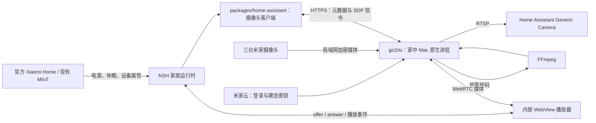

# 米家摄像头独立取流与 HA 包集成方案

调研日期：2026-11-10。目标设备为卧室、天台的两台 `isa.camera.hlc7`，以及大厅的 `chuangmi.camera.039a01`。

## 1. 建议采用的路线

采用 **go2rtc 独立取流 + `@super-looi/home-assistant` 统一摄像头接口 + NSH 内嵌 WebRTC 播放**。同一份流也通过 RTSP 提供给 Home Assistant 的 Generic Camera 集成。

这里的“集成到 HA 包”具体指：应用通过现有 `packages/home-assistant` 使用摄像头能力，设备绑定、取流元数据与信令协议都由这个包封装；加密握手、媒体传输和转码由家中常驻机器上的 go2rtc/FFmpeg 执行。手机上的 TypeScript 包不运行 Go 进程，也不重新实现米家 P2P 协议。

这能补齐官方 Xiaomi Home 集成缺失的实时画面。能否覆盖这三台设备、画面延迟和并发效果，分别由下文的实机实验确认，不能从“设备已导入”推导。



媒体和信令是两条连接：HTTPS 交换 SDP（会话描述）成功，不代表 WebRTC 媒体已经到达手机。[go2rtc WebRTC 文档](https://github.com/AlexxIT/go2rtc/blob/v1.9.15/internal/webrtc/README.md)

## 2. 已确认的事实与设备证据

| 项目 | 结论与依据 |
|---|---|
| 官方 Xiaomi Home 集成 | 明确不提供摄像头视频；其 OAuth 客户端不能协商视频密钥。[官方说明](https://github.com/XiaoMi/ha_xiaomi_home/wiki/Features-that-will-not-be-implemented#camera-video-stream) |
| go2rtc 调研基线 | 使用 `v1.9.15`，有 macOS ARM64 发布物；具体源码、账号与型号证据见 [调研记录](../xiaomi-camera-streaming-research.md)。 |
| 卧室、天台 `isa.camera.hlc7` | go2rtc 维护者的已工作型号表列有该型号，并注明启动 SD 画质时存在 H.265 SPS 参数问题；支持记录不能替代本机固件实测。[型号记录](https://github.com/AlexxIT/go2rtc/issues/1982) |
| 大厅 `chuangmi.camera.039a01` | go2rtc 汇总表未明确列出同一型号；MiBeeNvr 原作者有该型号 `vendor=cs2` 的实机记录，可作为候选依据，仍需用 go2rtc 实际登录、建连和解码。[原始记录](https://github.com/Mi-Bee-Studio/MiBeeNvr/issues/167) |
| 登录与联网 | go2rtc 的 Xiaomi 模块使用自己的小米账号会话；每次连接摄像头需联网取得加密参数，媒体连接走局域网。[Xiaomi 模块](https://github.com/AlexxIT/go2rtc/blob/v1.9.15/internal/xiaomi/README.md) |
| HA 接收独立视频 | Generic Camera 接受 RTSP，HA 的 `go2rtc` 集成可以连接自建实例；仅配置 `go2rtc.url` 不会自动生成米家摄像头实体。[Generic Camera](https://www.home-assistant.io/integrations/generic/)、[go2rtc 集成](https://www.home-assistant.io/integrations/go2rtc/) |

两类登录应独立保存：现有 MIoT OAuth 用于设备控制，go2rtc 小米账号会话用于视频。账号区域要与摄像头所在米家区域一致。前端可以把两次设置放在同一“家居服务”入口，但不能声称一次授权已经覆盖两种协议。

Miloco 的限制也不只是“禁止商用”：其原文将授权限于 Miloco 项目的非商业使用，并明确未授权把授权作品用于开发其他 App、Web 服务等软件；`camera.py` 文件头直接引用这份许可。因此，本项目独立集成该 SDK 不能仅凭“免费使用”认定已获得授权。[许可证原文](https://github.com/XiaoMi/xiaomi-miloco/blob/05cdb1c77310afcfb77e64349bfb5efbeebded05/LICENSE.md)、[SDK 文件头](https://github.com/XiaoMi/xiaomi-miloco/blob/05cdb1c77310afcfb77e64349bfb5efbeebded05/backend/miot/src/miot/camera.py)

## 3. 路线比较与复杂性成本

| 路线 | 能获得什么 | 新增成本 | 选择 |
|---|---|---|---|
| go2rtc 原生进程 | 米家 P2P 取流、标准媒体输出、HTTP 信令；MIT 开源实现 | 一个常驻进程、独立账号会话；需要转码时安装 FFmpeg | 推荐 |
| 官方 Miloco SDK / micam | 复用官方视频 SDK 和其支持型号 | SDK 二进制、平台 ABI 与额外服务；其 SDK 许可证对其他应用的使用有限制，不能只看仓库外层开源许可 | 不作为本项目实现基础；原文见调研记录 |
| `ha-xiaomi-camera` | 现成 HA 摄像头实体和桥接界面 | HA 集成加桥接服务，并引入 SDK、Python 媒体依赖和转码组件；当前项目是 HA Container，也不能直接照搬 add-on 安装步骤 | 本项目直接接 go2rtc 更贴合部署方式 |
| 自己在 TypeScript/Rust 重写米家协议 | 可在包内控制全部协议细节 | 小米登录、P2P、密钥、RTP 与型号差异都变成自维护代码 | 收益不足以抵偿维护成本 |

不新增 workspace 包。摄像头能力与现有家居设备发现、设备身份、账号连接共同使用，放进 `packages/home-assistant/src/camera/` 能集中这些变化；go2rtc 作为运行依赖，不加入 npm 依赖树。

## 4. 与现有代码的衔接

| 当前代码 | 观察 | 方案中的职责 |
|---|---|---|
| `packages/home-assistant/src/types.ts` | `HaTransportAdapter` 只有属性读写、健康状态 | 保留设备控制接口；视频另设客户端，因为 SDP 与媒体生命周期无法用属性回读表达 |
| `packages/home-assistant/src/miot/miot-entity-mapper.ts` | 直连设备的 `device_id` 是米家 DID | 用作直连设备与流的明确绑定依据 |
| `packages/home-assistant/src/transports/ha-registry.ts` | HA `device_id` 是注册表 ID；未导出设备 `identifiers` | 第一版用显式绑定保存 HA 注册表 ID，避免通过名称、型号猜测同一摄像头 |
| `packages/home-assistant/src/transports/ha-rest-transport.ts` | 状态属性只保留遥测字段 | 视频信令通过新客户端传输；无需把摄像头凭据 URL 塞入状态快照 |
| `packages/home-devices/src/device-aggregator.ts` | 当前以电源状态设置 `streamActive`，分辨率固定为 `2K HD` | 聚合层保留设备状态，追加摄像头绑定；分辨率来自实际播放帧，播放状态来自播放器 |
| `apps/nsh/runtime/home.ts` | 前台连接 owner、切换连接代际和设备聚合已存在 | 持有摄像头客户端、绑定设置及当前播放会话的取消信号 |
| `apps/nsh/ui/HomeSpaceView.tsx` | 摄像头视窗由图标和文字组成 | 用可播放画面替换中心占位区；设备开启与画面播放分别呈现 |

### 4.1 包接口：封装元数据和信令

建议在根导出中增加下列接口；这些是拟议 API：

```ts
interface CameraStreamInfo {
  streamKey: string;
  configured: boolean;
}

interface HomeCameraClient {
  listStreams(options?: { signal?: AbortSignal }): Promise<CameraStreamInfo[]>;
  answer(
    streamKey: string,
    offer: { type: "offer"; sdp: string },
    options?: { signal?: AbortSignal },
  ): Promise<{ type: "answer"; sdp: string }>;
}

declare function createGo2RtcCameraClient(options: {
  url: string;
  username: string;
  password: string;
  fetch?: typeof fetch;
}): HomeCameraClient;
```

`listStreams` 只返回已配置的流名与配置状态，不把 go2rtc 返回的 producer URL、账号信息转交 UI；它也不将“已配置”解释成“正在播放”。`answer` 使用已公开的 `POST /api/webrtc?src=<streamKey>` JSON offer/answer 接口。[go2rtc API](https://github.com/AlexxIT/go2rtc/blob/v1.9.15/website/api/openapi.yaml)

比较过只提供 `getPlaybackUrl()` 的接口：它最短，但调用方仍需重复处理认证、SDP 请求和取消。上面的客户端封装这些协议细节，同时不持有原生播放器。创建函数返回闭包即可；现阶段不需要带全局会话表的 class（类）或多提供者注册系统。端点、凭据和 `fetch` 的生命周期跟随现有 home runtime owner。

代表性调用关系：

```ts
// WebView 生成并收集完整 ICE offer 后，通过 onMessage 交给家居运行时。
const answer = await cameraClient.answer(binding.streamKey, offer, {
  signal: playbackAbort.signal,
});
// 运行时经现有 WebViewRef.postMessage 将 answer 交回播放器。
// 页面退出：播放器关闭 RTCPeerConnection，运行时中止仍在等待的信令请求。
```

客户端不删除 go2rtc 的流配置；关闭手机播放只关闭该消费者，不能中断仍在 HA 看画面的其他消费者。

### 4.2 设备绑定：一台摄像头，一张卡片

新增一种持久配置，用稳定的 go2rtc 流名连接不同来源的设备标识：

```ts
interface HomeCameraBinding {
  streamKey: string; // 例如 looi_roof；持续使用该名字，不依赖设备显示名
  applianceId: string; // 首次选择的现有卡片 ID，格式为 source:device_id
  devices: Array<{
    source: "direct_miot" | "external_ha";
    deviceId: string; // 对应来源现有的 device_id
  }>;
  haCameraEntityId?: string; // 例如 camera.looi_roof
}
```

必要性：两台 `isa.camera.hlc7` 具有相同型号，房间和名字又允许修改；HA 注册表 ID 也不是米家 DID。显式配置的成本是首次绑定一次，收益是摄像头控制、HA 播放实体和真实流准确落到同一张卡片。

`applianceId` 持久保存用户首次选择的原卡片身份，同时指定控制主来源；聚合器只从与它对应的记录组装电源、模式和动作，其他设备记录及 HA camera 实体附着到这张卡片。启停某一路来源不重新挑选主记录，卡片 ID、布局和详情选中 ID 保持稳定；主控制来源未启用时，相关控件显示不可用，视频仍按独立媒体连接工作。名称、房间等展示字段可取仍可见的绑定设备元数据。这样无需新增单独的卡片 ID 生成规则或自动控制来源切换逻辑。

官方 `xiaomi_home` 的设备 `identifiers` 含区域和 DID，可供后续自动匹配，但需先扩充注册表元数据；第一版三个绑定无需引入新的通用设备身份系统。[官方源码](https://github.com/XiaoMi/ha_xiaomi_home/blob/main/custom_components/xiaomi_home/miot/miot_device.py)

### 4.3 播放会话归家居运行时，展示归 UI

`VisionStreamCapability` 保留摄像头电源、休眠、模式等设备能力，并增加绑定流名。播放器状态单独由运行时保存，采用 `idle / connecting / playing / error`，离开详情页时释放。不能继续把电源 `isActive` 当成 `streamActive`。

收到 SDP answer 或 WebView `onLoad` 时仍处于 `connecting`。内嵌页面通过 `requestVideoFrameCallback` 观察实际呈现帧，再上报首帧、宽高和后续帧进展；停止产生新帧或连接失败时更新播放状态。卡片显示设备在线状态，详情页的“播放中”和分辨率使用这些真实事件。

首版只在进入摄像头详情后取流，默认静音；离开页面、退出账号、切换家庭连接或应用退后台时关闭 PeerConnection 并取消信令。HA 与手机共享同一 go2rtc 流名，由 go2rtc 按消费者管理源流。首页缩略图可在核心链路完成后使用其 JPEG 接口，避免首页三路视频常驻解码。

## 5. NSH 播放选型与编码

项目固定 NSH 修订为 `e626a8dd8f8d8b277b9507cfd5ac74d0e67020f3`。本机生成类型已经提供 `WebView.html`、`onMessage`、`WebViewRef.postMessage`，以及原生 `Video`；不需要为了嵌入画面先加入 React Native 播放器。

| 实现 | 收益 | 成本与选型 |
|---|---|---|
| 内嵌 WebView + WebRTC | 适合实时监控；播放器生成 SDP，包负责信令，媒体直接到播放器 | 推荐。需验证当前手机 WebView 的编码支持、内联播放与生命周期 |
| 原生 Video + HLS | NSH 已有播放器，HA 和 go2rtc 都能输出 HLS | 分片缓存会影响实时性；作为对照实验测量，不同时交付两套播放器和自动切换逻辑 |
| 新增原生 WebRTC SDK | 可直接控制原生 PeerConnection | 引入双平台构建、ABI 和额外生命周期；现有 WebView 未证明不能满足前不引入 |

原生 WebView 容器也需要核对具体配置：固定版 iOS 实现构造默认 `WKWebViewConfiguration`，未设置 `allowsInlineMediaPlayback`；Android 实现未显式设置 `setMediaPlaybackRequiresUserGesture`。因此第一轮真机 PoC 必须检查是否可内联显示，以及是否需要一次播放器内点击。若要补充配置，使用应用自有注册组件/插件集中设置，不修改生成的原生工程。[NSH 固定版 iOS 源码](https://github.com/longbridge/nsh/blob/e626a8dd8f8d8b277b9507cfd5ac74d0e67020f3/crates/nsh-platform-ios/src/web.rs)、[Android 源码](https://github.com/longbridge/nsh/blob/e626a8dd8f8d8b277b9507cfd5ac74d0e67020f3/crates/nsh-platform-android/java/com/longbridge/nsh/WebBox.java)

内嵌 HTML 通过 `window.nsh.postMessage` 与运行时通信；原生 `fetch` 发信令，避免浏览器再持有一份服务认证。`nsh.json` 需声明 `webview` 能力；内嵌 HTML 可使用 `{ "hosts": [] }`。现有网络能力已允许 HTTPS GET/POST，足够覆盖所选的查询与 JSON SDP 接口。[NSH 固定版能力说明](https://github.com/longbridge/nsh/blob/e626a8dd8f8d8b277b9507cfd5ac74d0e67020f3/website/docs/sandbox-and-capabilities.md#webview)

编码先测原始流：记录每台实际分辨率、H.264/H.265 与音频编码。H.265 不能仅凭手机硬件支持就推定其 WebView WebRTC 可用。确有播放不兼容时，go2rtc 调用 FFmpeg 生成一条按需的 H.264 播放流，音频确有需要时转 Opus；HA 可继续消费原始 RTSP。转码的用途是统一客户端编码，成本是主机的 CPU/GPU 与额外媒体处理，不能对所有流默认转码。[go2rtc 编码支持表](https://github.com/AlexxIT/go2rtc/blob/v1.9.15/README.md#codecs-madness)、[FFmpeg 模块](https://github.com/AlexxIT/go2rtc/blob/v1.9.15/internal/ffmpeg/README.md)

## 6. 部署与账号配置

推荐在家中常驻 Mac/Mac mini 上运行原生 macOS ARM64 go2rtc，HA 保持现有 Container 形态。原生进程直接使用主机局域网；不把 Linux 的 `network_mode: host` 效果直接套用到 Mac Docker Desktop。其 Xiaomi P2P 握手是否能经过容器网络须独立实测，第一轮使用原生进程减少这层变量。

部署内容：

1. 固定 go2rtc 版本，配置与小米会话存于被 Git 忽略的 `data/go2rtc/`；首次通过 go2rtc 登录，应用只保存媒体服务连接设置。
2. 为三台摄像头建立稳定流名。确认实际摄像头 IP，记录小米账号区域及 DID；依据各台取流结果配置画质，不统一强制未知的 `subtype=3`。
3. 由 go2rtc 自带 TLS 提供手机访问的 HTTPS API；部署需确定手机可解析的域名、与该域名匹配且被当前开发包信任的证书链。本仓已有 HA 安装记录是 HTTP，不能据此假定存在可复用的 HTTPS 证书。第一轮 PoC 以手机原生 `fetch` 成功执行 JSON SDP POST 确认这条路径，再固定证书配置；不新增一个 Node HTTP 代理服务。其 WebRTC 候选地址填写手机可达的主机局域网地址，验证 `8555` 的实际媒体连通。[API TLS 配置](https://github.com/AlexxIT/go2rtc/blob/v1.9.15/internal/api/README.md)、[WebRTC 网络](https://github.com/AlexxIT/go2rtc/blob/v1.9.15/internal/webrtc/README.md)
4. HA Container 经可达的主机地址读取 `rtsp://<host>:8554/<streamKey>`，为每台添加 Generic Camera；容器中的 `localhost` 仍指容器自己。自建 go2rtc 不会仅因 HA 自带 go2rtc 就被自动采用。
5. 本地开发所需服务地址、API 认证与证书路径放入 `.env`；应用连接凭据沿用现有加密 vault。小米取流会话只在取流主机保存。

HTTPS 信令和 RTSP 接入都无需新增 HA Python 自定义集成。方案首先提供家中局域网播放；外出访问时，HA HTTPS 入口本身不会转发这条直连 WebRTC 媒体，需另行确定可达媒体路径，不能据此宣称已支持远程监控。

## 7. 实施步骤与有意义的验收

### Step 1：三台真实摄像头的取流 PoC

- [ ] 原生 go2rtc 登录后逐台建立流：先卧室 `hlc7`，再天台同型号，最后大厅 `039a01`。
- [ ] 用实际解码画面确认每台可用；保存版本、固件、所选画质、音视频编码与分辨率。
- [ ] 确认手机解析媒体服务域名、当前开发包信任其证书链，并由手机原生 `fetch` 完成一次 JSON SDP POST；随后确认 WebRTC 媒体连通。
- [ ] 对 `hlc7` 复现或排除上游启动 SD 参数问题；对大厅型号明确原始协议是否成功，不用相似型号替代结论。
- [ ] 同一台先测一个消费者，再同时由 HA 和手机浏览器播放，记录是否复用源连接。
- [ ] 记录冷连接到首帧、稳定播放延迟、连续播放 15 分钟的中断情况、开启/关闭转码的主机负载；这些是实验结果，预设目标为局域网首帧 5 秒内、稳定画面延迟 2 秒内。

这一阶段决定型号覆盖，不必先做完整设置页。

### Step 2：封装 `packages/home-assistant` 摄像头能力

- [ ] 新增 `camera/` 下的类型与 go2rtc 客户端，根导出加入摄像头接口。
- [ ] 新增显式设备绑定，接入 home runtime 的保存、加载和连接代际。
- [ ] 摄像头聚合合并控制与播放实体，持久保存原卡片 ID 和控制主来源；启停米家或 HA 来源后保留位置与详情身份。
- [ ] 删除固定分辨率与“电源开即视频就绪”的推断；未连接播放器时显示设备状态与播放入口。
- [ ] 验证两台同型号不会串绑、退出后未完成的信令不会进入新连接、客户端仅输出其公开元数据。

### Step 3：魅族 20 Pro 真机内嵌播放

- [ ] NSH 内嵌 HTML 生成 recvonly（只接收）WebRTC offer，收集 ICE 完成后调用包接口取得 answer。
- [ ] 通过真实帧回调上报首帧和分辨率；先验证原始流，再按测量结果配置转码。
- [ ] 检查进入/离开详情、连续切换三台、前后台切换和同时使用 HA 的播放行为。
- [ ] 静音播放不争用当前语音会话；用户打开摄像头声音时验证现有音频会话的实际交互。
- [ ] 只安装开发包到真机。iPhone 可用时再验证 iOS 内联播放配置与编码，不使用模拟器结果替代。

### Step 4：家居设置和可复用部署交付

- [ ] 家居服务入口配置媒体地址、API 认证与三台摄像头绑定；小米取流登录状态可从部署端查询。
- [ ] 记录原生 Mac 运行与 HA Generic Camera 配置方法；选用现有进程管理方式保持常驻。
- [ ] 将包协议、家居聚合和播放器生命周期相关用例纳入各包现有测试；以真机画面完成视频验收。
- [ ] 实现改变实际运行架构后更新 `docs/arch/index.html`。

## 8. 仍需实验回答的问题

1. 三台现有固件分别能否在原生 Mac go2rtc 上持续取流，尤其是 `039a01`。
2. `hlc7` 首次建连画质和 SPS 问题在当前固件是否存在，以及最佳画质参数。
3. 魅族 WebView 是否直接播放这些 H.265 流；需要 H.264 时的转码负载与延迟。
4. 固定版 NSH WebView 的内联/用户手势设置是否需要应用自有注册组件补齐；iOS 结果单独记录。
5. 两个消费者共用源流的实际表现，以及开始/停止播放后的源连接释放时间。

这些问题的结论由 Step 1 和 Step 3 写回型号记录与部署文档，不在适配层预先加入多级自动回退。
