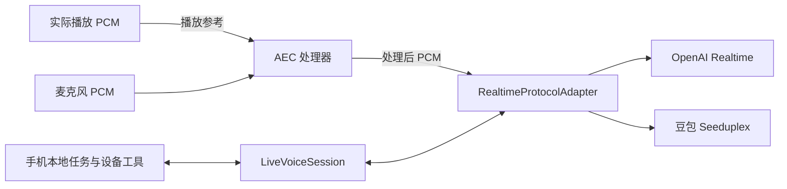

# 通用 Realtime 接入与独立 AEC 调研

核验日期：2026-11-12。目标是让 iOS / Android 使用同一套独立音频处理，并同时对接 OpenAI Realtime 与豆包 Seeduplex `1.2.6.1`，保留手机本地 Agent、家居／底座工具、KWS（唤醒词）与主动播报。

## 结论与优先比较对象

两条路线可以组合：AEC 处理器在手机上传前处理声音，Realtime 框架管理会话、工具和模型事件。通用性分别来自这两个边界。

- **独立模型方向可行。** LocalVQE 提供公开 GGUF 权重、推理实现与 C API，最符合“拿模型配独立推理器”的要求；AEC3 家族提供无需权重的通用处理路线，Sonora 是适合现有 Rust 宿主的移植候选。
- **用户的 `aec.model` 有独立运行的调查入口。** 文件使用 SAMI 标识，官方确有独立 SAMICore AEC 接口；但仍需匹配的运行库与离线授权，尚未证实这份 SpeechEngine 模型可直接装入独立 SAMI 运行库。
- **完整框架以 LiveKit 最接近目标。** 官方 OpenAI 插件配中文社区 Seeduplex 插件已覆盖两种协议，但社区插件有工具回传和音频截断缺口。Pipecat 需要自写豆包服务。按当前手机本地运行形态，优先引入独立 AEC 的收益更集中。

## 用户提供模型与独立 SAMI 路线

只读检查 `/Users/bugyaluwang/Downloads/aec.model`：大小 **100076 字节**，开头四字节为 ASCII `SAMI`；未读出可识别的输入／输出张量和网络定义。该结果指向 SAMI 封装，尚无将它作为 ONNX / TFLite 资产直接加载的依据。

火山音频技术文档提供独立 C 处理器，调用顺序为创建 handle、给入 mic / ref 双路 PCM、执行 `SAMICoreProcess`，最后释放。V2 文档区分两条路径：

| 路径 | 算法标识与模型 | 公开接口要求 |
| --- | --- | --- |
| 神经 AEC | `SAMICoreIdentify_RNNAEC`；16kHz 对应 `aec.model`，44.1kHz 对应 `aec44k.model` | 将模型字节、采样率、最大块长交给创建函数；PCM 为 Planar Float |
| DSP AEC | `SAMICoreIdentify_AEC` | 以 `SAMICore3ACreateParameter` 创建，文档示例不传神经权重 |

这套接口只承担音频处理，可在处理后继续使用现有任一 Realtime API。文件名和头部仍不足以确定用户模型与公开 V2 / V3 算法版本的对应关系，当前没有执行模型加载或推理。[官方 C AEC V2](https://docs.volcengine.com/docs/audio-technology/cechocancellation-v2?lang=zh)、[C AEC V3](https://docs.volcengine.com/docs/6489/193326)。

官方提供 **纯离线音频 SDK**，包含回声消除，列出了 Android `.so` / `.aar` 和 iOS 静态／动态库；纯离线版不要求在线版的 TTNet 依赖。公开下载页当前展示 Android / iOS 静态库 `8.0.2-tobsdk`、iOS 动态库 `8.0.3-tobsdk`，页面更新日期为 2023-11-13，不能将其视为已经验证适配当前手机的交付包。[SDK 下载](https://docs.volcengine.com/docs/6489/72021)、[集成指南](https://docs.volcengine.com/docs/6489/72014)。

音频增强能力集需要独立的离线功能授权，官方要求 APPKEY / TOKEN，并通过商务获取；这与 SpeechEngine 的 Realtime API Key 是不同的授权入口。采用 SAMI 路线的具体成本是原生库、授权生命周期、模型版本匹配与双路 PCM 接线。它能够解除与豆包实时会话 SDK 的耦合，仍保留 SAMI 运行库依赖。[能力集与授权要求](https://docs.volcengine.com/docs/audio-technology/introduction-to-audio-noise-reduction-and-enhancement-capability-set?lang=zh)、[授权介绍](https://docs.volcengine.com/docs/6489/192662)。

## 方向一：独立 AEC 模型与处理库

## 值得深入的三个开源候选

### 1. WebRTC APM / AEC3：成熟算法与独立 Rust 接法

上游 `AudioProcessing` 将采集帧交给 `ProcessStream`、播放参考交给 `ProcessReverseStream`，提供 `set_stream_delay_ms`；其设计明确要求靠近设备 HAL（硬件抽象层）。按约 10ms PCM 帧处理，可在当前 16kHz 采集链路把每个 20ms 包拆为两个 160 样本块。播放参考应取实际即将送往设备的音频，并按处理器要求重采样；不能把网络到包时刻等同于播放时刻。[上游固定版本接口](https://webrtc.googlesource.com/src/+/7cfcf6dc8e6573d09d967d1641fc7bbcf65bd499/api/audio/audio_processing.h)。

这套 AEC3 的普通路径使用自适应滤波和回声抑制，可不带独立模型权重。新增成本主要是处理器依赖、双流帧缓冲、延迟信息与原生音频工作线程，而不是迁移 Realtime 服务商。

| 接法 | 可用接口与维护证据 | 本项目成本 |
| --- | --- | --- |
| 上游 C++ APM / PulseAudio 独立打包 | WebRTC 提供公开 C++ APM；PulseAudio 将其独立成库。`tonarino/webrtc-audio-processing` 提供 Rust 包装，当前核对 `2.1.0`，支持 `bundled` 静态编译，2026-07-16 有提交。 | 增加 C++、Meson/Ninja 等构建链；移动端需要交叉编译和 Rust FFI（外部函数接口）。Rust 包装本身不是已验证的本项目移动构建。 |
| Sonora 纯 Rust 移植 | `sonora` / `sonora-aec3` 为 BSD-3-Clause；核对 `0.3.0`、Rust 1.91，2026-11-07 提交。API 提供 `process_render_f32`、`process_capture_f32`。作者 CI 列 Android 交叉构建与 iOS 模拟器构建测试。 | 避免 C++ / 外部推理 runtime，适合现有 Rust 宿主；增加一组 Rust DSP crates。算法来自 WebRTC，但移植工程的成熟度需单独评价。 |

Sonora 的性能数字来自 M4 Max，不是 iPhone 或 Android 真机；上游 C++ 测试对照也不等于手机外放验收。其 README 明确没有移植上游实验性的神经残余回声估计器，普通 AEC3 不依赖这一模型。[Rust 包装固定提交](https://github.com/tonarino/webrtc-audio-processing/tree/07b220c62ab57f3a2bd16f03dc6efae599d251aa)、[Sonora 固定提交](https://github.com/dignifiedquire/sonora/tree/1632d47c1e77d0857f9145bd175134b348541e11)、[实际双流 API 示例](https://github.com/dignifiedquire/sonora/blob/1632d47c1e77d0857f9145bd175134b348541e11/crates/sonora/examples/simple.rs)、[神经估计器范围](https://github.com/dignifiedquire/sonora/blob/1632d47c1e77d0857f9145bd175134b348541e11/crates/sonora-aec3/README.md)。

### 2. LocalVQE：可脱离语音 SDK 使用的神经 AEC 模型

LocalAI 作者项目直接提供 GGUF 权重、C++17 / GGML 推理实现与 C API。所有模型要求 16kHz 单声道 mic + ref，流式接口 `localvqe_process_frame_f32` 每次处理 256 样本（16ms），不是上传完整录音后离线处理。[固定版本 README](https://github.com/localai-org/LocalVQE/blob/7f61cd05095d42e56a135b303f5bb4d761da22b9/README.md)、[C API](https://github.com/localai-org/LocalVQE/blob/7f61cd05095d42e56a135b303f5bb4d761da22b9/ggml/localvqe_api.h)。

| 模型 | 公开资产与用途 | 已发表性能证据 |
| --- | --- | --- |
| `v1.4-AEC` | 约 203K 参数，F32 权重约 3MB；自适应前端加神经 mask，仅去回声，保留环境声。 | 作者 Ryzen 9 7900 单线程 p50 1.29ms / p99 1.89ms，每帧预算 16ms。 |
| 49K compact GTCRN-AEC | 小型 AEC 网络与 DSP 前端组合，提供完整增强与仅回声两个版本。 | 作者在 Raspberry Pi 5 / Cortex-A76、Ubuntu 上给出单线程约 0.78ms / 16ms hop；这是 ARM 设备测量，不能替代目标手机测量。 |

compact 的 49K 指网络规模；C API 要求模型中已内嵌回声前端，或另指定 v1.4-AEC GGUF / `frontend_path`。模型卡列自包含 compact GGUF 约 2.3MB，不能按“只有 49K 权重”估计完整接入成本。

项目最后核对提交为 2026-10-19，代码 LICENSE 与作者模型卡均声明 Apache-2.0。它确实实现了“直接拿模型配公开推理器”，但现有 ONNX Runtime 不能直接加载 GGUF；需要打包 GGML / LocalVQE native 库、模型资源并增加 Rust C ABI。现有 20ms 采集包与其 16ms hop 不同，还需重分帧、保持卷积/RNN 和参考延迟状态。仓库给出 Linux / ARM 推理，未找到作者 iOS / Android SDK 或目标手机功耗实测。[模型卡](https://huggingface.co/LocalAI-io/LocalVQE)、[代码许可证](https://github.com/localai-org/LocalVQE/blob/7f61cd05095d42e56a135b303f5bb4d761da22b9/LICENSE)。

### 3. DTLN-aec：权重与算法明确，移动集成工作较多

原作者发布三组 TFLite 模型：128 / 256 / 512 LSTM 单元，对应约 1.8M / 3.9M / 10.4M 参数。`run_aec.py` 同时读取 mic、loopback 两个 16kHz 单声道输入，用 512 样本窗口、128 样本 hop（8ms），外部维护两级 LSTM 状态，并执行 FFT / iFFT 与 overlap-add。该仓库提供的是可推理预训练资产和完整参考处理代码，而非只有论文。[固定 README](https://github.com/breizhn/DTLN-aec/blob/9d24e128b4f409db18227b8babb343016625921f/README.md)、[推理源码](https://github.com/breizhn/DTLN-aec/blob/9d24e128b4f409db18227b8babb343016625921f/run_aec.py)。

作者仓库核对的最后提交为 2022-04-26，公开资产只有 TFLite 模型，LICENSE 为 MIT；未找到该 AEC 仓库自身的 ONNX 导出、iOS/Android 集成或手机延迟证据。作者另一仓库 `DTLN` 的 ONNX 模型与 Raspberry Pi 性能表属于单输入降噪，不能挪用于 `DTLN-aec`。采用原资产需新增 TFLite，或者自行维护模型转换和状态接口；与已有 ONNX Runtime 的复用收益弱于文件名给人的印象。[LICENSE](https://github.com/breizhn/DTLN-aec/blob/9d24e128b4f409db18227b8babb343016625921f/LICENSE)、[单输入 DTLN 的不同用途](https://github.com/breizhn/DTLN)。

## 已有依赖能否复用

当前项目把 sherpa-onnx `v1.12.26` 用于 KWS（唤醒词），并已携带 ONNX Runtime。核对 sherpa-onnx 2026-11-11 固定源码的 C API 与功能树，可见在线 / 离线降噪及 GTCRN，但未找到双流 echo-reference AEC 接口。`OnlineSpeechDenoiser` 接收单路采集音频，不能直接代替基于播放参考的回声消除。[固定 C API](https://github.com/k2-fsa/sherpa-onnx/blob/bec3acea719faafa6c86c7022d98f19663b82a76/sherpa-onnx/c-api/c-api.h)。

单输入降噪和 VAD（人声检测）不能仅凭“去噪”或“检测人声”解决助手声音被录回；LocalVQE 的 GTCRN-AEC 是额外加入参考通道与回声前端的不同模型。已有 ONNX Runtime 可降低未来选用 ONNX AEC 的推理依赖成本，但仍需模型算子、状态与双流处理接口吻合，不能直接复用 sherpa 的单流 denoiser 接口。

SpeexDSP 提供 BSD 风格授权的 C `speex_echo_cancellation(rec, play, out)`，推荐 10～20ms 帧，独立构建比完整 WebRTC 小。它明确依赖采播延迟和滤波器长度，线性滤波不能消除非线性失真；官方镜像最后核对提交为 2025-07-05。它可做低成本传统 AEC 对照，但没有足够证据支持在本项目优先于 AEC3 / 神经 AEC。[官方接口](https://www.speex.org/docs/api/speex-api-reference/group__SpeexEchoState.html)、[官方原理与限制](https://www.speex.org/docs/manual/speex-manual/node7.html)、[源码与许可证](https://github.com/xiph/speexdsp/tree/7a158783df74efe7c2d1c6ee8363c1e695c71226)。

## 方向二：通用 Realtime 框架

## 核验的代码快照

| 项目 | 固定提交 | 日期／版本 |
| --- | --- | --- |
| LiveKit Agents 官方 Python 主仓 | [`d6a8aaa7ae1a8c01f5dd60f72c5caaa5ac74b6d8`](https://github.com/livekit/agents/tree/d6a8aaa7ae1a8c01f5dd60f72c5caaa5ac74b6d8) | 2026-11-11；包依赖围绕 Agents 1.8 系列 |
| LiveKit 中文社区插件 | [`8eab82630381e2acd3317791f2df7f2f4592ec77`](https://github.com/di-osc/livekit-plugins-chinese/tree/8eab82630381e2acd3317791f2df7f2f4592ec77) | 2026-11-02；Volcengine 插件 1.8.10，要求 `livekit-agents>=1.8.10,<1.9` |
| Pipecat 官方主仓 | [`7cf75afc37f321ecce1822901351bc5fdc372e0b`](https://github.com/pipecat-ai/pipecat/tree/7cf75afc37f321ecce1822901351bc5fdc372e0b) | 2026-11-11；1.16.0 发布合并 |
| TEN Framework 官方主仓 | [`b1113e4291da98be3c55ff000670a6dcf0c157a4`](https://github.com/TEN-framework/ten-framework/tree/b1113e4291da98be3c55ff000670a6dcf0c157a4) | 2026-11-11 |

以下兼容性结论依据固定源码；性能数字另注明测量设备。

## 协议支持对照

| 方案 | OpenAI Realtime | 现役豆包 Seeduplex | 达到本项目需求的额外工作 |
| --- | --- | --- | --- |
| LiveKit 官方插件集合 | 有 GA Realtime 实现，含 `audio.input.turn_detection`、工具调用与音频截断 | 核验的官方集合未包含 Doubao／Volcengine 插件 | 增加社区插件或自行实现 |
| LiveKit 官方 OpenAI + 中文社区 Volcengine | 同上 | 明确使用 `/api/v3/duplex/realtime/dialogue`，`session.create`，固定模型 `1.2.6.1` | 补齐工具结果回传、截断与判停配置后再接手机工具 |
| Pipecat 官方服务集合 | 有 `OpenAIRealtimeLLMService`，GA 会话结构与 Realtime 事件 | 核验的 `src/pipecat/services` 未找到 Doubao／Volcengine／Seeduplex 服务 | 自写 Seeduplex `LLMService`，实现双工事件和上下文语义 |
| TEN 官方扩展集合 | 提供 OpenAI 实时多模态扩展 | 未找到现役 Seeduplex 扩展；`bytedance_tts_duplex` 使用 `/api/v3/tts/bidirection` | 自写语音对话扩展；现有 TTS 扩展不能替代 |

依据：[LiveKit OpenAI 协议引擎](https://github.com/livekit/agents/blob/d6a8aaa7ae1a8c01f5dd60f72c5caaa5ac74b6d8/livekit-agents/livekit/agents/llm/_realtime/openai.py)、[社区 Seeduplex 实现](https://github.com/di-osc/livekit-plugins-chinese/blob/8eab82630381e2acd3317791f2df7f2f4592ec77/livekit-plugins/livekit-plugins-volcengine/livekit/plugins/volcengine/realtime.py)、[Pipecat OpenAI 服务](https://github.com/pipecat-ai/pipecat/blob/7cf75afc37f321ecce1822901351bc5fdc372e0b/src/pipecat/services/openai/realtime/llm.py)、[Pipecat 服务目录](https://github.com/pipecat-ai/pipecat/tree/7cf75afc37f321ecce1822901351bc5fdc372e0b/src/pipecat/services)、[TEN TTS 配置](https://github.com/TEN-framework/ten-framework/blob/b1113e4291da98be3c55ff000670a6dcf0c157a4/ai_agents/agents/ten_packages/extension/bytedance_tts_duplex/config.py)。

## LiveKit：最接近的框架，但社区适配仍需补齐

### 已实现的能力

社区插件的 `_run_ws()`（第 863 行起）发送 JSON `session.create`，固定 `model=1.2.6.1`，使用 16kHz 输入与 24kHz PCM 输出。保留的 `_run_ws_legacy()` 是旧二进制路径，但当前主流程调用新 JSON 路径，因此本次不是从插件名称猜测协议。对应测试明确检查当前端点与 API Key 鉴权。[实现及测试](https://github.com/di-osc/livekit-plugins-chinese/blob/8eab82630381e2acd3317791f2df7f2f4592ec77/tests/test_volcengine_realtime.py)。

已实现用户 ASR 事件、输出文字和音频、工具调用事件、`session.update` 更新工具／提示词、`response.cancel` 打断、`input_audio_buffer.commit` 强制提交与开场白 `speech_text_buffer.commit`。`generate_reply()` 通过文本用户消息请求回答，适合接入主动生成回复；直接口播与生成新回答的语义仍需调用方区分。[社区实现](https://github.com/di-osc/livekit-plugins-chinese/blob/8eab82630381e2acd3317791f2df7f2f4592ec77/livekit-plugins/livekit-plugins-volcengine/livekit/plugins/volcengine/realtime.py)。

LiveKit 框架本身具有工具执行、对话上下文、`generate_reply()`、`say()`、播放进度与中断调度。其 `AgentSession` 面向 Python／Node 服务进程；Python 版本同时提供自定义音频 I/O，`room` 可省略，所以房间服务器不是核心模型接口的硬性要求。标准手机客户端接入则使用 LiveKit Cloud 或自托管服务器与原生客户端 SDK。[框架说明](https://github.com/livekit/agents/blob/d6a8aaa7ae1a8c01f5dd60f72c5caaa5ac74b6d8/README.md)、[会话及音频 I/O](https://github.com/livekit/agents/blob/d6a8aaa7ae1a8c01f5dd60f72c5caaa5ac74b6d8/livekit-agents/livekit/agents/voice/agent_session.py)。

### 当前源码中的具体缺口

1. **工具调用结果没有完整回传。** 插件能产生 `FunctionCall`，但 `update_chat_ctx()`（第 1237 行起）只处理 `item.type == "message"`，忽略 `function_call_output`；整个插件未编码 `role=tool` 的结果事件。LiveKit 框架在工具结束后正是将结果加入上下文再调用这个方法，因此现有 `run_agent_task` 与家居工具回执需要补上该路径。[框架回传调用点](https://github.com/livekit/agents/blob/d6a8aaa7ae1a8c01f5dd60f72c5caaa5ac74b6d8/livekit-agents/livekit/agents/voice/agent_activity.py#L5089)、[插件过滤点](https://github.com/di-osc/livekit-plugins-chinese/blob/8eab82630381e2acd3317791f2df7f2f4592ec77/livekit-plugins/livekit-plugins-volcengine/livekit/plugins/volcengine/realtime.py#L1237)。
2. **音频截断是占位实现。** `truncate()`（第 1377 行起）在 audio 分支直接 `pass`，尽管模型能力声明 `message_truncation=True`。能发送 `response.cancel` 不等于远端历史与用户实际听到的音频已对齐。[截断实现](https://github.com/di-osc/livekit-plugins-chinese/blob/8eab82630381e2acd3317791f2df7f2f4592ec77/livekit-plugins/livekit-plugins-volcengine/livekit/plugins/volcengine/realtime.py#L1377)。
3. **外部判停没有获得对称控制。** 插件接受 `turn_detection_disabled` 只是兼容框架签名，注释明确表示未禁用豆包服务端判停；不能直接把 LiveKit 的本地判停模型用于接管这条服务端自动响应链路。默认窗口为 500ms，构造 `asr.extra` 时没有附带现有项目已经发送的 `enable_custom_vad=true`。[配置与能力声明](https://github.com/di-osc/livekit-plugins-chinese/blob/8eab82630381e2acd3317791f2df7f2f4592ec77/livekit-plugins/livekit-plugins-volcengine/livekit/plugins/volcengine/realtime.py#L309)。

这些缺口决定了当前组合的分类：**现役协议已有社区实现，可参考或补齐；尚非本项目完整业务的直接替换件。**

## Pipecat：可扩展性明确，豆包服务需自行实现

Pipecat 使用 Python 3.11+ 的帧处理管线，传输可选 WebSocket、SmallWebRTC、Daily、LiveKit 等；采用 SmallWebRTC 或 WebSocket 时无需固定引入 LiveKit／Daily 房间服务。[依赖及传输目录](https://github.com/pipecat-ai/pipecat/blob/7cf75afc37f321ecce1822901351bc5fdc372e0b/pyproject.toml)、[传输实现](https://github.com/pipecat-ai/pipecat/tree/7cf75afc37f321ecce1822901351bc5fdc372e0b/src/pipecat/transports)。

OpenAI Realtime 服务提供服务端／客户端控制的轮次、`conversation.item.truncate`、工具结果、上下文以及直接发送 Realtime 客户端事件。框架工具支持 `cancel_on_interruption=False`：任务继续运行，对话不必等待，结果随后通过消息注入；OpenAI 服务还声明支持中间结果。[Realtime 服务](https://github.com/pipecat-ai/pipecat/blob/7cf75afc37f321ecce1822901351bc5fdc372e0b/src/pipecat/services/openai/realtime/llm.py)、[异步工具接口](https://github.com/pipecat-ai/pipecat/blob/7cf75afc37f321ecce1822901351bc5fdc372e0b/src/pipecat/services/llm_service.py#L1237)。

补一个豆包服务不仅是改 `base_url`：需要映射 `session.create`、豆包 `items[]` 工具结果、ASR 文本更新、静音保活、直接口播、取消、采样率与服务端判停能力。现有 `RealtimeProtocolAdapter` 已经实现其中多项，迁移 Pipecat 是把这些逻辑重写为 Python 帧服务，并继续保留厂商差异。

Pipecat 客户端提供 Swift、Kotlin、React Native、C++；客户端负责采集、播放与传输，服务端负责 AI 管线。NSH 的 Rust／QuickJS 宿主需要原生桥接相应客户端或自定义传输，不能直接把 Python 包放进当前 TypeScript 运行时。[客户端说明](https://docs.pipecat.ai/client/introduction)。

## AEC 实际由哪一层完成

LiveKit 客户端支持基于 WebRTC 的 AEC／NS（降噪），设置在采集选项。官方列出的 Android `LocalAudioTrackOptions` 默认开启 echo cancellation；设备文档将 Rust／Python 接入均列为支持 AEC，Python 的媒体设备接口明确将播放数据送入 APM 逆向流作为参考。这些能力用于上传前消除本机外放回声；本轮没有核验可脱离媒体栈独立调用的 Rust APM 接口。[LiveKit 音频处理](https://docs.livekit.io/transport/media/noise-cancellation/)、[Android 采集选项](https://docs.livekit.io/reference/client-sdk-android/livekit-android-sdk/io.livekit.android.room.track/-local-audio-track-options/-local-audio-track-options.html)、[设备接入](https://docs.livekit.io/frontends/build/hardware/)、[Python 播放参考](https://docs.livekit.io/reference/python/livekit/rtc/media_devices.html)。

因此采用框架获得 AEC 的前提是手机接入对应的音频设备／WebRTC 客户端路径。继续从现有 `VoiceAudio` 上传未经处理的单路 PCM，只在服务端改成 `AgentSession` 或 Pipecat 管线，并不会自动接入手机扬声器参考与录音时钟。

LiveKit 服务端的 `aec_warmup_duration` 是启动播报后暂时忽略中断的调度参数，默认 3 秒；它不是一套独立 AEC，也会影响刚开始播报时的插话行为。[参数定义](https://github.com/livekit/agents/blob/d6a8aaa7ae1a8c01f5dd60f72c5caaa5ac74b6d8/livekit-agents/livekit/agents/voice/agent_session.py#L539)。

## 对本项目的迁移成本与取舍

| 选择 | 实际收益 | 新增复杂度 |
| --- | --- | --- |
| 保留当前 `RealtimeProtocolAdapter`，补通用端侧音频处理 | 同一套 AEC 可服务豆包与 OpenAI；保留手机工具、KWS 和追踪链路 | 原生音频处理依赖／接口、播放参考和录音时钟对齐；厂商协议继续由现有适配器维护 |
| LiveKit Agents + 官方 OpenAI + 社区 Seeduplex | 复用会话、工具调度、播放中断、原生 WebRTC 客户端生态 | Python Agent 进程；通常再接房间服务和手机 SDK；补社区插件缺口；手机家居／底座工具需要 RPC；KWS 与 WebRTC 交接麦克风所有权 |
| Pipecat + 自写 Seeduplex 服务 | 多传输管线、异步工具和不同模型组件统一编排 | Python 进程与手机传输桥；重写现有协议为帧服务；手机工具 RPC；AEC 仍需客户端接入 |

这些成本来自现有运行位置：[`VoiceAudio`](../apps/nsh/src/audio.rs) 直接控制手机设备并同时服务 KWS 与 LIVE；[`LiveVoiceSession`](../apps/nsh/runtime/voice/live-session.ts) 驱动本机工具和任务；[`RealtimeProtocolAdapter`](../packages/looi-runtime/src/voice/realtime-protocol.ts) 已区分两家协议，Langfuse 观测器复用相同事件解析。

建议保留当前协议适配层，优先采用通用端侧 AEC。若产品明确需要把实时会话迁到独立服务端，LiveKit 是优先比较对象；其收益来自完整媒体与会话栈，迁移时应把社区 Seeduplex 的工具回传与截断补齐计入实际工作量。Pipecat 更适合需要组合独立 STT／LLM／TTS 或多种传输的服务端管线；仅替换现有两个原生 Realtime API 时，自写豆包服务带来的收益较小。

## 与现有模块的接口比较

独立处理器方案的代表调用方仍是原生 `VoiceAudio`：播放线程向处理器提交实际 render-reference，采集线程得到处理后的 PCM；TypeScript 调用方继续通过 `drainCapture()` / `enqueue()` 操作设备。处理器及其跨帧状态随音频设备会话创建和释放，路由切换时重新建立，协议层不持有 AEC 状态。它新增的双流处理边界有明确用途：让 OpenAI 和豆包共享相同收音质量，同时把各算法的帧长与模型状态留在原生层。

当前实现的采集是 16kHz / 20ms，播放为 24kHz，原生队列还允许数秒缓冲。AEC 接线必须依据实际播放 PCM 与时钟：网络收到整段音频时，后续音频尚未播出。AEC3 的 10ms 与 LocalVQE 的 16ms 帧长都需要在原生层重分帧；上传仍可保持服务端要求的 20ms。处理来自 [`VoiceAudio`](../apps/nsh/src/audio.rs)、[`iOS 音频引擎`](../apps/nsh/src/audio/ios.rs)、[`Android AAudio`](../apps/nsh/src/audio/android.rs) 的时间信息，不能仅依据 TypeScript 收到网络包的时刻。

框架方案的代表调用方则变成手机客户端与后端会话：手机上传处理后音频，框架会话驱动模型，模型工具调用通过 RPC 回手机执行。`AgentSession` 隐藏轮次与工具调度，但调用方仍需承担手机连接生命周期、任务结果投递、KWS 交接和厂商协议能力差异。该成本在需要服务器统一管理多设备会话时有明确收益；当前单手机本地运行并没有相同的收益规模。

建议比较 **Sonora / 上游 AEC3** 与 **LocalVQE 仅去回声模型**。前者减少模型与推理运行库成本，后者满足独立神经模型目标；具体效果以目标手机的外放与用户、助手同时说话（双讲）场景选择。SAMI 是现有模型的独立运行库路径，需先拿到对应运行库及版本说明。完整 Realtime 框架保留为会话迁往服务端时的架构选项，优先考虑补齐社区插件后的 LiveKit。
