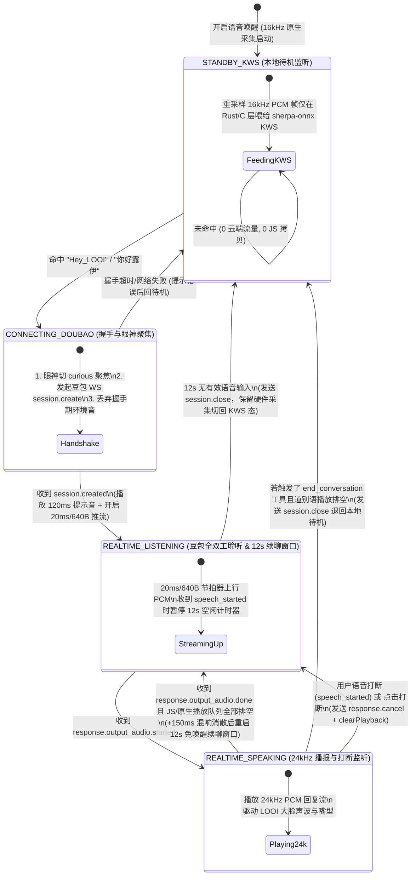

# 自动语音唤醒 → 豆包 Realtime 全双工对话：开源社区项目与架构深度调研

日期：2026-11-07

本文聚焦「**本地语音唤醒（Wake Word / Keyword Spotting, KWS，关键词检测） → 豆包 Realtime 全双工对话（Duplex V3）**」完整工作流（Flow），系统剖析主流开源社区项目的实现范式，并结合 Super-LOOI 现有 NSH 原生端代码（[apps/nsh/src/audio.rs](file:///Users/bugyaluwang/project/super-looi/apps/nsh/src/audio.rs)、[apps/nsh/src/audio/ios.rs](file:///Users/bugyaluwang/project/super-looi/apps/nsh/src/audio/ios.rs)、[apps/nsh/src/audio/android.rs](file:///Users/bugyaluwang/project/super-looi/apps/nsh/src/audio/android.rs)、[apps/nsh/runtime/voice.ts](file:///Users/bugyaluwang/project/super-looi/apps/nsh/runtime/voice.ts)）给出最小复杂度的落地方案。

---

## 一、 核心社区项目深度拆解

在「端侧唤醒 + 云端流式/Realtime 语音对话」领域，当前开源社区最具参考价值的代表性项目有 5 个：

### 1. `78/xiaozhi-esp32` 与 `huangjunsen0406/py-xiaozhi`（小智 AI 生态）
这是目前中文社区打磨「本地唤醒 → WebSocket 实时语音对话 → 多轮续聊 → 自动休眠」最成熟的开源标杆。

- **技术栈演进**：
  - 硬件端（`xiaozhi-esp32`）使用乐鑫 ESP-SR（AFE 音频前端 + WakeNet）。
  - 跨平台客户端（`py-xiaozhi` 等）早期使用 `Vosk` 或 `Porcupine`，现已全面收敛到 **`k2-fsa/sherpa-onnx`** 的 Zipformer 流式 KWS 模型。
- **单一音频流分流（Single Audio Capture Multiplexing）**：
  - 全程只打开**一个** 16kHz 单声道 PCM 麦克风采集流，绝不在“唤醒监听器”和“通话录音器”之间反复开关硬件设备（因为在 iOS/Android 上切换 `AVAudioSession` 或重开硬件流会产生 200ms~600ms 的卡顿与爆音，还会吃掉用户说的第一个字）。
  - 麦克风回调产出的 PCM 帧通过状态机开关路由：`IDLE` 态喂给本地 `KeywordSpotter`；`LISTENING` 态推入 WebSocket 发送队列。
- **状态机与自动回退（Auto-Sleep）**：
  - `IDLE`（本地 KWS 监听） $\xrightarrow{\text{命中唤醒词}}$ `CONNECTING`（建立会话） $\xrightarrow{\text{session.created}}$ `LISTENING`（播放短促提示音并上行 PCM 流） $\xrightarrow{\text{服务端 VAD 截断}}$ `SPEAKING`（播放 24kHz TTS 流） $\xrightarrow{\text{播放完毕}}$ `LISTENING`（保持续聊窗口，无需再次喊唤醒词） $\xrightarrow{\text{12 秒无语音超时}}$ 断开云端会话回到 `IDLE`。
- **回声消除（AEC, Acoustic Echo Cancellation）与防自唤醒**：
  - 在 `SPEAKING` 态，喇叭外放的声音会被麦克风捡回去。如果未启用硬件 AEC，直接静音上行麦克风并在播报结束后留出 `150ms~300ms` 尾音消散窗口（Tail Window）；若启用系统级 AEC（iOS `AVAudioSessionModeVoiceChat` / Android `AAudio` Voice Communication），则允许在 `SPEAKING` 态配合服务端 VAD 实现语音打断（Barge-in）。

### 2. Home Assistant `wyoming-satellite` / `linux-voice-assistant`
智能家居语音卫星节点（Voice Satellite）的工业级开源参考实现。

- **环形预卷缓冲（Pre-roll Ring Buffer）**：
  - KWS 模型判定“听到唤醒词”存在因果滞后（通常在词尾后 160ms~320ms 才触发回调）。如果用户连着说“Hey LOOI 把台灯调亮一点”，等 KWS 触发再去截音频，“把台灯”三个字已经过去了。
  - `wyoming-satellite` 在内存中维护一个固定长度（1.5s~2.0s）的 FIFO（First-In, First-Out，先进先出队列）环形缓冲区（Ring Buffer），持续覆写最新 PCM 帧。这就像是行车记录仪的循环录像，只在唤醒触发发生时锁存最近两秒的音频帧。
- **本地 VAD 门控（Local VAD Gating）**：
  - 结合轻量级 `Silero VAD` 或能量门限，仅在有人声活动时才推进唤醒检测，并在进入对话后用本地 VAD 辅助判断用户是否停止说话。

### 3. `k2-fsa/sherpa-onnx`（及 C API / `sherpa-rs`）
当前端侧离线语音社区事实上的底层基础设施（Apache-2.0 协议）。

- **架构原理（开放词表 Open-Vocabulary KWS）**：
  - 不同于传统唤醒引擎（如 Porcupine、Snowboy、openWakeWord）每换一个唤醒词都要重新收集样本训练 `.tflite`/`.onnx` 分类头，`sherpa-onnx` KWS 采用流式 **Zipformer Transducer（序列转导网络）** 架构（仅约 3.0M~3.3M 参数，包括 `encoder`、`decoder`、`joiner` 三组件）。
  - 它将语音实时解码为**音素（Phone）或声韵母拼音（Partial Pinyin, `ppinyin`）**流，在解码图上直接做关键词束搜索（Beam Search）。
- **对“Hey LOOI / 你好露伊”的零训练支持**：
  - 官方已发布中英双语轻量级模型 `sherpa-onnx-kws-zipformer-zh-en-3M-2025-12-20`（提供 `chunk-16-left-64` 320ms 窗口与 `chunk-8-left-64` 160ms 窗口两套导出文件；其中 `encoder` 与 `joiner` 提供 INT8 量化版，`decoder` 为 FP32 版，四文件合计约 `5.23 MB`）。
  - 只需编写纯文本 `keywords.txt`，即可同时挂载英文音素与中文谐音唤醒词，并支持按词独立调节 Boosting 权重（`:1.5`）和触发阈值（`#0.25`）：
    ```text
    HH EY1 L UW1 IY0 @Hey_LOOI :1.5 #0.25
    h ēi l ù y ī @嘿露伊 :1.5 #0.25
    n ǐ h ǎo l ù y ī @你好露伊 :1.5 #0.25
    ```

### 4. `dscripka/openWakeWord`（及 `oww-rs`）
海外开源社区（Home Assistant 默认引擎）最流行的唤醒方案。

- **三段式流水线**：`melspectrogram.onnx`（梅尔频谱特征提取） $\rightarrow$ `embedding_model.onnx`（Google 预训练共享语音表征，滑动窗口 76 帧） $\rightarrow$ `custom_wakeword.onnx`（特定唤醒词分类头）。
- **优缺点对比**：在树莓派和移动端 CPU 占用极低（~3%~5%），且有现成的 `oww-rs`（纯 Rust 基于 `tract-onnx`）；但**不支持开放词表配置**，要唤醒 `"Hey LOOI"` 必须使用 Google Colab 脚本合成 TTS 样本训练专属 `.onnx` 分类模型，且对中英混读/中文口音泛化不如 `sherpa-onnx` 的拼音/音素图搜索直观。

### 5. `openclaw`（原 `clawdbot`）iOS / macOS Voice Wake
个人 Agent 开源项目在苹果生态的落地实践。

- **方案特点**：直接调用 Apple 原生 `SFSpeechRecognizer`（强制开启 `requiresOnDeviceRecognition = true` 离线模式）持续转写文本，匹配到触发词（如 `"OpenClaw"`）后等待 `0.55s` 停顿窗口切分命令并送入 Agent。
- **社区踩坑教训**：
  1. iOS 的 `SFSpeechRecognizer` 有苹果系统硬编码的 **1 分钟单次识别时长限制**，超时必须重建任务，重建间隙会漏词；
  2. 系统级语音识别对算力和电量的消耗显著高于 3M 参数的专用 KWS 模型；
  3. 品牌自造词 `"LOOI"` 在通用英文/中文词典里常被误转写为 `"Louis"`、`"露易"`、`"路易"`、`"如意"`，需要维护脆弱的同音词正则表。

---

## 二、 主流端侧唤醒引擎横向对比

| 维度 | `sherpa-onnx` KWS (`zh-en-3M` / `wenetspeech-3.3M`) | `Picovoice Porcupine` | `openWakeWord` (`oww-rs`) | 系统自带离线 ASR (`SFSpeechRecognizer`) |
| :--- | :--- | :--- | :--- | :--- |
| **开源协议与商业成本** | Apache-2.0，完全免费，零联网鉴权 | 闭源商业 SDK，需 `AccessKey`（免费额度仅限极少设备，按端收费） | Apache-2.0，完全免费，零联网鉴权 | 系统内置免费，但受限于 OS 策略 |
| **自定义唤醒词成本** | **零训练**，直接改 `keywords.txt` 拼音/音素序列与阈值 | 需在 Picovoice Console 网页生成平台绑定 `.ppn` 文件 | 需跑 TTS 合成样本流水线训练专属 `.onnx` 模型 | 改字符串/同音词表，但受限于通用语言模型词表 |
| **中英混合支持 (`Hey LOOI` / `你好 LOOI`)** | **原生支持**（`phone+ppinyin` 双语模型或拼音谐音映射） | 单 `.ppn` 绑定单语种，中英混读需跨模型配置 | 训练样本主要面向英文音素，中文需额外调优 | 无法在同一离线 Task 中高质量混识中英文短词 |
| **模型体积与内存** | `zh-en-3M` 混合精度组合约 **5.23 MB**（`INT8 encoder` 4.4MB + `FP32 decoder` 743KB + `INT8 joiner` 85KB），RAM < 25 MB | 约 1.5 MB ~ 3 MB，RAM 极小 | 三模型合计约 5 MB ~ 8 MB | 零安装包增量，但系统后台进程内存占用大 |
| **与 NSH 原生栈契合度** | **极高**：Rust 音频层可直接通过 C FFI 调用 `sherpa-onnx` C API | 中（虽有 C SDK，但引入外部商业 Key 强依赖） | 中（需额外维护自定义词训练管线） | 低（1 分钟断流限制与 Android 碎片化严重） |

**选型结论**：
**`sherpa-onnx` KWS（`sherpa-onnx-kws-zipformer-zh-en-3M-2025-12-20` 流式模型）** 是唯一同时满足“Apache-2.0 零 Key 依赖、零训练配置 `Hey LOOI` / `你好露伊`、支持 iOS/Android C-ABI 原生内嵌”的方案。

---

## 三、 关键工程挑战：唤醒如何丝滑切入「豆包 Realtime」？

将本地唤醒词接入**豆包端到端全双工实时语音（Duplex V3：`wss://openspeech.bytedance.com/api/v3/duplex/realtime/dialogue`）**时，有一个区别于传统“唤醒 → 录音转文字 HTTP 请求”的**核心物理约束**，必须在架构上算清楚账：

### 1. 豆包 Duplex V3 的“20ms 实时节拍器（Pacer）”物理约束
查看本项目现有的 NSH 豆包实现（[apps/nsh/runtime/voice.ts](file:///Users/bugyaluwang/project/super-looi/apps/nsh/runtime/voice.ts#L361-L379)）：
- 豆包 Duplex V3 依赖**服务端实时流式 VAD**（`end_smooth_window_ms: 2500, enable_custom_vad: true`）。
- 客户端必须以**严格的 20ms / 640 Bytes（16kHz 16-bit mono）实时节奏**发送 `input_audio_buffer.append`。
- 如果像传统 ASR 那样，在唤醒后先把用户说的 1.5 秒语音缓存在本地队列里，等 WebSocket 握手 + `session.created`（通常耗时 `400ms ~ 1200ms`）完成后，再按 20ms 一帧发出去——**因为新采集的音频也在按每 20ms 一帧不断涌入，这 `400ms ~ 1200ms` 的握手延迟永远追不平（Lag 恒定存在）**！或者如果你瞬间把 50 帧缓存一口气并发 `send` 出去，豆包服务端流式缓冲与速率限制会直接乱序或报错。

### 2. 社区针对 Realtime API 握手延迟的三种模式对比

在开源社区（如 `xiaozhi-esp32`、`py-xiaozhi`、`openai-realtime` 硬件伴侣）中，有三种处理方案：

| 模式 | 交互表现 | 技术机制 | 优缺点与适用性 |
| :--- | :--- | :--- | :--- |
| **模式 A：两阶段唤醒（Wake $\rightarrow$ Cue $\rightarrow$ Speak）**<br>*（`xiaozhi-esp32` 默认模式，首版选定基线）* | 用户说：“Hey LOOI” $\rightarrow$ LOOI 眼睛亮起/眨眼并发出清脆提示音（同时完成豆包 WS 握手） $\rightarrow$ 用户听到/看到就绪后说：“明天天气怎么样” | 命中唤醒词后立即发起豆包 `session.create`，在收到 `session.created` 的瞬间清空旧采集缓存、播放 120ms 本地提示音并开启上行推流 | **零延迟积压、零吞字、零待机云端费用**。最符合桌面机器人直觉（用户本来就会看 LOOI 有没有抬头回应自己）。 |
| **模式 B：热备会话（Warm Session / Muted Standby）**<br>*（备选增强方案）* | 用户连贯说：“Hey LOOI 帮我把台灯关掉”（无需停顿） | App 在前台驻座期间预先建好豆包 WS 连接但保持 `input_audio_mute.commit`（此时不发送 `append` 音频帧）；本地 KWS 命中瞬间，仅需发送一条 `input_audio_unmute.commit` 并将环形缓冲区最后 `300ms`（唤醒词尾之后）的帧推入发送队列 | **真正 0ms 建连延迟**，完美支持“唤醒词+指令”连说；代价是驻座期间维持一条空闲 WebSocket（若服务端有空闲超时则按需重连）。 |
| **模式 C：冷启动 FIFO 缓存 + 加速追赶（Accelerated Catch-up Pacing）**<br>*（备选增强方案）* | 冷启动下用户连说“Hey LOOI 帮我把台灯关掉” | 命中唤醒词时一边建连，一边将唤醒词结束点之后的音频存入有界 FIFO；`session.created` 后，将发送节拍器从 `20ms` 临时提速到 `11ms`（约 1.8 倍速排空积压帧），追平实时流后恢复 `20ms` 节拍 | 无需长连接热备即可支持连说；但 1.8 倍速追赶在 `800ms` 建连延迟下仍需约 `1s` 才能追平，且需实测豆包 Duplex V3 对 `11ms` 突发帧率的容忍度。 |

**工程路线**：
1. **首版稳健基线**：采用 **模式 A（喊 `"Hey LOOI"` $\rightarrow$ 眼神/提示音就绪 $\rightarrow$ 开口多轮对话 + 12s 自动休眠）**。一旦唤醒进入对话，后续多轮交谈完全处于已建立的豆包 Realtime 会话中，零握手延迟。
2. **后续备选优化（零等待连说增强）**：将 **模式 B（Warm Session 热备）** 与 **模式 C（冷启动有界 FIFO + 加速节拍追赶）** 记录至 [todo.md](file:///Users/bugyaluwang/project/super-looi/todo.md)，在首版实机体验验证后按需启用。

---

## 四、 结合 Super-LOOI NSH 现有代码的最小侵入落地设计

观察 [apps/nsh/src/audio.rs](file:///Users/bugyaluwang/project/super-looi/apps/nsh/src/audio.rs#L64-L83) 与 [apps/nsh/src/audio/ios.rs](file:///Users/bugyaluwang/project/super-looi/apps/nsh/src/audio/ios.rs#L148-L221)、[apps/nsh/src/audio/android.rs](file:///Users/bugyaluwang/project/super-looi/apps/nsh/src/audio/android.rs#L211-L264)：
- **现有优势**：
  - `apps/nsh/src/audio.rs` 已经在 Rust 原生线程实现了 `16kHz mono PCM16LE` 采集（每包严格 `320 samples / 640 bytes / 20ms`）与 `24kHz` 播放。
  - iOS 端已经配置了 `AVAudioSessionCategoryPlayAndRecord` + `AVAudioSessionModeVoiceChat`（系统硬件级 AEC 回声消除已开启），Android 端配置了 `AAudio` `input_preset = 7`（`AAUDIO_INPUT_PRESET_VOICE_COMMUNICATION`，同样自带系统硬件 AEC）。
- **最小成本接入唤醒**：
  - **不跨 JS 桥接跑 KWS**：在 `apps/nsh/src/audio.rs` 的 `AudioBuffers::captured(&mut self, bytes: &[u8])` 中，直接将重采样后的 16kHz PCM 喂给 `sherpa-onnx` C API（通过轻量 FFI 绑定 `SherpaOnnxCreateKeywordSpotter` / `SherpaOnnxOnlineStreamAcceptWaveform` / `SherpaOnnxDecodeKeywordStream` / `SherpaOnnxGetKeywordResult` / `SherpaOnnxDestroyKeywordResult`）。
  - **待机零 JS 开销**：当处于 `standby`（待机监听唤醒词）模式时，Rust 原生层在 C/Rust 层原地完成 KWS 推理，**完全不唤醒 QuickJS 线程，也不向 JS 拷贝 `Vec<u8>`**。
  - **命中即切换（0ms 硬件无缝复流）**：一旦 `SherpaOnnxGetKeywordResult` 返回非空 `keyword`（如 `"Hey_LOOI"`），[apps/nsh/runtime/voice.ts](file:///Users/bugyaluwang/project/super-looi/apps/nsh/runtime/voice.ts) 的 `VoiceRuntime` 自动发起豆包 Duplex V3 连接；收到 `session.created` 后直接复用同一个底层 `Audio` 实例切换为 `conversation` 推流模式并播放 120ms 就绪提示音，完整实施计划见 [nsh-voice-wake-realtime-plan.md](file:///Users/bugyaluwang/project/super-looi/docs/plans/nsh-voice-wake-realtime-plan.md)。

---

## 五、 稳健基线完整状态机与防坑要点（Wake $\rightarrow$ Cue $\rightarrow$ Doubao Realtime）



### 关键细节防坑清单（社区实践总结）

1. **退出对话时的优雅挂断口令（Exit Intent）**：
   - 在 `xiaozhi-esp32` 中，用户在多轮对话结束时说“退下吧”、“没事了”、“再见”，如果只靠大模型回复“好的再见”，客户端播完后又会进入 12 秒 `LISTENING` 续聊窗口，期间用户跟别人说话又会被豆包接过去。
   - **实践方案**：在豆包 `session.create` 的 `tools` 中增加一个零参数的轻量工具 `end_conversation`，当用户表达结束对话时，回传工具结果等待模型新一轮告别语播完排空后，客户端立即触发 `endSession()` 退回 `STANDBY_KWS`。
2. **TTS 播报尾音防自触发（Tail Suppression）**：
   - 从 `REALTIME_SPEAKING` 切回 `REALTIME_LISTENING` 或 `STANDBY_KWS` 时，必须等待 **JS 层 `outputFrames` 与原生硬件播放缓冲区真正排空**（如 [apps/nsh/src/audio/ios.rs](file:///Users/bugyaluwang/project/super-looi/apps/nsh/src/audio/ios.rs#L277) 的 `AVAudioPlayerNodeCompletionDataPlayedBack` 回调，`queued_playback_ms == 0`）后再加 `150ms`（2400 samples @ 16kHz）物理房间混响消散期，并调用 `SherpaOnnxResetKeywordStream` 清空 KWS 内部解码状态，防止 LOOI 自己说的最后一两个字把 KWS 或 VAD 再次激活。
3. **双通道防抖与阈值调优**：
   - 品牌词 `"LOOI"`（双音节 `/l uː i/`）单独作为唤醒词极易被日常对话中的“路易”、“留意”、“容易”误触发。必须坚持 **3~4 音节前缀组合**（`"Hey LOOI"` / `"嘿露伊"` / `"你好露伊"`），在 `sherpa-onnx` 的 `keywords.txt` 中设置 `boost = 1.5`、`threshold = 0.25` 作为初始基线。
