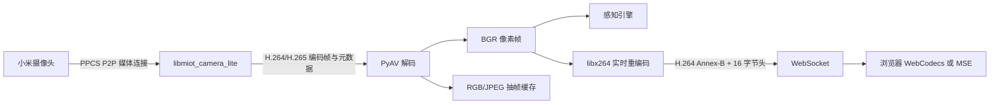

# Miloco 摄像头取流机制与手机接入边界

核对日期：2026-11-10。官方仓库 `XiaoMi/xiaomi-miloco` 的 `main` 与本地分析副本均为 [`05cdb1c77310afcfb77e64349bfb5efbeebded05`](https://github.com/XiaoMi/xiaomi-miloco/tree/05cdb1c77310afcfb77e64349bfb5efbeebded05)。以下源码链接固定到该提交；二进制部分由该提交分发的库静态检查得到。

## 关键结论

Miloco 的取流核心是 `libmiot_camera_lite`：Python 将 Miloco 的 OAuth 身份、设备 DID/model/IP 和视频配置交给原生库，原生库通过回调交回编码帧。它不是调用 Google Home 的 `start-hls-stream` 后把云端 `.m3u8` 地址交给播放器。[初始化与创建实例](https://github.com/XiaoMi/xiaomi-miloco/blob/05cdb1c77310afcfb77e64349bfb5efbeebded05/backend/miot/src/miot/camera.py#L896)、[启动调用](https://github.com/XiaoMi/xiaomi-miloco/blob/05cdb1c77310afcfb77e64349bfb5efbeebded05/backend/miot/src/miot/camera.py#L557)、[编码帧回调](https://github.com/XiaoMi/xiaomi-miloco/blob/05cdb1c77310afcfb77e64349bfb5efbeebded05/backend/miot/src/miot/camera.py#L613)

这证明官方存在以 OAuth 取得实际摄像头媒体的实现。但 Miloco 与当前 Super LOOI/HA 使用不同的客户端身份；公开仓库也没有供 iOS/Android 直接使用的 camera SDK 产物。两者分别属于授权接口与平台构建问题，不能由“都用 OAuth”或“都有 arm64 库”消除。[官方常量](https://github.com/XiaoMi/xiaomi-miloco/blob/05cdb1c77310afcfb77e64349bfb5efbeebded05/backend/miot/src/miot/const.py#L11)、[库加载器](https://github.com/XiaoMi/xiaomi-miloco/blob/05cdb1c77310afcfb77e64349bfb5efbeebded05/backend/miot/src/miot/camera.py#L772)

## 1. 授权身份及令牌生命周期

| 项目 | Miloco | 当前 Super LOOI 米家直连 |
|---|---|---|
| OAuth client ID | `2882303761520431603` | `2882303761520251711` |
| 中国区 API host | `mico.api.mijia.tech` | `ha.api.io.mi.com` |
| 业务标识 | `micoapi` | `haapi` |
| HTTP 请求体 | 加密文本；`Content-Type: text/plain` | JSON |
| 摄像头连接层 | 原生 camera SDK | 当前只实现 MIoT HLS 动作和原生 Video 接线 |

Miloco 常量与 HTTP 实现见 [const.py](https://github.com/XiaoMi/xiaomi-miloco/blob/05cdb1c77310afcfb77e64349bfb5efbeebded05/backend/miot/src/miot/const.py#L11)、[cloud.py](https://github.com/XiaoMi/xiaomi-miloco/blob/05cdb1c77310afcfb77e64349bfb5efbeebded05/backend/miot/src/miot/cloud.py#L475)；当前项目对照见 [protocol.ts](../packages/home-assistant/src/miot/protocol.ts)、[miot-http-client.ts](../packages/home-assistant/src/miot/miot-http-client.ts)、[miot-camera.ts](../packages/home-assistant/src/camera/miot-camera.ts)。

Miloco 在小米账号页发起授权码流程，`device_id` 采用 `mico.<uuid>`，将授权码交给 `/app/v2/mico/oauth/get_token` 换取 access/refresh token。内置回调是 `https://127.0.0.1` 或 `https://mico.api.mijia.tech/login_redirect`；它们与当前 HA webhook 回调不同。[授权与换票](https://github.com/XiaoMi/xiaomi-miloco/blob/05cdb1c77310afcfb77e64349bfb5efbeebded05/backend/miot/src/miot/cloud.py#L249)、[回调常量](https://github.com/XiaoMi/xiaomi-miloco/blob/05cdb1c77310afcfb77e64349bfb5efbeebded05/backend/miot/src/miot/const.py#L29)

Python HTTP 客户端生成随机 16 字节 AES key，以该 key 同时作为 AES-CBC 的 key/IV，PKCS7 填充 JSON 后加密并 Base64 编码。AES key 用官方公开 RSA key 和 PKCS1v15 加密，放到 `X-Client-Secret`；请求还带 `X-Encrypt-Type: 1`、`X-Client-AppId`、`X-Client-BizId` 和无空格的 `Bearer<TOKEN>`。[加密封装与 headers](https://github.com/XiaoMi/xiaomi-miloco/blob/05cdb1c77310afcfb77e64349bfb5efbeebded05/backend/miot/src/miot/cloud.py#L480)

摄像头初始化确实接收上述 Miloco host、client ID、access token；刷新令牌后，`MIoTClient.__apply_access_token_async()` 同时更新 HTTP 客户端和 `miot_camera_update_access_token`，并处理云端长连接的令牌更新。它不是靠长期保留一次性视频 URL 工作。[camera 初始化](https://github.com/XiaoMi/xiaomi-miloco/blob/05cdb1c77310afcfb77e64349bfb5efbeebded05/backend/miot/src/miot/camera.py#L950)、[令牌传播](https://github.com/XiaoMi/xiaomi-miloco/blob/05cdb1c77310afcfb77e64349bfb5efbeebded05/backend/miot/src/miot/client.py#L1220)

**未实证项：** 当前 HA client 的 token 能否调用 Miloco 摄像头授权接口；独立手机 App 能否取得同样的摄像头权限。Miloco 自己能取流，不是这两件事的成功证据。

## 2. 原生摄像头接口如何工作

官方架构文档明确说明摄像头依赖闭源 C 库，使用 PPCS P2P 建连并接收 H.264/H.265 与音频；工程侧不持有该库源码。公开 Python 层给出了 C ABI（C 语言调用接口），而实际网络/协议实现位于预编译库。[官方 SDK 依赖说明](https://github.com/XiaoMi/xiaomi-miloco/blob/05cdb1c77310afcfb77e64349bfb5efbeebded05/knowledge/05-external-deps/sdk-miot.md)

调用边界如下：

| 调用 | 输入/输出及职责 |
|---|---|
| `miot_camera_init(host, app_id, access_token)` | 初始化原生摄像头运行时 |
| `miot_camera_new(info)` | 输入 DID、model、可选本地 IP、通道数量，得到相机实例 |
| `miot_camera_register_status_changed(...)` | 接收连接/断开/重连/错误状态 |
| `miot_camera_register_raw_data(instance, callback, channel)` | 按通道注册编码帧回调 |
| `miot_camera_start(instance, config)` | 每通道画质、是否带音频、可选 PIN |
| `miot_camera_stop/free/deinit` | 分别停止流、销毁相机和关闭整体运行时 |

结构与 ABI 声明见 [camera.py](https://github.com/XiaoMi/xiaomi-miloco/blob/05cdb1c77310afcfb77e64349bfb5efbeebded05/backend/miot/src/miot/camera.py#L63)、[加载后绑定参数](https://github.com/XiaoMi/xiaomi-miloco/blob/05cdb1c77310afcfb77e64349bfb5efbeebded05/backend/miot/src/miot/camera.py#L820)。

编码帧回调带 `codec_id`、`length`、`timestamp`、`sequence`、`frame_type`、`channel` 和字节指针。Python 将帧分发给解码订阅或 `raw_video`/`raw_audio` 订阅；视频编码类型包含 H.264 和 H.265，音频包含 Opus、G.711A、G.711U。这里取得的是视频码流，不是只有“设备在线”或“动作返回 0”的状态。[帧头](https://github.com/XiaoMi/xiaomi-miloco/blob/05cdb1c77310afcfb77e64349bfb5efbeebded05/backend/miot/src/miot/camera.py#L63)、[回调分发](https://github.com/XiaoMi/xiaomi-miloco/blob/05cdb1c77310afcfb77e64349bfb5efbeebded05/backend/miot/src/miot/camera.py#L613)、[编码枚举](https://github.com/XiaoMi/xiaomi-miloco/blob/05cdb1c77310afcfb77e64349bfb5efbeebded05/backend/miot/src/miot/types.py#L308)

`MIoTCameraInfo` 中有设备云端在线信息和原生 `camera_status` 两种状态。启动时注册原生状态回调，随后在线程池调用 `miot_camera_start`；`enable_reconnect` 开启时，Python 以逐次加倍、最大 1200 秒的间隔重试。媒体连接由 SDK 状态及实际帧驱动，不由云端设备电源状态代替。[状态定义](https://github.com/XiaoMi/xiaomi-miloco/blob/05cdb1c77310afcfb77e64349bfb5efbeebded05/backend/miot/src/miot/types.py#L79)、[启动与重试](https://github.com/XiaoMi/xiaomi-miloco/blob/05cdb1c77310afcfb77e64349bfb5efbeebded05/backend/miot/src/miot/camera.py#L557)

### SDK 内部授权与 CS2：二进制证据

对该提交的 [darwin/arm64 原生库](https://github.com/XiaoMi/xiaomi-miloco/blob/05cdb1c77310afcfb77e64349bfb5efbeebded05/backend/miot/src/miot/libs/darwin/arm64/libmiot_camera_lite.dylib) 用 `strings` 和 `otool -tvV` 静态检查，可见：

- `0x73e14/0x73e20` 将 `/v2/device/miss_get_vendor_security` 交给 RPC 调用。
- `0x11b8/0x11c8` 的分发器实际比较该方法名；`0x3a78/0x3a90` 组装 `https://%s/app/v2/device/miss_get_vendor_security` 并发起 HTTP 调用。
- 请求字段包含 `app_pubkey`、`did`、`support_vendors`、`caller_uuid`；库内还有 `crypt_params`、`crypt_result`、`svr_pubkey` 和 CS2/PPCS 建连、读取、relay/tcp/p2p 模式的相关实现与日志字符串。

这是**实际二进制调用链和字符串证据**，不是公开的原生协议源码。它能证明 SDK 内有摄像头授权与 CS2 相关传输，不能单靠函数名重建每个 vendor 的全部密码学和握手时序。已有更细地址追踪见 [P2P 授权调查](xiaomi-camera-mobile-p2p-authorization.md)。

## 3. 从编码帧到网页：实际解码与转码流程

当前网页直播链路如下；取流 SDK、解码和转码都由后端进程承载：

`MiotService.start_video_stream()` 订阅的是 decoded video frame，而非 raw-video；`MIoTMediaDecoder` 使用 PyAV 的 H.264/HEVC 解码器，把视频帧转为 BGR ndarray。网页的 decoded-video 订阅使用 `multi_reg=True`，与其他订阅共享同一摄像头实例及解码器。感知引擎同样订阅 decoded-video。JPEG 抽帧从同一 PyAV VideoFrame 另行转换成 RGB/PIL 图像，按时间间隔输出给独立缓存接口；它不经过 BGR→H.264 的网页转码链。[服务入口](https://github.com/XiaoMi/xiaomi-miloco/blob/05cdb1c77310afcfb77e64349bfb5efbeebded05/backend/miloco/src/miloco/miot/service.py#L1280)、[解码与 BGR/JPEG 分发](https://github.com/XiaoMi/xiaomi-miloco/blob/05cdb1c77310afcfb77e64349bfb5efbeebded05/backend/miot/src/miot/decoder.py#L289)、[共享订阅](https://github.com/XiaoMi/xiaomi-miloco/blob/05cdb1c77310afcfb77e64349bfb5efbeebded05/backend/miloco/src/miloco/miot/camera_handler.py#L237)、[感知订阅](https://github.com/XiaoMi/xiaomi-miloco/blob/05cdb1c77310afcfb77e64349bfb5efbeebded05/backend/miloco/src/miloco/perception/collect/camera_adapter.py#L481)

网页兼容层为每个正在被观看的摄像头通道分配一个 `H264LiveEncoder`。它把 BGR 转为 YUV420P，以 `libx264`、`ultrafast`、`zerolatency`、无 B 帧、GOP=30 重新编码为 H.264 Annex-B；同一路编码结果分发给多个网页订阅者。每个编码器有单线程执行器，避免在 Python 事件循环内同步编码。[转码实现](https://github.com/XiaoMi/xiaomi-miloco/blob/05cdb1c77310afcfb77e64349bfb5efbeebded05/backend/miloco/src/miloco/miot/transcoder.py#L30)、[分发调用](https://github.com/XiaoMi/xiaomi-miloco/blob/05cdb1c77310afcfb77e64349bfb5efbeebded05/backend/miloco/src/miloco/miot/ws.py#L805)

WebSocket 先发送 `init` 文本（codec=`h264`、container=`annexb`），再发送二进制消息：16 字节帧头（关键帧标识与毫秒时间戳）加 NAL 字节。`watch.html` 在支持 WebCodecs 的环境用 `VideoDecoder` 解码并画到 canvas，每帧绘制后 `frame.close()`；其他受支持环境通过 jmuxer 将 H.264 封装给 MSE/video。两条网页路径消费的都是后端重新编码的 H.264。[传输协议](https://github.com/XiaoMi/xiaomi-miloco/blob/05cdb1c77310afcfb77e64349bfb5efbeebded05/backend/miloco/src/miloco/miot/ws.py#L369)、[网页实现](https://github.com/XiaoMi/xiaomi-miloco/blob/05cdb1c77310afcfb77e64349bfb5efbeebded05/web/public/watch.html#L282)

### 内存、慢消费者与释放

- 编码帧等待解码的 ring buffer 默认上限为 20 个视频项；满时优先保留关键访问单元。它按帧数量计数，不是固定字节容量。[队列](https://github.com/XiaoMi/xiaomi-miloco/blob/05cdb1c77310afcfb77e64349bfb5efbeebded05/backend/miot/src/miot/decoder.py#L81)
- 网页分发在每个订阅者侧保留最多 8 条视频消息；慢连接丢旧数据，单次发送挂起超过 20 秒则移除连接。编码回调另有“上一帧尚未处理完就丢弃本帧”的门控，限制直播转码回调持有 BGR 帧的堆积。[订阅者通道](https://github.com/XiaoMi/xiaomi-miloco/blob/05cdb1c77310afcfb77e64349bfb5efbeebded05/backend/miloco/src/miloco/miot/ws.py#L223)、[编码门控](https://github.com/XiaoMi/xiaomi-miloco/blob/05cdb1c77310afcfb77e64349bfb5efbeebded05/backend/miloco/src/miloco/miot/ws.py#L838)
- 最后一个网页/录像订阅者退出时，注销直播的 decoded 回调并关闭 H.264 编码器。感知可继续订阅底层相机，因此这个动作不等于停止整个 PPCS 连接。完整销毁相机还会由 camera manager 执行 stop、回调注销和 free。[直播释放](https://github.com/XiaoMi/xiaomi-miloco/blob/05cdb1c77310afcfb77e64349bfb5efbeebded05/backend/miloco/src/miloco/miot/ws.py#L576)、[相机销毁](https://github.com/XiaoMi/xiaomi-miloco/blob/05cdb1c77310afcfb77e64349bfb5efbeebded05/backend/miloco/src/miloco/miot/camera_handler.py#L262)

不能从 `enable_hw_accel=True` 推导其实际使用硬件解码。当前 `_on_video_callback()` 直接创建 `h264`/`hevc` 的 PyAV decoder；定义了硬件探测辅助方法，但该路径没有调用它们。[解码器选择](https://github.com/XiaoMi/xiaomi-miloco/blob/05cdb1c77310afcfb77e64349bfb5efbeebded05/backend/miot/src/miot/decoder.py#L268)

**手机端成本判断：** 若手机已有适用的取流实现，直接把编码帧交给系统解码器可避免复制该网页兼容层。照搬后端则会额外带入 Python、PyAV/FFmpeg、NumPy、软件重编码及 WebSocket 播放链。仅 1920×1080 的一帧 BGR 数据就有 `1920 × 1080 × 3 = 6,220,800` 字节，约 5.93 MiB；这是像素数据的计算值，不是进程内存实测。现有 NSH `Video` 只接收 URL；要直接消费编码帧，仍需要原生解码/显示接口，其价值是打通新的媒体输入，成本是双端会话与解码器生命周期维护。[当前播放器调用方](../apps/nsh/ui/HomeSpaceView.tsx)

## 4. 发布库是否可以放进手机

仓库实际分发四个 camera 库；下表大小为原始文件字节数，不是安装包增量或运行内存。[分发目录](https://github.com/XiaoMi/xiaomi-miloco/tree/05cdb1c77310afcfb77e64349bfb5efbeebded05/backend/miot/src/miot/libs)

| 产物 | 文件大小 | 静态识别 |
|---|---:|---|
| `darwin/arm64/libmiot_camera_lite.dylib` | 6,012,480 | Mach-O arm64，`LC_BUILD_VERSION platform=1`（macOS），最低 macOS 26.0 |
| `darwin/x86_64/libmiot_camera_lite.dylib` | 6,820,744 | Mach-O x86_64 |
| `linux/arm64/libmiot_camera_lite.so` | 7,440,360 | ELF AArch64；含 `GLIBC_2.17`/`GLIBC_2.25`、`libc.so.6` 等 glibc 依赖 |
| `linux/x86_64/libmiot_camera_lite.so` | 8,632,392 | ELF x86-64 |

macOS arm64 库的加载信息还依赖 macOS `CoreFoundation.framework`、`SystemConfiguration.framework` 路径；它不是 iOS 或 iOS Simulator 库。Linux AArch64 的 glibc 库也不是 Android bionic 目标。可用 `file`、`stat -f '%z %N'`、`otool -l/-L`、`strings` 对上述固定产物复核。

加载器虽写有 Windows、Linux 32 位 ARM 的分支，但该提交没有对应库；仓库也没有 camera SDK 的 C/C++ 源码、iOS XCFramework、Android AAR/NDK 工程。源码搜索到的 C 文件是 `launcher/src/miloco_launcher.c`，与摄像头协议无关；官方依赖文档也明确库仅提供 Linux/macOS，不支持交叉编译或源码定制。[官方集成约束](https://github.com/XiaoMi/xiaomi-miloco/blob/05cdb1c77310afcfb77e64349bfb5efbeebded05/knowledge/05-external-deps/sdk-miot.md#集成约束)

手机端要复用这个实现，缺的是对应平台的 SDK 或可移植协议实现，而非给现有 `.dylib/.so` 外面包一层 Rust FFI 即可。[加载器](https://github.com/XiaoMi/xiaomi-miloco/blob/05cdb1c77310afcfb77e64349bfb5efbeebded05/backend/miot/src/miot/camera.py#L772)、[仓库源树](https://github.com/XiaoMi/xiaomi-miloco/tree/05cdb1c77310afcfb77e64349bfb5efbeebded05)

另一个直接影响代码/库复用的事实是：当前许可证仅授权为非商业目的使用 Miloco 项目，并明确不授权用于开发其他 App、Web 服务等软件。该条款覆盖源码与目标代码；因此不能把这个 camera 库当作已获宽松许可的 App SDK 直接纳入 Super LOOI。[官方许可证](https://github.com/XiaoMi/xiaomi-miloco/blob/05cdb1c77310afcfb77e64349bfb5efbeebded05/LICENSE.md)

## 5. 对 Super LOOI 的具体意义

可以借鉴的模块边界是：账号授权更新 → 以 DID/model/IP 创建原生观看会话 → 状态与编码帧回调 → 解码/呈现。它把“取得视频”和“显示视频”分开；现有 HLS 路线只接到了“地址 → 显示”，MISS/CS2 的媒体连接不在当前实现中。[原生调用链](https://github.com/XiaoMi/xiaomi-miloco/blob/05cdb1c77310afcfb77e64349bfb5efbeebded05/backend/miot/src/miot/camera.py)、[当前接入审计](xiaomi-camera-mobile-verification.md#ios-复测与原接入流程审计2026-11-10)

若后续取得可用于手机的取流实现，新增原生会话的具体价值是处理 TypeScript 宿主没有的媒体握手和持续编码帧输入；复杂度成本在于双端 SDK/协议维护、会话退出与令牌更新、解码器和帧队列生命周期。Miloco 已有 raw-video 订阅接口，说明取得编码帧后不必先走 JPEG 或 Web 视频转码；具体呈现方案应按手机系统解码器确定，而不是复制完整 Python/浏览器服务栈。[raw-video 接口](https://github.com/XiaoMi/xiaomi-miloco/blob/05cdb1c77310afcfb77e64349bfb5efbeebded05/backend/miot/src/miot/camera.py#L329)

尚需取得的关键证据是：手机可用的摄像头 SDK/等效协议实现、独立客户端的取流授权、以及目标 `isa.camera.hlc7` / `chuangmi.camera.039a01` 的真实编码帧。Miloco 的型号分类采用 camera 类加 denylist，两个型号不在该提交 denylist 中；这只是发现规则，不能代替实际连接成功记录。[型号规则](https://github.com/XiaoMi/xiaomi-miloco/blob/05cdb1c77310afcfb77e64349bfb5efbeebded05/backend/miot/src/miot/camera.py#L1351)、[型号配置](https://github.com/XiaoMi/xiaomi-miloco/blob/05cdb1c77310afcfb77e64349bfb5efbeebded05/backend/miot/src/miot/configs/camera_extra_info.yaml)
